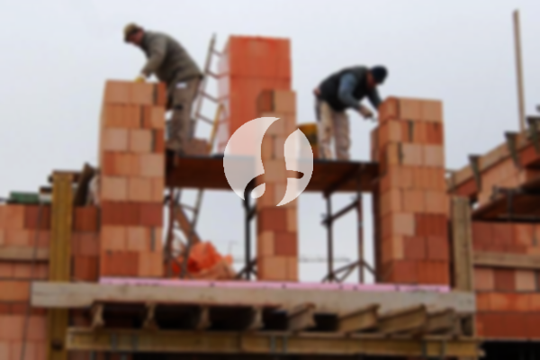

**Biaya Bangun Rumah Per Meter Di Kebon Kosong Jakarta** - Hai Mitra Sumber Material! Gimana kabarnya? Kami dari Sumber Material hadir untuk memberikan solusi lengkap kebutuhan konstruksi Anda di Kebon Kosong Jakarta. Seiring perkembangan zaman, jasa pembangunan rumah semakin diminati dan berkembang pesat, termasuk layanan desain interior. Ini membuktikan betapa pentingnya memilih penyedia jasa yang kompeten dan terpercaya. Pertumbuhan populasi dan kebutuhan akan hunian yang nyaman mendorong para kontraktor properti untuk berlomba-lomba menawarkan layanan terbaik, mulai dari rumah sederhana hingga mewah. Kepercayaan konsumen adalah kunci utama, dan jasa bangun rumah profesional selalu berupaya menjaga reputasi dengan memberikan hasil yang memuaskan. Nah, bagi Anda yang berencana membangun rumah di Kebon Kosong Jakarta, Kami akan membahas beberapa layanan yang dapat Kami tawarkan.



## Harga Jasa Desain Gambar Arsitek Di Kebon Kosong Jakarta

Sebagai penyedia jasa arsitektur, Kami selalu mengutamakan desain yang sesuai dengan impian Anda. Proses desain adalah langkah awal yang krusial dalam membangun rumah idaman. Dengan desain yang baik, rumah Anda tidak hanya terlihat indah, tetapi juga fungsional dan nyaman. Kami memperhitungkan berbagai faktor penting untuk menciptakan komposisi desain yang harmonis dan sesuai dengan kebutuhan Anda. Anda tahu, desain rumah adalah hal yang sangat penting untuk diperhatikan karena akan menentukan estetika rumah Anda. Untungnya, Kami dapat membantu Anda membuat desain yang sesuai dengan budget yang ada. Desain yang Kami buat akan memberikan gambaran jelas mengenai anggaran biaya yang dibutuhkan untuk mewujudkan rumah impian Anda. Selain itu, Kami juga mempertimbangkan pemilihan material bangunan yang tepat. Ini semua membutuhkan keahlian seorang arsitek profesional.

Biaya jasa desain rumah Kami bervariasi, tergantung pada luas bangunan dan tingkat kerumitan desain yang diinginkan. Saat ini, Kami menawarkan harga per meter untuk jasa desain, termasuk kalkulasi RAB (Rencana Anggaran Biaya) dan dua kali revisi. Untuk rumah minimalis satu lantai, harga jasa desain adalah Rp 54.000,- per meter persegi. Untuk rumah dua lantai atau lebih, biayanya dapat dikalikan 2 atau 3, tergantung jumlah lantai.

## Ongkos Borong Bangun Tempat Tinggal Di Kebon Kosong Jakarta

Mengingat semakin banyaknya orang yang membutuhkan tempat tinggal, jasa borong bangun rumah menjadi solusi praktis dan efisien. Banyak penyedia jasa menawarkan layanan terbaik untuk memenuhi kebutuhan konsumen. Kami hadir sebagai mitra terpercaya untuk mewujudkan rumah impian Anda di Kebon Kosong Jakarta. Memiliki rumah yang bagus adalah impian semua orang. Dengan menggunakan jasa borong bangun rumah, Anda dapat mewujudkan impian tersebut tanpa perlu repot memikirkan desain atau detail teknis lainnya. Kami akan berusaha memahami keinginan Anda dan mewujudkannya dalam bentuk bangunan impian yang nyata, sehingga Anda akan merasa puas dan percaya dengan layanan Kami.

Untuk ongkos borong pembangunan rumah, Kami menawarkan beberapa tingkatan harga yang disesuaikan dengan material bangunan yang digunakan dan lokasi pembangunan di Kebon Kosong Jakarta. Dengan asumsi tanah dalam keadaan rata dan tidak memerlukan pengurukan, harga per meter persegi dengan material dinding hebel adalah Rp 1.950.000,-, sedangkan dengan material bata merah adalah Rp 2.200.000,-. Harga tersebut sudah termasuk pondasi batu kali, kolom dan tiang beton, lantai keramik standar, serta rangka baja ringan dan genteng spandek. Untuk genteng dan keramik, Anda dapat memilih jenis, model, dan mutu lain dengan penyesuaian harga.

## Ongkos Renovasi Rumah Di Kebon Kosong Jakarta

Selain jasa arsitek dan borong bangun rumah, Kami juga menyediakan jasa renovasi rumah. Renovasi adalah cara yang efektif untuk memperbarui tampilan rumah Anda tanpa harus membangun dari awal. Dengan layanan renovasi bangunan, Anda tidak perlu khawatir mencari tukang atau mengatur proses renovasi sendiri. Kami menawarkan renovasi total atau sebagian, tergantung pada kebutuhan Anda. Renovasi bisa menjadi solusi ideal untuk mengubah tampilan bangunan agar terlihat lebih cantik dan modern. Namun, seringkali anggaran menjadi kendala utama. Dengan adanya jasa renovasi rumah, semua masalah tersebut dapat teratasi. Kami hadir sebagai solusi renovasi bangunan yang mudah dan terjangkau, siap membantu Anda mengubah rumah Anda menjadi lebih indah dan menarik.

Harga borongan untuk jasa renovasi rumah Kami bervariasi, tergantung pada kondisi kerusakan bangunan. Karena setiap bangunan memiliki tingkat kerusakan yang berbeda, Kami akan menyesuaikan biaya berdasarkan jenis kerusakan yang perlu diperbaiki. Untuk biaya tenaga tukang harian, Kami mengenakan tarif Rp 150.000,- per hari untuk tukang dan Rp 100.000,- per hari untuk kenek.

## Didukung Tenaga Kerja Dan Arsitek Berpengalaman Di Kebon Kosong Jakarta

Baik jasa arsitek, borong bangun rumah, maupun renovasi, semuanya memiliki peran penting dalam mewujudkan impian Anda. Dengan dukungan arsitek profesional dan tenaga kerja yang handal, Kami siap membantu Anda membangun rumah impian. Mempercayakan pembangunan rumah kepada jasa bangun rumah yang terpercaya akan memberikan Anda ketenangan pikiran dan hasil yang memuaskan. Kami selalu mengutamakan kualitas dan ketepatan waktu dalam setiap proyek, serta menjaga kepercayaan konsumen dengan memberikan pelayanan terbaik. Kepuasan Anda adalah motivasi utama Kami untuk terus berkarya dan menghasilkan karya-karya yang lebih baik lagi. Melalui katalog proyek-proyek yang telah Kami selesaikan, Anda dapat melihat sendiri kualitas dan desain inovatif yang Kami tawarkan. [bangun rumah di Bintaro](/bangunan/biaya-bangun-rumah-per-meter-di-bintaro-jakarta/)

Perlu diingat, rumah adalah kebutuhan primer manusia selain sandang dan pangan. Rumah menjadi tempat berlindung dari cuaca ekstrem dan berbagai bahaya. Hal ini menjadi peluang bagi penyedia jasa bangun rumah untuk menawarkan layanan mereka. Sebagai penyedia jasa, Kami berpartisipasi aktif dalam memajukan dunia arsitektur dengan menampilkan layanan Kami melalui berbagai media, baik cetak maupun online. Ini memudahkan banyak orang untuk mewujudkan rumah impian mereka. Dengan menjaga kualitas dan standar terbaik, Kami telah memiliki pengalaman yang cukup lama dalam bidang arsitektur dan konstruksi. Inilah yang membuat Kami semakin dipercaya oleh banyak orang.

Didukung oleh arsitek profesional dan tenaga kerja yang terampil, Kami siap memberikan layanan terbaik untuk Anda. Kami terus berinovasi dan menciptakan karya-karya baru yang menarik dan kreatif. Banyak bangunan yang telah Kami bangun dengan desain yang apik dan menarik. Proses pengerjaan yang cepat dan efisien memungkinkan Anda untuk segera menikmati rumah impian Anda. Baik rumah berskala kecil maupun besar, Kami dapat menangani semuanya dengan baik. Mulai dari desain rumah, pemilihan material bangunan, hingga pengawasan konstruksi, semuanya Kami atur dengan cermat. Dengan demikian, Kami dapat mendukung terwujudnya rumah yang cantik, nyaman, dan sesuai dengan keinginan Anda. [Hubungi Kami Sekarang!](https://api.whatsapp.com/send?phone=6285776786091&text=*Halo%20sumbermaterial.com*%20%3A) Kami siap membantu Anda mewujudkan rumah impian Anda di Kebon Kosong Jakarta.
