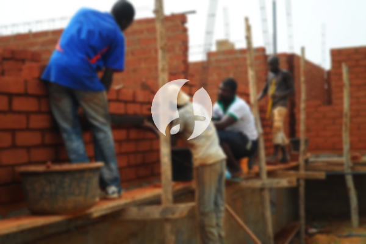

**Biaya Bangun Rumah Per Meter Di Kebon Melati Jakarta** - Hai Mitra Sumber Material! Bagaimana kabarnya? Kami dari Sumber Material hadir untuk membantu Anda mewujudkan rumah impian di Kebon Melati Jakarta. Sejalan dengan perkembangan zaman, layanan pembangunan bangunan semakin diminati. Borongan pembangunan tempat tinggal kini berkembang pesat, bahkan merambah ke layanan desain interior. Peningkatan permintaan ini membuat banyak orang lebih selektif memilih jasa bangun rumah yang terpercaya. Dengan pertumbuhan populasi yang pesat, kebutuhan akan tempat tinggal juga semakin meningkat. Tak heran jika pengembang properti berlomba-lomba membangun rumah, apartemen, dan tempat tinggal susun dengan berbagai pilihan kelas. Kami, sebagai penyedia jasa bangun rumah terpercaya, berkomitmen untuk menjaga kepercayaan pelanggan dan memberikan hasil terbaik.



## Jasa Desain Gambar Arsitek Di Kebon Melati Jakarta

Sebagai penyedia jasa desain arsitektur, kami akan mengamati dan merancang desain rumah impian Anda di Kebon Melati Jakarta. Dengan desain yang tepat, kami akan menciptakan keindahan dan kenyamanan pada hunian Anda. Untuk itu, kami memperhatikan beberapa faktor penting dalam menyusun komposisi desain yang selaras dan menarik. Kami memahami bahwa desain adalah elemen krusial dalam menciptakan rumah yang indah dan berkarakter. Dengan desain yang baik, rumah Anda akan terlihat lebih menarik dan bernilai tinggi. Anda tidak perlu khawatir tentang anggaran, karena kami akan menciptakan desain yang sesuai dengan *budget* yang Anda miliki. Dari desain tersebut, Anda dapat memperkirakan biaya yang dibutuhkan untuk mewujudkan rumah impian Anda. Selain itu, kami juga mempertimbangkan pemilihan material yang tepat agar sesuai dengan desain dan anggaran Anda. Kami mengerti, proses ini bisa cukup kompleks. Itulah mengapa, Anda membutuhkan jasa arsitek profesional. Kami akan memahami keinginan Anda dan mewujudkannya dalam rancangan yang memuaskan.

Harga jasa desain bangunan kami bervariasi, tergantung pada luas bangunan dan tingkat kesulitan desain yang Anda inginkan. Saat ini, kami menawarkan harga per meter untuk desain bangunan. Untuk desain rumah minimalis satu lantai, harga per meternya mulai dari Rp 54.000,-. Harga ini sudah termasuk desain, perhitungan RAB (Rencana Anggaran Biaya), dan dua kali revisi. Sedangkan untuk bangunan dua lantai atau lebih, biayanya dikalikan 2 atau 3 sesuai dengan jumlah lantai.

## Harga Borong Renovasi Rumah Di Kebon Melati Jakarta

Setiap orang membutuhkan tempat tinggal yang nyaman dan aman. Banyaknya pilihan layanan bangun rumah yang tersedia tentu menawarkan produk dan layanan terbaik untuk memenuhi kebutuhan para pembeli. Di sinilah peran penting jasa borongan bangun rumah dalam menangani proses pembangunan tempat tinggal Anda. Dengan memilih jasa yang tepat, Anda akan mendapatkan rumah yang sesuai dengan keinginan Anda. Memiliki rumah yang bagus adalah impian setiap orang. Dengan menggunakan layanan bangun rumah profesional, Anda akan terbantu mewujudkan impian tersebut. Kami akan membantu Anda mendesain rumah sesuai dengan preferensi Anda tanpa perlu khawatir. Kami selalu berusaha memahami keinginan Anda dan mewujudkannya dalam bentuk bangunan nyata. Kepuasan Anda adalah prioritas kami, dan hal itu semakin memperkuat kepercayaan terhadap jasa kami.

Untuk jasa borong renovasi rumah di Kebon Melati Jakarta, kami menawarkan beberapa pilihan harga. Harga ini disesuaikan dengan bahan bangunan yang digunakan dan lokasi pembangunan. Harga per meter untuk material dinding hebel adalah Rp 1.950.000,-, sedangkan untuk bata merah adalah Rp 2.200.000,-. Harga tersebut sudah termasuk pondasi batu sungai, kolom dan tiang beton, lantai keramik standar, serta atap dengan rangka baja ringan dan genteng spandek. Untuk genteng dan keramik, Anda dapat memilih jenis lain sesuai dengan preferensi Anda, dan biayanya akan disesuaikan.

## Ongkos Perbaikan Bangunan Di Kebon Melati Jakarta

Selain jasa arsitek dan bangun rumah, kami juga menyediakan jasa renovasi rumah. Renovasi rumah adalah cara yang efektif untuk memberikan tampilan baru pada hunian Anda. Dengan adanya jasa renovasi rumah, Anda tidak perlu khawatir tentang proses renovasi. Kami dapat membantu mengubah tampilan bangunan secara menyeluruh atau melakukan perbaikan kecil sesuai kebutuhan Anda. Renovasi adalah alternatif yang baik untuk meningkatkan tampilan rumah, terutama dengan anggaran yang terbatas. Namun, proses renovasi bisa menjadi tantangan. Di sinilah jasa renovasi rumah hadir sebagai solusi mudah dan terjangkau. Kami siap membantu Anda merenovasi rumah Anda agar terlihat lebih segar dan indah.

Biaya borongan jasa renovasi rumah kami bervariasi, tergantung pada kondisi kerusakan bangunan Anda. Oleh karena itu, kami menyesuaikan biaya dengan jenis kerusakan yang perlu diperbaiki. Namun, untuk biaya jasa renovasi dengan tenaga tukang harian, kami mengenakan biaya Rp 150.000,- per hari untuk tukang dan Rp 100.000,- per hari untuk kenek.

## Disupport Tukang Dan Arsitek Berpengalaman Di Kebon Melati Jakarta

Baik jasa arsitek, bangun rumah, maupun renovasi, semuanya memiliki peran penting dalam mewujudkan rumah impian Anda. Dengan dukungan arsitek profesional dan tenaga kerja yang handal, kami akan membantu Anda mencapai tujuan tersebut. Dengan membangun rumah bersama Kami, Anda akan memiliki hunian yang menarik dan berkualitas. Anda tidak perlu khawatir, karena Kami berkomitmen untuk memberikan pelayanan terbaik, menjaga kualitas, dan memberikan kepuasan maksimal. Sebagai penyedia jasa yang terpercaya, kepuasan pelanggan adalah motivasi Kami untuk terus berkarya dan menghasilkan karya yang lebih baik. Anda dapat melihat katalog proyek sebelumnya untuk melihat hasil karya Kami. Katalog tersebut membuktikan bahwa Kami adalah pilihan terbaik dan terpercaya untuk proyek bangunan Anda.

Perlu diingat, rumah adalah kebutuhan pokok manusia selain sandang dan pangan. Rumah menjadi tempat berlindung dari cuaca ekstrem dan berbagai bahaya. Hal ini membuka peluang bagi penyedia jasa bangun rumah untuk menawarkan layanan mereka. Sebagai penyedia jasa terkhusus dalam membangun tempat tinggal, kami berpartisipasi dalam meramaikan dunia arsitektur dengan menampilkan layanan Kami melalui berbagai media. Mulai dari media cetak hingga online, Kami memanfaatkan berbagai platform untuk menawarkan jasa bangun rumah. Hal ini tentu memudahkan banyak orang dalam mewujudkan rumah impian mereka. Dengan menjaga kualitas dan mutu terbaik, Kami telah terbukti memiliki pengalaman yang cukup lama dalam bidang arsitektur. Inilah alasan mengapa Kami semakin dipercaya oleh banyak orang.

Didukung oleh arsitek profesional dan tenaga kerja yang handal, Kami dapat menjamin kualitas dan kecepatan pengerjaan. Kami terus berinovasi dan menciptakan karya-karya baru yang kreatif dan menarik. Hingga saat ini, banyak bangunan yang telah Kami bangun dengan desain yang apik dan menarik. Dengan proses pengerjaan yang efisien, Anda akan dapat menikmati rumah impian Anda dalam waktu yang singkat. Baik rumah berskala kecil maupun besar, Kami dapat mengatasinya dengan baik. Anda tidak perlu ragu atau khawatir. Mulai dari desain bangunan, pemilihan material, ukuran bangunan, hingga sumber daya manusia, semuanya dapat Kami koordinasikan dengan baik. Kami akan membantu Anda mewujudkan rumah impian Anda. [Hubungi Kami Sekarang](https://api.whatsapp.com/send?phone=6285776786091&text=*Halo%20sumbermaterial.com*%20%3A) — Kami siap melayani kebutuhan Anda di Kebon Melati Jakarta.[bangun rumah di Bendungan Hilir](/bangunan/biaya-bangun-rumah-per-meter-di-bendungan-hilir-jakarta/)
