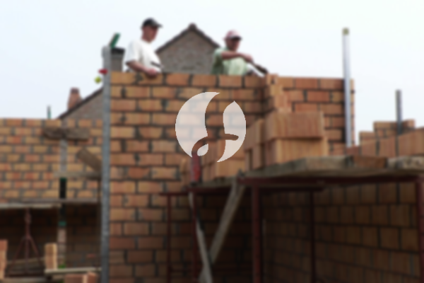

**Biaya Bangun Rumah Per Meter Di Kecamatan Bogor Tengah** - Hai Mitra Sumber Material! Gimana kabarnya? Kami dari Sumber Material hadir untuk membantu mewujudkan impian memiliki rumah impian Anda di Kecamatan Bogor Tengah. Seiring dengan perkembangan zaman, layanan membangun rumah semakin diminati. Nah, makin banyak orang yang membutuhkan tempat tinggal, otomatis permintaan akan jasa konstruksi juga meningkat. Para pelaku properti pun berlomba-lomba menawarkan layanan terbaik, mulai dari perumahan sederhana hingga mewah. Kami memahami bahwa kepercayaan adalah kunci utama, dan Kami berkomitmen untuk menjaga kepercayaan yang Anda berikan. Karena itu, Kami akan melaksanakan pekerjaan sesuai dengan harapan Anda. Sebagai penyedia jasa yang terpercaya, Kami menghadirkan berbagai pilihan layanan untuk membangun rumah impian Anda.



## Desain Rumah Impian dengan Jasa Arsitek di Kecamatan Bogor Tengah

Sebagai penyedia jasa desain arsitek, Kami akan mengamati dan mewujudkan desain rumah yang Anda inginkan di Kecamatan Bogor Tengah. Dengan desain yang tepat, Kami akan menciptakan keindahan dan kenyamanan pada hunian Anda. Kami akan mempertimbangkan berbagai faktor penting untuk menghasilkan komposisi desain yang selaras dan menarik. Sebab, desain adalah elemen krusial yang menentukan tampilan rumah Anda. Dengan desain yang baik, rumah Anda akan terlihat cantik dan memikat. Anda tidak perlu khawatir soal anggaran, karena Kami akan membuat desain yang sesuai dengan budget yang Anda miliki. Dari desain inilah, Anda dapat memperkirakan biaya yang dibutuhkan untuk mewujudkan rumah impian Anda. Selain itu, Kami juga akan memperhatikan pemilihan material bangunan yang tepat. Semua proses ini memang membutuhkan ketelitian dan keahlian khusus. Itulah mengapa, Anda sebaiknya mempercayakan desain rumah Anda kepada profesional. Kami akan memahami semua harapan Anda dan mewujudkannya menjadi kenyataan.

Biaya jasa desain rumah Kami bervariasi, tergantung pada luas bangunan dan tingkat kesulitan desain yang Anda inginkan. Saat ini, harga jasa desain rumah minimalis satu lantai adalah Rp 54.000,- per meter persegi, sudah termasuk desain, perhitungan RAB, dan 2 kali revisi. Sedangkan untuk rumah dua lantai atau lebih, biayanya hanya dikali 2 atau 3, sesuai dengan jumlah lantai.

## Estimasi Biaya Borong Renovasi Rumah Di Kecamatan Bogor Tengah

Seiring dengan bertambahnya jumlah orang yang membutuhkan tempat tinggal, permintaan akan jasa renovasi rumah pun semakin meningkat. Jasa renovasi hadir untuk membantu Anda memperbarui tampilan rumah agar terlihat lebih segar dan modern. Kami menawarkan layanan renovasi rumah yang dapat mengubah tampilan rumah Anda secara signifikan, baik melalui perubahan kecil maupun renovasi total. Renovasi adalah solusi yang tepat untuk memberikan tampilan baru pada rumah Anda tanpa harus membangun dari awal. Namun, biaya renovasi seringkali menjadi pertimbangan utama. Dengan adanya jasa renovasi rumah yang terpercaya, Anda tidak perlu khawatir lagi. Kami akan membantu Anda mewujudkan rumah impian dengan budget yang terjangkau.

Untuk biaya borong renovasi rumah, Kami menawarkan beberapa pilihan harga, disesuaikan dengan material bangunan yang digunakan dan lokasi pembangunan. Dengan syarat lokasi tanah yang akan dibangun dalam kondisi rata, stabil, dan tidak memerlukan pengurugan. Harga per meter persegi dengan material dinding hebel adalah Rp 1.950.000,-, sedangkan dengan material bata merah adalah Rp 2.200.000,-. Harga tersebut sudah termasuk pondasi batu kali, kolom dan tiang beton, lantai keramik standar, serta atap rangka baja ringan plus genteng spandek. Anda juga dapat memilih jenis genteng dan keramik lain sesuai keinginan Anda, dengan penyesuaian harga.

## Jasa Renovasi Rumah Terpercaya di Kecamatan Bogor Tengah

Selain jasa arsitek dan borongan bangun rumah, Kami juga menyediakan jasa renovasi rumah. Layanan renovasi ini bisa menjadi solusi tepat bagi Anda yang ingin memberikan sentuhan baru pada hunian Anda di Kecamatan Bogor Tengah. Kami akan melakukan perubahan pada tampilan rumah Anda, baik secara parsial maupun menyeluruh, sesuai dengan kebutuhan dan keinginan Anda. Renovasi memang menjadi pilihan cerdas untuk menyegarkan tampilan rumah tanpa harus mengeluarkan biaya yang besar. Namun, biaya renovasi sering menjadi hambatan. Dengan layanan renovasi Kami, Anda dapat mengatasi masalah tersebut. Karena Kami akan memberikan solusi renovasi yang sesuai dengan budget Anda, tanpa mengorbankan kualitas dan estetika.  Kami siap mewujudkan perubahan yang Anda impikan untuk rumah Anda.

Untuk biaya jasa renovasi rumah Kami, harganya bervariasi, tergantung pada kondisi kerusakan bangunan. Jadi, harga borongan renovasi akan disesuaikan dengan jenis kerusakan yang perlu diperbaiki. Namun, untuk biaya tenaga tukang harian, harganya adalah Rp 150.000,- per hari untuk tukang, dan Rp 100.000,- per hari untuk kenek.

## Dukungan Tukang dan Arsitek Berpengalaman di Kecamatan Bogor Tengah

Baik itu jasa arsitek, borongan bangun rumah, maupun jasa renovasi rumah, setiap layanan memiliki peran penting dalam mewujudkan impian Anda. Kami berkomitmen memberikan layanan berkualitas dengan dukungan arsitek profesional dan tenaga kerja yang handal. Dengan tim yang kompeten, Kami akan membantu Anda membangun rumah impian yang menarik dan indah di Kecamatan Bogor Tengah. Jangan khawatir, Kami akan memberikan pelayanan terbaik, menjaga kualitas dan ketepatan waktu untuk memastikan kepuasan Anda. Kepuasan Anda adalah motivasi utama Kami untuk terus berkarya dan menghasilkan karya-karya yang lebih baik. Anda dapat melihat portofolio proyek-proyek Kami untuk membuktikan kualitas layanan yang Kami berikan.

Perlu Anda ketahui, rumah adalah kebutuhan dasar manusia yang sangat penting, selain sandang dan pangan. Rumah menjadi tempat berlindung dari cuaca ekstrem dan berbagai bahaya. Hal ini menjadi peluang bagi penyedia jasa bangun rumah untuk menawarkan layanan terbaik mereka. Sebagai penyedia jasa terpercaya, Kami akan berpartisipasi secara aktif dalam memajukan dunia arsitektur dengan menawarkan layanan yang berkualitas melalui berbagai media, baik cetak maupun online. Ini tentu akan membantu Anda mewujudkan rumah impian Anda. Dengan menjaga kualitas dan memberikan layanan terbaik, Kami telah memiliki pengalaman yang cukup lama dalam dunia arsitektur.

Didukung oleh arsitek profesional dan tenaga kerja yang terampil, Kami yakin dapat memberikan layanan yang tak tertandingi di Kecamatan Bogor Tengah. Kami terus berinovasi dan berkreasi untuk menghasilkan karya-karya yang lebih inovatif dan menarik. Banyak rumah dan bangunan yang telah Kami bangun dengan desain yang apik dan memukau. Proses pengerjaan yang cepat dan efisien juga menjadi keunggulan Kami. Dengan demikian, Anda dapat segera menikmati rumah impian Anda. Kami mampu menangani proyek dengan skala kecil maupun besar. Mulai dari desain bangunan, pemilihan material, ukuran rumah, hingga tenaga kerja, semuanya dapat Kami atasi dengan baik. Jadi, Kami akan mendukung terwujudnya rumah yang cantik dan menarik sesuai dengan harapan Anda. Disinilah peran penting Kami sebagai penyedia jasa bangunan yang handal. Kami akan merencanakan, mengawasi, dan melaksanakan pembangunan rumah Anda dengan cermat dan profesional. [Hubungi Kami Sekarang!](https://api.whatsapp.com/send?phone=6285776786091&text=*Halo%20sumbermaterial.com*%20%3A)
