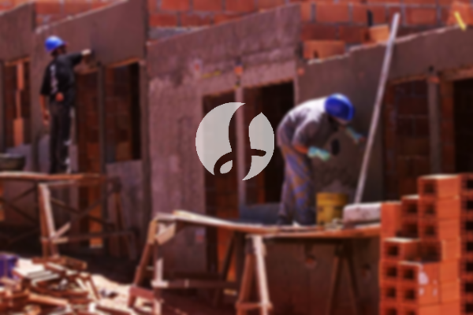

**Biaya Bangun Rumah Per Meter Di Kedung Waringin Bogor** - Mitra Sumber Material, bagaimana kabarnya? Perkembangan layanan pembangunan bangunan semakin pesat, menawarkan solusi lengkap mulai dari desain hingga konstruksi. Kehadiran jasa bangun rumah kini menjadi pilihan cerdas bagi banyak orang. Meningkatnya populasi secara alami memicu kebutuhan akan tempat tinggal yang layak. Hal ini mendorong para pengembang properti untuk berlomba-lomba menghadirkan beragam pilihan hunian, mulai dari yang ekonomis hingga mewah. Kepercayaan konsumen adalah kunci, dan jasa bangun rumah yang terpercaya selalu berusaha memenuhinya. Komitmen ini tercermin dalam penawaran layanan komprehensif untuk mewujudkan rumah impian Anda. Berikut adalah beberapa layanan utama yang dapat Anda pilih:



## Desain Rumah Impian di Kedung Waringin Bogor

Sebagai penyedia layanan desain arsitektur, Kami akan mengawal proses perancangan rumah Anda dengan cermat. Melalui desain yang matang, Kami berupaya menghadirkan keindahan dan fungsionalitas dalam setiap detail. Beberapa faktor penting dipertimbangkan untuk menciptakan komposisi desain yang harmonis dan selaras dengan kebutuhan Anda. Seperti yang Anda ketahui, desain merupakan elemen krusial dalam menciptakan tampilan rumah yang menarik. Dengan desain yang tepat, rumah Anda akan terlihat estetis dan nyaman dihuni. Kami memahami bahwa anggaran adalah pertimbangan utama. Oleh karena itu, Kami akan merancang desain yang sesuai dengan *budget* yang Anda miliki. Dari desain tersebut, Anda dapat memperkirakan biaya yang dibutuhkan untuk mewujudkan rumah impian Anda. Selain itu, desain juga harus mempertimbangkan pemilihan material yang tepat. Semua aspek ini memerlukan keahlian khusus dari seorang arsitek profesional. Itulah mengapa Anda membutuhkan jasa arsitek terpercaya. Dengan demikian, Anda akan merasa puas karena kebutuhan dan keinginan Anda dipahami dengan baik.

Harga jasa desain rumah Kami bervariasi, tergantung pada luas bangunan dan kompleksitas desain yang Anda inginkan. Saat ini, Kami menawarkan harga per meter persegi mulai dari Rp 54.000,- untuk desain rumah minimalis satu lantai, termasuk perhitungan RAB dan dua kali revisi. Untuk rumah dua lantai atau lebih, harga per meternya dikali dua atau tiga, disesuaikan dengan jumlah lantai.

## Borong Bangun Rumah Berkualitas di Kedung Waringin Bogor

Seiring dengan pertumbuhan populasi, kebutuhan akan hunian yang layak semakin meningkat. Banyaknya penyedia jasa bangun rumah yang hadir menawarkan berbagai layanan dan produk berkualitas. Di sinilah peran penting jasa bangun rumah dalam mengatasi tantangan menciptakan hunian ideal bagi Anda. Dengan memilih layanan yang tepat, Anda akan mendapatkan solusi yang sesuai dengan harapan Anda. Memiliki rumah yang nyaman dan indah adalah impian setiap orang. Dengan mempercayakan pembangunan rumah Anda kepada Kami, Anda akan terbantu mewujudkan impian tersebut. Kami tidak hanya membangun rumah, tetapi juga mewujudkan harapan Anda menjadi kenyataan. Kepuasan Anda adalah prioritas Kami, dan Kami akan berusaha memberikan layanan terbaik untuk mendapatkan kepercayaan Anda.

Untuk harga borongan pembangunan rumah, Kami memiliki beberapa tingkatan harga yang disesuaikan dengan jenis material bangunan yang digunakan dan lokasi pembangunan. Dengan asumsi kondisi tanah yang rata, stabil, dan tidak memerlukan pengurugan, harga per meter persegi dengan material dinding hebel adalah Rp 1.950.000,-, sedangkan dengan material bata merah adalah Rp 2.200.000,-. Harga tersebut sudah termasuk pondasi batu kali, kolom dan tiang beton, lantai keramik standar, serta rangka baja ringan dan genteng spandek. Anda dapat menyesuaikan pilihan genteng dan keramik sesuai dengan preferensi, model, kualitas, dan anggaran Anda.

## Jasa Perbaikan Rumah Terpercaya di Kedung Waringin Bogor

Selain layanan desain dan pembangunan rumah baru, Kami juga menyediakan jasa renovasi rumah. Renovasi adalah solusi efektif untuk memberikan tampilan baru pada rumah Anda. Dengan layanan renovasi Kami, Anda tidak perlu khawatir tentang proses renovasi yang rumit. Kami menawarkan renovasi menyeluruh, yang meliputi perubahan tampilan rumah secara signifikan atau bahkan perubahan total. Renovasi memang menjadi alternatif yang menarik untuk memperbarui tampilan rumah Anda dengan anggaran yang lebih terjangkau. Namun, tidak sedikit orang mengalami kesulitan dalam menjalankan renovasi karena keterbatasan anggaran atau pengetahuan. Dengan adanya jasa renovasi profesional, masalah ini dapat diatasi. Kami siap membantu Anda merenovasi rumah Anda menjadi lebih segar dan menarik seperti yang Anda impikan.

Harga borongan jasa renovasi Kami bervariasi tergantung pada kondisi kerusakan rumah Anda. Karena setiap rumah memiliki tingkat kerusakan yang berbeda-beda, harga disesuaikan dengan jenis kerusakan yang perlu diperbaiki. Untuk biaya tenaga tukang harian, Kami mengenakan biaya Rp 150.000,- per hari untuk tukang dan Rp 100.000,- per hari untuk kenek.

## Dukungan Tenaga Ahli & Arsitek Berpengalaman di Kedung Waringin Bogor

Baik layanan desain, pembangunan, maupun renovasi, semuanya memiliki peran penting dalam mewujudkan rumah impian Anda. Dengan dukungan arsitek profesional dan tenaga kerja yang handal, Kami siap membantu Anda mewujudkan impian tersebut. Pembangunan rumah bersama Kami akan menghadirkan rumah yang menarik, cantik, dan tentunya nyaman untuk ditinggali. Kami mengutamakan kualitas dan mutu layanan untuk memberikan kepuasan maksimal kepada Anda. Sebagai penyedia jasa bangun rumah yang terpercaya, Kami selalu berusaha meningkatkan kualitas karya melalui inovasi dan kreativitas yang berkelanjutan. Hasil karya desain dan proyek pembangunan Kami dapat Anda lihat di katalog yang tersedia. Katalog tersebut merupakan bukti nyata bahwa Kami adalah pilihan terbaik dan terpercaya.

Perlu Anda ketahui, rumah adalah kebutuhan pokok manusia setelah sandang dan pangan. Rumah menjadi tempat berlindung dari cuaca ekstrem dan berbagai bahaya. Hal ini membuka peluang bagi penyedia jasa bangun rumah untuk menawarkan keahlian mereka. Sebagai penyedia jasa terpercaya, Kami berpartisipasi aktif dalam memajukan dunia arsitektur dengan mempresentasikan layanan Kami melalui berbagai media, baik cetak maupun *online*. Hal ini membantu banyak orang yang berencana membangun rumah. Dengan menjaga kualitas dan mutu terbaik, Kami telah terbukti memiliki pengalaman yang cukup lama di bidang arsitektur. Itulah mengapa Kami semakin dipercaya oleh banyak pelanggan.

Didukung oleh arsitek profesional dan tenaga kerja yang handal, Kami mampu memberikan layanan yang optimal. Kami terus berinovasi dan mengembangkan diri untuk memberikan yang terbaik bagi Anda. Dengan layanan ini, banyak bangunan indah dan unik yang telah Kami bangun. Proses pengerjaan yang efisien memungkinkan Anda untuk segera menempati rumah impian Anda. Kami berpengalaman membangun rumah dengan berbagai skala, baik kecil maupun besar. Anda tidak perlu ragu atau khawatir tentang hal tersebut. Mulai dari desain, material, ukuran, hingga sumber daya manusia, semuanya dapat Kami atasi. Kami hadir untuk mendukung terwujudnya rumah cantik dan menarik bagi Anda. Karena, Kami tidak hanya menciptakan rancangan, tetapi juga mengawasi proses pembangunan hingga selesai. [Hubungi Kami Sekarang](https://api.whatsapp.com/send?phone=6285776786091&text=*Halo%20sumbermaterial.com*%20%3A) untuk konsultasi gratis!
