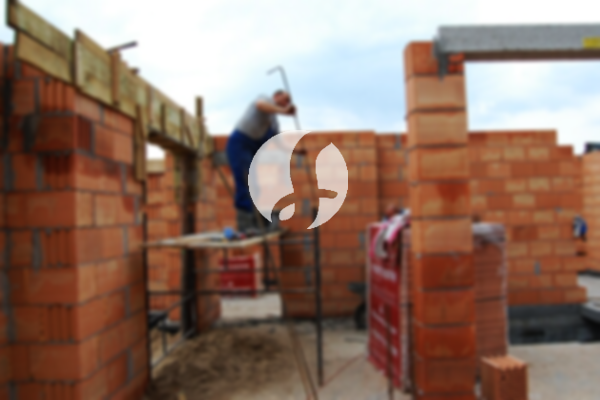

**Biaya Bangun Rumah Per Meter Di Kedungwaringin Bekasi** - Hai Mitra Sumber Material! Gimana kabarnya hari ini? Kami dari Sumber Material hadir sebagai mitra terpercaya dalam mewujudkan rumah impian Anda di Kedungwaringin Bekasi. Seiring perkembangan zaman, jasa konstruksi kini semakin banyak dicari. Layanan bangun rumah pun terus berkembang, termasuk jasa desain interior dan eksterior. Hal ini memicu persaingan sehat antar penyedia jasa agar memberikan penawaran terbaik bagi pelanggan. Meningkatnya jumlah penduduk juga meningkatkan kebutuhan akan tempat tinggal. Tentu saja, hal ini menjadi peluang bagi pelaku properti untuk membangun rumah, perumahan, bahkan apartemen dengan berbagai pilihan harga. Kepercayaan pelanggan adalah prioritas utama kami sebagai penyedia jasa bangun rumah yang terpercaya, dan kami selalu berusaha untuk memenuhi ekspektasi tersebut. Kami menawarkan beragam layanan yang bisa Anda pilih untuk membangun hunian ideal:



## Jasa Desain Gambar Arsitektur Di Kedungwaringin Bekasi

Sebagai penyedia jasa desain, kami di Sumber Material memberikan perhatian khusus pada desain rumah yang akan dibangun. Melalui desain yang berkualitas, kami berupaya menghadirkan keindahan dan kenyamanan maksimal. Kami memahami bahwa desain adalah elemen penting yang menentukan estetika rumah Anda. Dengan desain yang tepat, rumah akan terlihat menarik dan sesuai dengan selera Anda. Kami juga menyesuaikan desain dengan budget yang Anda miliki. Dengan begitu, Anda bisa memiliki gambaran jelas mengenai biaya yang dibutuhkan untuk mewujudkan desain impian Anda. Selain itu, kami juga mempertimbangkan pemilihan material bangunan yang sesuai dengan desain dan anggaran Anda. Proses ini memang cukup kompleks, itulah mengapa Anda membutuhkan jasa arsitek yang berpengalaman. Kami menyediakan arsitek yang siap memahami kebutuhan dan harapan Anda, sehingga Anda akan merasa puas dengan hasil desain yang kami berikan.

Biaya jasa desain kami bervariasi, tergantung pada luas bangunan dan kerumitan desain yang diinginkan. Saat ini, kami menetapkan harga minimal Rp 54.000,- per meter untuk desain rumah minimalis satu lantai, yang sudah termasuk gambar desain, kalkulasi RAB (Rencana Anggaran Biaya), dan dua kali revisi. Untuk bangunan dua lantai atau lebih, biayanya dapat ditingkatkan, disesuaikan dengan jumlah lantai bangunan Anda.

## Jasa Borong Bangun Rumah Di Kedungwaringin Bekasi

Melihat kebutuhan akan tempat tinggal yang semakin meningkat di Kedungwaringin Bekasi, kami hadir sebagai solusi terpercaya untuk membangun hunian impian Anda. Banyaknya penyedia jasa konstruksi saat ini tentu menawarkan berbagai pilihan, namun kenyamanan dan keandalan tetap menjadi prioritas utama. Kami berkomitmen untuk menyediakan layanan yang sesuai dengan harapan Anda. Memiliki rumah yang nyaman dan indah adalah impian setiap orang. Dengan memanfaatkan jasa bangun rumah dari Sumber Material, Anda dapat mewujudkan impian tersebut tanpa perlu repot mendesain sendiri. Tim kami akan berusaha memahami keinginan Anda dan mewujudkannya menjadi karya nyata berupa rumah impian Anda. Kepuasan Anda adalah motivasi utama kami untuk terus memberikan pelayanan terbaik.

Kami menawarkan berbagai pilihan harga untuk layanan borong bangun rumah, disesuaikan dengan material bangunan yang digunakan dan lokasi pembangunan. Dengan asumsi lahan yang rata, stabil, dan tidak memerlukan pengurukan, harga per meter untuk material dinding hebel dimulai dari Rp 1.950.000,-, sementara untuk bata merah dimulai dari Rp 2.200.000,-. Harga tersebut sudah termasuk pondasi batu kali, kolom dan tiang beton, lantai keramik standar, serta rangka baja ringan dan genteng spandek untuk atap. Anda juga dapat memilih jenis genteng dan keramik lain sesuai preferensi, model, kualitas, dan budget Anda.

## Jasa Renovasi Rumah Di Kedungwaringin Bekasi

Selain layanan desain dan bangun rumah, kami juga menyediakan jasa renovasi rumah di Kedungwaringin Bekasi. Renovasi adalah cara efektif untuk menyegarkan tampilan rumah Anda. Dengan hadirnya jasa renovasi bangunan dari Sumber Material, Anda tidak perlu khawatir menghadapi proses renovasi yang rumit. Kami menawarkan renovasi yang bisa berupa perubahan tampilan eksterior, renovasi total, atau bahkan penambahan ruang. Renovasi bisa menjadi solusi yang ekonomis untuk meningkatkan nilai estetika rumah Anda. Namun, seringkali anggaran menjadi kendala utama dalam melakukan renovasi. Dengan layanan renovasi kami, Anda akan mendapatkan solusi yang sesuai dengan budget Anda. Kami siap membantu Anda merenovasi rumah Anda agar terlihat lebih segar dan menarik dari sebelumnya, sesuai dengan impian Anda.

Untuk biaya borongan renovasi rumah, kami menetapkan harga yang bervariasi tergantung kondisi kerusakan bangunan. Kami akan melakukan survei terlebih dahulu untuk menilai kerusakan dan memberikan penawaran harga yang sesuai. Jika Anda lebih memilih untuk menyewa tenaga tukang harian, kami mengenakan biaya Rp 150.000,- per hari untuk tukang dan Rp 100.000,- per hari untuk kenek.

## Didukung Tukang & Arsitek Berpengalaman Di Kedungwaringin Bekasi

Baik itu layanan desain, bangun rumah, atau renovasi, semuanya memiliki peran penting dalam mewujudkan hunian impian Anda. Didukung oleh arsitek profesional dan tenaga kerja yang handal, kami siap membantu Anda mencapai tujuan tersebut. Dengan membangun rumah melalui Sumber Material, Anda akan mendapatkan rumah yang menarik dan indah. Kami mengutamakan kualitas dan ketepatan waktu dalam setiap pekerjaan. Kepuasan pelanggan adalah prioritas utama kami. Kami terus berupaya meningkatkan kualitas karya kami untuk memenuhi harapan Anda. Anda dapat melihat portofolio proyek-proyek sebelumnya untuk melihat hasil karya kami. Katalog proyek kami akan membuktikan bahwa Sumber Material adalah pilihan terbaik dan terpercaya.

Sebagai informasi tambahan, rumah adalah kebutuhan pokok manusia yang sangat penting, selain dari sandang dan pangan. Rumah berfungsi sebagai tempat berlindung dari cuaca ekstrem dan berbagai bahaya. Hal ini menjadikan penyedia jasa bangun rumah berperan penting dalam meramaikan dunia arsitektur yang terus berkembang, dengan menawarkan jasa melalui berbagai media, baik cetak maupun online. Ini mempermudah masyarakat yang ingin membangun rumah untuk menemukan solusi yang tepat. Dengan memprioritaskan kualitas dan pengalaman, jasa bangun rumah menjadi semakin dipercaya oleh banyak orang.

Didukung oleh arsitek profesional dan tenaga kerja yang terampil, Sumber Material terus berkembang dan memberikan inovasi dalam dunia konstruksi. Kami sering menciptakan karya-karya baru yang lebih inovatif dan kreatif. Banyak bangunan dengan desain yang apik dan menarik telah kami bangun. Proses pengerjaan yang efisien memungkinkan Anda mendapatkan rumah impian dengan cepat. Baik bangunan skala kecil maupun besar, kami mampu mengatasinya dengan baik. Anda tidak perlu khawatir dengan kendala dan kesulitan yang mungkin muncul. Mulai dari desain rumah, pemilihan material, ukuran bangunan, hingga sumber daya manusia, semuanya dapat kami atasi dengan baik. Inilah peran penting dari Sumber Material sebagai penyedia jasa bangun rumah yang andal. Kami memberikan perencanaan yang matang dan pengawasan yang ketat selama proses pembangunan. [Hubungi Kami Sekarang!](https://api.whatsapp.com/send?phone=6285776786091&text=*Halo%20sumbermaterial.com*%20%3A) atau kunjungi [bangun rumah di Bojongmangu](/bangunan/biaya-bangun-rumah-per-meter-di-bojongmangu-bekasi/) untuk informasi lebih lanjut tentang membangun rumah di Bekasi.
