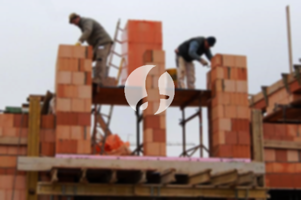

**Biaya Bangun Rumah Per Meter Di Kemayoran Jakarta** - Hai Mitra Sumber Material! Gimana kabarnya? Kami dari Sumber Material hadir untuk membantu Anda mewujudkan rumah impian di Kemayoran Jakarta dan sekitarnya. Seiring perkembangan zaman, minat masyarakat terhadap jasa bangun rumah semakin meningkat. Banyak yang memilih borongan bangun rumah karena praktis dan efisien. Jumlah penduduk yang terus bertambah, tentu saja meningkatkan kebutuhan akan tempat tinggal. Para kontraktor properti berlomba-lomba menawarkan berbagai pilihan: rumah sederhana hingga mewah. Membangun kepercayaan pelanggan adalah kunci utama. Jasa bangun rumah yang terpercaya akan selalu berusaha memenuhi amanah dan harapan konsumen. Kami sebagai penyedia layanan bangun rumah yang dapat diandalkan, hadir dengan beragam penawaran menarik.  Berikut beberapa layanan yang dapat Anda pilih:

## Layanan Desain Gambar Arsitek Profesional Di Kemayoran Jakarta

Sebagai penyedia jasa desain arsitektur, kami akan membantu Anda mewujudkan konsep rumah impian menjadi gambar yang nyata. Melalui desain yang cermat, kami berupaya menghadirkan keindahan dan fungsionalitas pada hunian Anda. Kami mempertimbangkan berbagai faktor penting untuk menciptakan komposisi desain yang harmonis dan sesuai dengan selera Anda. Desain adalah elemen kunci dalam pembangunan rumah. Desain yang baik akan membuat rumah terlihat menarik dan bernilai estetika tinggi. Anda tidak perlu khawatir tentang anggaran, karena kami menawarkan desain yang disesuaikan dengan *budget* yang Anda miliki. Dari desain tersebut, Anda dapat memahami perkiraan biaya yang dibutuhkan untuk mewujudkan rumah impian Anda. Selain itu, kami juga mempertimbangkan pemilihan material yang sesuai dengan desain dan anggaran Anda. Semua proses ini membutuhkan keahlian dan pengalaman khusus. Itulah mengapa, Anda wajib memilih jasa arsitek profesional. Jasa arsitek akan memahami keinginan Anda dan menerjemahkannya ke dalam desain yang memuaskan.

Harga jasa desain bangunan dari Kami bervariasi, tergantung pada luas rumah dan kompleksitas desain yang diinginkan. Saat ini, Kami menetapkan harga per meter persegi. Biaya jasa desain bangunan minimalis satu lantai adalah Rp54.000,- per meter, sudah termasuk desain, perhitungan RAB, dan dua kali revisi. Untuk rumah dua lantai atau lebih, harganya hanya dikalikan 2 atau 3 sesuai dengan jumlah lantai.

## Jasa Borong Renovasi Bangunan Terpercaya Di Kemayoran Jakarta

Mewujudkan tempat tinggal adalah kebutuhan dasar setiap manusia. Semakin banyak penyedia jasa bangun rumah bermunculan, semakin banyak pula pilihan yang tersedia bagi konsumen. Disinilah peran penting jasa bangun rumah dalam mengatasi permasalahan konstruksi. Kami hadir untuk membantu Anda membangun rumah impian yang sesuai dengan keinginan Anda. Memiliki rumah yang nyaman dan indah adalah impian setiap orang. Dengan memanfaatkan layanan bangun rumah, Anda akan mendapatkan bantuan penuh dalam mewujudkan impian tersebut. Anda tidak perlu pusing memikirkan desain, karena jasa bangun rumah akan membantu Anda menciptakan desain yang sesuai dengan kebutuhan dan anggaran Anda. Kami selalu berusaha memahami harapan Anda dan mewujudkannya dalam bentuk bangunan nyata yang memuaskan. Hal ini menjadikan jasa bangun rumah semakin dipercaya oleh banyak orang.

Untuk harga layanan borong renovasi rumah Kami, terdapat beberapa tingkatan harga. Harga disesuaikan dengan material yang digunakan dan lokasi pembangunan. Dengan asumsi area tanah rata, stabil, dan tidak memerlukan pengurukan, harga per meter persegi dengan material dinding *hebel* adalah Rp1.950.000,-, sedangkan dengan material bata merah adalah Rp2.200.000,-. Harga tersebut sudah termasuk pondasi batu sungai, kolom dan tiang beton, lantai keramik standar, serta atap rangka baja ringan dengan genteng spandek. Anda dapat memilih jenis genteng dan keramik lain sesuai preferensi, model, kualitas, dan anggaran Anda.

## Harga Jasa Renovasi Rumah Terjangkau Di Kemayoran Jakarta

Selain layanan arsitek dan bangun rumah, Kami juga menyediakan jasa renovasi rumah. Renovasi bangunan adalah cara efektif untuk memberikan tampilan baru pada rumah Anda. Dengan kehadiran jasa renovasi bangunan, Anda tidak perlu lagi bingung menentukan cara renovasi rumah Anda. Kami menawarkan renovasi yang dapat berupa perubahan model bangunan secara keseluruhan atau hanya perbaikan sebagian. Renovasi memang menjadi pilihan populer untuk meningkatkan keindahan rumah, namun seringkali terhambat oleh keterbatasan anggaran. Namun, dengan adanya jasa renovasi bangunan, semua kendala tersebut dapat diatasi. Kami hadir sebagai solusi renovasi bangunan yang memudahkan Anda untuk memperbarui rumah Anda menjadi lebih segar dan indah dari sebelumnya. Kami siap mewujudkan bangunan impian sesuai dengan harapan Anda.

Biaya borongan jasa renovasi rumah Kami bervariasi, karena kondisi kerusakan setiap rumah berbeda-beda. Kami akan menyesuaikan harga dengan jenis kerusakan yang akan diperbaiki. Namun, untuk biaya jasa renovasi dengan tenaga tukang harian, harganya adalah Rp150.000,- per hari untuk tukang dan Rp100.000,- per hari untuk kenek.

## Didukung Tukang dan Arsitek Terbaik Di Kemayoran Jakarta

Baik jasa arsitek, bangun rumah, maupun renovasi rumah, semuanya memiliki peran penting. Dengan dukungan arsitek profesional dan tenaga kerja yang handal, Kami akan membantu mewujudkan impian Anda. Membangun rumah bersama jasa bangun rumah yang terpercaya akan menghasilkan hunian yang menarik dan berkualitas tinggi. Anda tidak perlu khawatir, karena Kami selalu mengutamakan kualitas dan kepuasan pelanggan. Sebagai jasa bangun rumah, kepuasan Anda adalah dorongan Kami untuk terus berkarya dan menghasilkan karya yang lebih baik. Anda dapat melihat katalog proyek Kami untuk melihat hasil karya desain dan konstruksi Kami. Katalog tersebut membuktikan bahwa Kami adalah pilihan terbaik dan terpercaya. [bangun rumah di Bidara Cina](/bangunan/biaya-bangun-rumah-per-meter-di-bidara-cina-jakarta/)

Perlu diingat, rumah adalah kebutuhan pokok manusia yang sangat penting, selain sandang dan pangan. Rumah menjadi tempat berlindung dari cuaca ekstrem dan berbagai bahaya. Hal inilah yang menjadi peluang bagi penyedia jasa bangun rumah untuk menawarkan jasanya. Sebagai penyedia jasa khususnya di bidang pembangunan rumah, Kami berpartisipasi dalam memajukan dunia arsitektur dengan menawarkan layanan melalui berbagai media, mulai dari cetak hingga *online*. Hal ini tentu saja memudahkan masyarakat yang ingin mewujudkan rumah impian mereka. Dengan menjaga kualitas dan mutu terbaik, Kami telah terbukti memiliki pengalaman yang cukup lama dalam dunia arsitektur. Itulah alasan mengapa jasa bangun rumah Kami semakin dipercaya oleh banyak orang.

Didukung oleh arsitek profesional dan tenaga kerja ahli, tentu akan membuat jasa bangun rumah Kami semakin dikenal dan dipercaya. Hal ini terlihat dari perkembangan yang selalu Kami berikan. Kami terus berkarya dan menciptakan desain-desain inovatif dan kreatif. Banyak rumah dan bangunan telah Kami bangun dengan desain yang menarik dan apik. Dengan proses pengerjaan yang efisien, Anda akan lebih cepat mendapatkan rumah impian Anda. Baik rumah berskala kecil maupun besar, semuanya dapat Kami tangani. Jadi, Anda tidak perlu khawatir atau cemas. Mulai dari desain bangunan, pemilihan material, ukuran rumah, hingga tenaga kerja, semuanya dapat Kami atasi. Dengan demikian, Kami mendukung terwujudnya rumah yang cantik dan nyaman. Disitulah peran penting dari jasa bangun rumah yang terpercaya. Anda bisa langsung [Hubungi Kami](https://api.whatsapp.com/send?phone=6285776786091&text=*Halo%20sumbermaterial.com*%20%3A) untuk mendapatkan penawaran terbaik!
