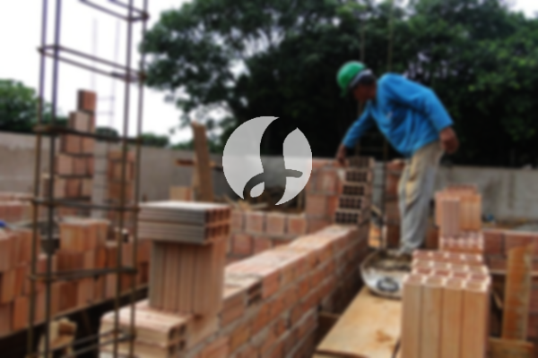

**Biaya Bangun Rumah Per Meter Di Kembangan Barat Jakarta** - Hai Mitra Sumber Material! Bagaimana kabar Anda semua? Kami dari penyedia jasa konstruksi terpercaya di Kembangan Barat Jakarta ingin memperkenalkan layanan unggulan kami. Di era modern ini, semakin banyak orang yang memilih jasa bangun rumah untuk mewujudkan tempat tinggal impian mereka. Perkembangan ini juga memacu inovasi dalam desain rumah, menawarkan beragam pilihan sesuai kebutuhan dan selera. Semakin banyak kebutuhan akan tempat tinggal, semakin banyak pula pengembang properti yang berlomba-lomba menghadirkan solusi terbaik. Kami memahami betul pentingnya kepercayaan konsumen, dan berkomitmen untuk memberikan layanan yang andal dan memuaskan. Kami berfokus menyediakan solusi konstruksi lengkap, mulai dari perencanaan hingga penyelesaian. Nah, mari kita bahas lebih lanjut bagaimana Kami dapat membantu mewujudkan hunian impian Anda di Kembangan Barat Jakarta.



## Layanan Desain Gambar Arsitek Profesional di Kembangan Barat Jakarta

Sebagai mitra terpercaya dalam mewujudkan hunian impian Anda, Kami menawarkan layanan desain gambar arsitek yang komprehensif di Kembangan Barat Jakarta. Kami memahami bahwa desain adalah fondasi utama dalam membangun rumah yang indah dan fungsional. Melalui desain yang cermat, Kami berupaya menciptakan komposisi visual yang harmonis. Beberapa faktor penting yang Kami perhatikan dalam proses desain meliputi estetika, ergonomi, dan efisiensi ruang. Desain yang baik bukan hanya tentang tampilan luar, tetapi juga tentang bagaimana ruang tersebut akan digunakan dan dinikmati oleh penghuninya. Kami juga memastikan bahwa desain yang Kami buat sesuai dengan anggaran yang Anda miliki. Dengan demikian, Anda dapat memiliki gambaran yang jelas tentang biaya yang akan dikeluarkan untuk mewujudkan desain rumah idaman Anda. Selain itu, Kami juga memperhatikan pemilihan material bangunan yang tepat, menyeimbangkan antara kualitas, harga, dan ketersediaan. Semua elemen ini digabungkan untuk menciptakan desain yang optimal dan sesuai dengan kebutuhan Anda.

Untuk harga jasa desain kami, biaya bervariatif tergantung pada luas bangunan dan kompleksitas desain yang Anda inginkan. Saat ini, Kami menawarkan harga jasa desain rumah minimalis satu lantai mulai dari Rp 54.000,- per meter persegi, sudah termasuk gambar desain lengkap, perhitungan RAB (Rencana Anggaran Biaya), dan dua kali revisi. Untuk bangunan dua lantai atau lebih, biaya desain dikalikan dua atau tiga sesuai dengan jumlah lantai.

## Harga Jasa Borong Renovasi Bangunan di Kembangan Barat Jakarta

Dengan bertambahnya jumlah penduduk, kebutuhan akan tempat tinggal yang layak terus meningkat. Hal ini mendorong perkembangan bisnis jasa borong bangunan, di mana setiap penyedia layanan berusaha menawarkan produk dan layanan terbaik kepada konsumen. Di sinilah peran penting Kami sebagai borongan bangun rumah dalam menangani permasalahan pembangunan rumah Anda di Kembangan Barat Jakarta. Dengan memilih jasa Kami, Anda akan mendapatkan layanan yang sesuai dengan keinginan dan kebutuhan Anda. Memiliki rumah yang bagus adalah impian setiap orang. Dengan menggunakan jasa Kami, Anda akan mendapatkan bantuan dalam mewujudkan impian tersebut. Kami memahami bahwa membangun rumah dari nol bisa menjadi proses yang rumit, oleh karena itu Kami hadir untuk mempermudah Anda. Kami selalu berusaha memahami keinginan Anda dan mewujudkannya dalam karya nyata berupa rumah impian. Kepuasan Anda adalah prioritas utama Kami.

Untuk harga borong pembangunan, Kami menawarkan beberapa tingkatan harga yang disesuaikan dengan bahan bangunan yang digunakan dan lokasi proyek di Kembangan Barat Jakarta. Dengan syarat bahwa lokasi tanah dalam keadaan rata, stabil, dan tidak memerlukan pengurugan, harga per meter persegi dengan material dinding hebel adalah Rp 1.950.000,-, sedangkan dengan material bata merah adalah Rp 2.200.000,-. Harga tersebut sudah termasuk pondasi batu kali, kolom dan tiang beton, lantai keramik standar, serta atap dengan rangka baja ringan dan genteng spandek. Anda juga dapat menyesuaikan jenis genteng dan keramik sesuai dengan preferensi, anggaran, dan kualitas yang diinginkan.

## Harga Renovasi Rumah di Kembangan Barat Jakarta

Selain layanan arsitek dan pembangunan rumah baru, Kami juga menyediakan jasa renovasi rumah di Kembangan Barat Jakarta. Renovasi rumah merupakan cara yang efektif untuk memperbarui tampilan rumah agar terlihat lebih segar dan modern. Dengan adanya layanan renovasi rumah profesional, Anda tidak perlu lagi khawatir menghadapi proses renovasi yang rumit. Kami menawarkan renovasi yang dapat berupa perubahan bentuk model rumah, perubahan keseluruhan atau total, hingga perbaikan kerusakan yang ada. Renovasi memang bisa menjadi solusi untuk mengubah tampilan rumah Anda menjadi lebih cantik dan nyaman. Namun, dengan anggaran yang terbatas, terkadang seseorang merasa kesulitan untuk melakukan renovasi. Nah, Kami hadir untuk mengatasi masalah tersebut. Dengan layanan renovasi rumah yang terjangkau, Kami akan membantu Anda merenovasi rumah Anda menjadi lebih bagus dan menarik dari sebelumnya. Tim Kami siap mewujudkan impian Anda untuk memiliki rumah yang sesuai dengan selera Anda.

Untuk harga borongan renovasi, Kami memberikan harga yang variatif karena kondisi kerusakan rumah yang akan direnovasi berbeda-beda. Harga borongan renovasi disesuaikan dengan jenis kerusakan yang akan diperbaiki. Namun, untuk biaya jasa renovasi dengan tenaga tukang harian, harganya adalah Rp 150.000,- per hari untuk tukang dan Rp 100.000,- per hari untuk kenek.

## Didukung Tenaga Kerja dan Arsitek Berpengalaman di Kembangan Barat Jakarta

Baik itu layanan arsitek, pembangunan rumah baru, atau renovasi bangunan, semuanya memiliki peran yang sangat penting dalam mewujudkan hunian impian Anda. Dengan dukungan arsitek profesional dan tenaga kerja yang handal, Kami dapat membantu mewujudkan impian Anda. Dengan membangun rumah impian bersama Kami, Anda akan memiliki rumah yang menarik dan indah. Anda tidak perlu khawatir, karena Kami akan memberikan pelayanan terbaik, menjaga kualitas dan ketepatan waktu untuk memberikan kepuasan kepada Anda. Sebagai penyedia jasa konstruksi, kepuasan pelanggan adalah motivasi utama Kami untuk terus berkarya dan menghasilkan karya yang lebih baik. Anda dapat melihat katalog hasil proyek Kami untuk melihat contoh-contoh bangunan yang telah Kami kerjakan. Katalog tersebut dapat membuktikan bahwa Kami adalah pilihan yang tepat dan terpercaya. [bangun rumah di Bale Kambang](/bangunan/biaya-bangun-rumah-per-meter-di-bale-kambang-jakarta/)

Penting untuk diingat bahwa rumah adalah kebutuhan dasar manusia selain sandang dan pangan. Rumah berfungsi sebagai tempat berlindung dari cuaca panas dan dingin serta sebagai perlindungan dari berbagai bahaya. Hal ini menjadi peluang bagi penyedia jasa konstruksi untuk menawarkan jasanya. Sebagai penyedia jasa, khususnya jasa bangun rumah, Kami berpartisipasi dalam memajukan dunia arsitektur dengan menawarkan layanan Kami melalui berbagai media. Mulai dari media cetak hingga media online, Kami memanfaatkan berbagai platform untuk menjangkau calon pelanggan. Hal ini tentu memudahkan orang-orang yang ingin membangun rumah untuk mendapatkan informasi yang mereka butuhkan. Dengan mempertahankan kualitas dan standar terbaik, Kami telah terbukti memiliki pengalaman yang cukup lama dalam menggeluti dunia arsitektur. Inilah alasan mengapa Kami semakin banyak dipercaya oleh banyak orang.

Dengan dukungan arsitek profesional serta tenaga kerja yang handal, Kami yakin dapat memberikan layanan yang memuaskan bagi Anda di Kembangan Barat Jakarta. Perkembangan yang terus Kami lakukan membuktikan kemampuan Kami dalam memberikan solusi konstruksi yang inovatif dan kreatif. Banyak bangunan-bangunan yang telah Kami bangun dengan desain yang apik dan menarik. Dengan proses pengerjaan yang efisien, Kami dapat menyelesaikan proyek Anda dengan cepat. Baik rumah berskala kecil maupun besar, Kami dapat mengelola berbagai jenis proyek konstruksi. Oleh karena itu, Anda tidak perlu khawatir atau ragu. Mulai dari desain rumah, pemilihan material, ukuran bangunan, hingga sumber daya manusia, semuanya dapat Kami atasi. Hal ini menjadikan Kami mitra yang tepat untuk mendukung terwujudnya bangunan yang cantik dan menarik. Itulah peran penting Kami sebagai penyedia jasa konstruksi. Kami akan mewujudkan tata desain yang Anda inginkan dan sekaligus mengawasi jalannya pembangunan. [Hubungi Kami Sekarang](https://api.whatsapp.com/send?phone=6285776786091&text=*Halo%20sumbermaterial.com*%20%3A) untuk konsultasi gratis dan penawaran terbaik!
