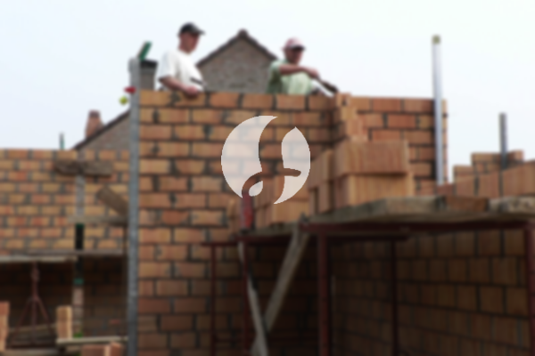

**Biaya Bangun Rumah Per Meter Di Kembangan Jakarta** - Hai Mitra Sumber Material! Gimana kabarnya hari ini? Kami dari Sumber Material hadir untuk membantu mewujudkan rumah impian Anda di Kembangan Jakarta dan sekitarnya. Seiring kemajuan zaman, jasa bangun rumah semakin diminati karena menawarkan solusi praktis dan efisien bagi mereka yang ingin memiliki hunian. Semakin banyak orang yang membutuhkan tempat tinggal, semakin besar pula persaingan antar kontraktor properti untuk memberikan layanan terbaik. Kepercayaan konsumen adalah prioritas utama, sehingga jasa bangun rumah berupaya keras mempertahankan reputasi dan memberikan hasil yang memuaskan. Kami sebagai penyedia jasa bangun rumah yang terpercaya menawarkan berbagai layanan untuk memenuhi kebutuhan Anda.



## Estimasi Biaya Desain Gambar Arsitek Di Kembangan Jakarta

Sebagai penyedia layanan desain arsitektur, Kami akan mengamati dan mewujudkan desain bangunan yang Anda impikan. Dengan desain yang tepat, rumah Anda akan terlihat indah dan sesuai dengan selera Anda. Kami memanfaatkan berbagai faktor penting untuk menciptakan komposisi desain yang harmonis dan menarik. Desain adalah elemen krusial dalam pembangunan rumah karena menentukan estetika dan fungsi bangunan. Kami akan membantu Anda mewujudkan desain yang sesuai dengan anggaran yang Anda miliki. Desain yang matang akan memberikan gambaran jelas mengenai biaya yang dibutuhkan untuk mewujudkan rumah impian Anda. Selain itu, Kami juga memperhatikan pemilihan material bangunan yang tepat agar sesuai dengan desain dan anggaran Anda. Semua hal ini membutuhkan perencanaan yang cermat, itulah mengapa Kami merekomendasikan untuk menggunakan jasa arsitek profesional. Arsitek akan memahami keinginan Anda dan mewujudkannya menjadi kenyataan, sehingga Anda akan merasa puas dengan hasilnya.

Harga jasa desain rumah Kami bervariasi tergantung pada luas rumah dan tingkat kesulitan desain yang diinginkan. Saat ini, Kami menetapkan harga per meter persegi. Biaya jasa desain rumah minimalis satu lantai adalah Rp 54.000,- per meter, sudah termasuk desain, perhitungan RAB, dan dua kali revisi. Untuk rumah dua lantai atau lebih, biayanya hanya dikalikan 2 atau 3 sesuai dengan jumlah lantai.

## Harga Borong Renovasi Bangunan Di Kembangan Jakarta

Seperti yang kita ketahui, memiliki rumah adalah kebutuhan dasar setiap manusia. Hal ini mendorong banyak penyedia jasa bangun rumah untuk menawarkan produk dan layanan terbaik mereka. Di sinilah peran penting jasa bangun rumah dalam mengatasi tantangan pembangunan. Dengan memilih jasa bangun rumah yang tepat, Anda akan mendapatkan layanan yang sesuai dengan keinginan Anda. Memiliki rumah yang nyaman dan indah adalah impian setiap orang. Dengan menggunakan jasa bangun rumah, Anda akan terbantu mewujudkan impian tersebut. Kami tidak hanya membangun rumah baru, tetapi juga menawarkan layanan renovasi untuk memberikan tampilan baru pada hunian Anda. Dengan borongan bangun rumah, Anda tidak perlu repot mendesain rumah sendiri. Kami akan berusaha memahami keinginan Anda dan mewujudkannya menjadi karya nyata. Kepuasan Anda adalah prioritas utama Kami, dan Kami akan terus berusaha memberikan layanan terbaik.

Untuk jasa borong renovasi bangunan, Kami menawarkan beberapa pilihan harga yang disesuaikan dengan material bangunan dan lokasi proyek. Dengan syarat lahan yang akan dibangun dalam keadaan rata, stabil, dan tidak memerlukan pengurugan. Harga per meter persegi dengan material dinding hebel adalah Rp 1.950.000,-, sementara untuk material bata merah adalah Rp 2.200.000,-. Harga tersebut sudah termasuk pondasi batu kali, kolom dan tiang beton, lantai keramik standar, serta atap dengan rangka baja ringan dan genteng spandek. Untuk jenis genteng dan keramik, Anda dapat menyesuaikan dengan preferensi Anda, dengan penyesuaian harga yang sesuai.

## Biaya Perbaikan Bangunan Di Kembangan Jakarta

Selain layanan arsitek dan borongan bangun rumah, Kami juga menyediakan jasa perbaikan bangunan. Layanan renovasi rumah adalah solusi tepat untuk memberikan tampilan baru pada hunian Anda. Kami akan membantu Anda mengubah tampilan bangunan atau melakukan renovasi total sesuai kebutuhan Anda. Renovasi adalah alternatif yang efektif untuk meningkatkan estetika dan nilai properti Anda. Namun, biaya renovasi bisa menjadi kendala bagi sebagian orang. Dengan adanya jasa renovasi bangunan, Anda dapat mengatasi masalah tersebut. Kami hadir sebagai solusi renovasi bangunan yang akan membantu Anda menciptakan rumah yang lebih indah dan menarik. Kami siap mewujudkan impian Anda dengan hasil yang memuaskan.

Untuk harga borongan jasa renovasi bangunan, Kami menawarkan harga yang bervariasi tergantung pada kondisi kerusakan bangunan. Setiap bangunan memiliki tingkat kerusakan yang berbeda-beda, sehingga Kami akan menyesuaikan biaya dengan kebutuhan perbaikan. Namun, untuk biaya jasa renovasi dengan tenaga tukang harian, Kami mengenakan biaya sebesar Rp 150.000,- per hari untuk tukang dan Rp 100.000,- per hari untuk kenek.

## Didukung Tukang Dan Arsitek Berpengalaman Di Kembangan Jakarta

Baik jasa arsitek, borongan bangun rumah, maupun jasa renovasi bangunan, semuanya memiliki peran penting dalam mewujudkan impian Anda. Dengan dukungan arsitek profesional dan tenaga kerja yang handal, Kami akan membantu Anda mewujudkan rumah idaman Anda. Membangun rumah bersama Kami akan memberikan Anda rumah yang menarik dan berkualitas. Kami tidak perlu khawatir, karena Kami berkomitmen untuk memberikan pelayanan terbaik, menjaga mutu dan kualitas, serta memberikan kepuasan kepada Anda. Sebagai penyedia jasa bangun rumah, kepuasan pelanggan menjadi motivasi Kami untuk terus berkarya dan memberikan hasil yang lebih baik. Anda dapat melihat portofolio proyek Kami untuk melihat hasil karya desain dan pembangunan yang telah Kami lakukan. Katalog proyek Kami dapat membuktikan bahwa Kami adalah pilihan terbaik dan terpercaya.

Perlu diingat bahwa rumah adalah kebutuhan primer manusia yang sangat penting, selain sandang dan pangan. Rumah memberikan perlindungan dari cuaca dan bahaya, serta menjadi tempat yang nyaman untuk beristirahat. Hal ini menjadi celah bagi penyedia jasa bangun rumah untuk menawarkan jasanya. Sebagai penyedia jasa terkhusus dalam pembangunan rumah, Kami berpartisipasi aktif dalam memajukan dunia arsitektur dengan menawarkan layanan melalui berbagai media. Mulai dari media cetak hingga media online, Kami memanfaatkan berbagai platform untuk mempromosikan jasa bangun rumah. Hal ini membantu banyak orang mewujudkan impian memiliki rumah. Dengan menjaga mutu dan kualitas terbaik, Kami telah terbukti memiliki pengalaman yang cukup lama dalam menggeluti dunia arsitektur. Inilah sebabnya mengapa jasa bangun rumah semakin banyak dipercaya oleh masyarakat.

Didukung oleh arsitek profesional dan tenaga kerja yang handal, tentu akan membuat layanan Kami semakin dikenal dan terpercaya. Kami terus berinovasi dan berkreativitas dalam setiap proyek pembangunan. Banyak rumah dan bangunan indah yang telah Kami bangun dengan desain yang apik dan menarik. Dengan cara pengerjaan yang efisien, Kami dapat menyelesaikan proyek dengan cepat dan tepat waktu. Apakah itu rumah skala kecil maupun besar, Kami siap menghadapinya. Anda tidak perlu ragu atau khawatir dengan hal tersebut. Mulai dari desain bangunan, pemilihan material, ukuran rumah, dan sumber daya manusia, semuanya dapat Kami atasi dengan baik. Sehingga, Kami dapat mendukung terwujudnya rumah impian Anda yang cantik dan menarik. Di sinilah peran penting dari jasa bangun rumah, karena Kami akan membuat tata desain yang sesuai dengan keinginan Anda, serta bertindak sebagai pengawas selama proses pembangunan. [Hubungi Kami Sekarang](https://api.whatsapp.com/send?phone=6285776786091&text=*Halo%20sumbermaterial.com*%20%3A) untuk konsultasi gratis!
