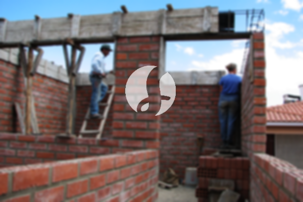

**Biaya Bangun Rumah Per Meter Di Kembangan Timur Jakarta** - Hai Mitra Sumber Material! Gimana kabarnya hari ini? Kami dari Sumber Material hadir untuk memberikan solusi lengkap kebutuhan konstruksi Anda di Kembangan Timur Jakarta. Seiring dengan meningkatnya kebutuhan akan hunian yang nyaman dan berkualitas, layanan jasa bangun rumah semakin banyak dicari. Perkembangan ini mendorong banyak kontraktor properti untuk berlomba-lomba menawarkan layanan terbaik, mulai dari standar hingga mewah. Kepercayaan pelanggan adalah kunci utama, sehingga layanan bangun rumah selalu berupaya menjaga kualitas dan memberikan hasil yang memuaskan. Sebagai penyedia jasa yang terpercaya, kami menawarkan berbagai pilihan layanan yang dapat Anda sesuaikan dengan kebutuhan dan anggaran Anda.



## Jasa Desain Gambar Arsitektur Di Kembangan Timur Jakarta

Sebagai penyedia jasa desain arsitektur, kami akan membantu Anda mewujudkan konsep rumah impian Anda. Dengan desain yang tepat, sebuah rumah dapat terlihat lebih indah dan fungsional. Kami memahami bahwa desain adalah faktor penting dalam proses pembangunan, oleh karena itu kami akan bekerja sama dengan Anda untuk menciptakan komposisi desain yang cantik dan selaras dengan preferensi Anda. Anda tidak perlu khawatir mengenai anggaran, karena kami akan menyesuaikan desain dengan *budget* yang Anda miliki. Dari desain tersebut, Anda akan memiliki gambaran yang jelas mengenai biaya yang dibutuhkan untuk mewujudkan rumah idaman Anda. Selain itu, kami juga mempertimbangkan pemilihan bahan material yang tepat. Proses ini memang membutuhkan ketelitian dan keahlian khusus. Itulah mengapa, bekerja sama dengan arsitek profesional adalah pilihan yang tepat. Kami akan memahami keinginan Anda dan menerjemahkannya menjadi desain yang memuaskan.

Biaya jasa desain kami bervariasi tergantung pada luas rumah dan tingkat kesulitan desain. Saat ini, kami menawarkan harga jasa desain rumah minimalis satu lantai mulai dari Rp 54.000,- per meter persegi, sudah termasuk desain, kalkulasi RAB, dan 2 kali revisi. Untuk rumah dua lantai atau lebih, harganya hanya dikalikan 2 atau 3 sesuai dengan jumlah lantai.

## Harga Layanan Borong Bangun Tempat Tinggal Di Kembangan Timur Jakarta

Seiring dengan pertumbuhan populasi, kebutuhan akan tempat tinggal semakin meningkat. Hal ini membuka peluang bagi banyak penyedia jasa bangun rumah untuk menawarkan produk dan layanan terbaik kepada pelanggan. Kami hadir sebagai solusi bagi Anda yang ingin membangun rumah impian di Kembangan Timur Jakarta. Memiliki rumah yang cantik dan nyaman adalah impian setiap orang. Dengan menggunakan layanan borong bangun rumah dari Kami, Anda tidak perlu repot memikirkan desain rumah Anda sendiri. Kami akan membantu mewujudkan impian Anda dengan menciptakan rumah yang sesuai dengan keinginan Anda. Kepercayaan Anda adalah motivasi kami untuk terus memberikan pelayanan terbaik dan menjaga kualitas pekerjaan.

Untuk mengetahui perkiraan biaya borong renovasi tempat tinggal, Kami menawarkan beberapa tingkatan harga. Biaya tersebut disesuaikan dengan material bangunan yang digunakan dan lokasi proyek. Dengan syarat area tanah dalam kondisi rata dan stabil, tanpa perlu pengurugan. Harga per meter persegi dengan material dinding hebel adalah Rp 1.950.000,-, sedangkan dengan material bata merah adalah Rp 2.200.000,-. Harga tersebut sudah termasuk pondasi batu kali, kolom dan tiang beton, lantai keramik standar, dan atap dengan rangka baja ringan plus genteng spandek. Pilihan genteng dan keramik lainnya tersedia, dengan penyesuaian model, kualitas, dan anggaran.

## Harga Perbaikan Rumah Di Kembangan Timur Jakarta

Selain jasa arsitek dan borong bangun rumah, Kami juga menyediakan jasa renovasi rumah. Renovasi adalah cara yang efektif untuk memberikan tampilan baru pada rumah Anda. Dengan adanya layanan renovasi rumah, Anda tidak perlu bingung menentukan cara terbaik untuk merenovasi rumah Anda. Renovasi yang Kami lakukan dapat berupa perubahan bentuk model rumah atau renovasi total. Renovasi memang bisa menjadi solusi untuk mempercantik rumah Anda dengan biaya yang terjangkau. Namun, terkadang seseorang mengalami kesulitan dalam menjalankan renovasi karena keterbatasan anggaran. Dengan adanya jasa renovasi bangunan, semua masalah tersebut dapat diatasi. Kami hadir sebagai layanan renovasi rumah yang akan memudahkan Anda untuk merenovasi rumah Anda menjadi lebih *fresh* dan indah dari sebelumnya. Kami siap mewujudkan rumah impian Anda sesuai dengan yang Anda harapkan.

Untuk harga borongan renovasi rumah, Kami memberikan harga yang bervariasi karena kondisi kerusakan bangunan berbeda-beda. Harga disesuaikan dengan tingkat kerusakan yang perlu diperbaiki. Namun, untuk biaya jasa renovasi dengan tenaga tukang harian, harganya adalah Rp 150.000,- per hari untuk tukang dan Rp 100.000,- per hari untuk kenek.

## Didukung Tenaga Kerja Dan Arsitek Berpengalaman Di Kembangan Timur Jakarta

Baik jasa arsitek, borong bangun rumah, maupun renovasi, semuanya memiliki peran penting dalam mewujudkan impian Anda. Dengan dukungan arsitek profesional dan tenaga kerja yang handal, Kami akan membantu Anda mewujudkan rumah impian Anda. Membangun rumah bersama Kami akan memberikan Anda tempat tinggal yang menarik dan indah. Anda tidak perlu khawatir, karena Kami akan memberikan pelayanan terbaik, menjaga kualitas dan mutu pekerjaan untuk memberikan kepuasan Anda. Sebagai penyedia jasa bangun rumah, kepuasan pelanggan adalah prioritas utama kami. Kami selalu berusaha untuk terus berkarya dan memberikan hasil yang lebih baik. Anda dapat melihat katalog proyek Kami untuk melihat hasil karya desain dan pembangunan yang telah Kami lakukan. Katalog tersebut akan membuktikan bahwa Kami adalah pilihan terbaik dan terpercaya.

Perlu Anda ketahui, rumah adalah kebutuhan pokok manusia yang sangat penting, selain sandang dan pangan. Rumah menjadi tempat berteduh dari cuaca panas dan dingin serta melindungi dari berbagai bahaya. Hal ini menjadi peluang bagi penyedia jasa bangun rumah untuk mempresentasikan jasanya. Sebagai penyedia jasa, terutama dalam bidang konstruksi, Kami berpartisipasi dalam meramaikan dunia arsitektur yang terus berkembang. Kami mempresentasikan jasa Kami melalui berbagai media, mulai dari media cetak hingga *online*. Hal ini tentu akan membantu Anda yang sedang berencana membangun rumah. Dengan menjaga mutu dan kualitas terbaik, Kami telah terbukti memiliki pengalaman yang cukup lama dalam menggeluti dunia arsitektur. Itulah mengapa, Kami semakin banyak dipercaya oleh masyarakat.

Didukung oleh arsitek profesional dan tenaga kerja yang handal, tentu akan membuat layanan Kami semakin dikenal dan diakui kemampuannya. Hal ini terlihat dari perkembangan yang terus Kami berikan. Kami selalu berkarya mewujudkan karya-karya baru yang inovatif dan kreatif. Banyak rumah dan bangunan yang telah Kami bangun dengan desain yang apik dan menarik. Dengan progres pengerjaan yang efisien, Anda akan segera mendapatkan rumah impian Anda. Baik bangunan berskala kecil maupun besar, semuanya dapat Kami tangani. Anda tidak perlu khawatir atau cemas. Mulai dari desain rumah, material bahan, ukuran rumah, dan sumber daya manusia, semuanya dapat Kami atasi. Hal ini mendukung terwujudnya rumah yang cantik dan menarik. Disitulah peran penting dari Kami sebagai penyedia jasa bangun rumah. Karena, Kami akan mewujudkan perencanaan Anda dan sekaligus melakukan pengawasan selama proses pembangunan. [Hubungi Kami Sekarang](https://api.whatsapp.com/send?phone=6285776786091&text=*Halo%20sumbermaterial.com*%20%3A)
