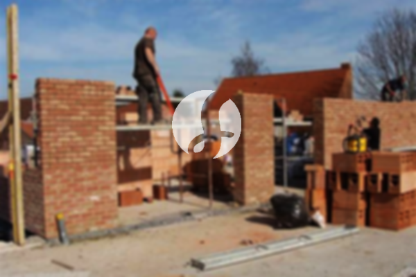

**Biaya Bangun Rumah Per Meter Di Klari Karawang** - Halo Mitra Sumber Material! Bagaimana kabarnya? Kami dari penyedia jasa konstruksi di Klari Karawang ingin berbagi informasi penting bagi Anda yang berencana membangun rumah impian. Seiring perkembangan zaman, layanan bangun bangunan semakin diminati. Bahkan, kini banyak yang mencari jasa desain bangunan sebagai bagian dari layanan tersebut. Hal ini menunjukkan bahwa banyak orang memilih menggunakan jasa bangun rumah profesional untuk memastikan proyek mereka berjalan lancar dan sesuai harapan. Dengan semakin banyaknya kebutuhan akan tempat tinggal, para pelaku properti berlomba-lomba membangun rumah, apartemen, hingga perumahan dengan berbagai kelas, mulai dari ekonomis hingga mewah. Kepercayaan adalah kunci, dan jasa bangun rumah yang terpercaya akan berupaya mempertahankan kepercayaan tersebut dengan menjalankan pekerjaan sesuai amanah. Kami hadir sebagai mitra Anda dalam mewujudkan rumah idaman dengan menawarkan berbagai layanan unggulan. Berikut adalah beberapa jenis layanan yang dapat Anda pilih:



## Jasa Desain Gambar Arsitek Di Klari Karawang

Sebagai penyedia jasa arsitek terpercaya di Klari Karawang, kami sangat memperhatikan desain sebuah rumah. Desain yang baik akan menciptakan keindahan dan kenyamanan hunian Anda. Kami berusaha memunculkan keindahan tersebut melalui komposisi desain yang cantik dan selaras. Desain adalah faktor penting yang perlu diperhatikan, karena tampilan rumah akan sangat dipengaruhi oleh desain yang digunakan.  Jangan khawatir, Kami akan mewujudkan desain yang sesuai dengan budget yang Anda miliki. Dengan desain yang jelas, Anda bisa memperkirakan biaya yang dibutuhkan untuk mewujudkan rumah idaman Anda. Selain itu, desain juga mempertimbangkan pemilihan material yang tepat. Semua ini membutuhkan keahlian dan pengalaman yang mendalam. Itulah mengapa, Anda membutuhkan jasa arsitek profesional. Kami memahami harapan Anda dan akan mewujudkannya menjadi kenyataan.

Biaya jasa desain rumah Kami bervariasi, tergantung pada luas rumah dan kerumitan desain yang diinginkan. Saat ini, tarif jasa desain bangunan minimalis satu lantai adalah Rp 54.000,- per meter. Harga ini sudah termasuk desain, perhitungan RAB, dan dua kali revisi. Untuk rumah dua lantai atau lebih, biayanya hanya dikalikan 2 atau 3 sesuai dengan jumlah lantai.

## Harga Borong Renovasi Bangunan Di Klari Karawang

Seiring bertambahnya populasi, kebutuhan akan tempat tinggal semakin meningkat. Banyak penyedia jasa bangun rumah bermunculan, menawarkan produk dan layanan terbaik untuk menarik perhatian calon pembeli. Di sinilah peran utama jasa bangun rumah dalam menangani masalah pembuatan rumah. Kami akan membantu Anda menemukan solusi yang sesuai dengan harapan Anda. Memiliki rumah yang cantik adalah impian semua orang. Dengan memanfaatkan layanan bangun rumah Kami, Anda akan terbantu mewujudkan impian tersebut. Anda tidak perlu khawatir mendesain rumah sendiri, karena Kami akan memahami keinginan Anda dan mewujudkannya menjadi karya nyata. Hal ini akan memberikan kepuasan bagi Anda dan memperkuat kepercayaan terhadap Kami.

Untuk jasa borong renovasi rumah, Kami menawarkan beberapa tingkatan harga. Harga disesuaikan dengan material bangunan yang digunakan dan lokasi daerah yang akan dibangun. Dengan asumsi lokasi tanah rata, stabil, dan tidak memerlukan pengurugan, harga per meter dengan material dinding hebel adalah Rp 1.950.000,-, sedangkan dengan material bata merah adalah Rp 2.200.000,-. Harga tersebut sudah termasuk pondasi batu gunung, kolom dan tiang beton, lantai keramik standar, serta atap dengan rangka baja ringan dan genteng spandek. Anda juga bisa memilih variasi genteng dan keramik lainnya sesuai dengan model, kualitas, dan budget Anda.

## Jasa Renovasi Bangunan Di Klari Karawang

Selain jasa arsitek dan bangun rumah, Kami juga menyediakan jasa renovasi bangunan di Klari Karawang. Jasa renovasi adalah solusi tepat untuk memberikan tampilan baru pada rumah Anda. Dengan mengandalkan layanan renovasi bangunan Kami, Anda tidak perlu repot memikirkan proses renovasi karena Kami akan melakukan perubahan bentuk tampilan rumah atau renovasi total sesuai kebutuhan Anda. Renovasi bisa menjadi alternatif yang hemat biaya untuk memperbarui tampilan rumah. Namun, seringkali orang kesulitan melakukannya sendiri karena berbagai kendala. Kami hadir sebagai solusi, menawarkan layanan renovasi rumah yang akan membantu Anda memperbarui bangunan agar terlihat lebih segar dan menarik dari sebelumnya. Kami siap mewujudkan rumah impian Anda sesuai dengan keinginan Anda.

Harga borongan jasa renovasi Kami bervariasi, tergantung pada kondisi kerusakan bangunan. Karena setiap bangunan memiliki tingkat kerusakan yang berbeda, Kami akan menyesuaikan biaya renovasi sesuai dengan jenis kerusakan yang akan diperbaiki. Untuk jasa renovasi dengan tenaga tukang harian, tarifnya adalah Rp 150.000,- per hari untuk tukang dan Rp 100.000,- per hari untuk kenek.

## Didukung Tenaga Kerja Dan Arsitek Berpengalaman Di Klari Karawang

Baik jasa arsitek, bangun rumah, maupun renovasi, semuanya memiliki peran penting. Didukung oleh arsitek profesional dan tenaga kerja handal, Kami akan membantu mewujudkan impian Anda. Membangun rumah idaman bersama Kami akan memberikan Anda hunian yang menarik dan berkualitas. Anda tidak perlu khawatir, karena Kami memberikan pelayanan terbaik, menjaga mutu dan kualitas untuk memastikan kepuasan Anda. Kepuasan klien adalah penyemangat Kami untuk terus berkarya dan menghasilkan karya yang lebih baik. Anda dapat melihat katalog proyek Kami untuk melihat hasil karya desain dan konstruksi Kami. Katalog tersebut merupakan bukti bahwa Kami adalah pilihan terbaik dan terpercaya.

Perlu diingat bahwa rumah adalah kebutuhan primer manusia yang sangat penting, sama seperti sandang dan pangan. Rumah menjadi tempat berlindung dari cuaca ekstrem dan berbagai bahaya. Hal ini menjadi peluang bagi penyedia jasa bangun rumah untuk menawarkan jasanya. Sebagai penyedia jasa terkhusus pada jasa bangun rumah, Kami berpartisipasi dalam memajukan dunia arsitektur dengan menawarkan jasa melalui berbagai media, baik cetak maupun online. Ini tentu saja membantu banyak orang mewujudkan rumah impian mereka. Dengan menjaga mutu dan kualitas terbaik, Kami telah terbukti memiliki pengalaman yang cukup lama di dunia arsitektur. Itulah mengapa, banyak orang mempercayai Kami.

Didukung oleh arsitek profesional dan tenaga kerja handal, jasa bangun rumah Kami semakin dikenal dan dapat diandalkan. Ini terlihat dari perkembangan yang terus Kami berikan, dengan menciptakan karya-karya baru yang inovatif dan kreatif. Banyak rumah dan bangunan telah dibangun dengan desain apik dan menarik oleh Kami. Dengan proses pengerjaan yang efisien, Anda akan segera mendapatkan rumah impian Anda. Baik rumah berskala kecil maupun besar, semuanya dapat Kami tangani. Anda tidak perlu khawatir atau cemas karena Kami dapat mengatasi semua kendala, mulai dari desain bangunan, material bahan, ukuran rumah, hingga sumber daya manusia. Itulah peran penting jasa bangun rumah. Karena, Kami akan membuat perencanaan yang matang dan melakukan pengawasan selama pembangunan. [bangun rumah di Banyusari](/bangunan/biaya-bangun-rumah-per-meter-di-banyusari-karawang/) Untuk informasi lebih lanjut mengenai membangun rumah di Banyusari, silakan hubungi Kami. [Hubungi Kami Sekarang](https://api.whatsapp.com/send?phone=6285776786091&text=*Halo%20sumbermaterial.com*%20%3A)
