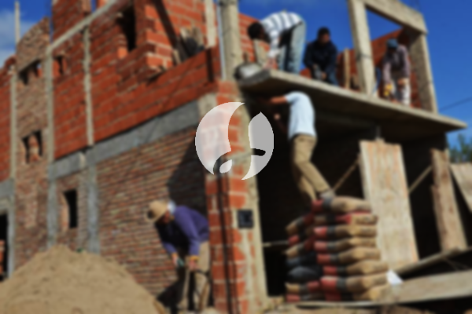

**Biaya Bangun Rumah Per Meter Di Kota Bambu Jakarta** - Mitra Sumber Material hadir untuk membantu Anda mewujudkan rumah impian! Sejalan dengan perkembangan zaman, layanan membangun rumah kini semakin diminati. Banyak yang memilih jasa bangun rumah karena kemudahan dan desain yang ditawarkan. Pertumbuhan populasi otomatis meningkatkan kebutuhan akan tempat tinggal, membuat para kontraktor berlomba-lomba menawarkan layanan berkualitas, mulai dari rumah sederhana hingga mewah. Kepercayaan pelanggan menjadi kunci utama bagi penyedia jasa bangun rumah untuk menjaga reputasi dan memberikan yang terbaik. Nah, Kami akan menguraikan beberapa opsi layanan dari jasa bangun rumah yang dapat Anda pertimbangkan:



## Harga Jasa Desain Gambar Arsitek Di Kota Bambu Jakarta

Sebagai penyedia jasa desain, Kami akan mengamati dengan cermat desain rumah yang Anda inginkan. Tujuan Kami adalah menghadirkan keindahan dan fungsionalitas dalam setiap rancangan. Kami memperhitungkan berbagai faktor penting untuk menciptakan komposisi desain yang harmonis dan sesuai dengan selera Anda. Desain adalah elemen krusial karena menentukan estetika rumah Anda. Dengan desain yang tepat, Anda dapat membayangkan bagaimana rumah impian Anda akan terlihat. Anda tak perlu khawatir soal anggaran, karena Kami menyediakan desain yang sesuai dengan *budget* yang Anda miliki. Dari desain tersebut, Anda dapat memperkirakan biaya yang dibutuhkan untuk mewujudkan rumah yang Anda inginkan. Selain itu, desain juga mempertimbangkan pemilihan bahan bangunan yang tepat. Semua aspek ini cukup rumit, itulah mengapa memilih jasa arsitek profesional adalah langkah yang bijak. Karena, jasa arsitek akan memahami keinginan Anda secara mendalam, sehingga Anda akan merasa puas dengan hasilnya.

Dan untuk harga jasa desain rumah Kami, ada variasi tergantung luas bangunan dan tingkat kesulitan desain. Saat ini, Kami menawarkan harga per meter persegi. Harga jasa desain bangunan minimalis satu lantai adalah Rp 54.000,- per meter persegi, sudah termasuk desain, perhitungan RAB (Rencana Anggaran Biaya), dan 2 kali revisi. Untuk rumah dua lantai atau lebih, harganya cukup dikalikan 2 atau 3 sesuai jumlah lantai.

## Harga Layanan Borong Bangun Tempat Tinggal Di Kota Bambu Jakarta

Seiring dengan pertumbuhan populasi, kebutuhan akan rumah terus meningkat. Banyak penyedia jasa bangun rumah yang menawarkan produk dan layanan terbaik mereka. Di sinilah peran penting dari layanan bangun rumah dalam mengatasi tantangan membangun rumah yang Anda impikan. Dengan layanan Kami, Anda akan mendapatkan solusi yang sesuai dengan kebutuhan dan keinginan Anda. Memiliki rumah yang indah adalah impian setiap orang. Dengan menggunakan jasa bangun rumah Kami, Anda akan terbantu mewujudkan impian tersebut. Anda tidak perlu repot mendesain rumah sendiri, karena Kami akan berusaha memahami keinginan Anda dan menerjemahkannya menjadi karya nyata. Kepuasan Anda adalah prioritas Kami, dan itu menjadi motivasi Kami untuk terus memberikan yang terbaik.

Untuk harga layanan borong bangun rumah Kami, terdapat beberapa tingkatan harga yang disesuaikan dengan jenis material bangunan dan lokasi pembangunan. Dengan asumsi area tanah dalam keadaan rata, stabil, dan tidak memerlukan pengurugan, harga per meter persegi dengan material dinding hebel adalah Rp 1.950.000,-, sedangkan dengan material bata merah adalah Rp 2.200.000,-. Harga ini sudah termasuk pondasi batu sungai, kolom dan tiang beton, lantai keramik standar, dan atap rangka baja ringan dengan genteng spandek. Anda tetap bisa memilih variasi genteng dan keramik sesuai preferensi, model, kualitas, dan harga yang Anda inginkan.

## Ongkos Perbaikan Bangunan Di Kota Bambu Jakarta

Selain layanan desain dan borong bangun rumah, Kami juga menyediakan jasa renovasi rumah di Kota Bambu Jakarta. Renovasi adalah cara yang efektif untuk menyegarkan tampilan rumah Anda. Dengan kehadiran jasa renovasi bangunan, Anda tidak perlu khawatir menghadapi proses renovasi yang rumit. Renovasi yang Kami lakukan dapat berupa perubahan bentuk model bangunan, renovasi total, maupun perbaikan kerusakan ringan. Renovasi memang bisa menjadi solusi untuk mempercantik rumah dengan biaya yang relatif terjangkau, namun seringkali terasa sulit untuk dilakukan sendiri. Namun, dengan adanya jasa renovasi rumah, semua itu dapat diatasi. Kami hadir sebagai partner Anda dalam merenovasi rumah menjadi lebih bagus dan indah dari sebelumnya. Kami siap mewujudkan impian Anda untuk memiliki rumah yang lebih nyaman dan menarik.

Untuk biaya borongan jasa renovasi rumah Kami, harganya bervariasi tergantung kondisi kerusakan bangunan. Karena setiap rumah memiliki tingkat kerusakan yang berbeda-beda, penyesuaian harga diperlukan. Untuk biaya jasa renovasi dengan tenaga tukang harian, tarifnya adalah Rp 150.000,- per hari untuk tukang dan Rp 100.000,- per hari untuk kenek.

## Disupport Tenaga Kerja Dan Arsitek Terbaik Di Kota Bambu Jakarta

Baik itu layanan desain, borong bangun rumah, maupun renovasi, semuanya memiliki peran yang sangat penting. Didukung oleh arsitek profesional dan tenaga kerja yang handal, Kami siap membantu mewujudkan impian Anda. Dengan membangun rumah idaman bersama Kami, Anda akan memiliki tempat tinggal yang menarik dan indah. Anda tidak perlu khawatir, karena Kami berkomitmen untuk memberikan pelayanan terbaik, menjaga kualitas, dan memberikan kepuasan kepada Anda. Sebagai penyedia jasa bangun rumah, kepuasan Anda menjadi motivasi Kami untuk terus berkarya dan menghasilkan karya yang lebih baik. Anda dapat melihat katalog proyek-proyek Kami sebelumnya untuk membuktikan kualitas dan keandalan Kami. Kami telah menyelesaikan banyak proyek pembangunan rumah di Kota Bambu Jakarta dan sekitarnya.

Penting untuk diingat bahwa rumah adalah kebutuhan pokok manusia yang sangat penting, selain sandang dan pangan. Rumah memberikan perlindungan dari cuaca ekstrem dan berbagai bahaya. Hal ini menjadi peluang bagi penyedia jasa bangun rumah untuk menawarkan layanan mereka. Sebagai penyedia jasa terpercaya, Kami berpartisipasi dalam memajukan dunia arsitektur dengan menawarkan layanan Kami melalui berbagai media. Dari media cetak hingga online, Kami memanfaatkan berbagai saluran untuk menjangkau lebih banyak calon pelanggan. Kami yakin dapat membantu Anda mewujudkan rumah impian Anda. Dengan mempertahankan kualitas dan mutu terbaik, Kami telah terbukti memiliki pengalaman yang cukup lama dalam menggeluti dunia arsitektur. Inilah yang membuat Kami semakin dipercaya oleh banyak orang.

Didukung oleh arsitek profesional dan tenaga kerja yang handal, Kami yakin dapat memberikan yang terbaik untuk Anda. Fleksibilitas dan kemampuan Kami dalam beradaptasi dengan berbagai kebutuhan pelanggan membuat Kami semakin dikenal dan diandalkan. Kami terus berinovasi dan menciptakan karya-karya baru yang kreatif dan menarik. Banyak rumah-bangunan indah telah Kami bangun dengan desain yang apik. Proses pengerjaan yang cepat dan efisien memungkinkan Anda untuk segera menikmati rumah impian Anda. Baik itu proyek kecil maupun besar, Kami mampu mengatasinya dengan profesional. Kami menyediakan solusi lengkap, mulai dari desain, bahan bangunan, ukuran rumah, hingga tenaga kerja yang terampil. Dengan demikian, Kami dapat mendukung terwujudnya rumah yang cantik dan nyaman. Di sinilah peran penting Kami sebagai penyedia jasa bangun rumah. Karena, Kami akan menciptakan tata desain yang indah sekaligus mengawasi seluruh proses pembangunan untuk memastikan hasilnya sesuai dengan harapan Anda. [Hubungi Kami Sekarang](https://api.whatsapp.com/send?phone=6285776786091&text=*Halo%20sumbermaterial.com*%20%3A)
