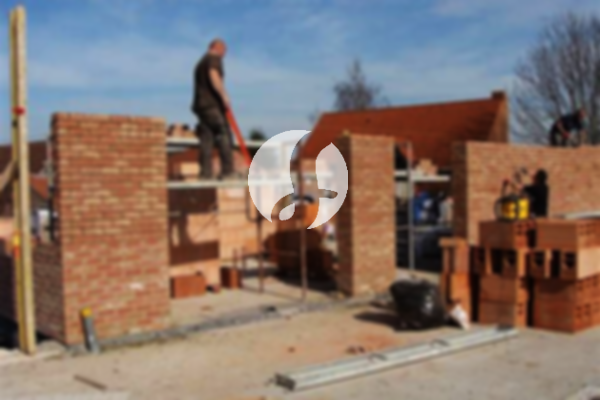

**Biaya Bangun Rumah Per Meter Di Kragilan Serang** - Hai Mitra Sumber Material! Bagaimana kabar Anda semua? Kami dari penyedia layanan pembangunan rumah di Kragilan Serang ingin memperkenalkan diri. Perkembangan zaman telah membuat layanan pembuatan rumah semakin diminati. Bukan hanya layanan konstruksi, tapi juga desain rumah yang semakin berkembang pesat. Hal ini membuat banyak orang lebih memilih jasa bangun rumah untuk mewujudkan hunian impian mereka. Dengan pertumbuhan populasi yang pesat, kebutuhan akan tempat tinggal juga meningkat. Para kontraktor properti berlomba-lomba menawarkan layanan pembangunan, mulai dari rumah sederhana hingga mewah. Kepercayaan konsumen adalah segalanya, dan Kami berkomitmen untuk menjaga kepercayaan tersebut dengan menjalankan pekerjaan sesuai amanah. Oleh karena itu, Kami hadir menawarkan berbagai solusi dalam membangun rumah Anda. Berikut adalah beberapa tipe layanan yang dapat Anda pilih:



## Estimasi Biaya Desain Gambar Arsitektur Di Kragilan Serang

Sebagai penyedia jasa desain, Kami akan mengamati dan merancang desain rumah yang Anda inginkan dengan cermat. Dengan desain yang baik, Kami akan berusaha menampilkan keindahan rumah Anda. Beberapa faktor penting Kami perhatikan untuk menciptakan komposisi desain yang cantik dan harmonis. Seperti yang Anda ketahui, desain adalah elemen krusial dalam membangun rumah impian. Karena desain yang tepat akan membuat rumah Anda terlihat menarik. Anda tidak perlu khawatir, Kami dapat menyesuaikan desain dengan anggaran yang Anda miliki. Dari desain tersebut, Anda dapat memperkirakan biaya yang dibutuhkan untuk mewujudkan rumah impian Anda. Selain itu, desain juga harus mempertimbangkan pemilihan bahan bangunan yang sesuai. Semua proses ini memang cukup kompleks. Itulah mengapa Anda membutuhkan jasa arsitek profesional. Karena arsitek Kami akan memahami keinginan Anda dan mewujudkannya dalam desain yang memuaskan.

Untuk harga jasa desain bangunan, Kami menawarkan tarif yang bervariasi. Harga tergantung pada luas rumah dan kompleksitas desain yang diinginkan. Saat ini, harga jasa desain rumah minimalis satu lantai adalah Rp 54.000,- per meter persegi, sudah termasuk desain, perhitungan RAB, dan 2 kali revisi. Untuk rumah dua lantai atau lebih, biayanya hanya dikalikan 2 atau 3, sesuai dengan jumlah lantai.

## Perkiraan Biaya Borong Bangun Bangunan Di Kragilan Serang

Seiring dengan bertambahnya populasi bumi, kebutuhan akan tempat tinggal juga semakin meningkat. Banyak penyedia jasa bangun rumah menawarkan produk dan layanan terbaik mereka untuk menarik pelanggan. Di sinilah pentingnya peran jasa bangun rumah dalam menangani permasalahan pembangunan. Dengan layanan Kami, Anda akan mendapatkan solusi pembangunan yang sesuai dengan keinginan Anda. Memiliki rumah yang indah adalah impian semua orang. Dengan memanfaatkan jasa bangun rumah, Kami akan membantu Anda mewujudkan impian tersebut. Anda tidak perlu repot mendesain rumah sendiri, karena Kami akan berusaha memahami keinginan Anda dan mewujudkannya dalam bentuk nyata. Kepuasan Anda adalah prioritas Kami, dan hal itu menjadi motivasi Kami untuk terus berkarya lebih baik. Anda dapat melihat portofolio proyek Kami untuk melihat hasil karya Kami.

Untuk harga borong renovasi rumah, Kami menawarkan beberapa tingkatan harga. Harga menyesuaikan dengan material bangunan yang digunakan dan lokasi pembangunan. Dengan asumsi area tanah dalam kondisi rata dan tidak memerlukan pengurukan, harga per meter persegi dengan material dinding hebel adalah Rp 1.950.000,- dan dengan material bata merah adalah Rp 2.200.000,-. Harga tersebut sudah termasuk pondasi batu gunung, kolom dan tiang beton, lantai keramik standar, dan atap dengan rangka baja ringan plus genteng spandek. Untuk genteng dan keramik, Anda dapat memilih jenis, model, dan kualitas lain sesuai keinginan Anda, dengan penyesuaian biaya.

## Jasa Rombak Bangunan Di Kragilan Serang

Selain jasa arsitek dan pembangunan rumah, Kami juga menyediakan jasa renovasi bangunan di Kragilan Serang. Renovasi bangunan adalah cara yang efektif untuk memberikan tampilan baru pada rumah Anda. Dengan layanan renovasi Kami, Anda tidak perlu khawatir memastikan renovasi rumah Anda dilakukan dengan benar. Renovasi yang Kami lakukan dapat berupa perubahan bentuk tampilan bangunan atau perubahan total. Renovasi merupakan solusi tepat untuk meningkatkan keindahan rumah Anda, terutama dengan anggaran yang terbatas. Namun, renovasi seringkali terasa sulit dilakukan sendiri. Itulah mengapa Kami hadir sebagai penyedia jasa renovasi bangunan yang akan membantu Anda merenovasi rumah Anda menjadi lebih segar dan indah. Kami siap mewujudkan impian Anda dalam merenovasi bangunan Anda.

Untuk harga borongan jasa renovasi bangunan, Kami menawarkan harga yang bervariasi. Hal ini karena kondisi kerusakan bangunan yang akan direnovasi juga bervariasi. Biaya borongan renovasi bangunan disesuaikan dengan jenis kerusakan yang akan diperbaiki. Namun, untuk biaya tenaga tukang harian, tarifnya adalah Rp 150.000,- per hari untuk tukang dan Rp 100.000,- per hari untuk kenek.

## Didukung Tenaga Kerja Dan Arsitek Berpengalaman Di Kragilan Serang

Baik jasa arsitek, pembangunan rumah, maupun renovasi bangunan, semuanya memiliki peran yang cukup penting. Dengan didukung oleh arsitek profesional dan tenaga kerja yang handal, Kami akan membantu mewujudkan impian Anda. Dengan membangun rumah idaman bersama Kami, Anda akan memiliki rumah yang menarik dan indah. Anda tidak perlu khawatir, karena Kami berkomitmen untuk memberikan pelayanan terbaik, menjaga kualitas dan mutu, serta memberikan kepuasan kepada Anda. Kepuasan klien adalah motivasi Kami untuk terus berkarya lebih baik. Anda dapat melihat katalog hasil proyek Kami untuk membuktikan bahwa Kami adalah pilihan terbaik dan terpercaya.

Penting untuk diketahui bahwa rumah adalah kebutuhan primer manusia yang sangat penting, selain sandang dan pangan. Rumah menjadi tempat berlindung dari cuaca panas dan dingin serta sebagai penjaga dari berbagai bahaya. Hal ini menjadi peluang bagi penyedia jasa bangun rumah untuk mempresentasikan jasanya. Sebagai penyedia jasa khusus dalam pembangunan rumah di Kragilan Serang, Kami berpartisipasi untuk meramaikan dunia arsitektur dengan mempresentasikan jasa Kami melalui berbagai media. Mulai dari media cetak hingga media online, Kami gunakan untuk memperkenalkan layanan Kami. Hal ini tentu membantu banyak orang yang akan membangun rumah. Dengan menjaga kualitas dan mutu terbaik, Kami telah memiliki pengalaman yang cukup lama dalam menggeluti dunia arsitektur. Inilah alasan mengapa Kami semakin dipercaya oleh banyak orang.

Didukung oleh arsitek profesional dan tenaga kerja yang handal, tentu akan menciptakan layanan Kami semakin dikenal dan terpercaya. Hal ini terlihat dari perkembangan yang terus Kami berikan. Kami selalu berkarya membuat karya-karya baru yang lebih inovatif dan kreatif. Banyak rumah dan bangunan yang Kami bangun dengan desain yang apik dan menarik. Dengan progres pengerjaan yang tidak memakan waktu lama, Anda akan segera mendapatkan rumah impian Anda. Baik rumah berskala kecil maupun besar, semuanya dapat Kami tangani. Sehingga, Anda tidak perlu khawatir atau cemas. Mulai dari desain rumah, material bahan, ukuran rumah, dan SDM, semua dapat Kami atasi dengan layanan bangun rumah Kami. Dengan demikian, Kami dapat mendukung terwujudnya rumah yang cantik dan menarik. Disitulah peran penting dari jasa bangun rumah. Karena Kami tidak hanya mewujudkan tata desain, tetapi juga menjadi pengawas dalam proses pembangunan. [Hubungi Kami Sekarang!](https://api.whatsapp.com/send?phone=6285776786091&text=*Halo%20sumbermaterial.com*%20%3A)
