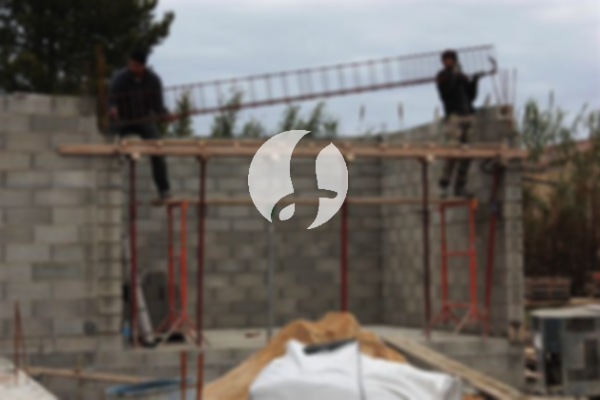

**Biaya Bangun Rumah Per Meter Di KramatPela Jakarta** - Hai Mitra Sumber Material! Gimana kabarnya hari ini? Kami dari Sumber Material hadir untuk memberikan solusi lengkap kebutuhan konstruksi Anda di KramatPela Jakarta. Seiring dengan perkembangan zaman, layanan pembangunan rumah semakin diminati. Jasa bangun rumah terus berkembang dan merambah ke layanan desain bangunan yang lebih beragam. Banyak orang kini lebih memilih menggunakan jasa bangun rumah karena kemudahan dan efisiensinya. Meningkatnya populasi otomatis meningkatkan kebutuhan akan tempat tinggal, sehingga banyak pengembang properti berlomba-lomba membangun rumah dan perumahan dengan berbagai pilihan. Dengan kepercayaan yang diberikan oleh konsumen, penyedia jasa bangun rumah berkomitmen untuk mempertahankan kualitas dan memberikan hasil terbaik. Nah, ada beberapa jenis layanan yang bisa Anda pilih dari jasa bangun rumah, di antaranya:



## Jasa Desain Gambar Arsitektur Di KramatPela Jakarta

Sebagai penyedia jasa desain arsitektur, Kami akan mengamati dan mewujudkan desain rumah impian Anda. Melalui desain yang kami buat, Kami berusaha menampilkan keindahan dan fungsionalitas rumah Anda. Kami memperhitungkan berbagai faktor penting untuk menciptakan komposisi desain yang selaras dan menarik. Desain yang baik sangat penting karena akan mempengaruhi tampilan keseluruhan rumah Anda. Anda tidak perlu khawatir, karena Kami akan menciptakan desain yang sesuai dengan anggaran yang Anda miliki. Dari desain tersebut, Anda dapat mengetahui perkiraan biaya yang dibutuhkan untuk mewujudkan rumah impian Anda. Selain itu, desain juga akan mempertimbangkan pemilihan bahan bangunan yang tepat. Proses ini memang cukup kompleks, itulah mengapa sebaiknya Anda mempercayakan pekerjaan ini kepada ahli arsitek. Mereka akan memahami keinginan Anda dan menerjemahkannya menjadi desain yang memuaskan.

Biaya jasa desain rumah Kami bervariasi tergantung pada luas bangunan dan tingkat kesulitan desain. Saat ini, Kami menawarkan harga jasa desain rumah minimalis satu lantai mulai dari Rp 54.000,- per meter persegi. Harga tersebut sudah termasuk desain, RAB (Rencana Anggaran Biaya), dan 2 kali revisi. Untuk bangunan dua lantai atau lebih, harga hanya dikalikan 2 atau 3 sesuai dengan jumlah lantai.

## Jasa Borong Renovasi Bangunan Di KramatPela Jakarta

Dengan semakin banyaknya orang yang membutuhkan tempat tinggal, jasa bangun rumah menjadi semakin penting. Banyak penyedia jasa menawarkan produk dan layanan terbaik untuk memenuhi kebutuhan pembeli. Di sinilah peran penting jasa bangun rumah dalam menangani permasalahan pembangunan rumah Anda. Dengan mempercayakan pekerjaan kepada Kami, Anda akan mendapatkan layanan yang sesuai dengan harapan Anda. Memiliki rumah yang cantik adalah impian semua orang. Dengan menggunakan jasa bangun rumah, Anda akan terbantu mewujudkan impian tersebut tanpa perlu repot mendesain sendiri. Kami akan berusaha memahami keinginan Anda dan mewujudkannya dalam bentuk rumah impian Anda. Kepuasan Anda adalah prioritas Kami, dan Kami akan selalu berusaha memberikan pelayanan terbaik.

Untuk harga borong renovasi bangunan, Kami menawarkan beberapa tingkatan harga yang disesuaikan dengan bahan bangunan yang digunakan dan lokasi pembangunan. Dengan asumsi area tanah dalam keadaan rata, stabil, dan tidak memerlukan pengurukan, harga per meter persegi dengan material dinding hebel adalah Rp 1.950.000,-, sedangkan dengan material bata merah adalah Rp 2.200.000,-. Harga tersebut mencakup pondasi batu kali, kolom dan tiang beton, lantai keramik standar, serta atap dengan rangka baja ringan dan genteng spandek. Pemilihan jenis genteng dan keramik dapat disesuaikan dengan preferensi Anda, dengan penyesuaian biaya sesuai dengan mutu dan model yang dipilih.

## Jasa Rombak Bangunan Di KramatPela Jakarta

Selain layanan arsitek dan pembangunan rumah baru, Kami juga menyediakan jasa renovasi bangunan di KramatPela Jakarta. Jasa renovasi bangunan adalah solusi yang tepat untuk mengubah tampilan rumah Anda agar terlihat baru kembali. Dengan bantuan jasa renovasi bangunan, Anda tidak perlu khawatir tentang proses renovasi, karena Kami akan menangani semuanya untuk Anda. Renovasi yang Kami lakukan dapat berupa perubahan bentuk model rumah, atau bahkan renovasi total. Renovasi adalah alternatif yang efektif untuk mempercantik rumah Anda tanpa harus mengeluarkan biaya yang terlalu besar. Namun, seringkali orang kesulitan untuk melakukan renovasi sendiri karena keterbatasan anggaran. Di sinilah Kami hadir sebagai solusi, menawarkan jasa renovasi rumah yang terjangkau dan berkualitas. Dengan pengalaman Kami, Kami siap mengubah rumah Anda menjadi lebih indah dan menarik sesuai dengan impian Anda.

Biaya borong renovasi bangunan Kami bervariasi tergantung pada kondisi kerusakan bangunan. Setiap rumah memiliki tingkat kerusakan yang berbeda-beda. Oleh karena itu, biaya borongan renovasi akan disesuaikan dengan jenis kerusakan yang perlu diperbaiki. Untuk tenaga tukang harian, Kami mengenakan biaya Rp 150.000,- per hari untuk tukang dan Rp 100.000,- per hari untuk kenek.

## Didukung Tenaga Kerja Dan Arsitek Terbaik Di KramatPela Jakarta

Baik jasa desain arsitektur, pembangunan rumah baru, maupun renovasi bangunan, semuanya memiliki peran yang sangat penting. Dengan dukungan arsitek profesional dan tenaga kerja yang handal, Kami akan membantu mewujudkan impian Anda. Membangun rumah impian bersama Kami akan memberikan Anda rumah yang menarik dan tentunya nyaman. Anda tidak perlu khawatir, karena Kami akan memberikan pelayanan terbaik, menjaga kualitas dan standar untuk memberikan kepuasan kepada Anda. Sebagai penyedia jasa bangun rumah, kepuasan pelanggan adalah motivasi Kami untuk terus berkarya dan menghasilkan karya yang lebih baik. Anda dapat melihat katalog proyek-proyek Kami sebelumnya untuk melihat hasil karya desain dan konstruksi Kami. Katalog tersebut akan membuktikan bahwa Kami adalah pilihan terbaik dan terpercaya untuk kebutuhan konstruksi Anda di KramatPela Jakarta. [bangun rumah di Bendungan Hilir](/bangunan/biaya-bangun-rumah-per-meter-di-bendungan-hilir-jakarta/)

Perlu diingat bahwa rumah adalah kebutuhan pokok manusia, selain sandang dan pangan. Rumah menjadi tempat berlindung dari cuaca ekstrem dan berbagai bahaya. Hal ini menjadi peluang bagi penyedia jasa bangun rumah untuk mempresentasikan layanan mereka. Kami sebagai penyedia jasa, khususnya jasa bangun rumah, berpartisipasi dalam memajukan dunia arsitektur dengan mempresentasikan layanan Kami melalui berbagai media, mulai dari media cetak hingga online. Hal ini tentu akan membantu orang-orang yang ingin mewujudkan rumah impian mereka. Dengan menjaga kualitas dan standar terbaik, Kami telah memiliki pengalaman yang cukup lama dalam menggeluti dunia arsitektur. Itulah mengapa jasa bangun rumah Kami semakin banyak dipercaya oleh banyak orang.

Didukung oleh arsitek profesional dan tenaga kerja yang handal, tentu saja akan menjadikan layanan bangun rumah Kami semakin dikenal dan terpercaya. Hal ini terlihat dari perkembangan yang terus Kami berikan. Kami terus berkarya mewujudkan karya-karya baru yang inovatif dan kreatif. Banyak rumah-bangunan yang dibangun dengan desain apik dan menarik berkat bantuan Kami. Dengan proses pengerjaan yang efisien, Anda akan segera mendapatkan rumah impian Anda. Baik rumah berskala kecil maupun besar, Kami mampu mengendalikan proyek dengan baik. Anda tidak perlu khawatir tentang hal tersebut. Mulai dari desain rumah, material bahan, ukuran rumah, hingga sumber daya manusia, semuanya dapat Kami atasi dengan layanan bangun rumah Kami. Dengan demikian, Kami dapat mendukung terwujudnya bangunan yang cantik dan menarik. Disinilah peran penting Kami sebagai jasa bangun rumah. Kami akan mewujudkan rancangan Anda dan sekaligus mengawasi proses pembangunan secara keseluruhan. [Hubungi Kami Sekarang](https://api.whatsapp.com/send?phone=6285776786091&text=*Halo%20sumbermaterial.com*%20%3A)
