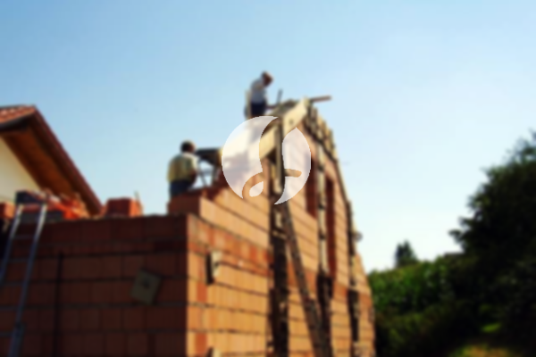

**Biaya Bangun Rumah Per Meter Di Krendang Jakarta** - Hai Mitra Sumber Material! Gimana kabarnya? Kami dari Sumber Material hadir untuk membantu mewujudkan rumah impian Anda di Krendang Jakarta dan sekitarnya. Seiring dengan perkembangan zaman, layanan pembangunan bangunan semakin diminati. Banyak orang kini memilih jasa bangun rumah untuk mendapatkan hasil yang optimal. Peningkatan populasi secara otomatis meningkatkan kebutuhan akan tempat tinggal. Tak heran jika banyak kontraktor properti berlomba-lomba membangun rumah, perumahan, apartemen, dan bangunan lainnya, mulai dari yang standar hingga mewah. Kami memahami betul bahwa kepercayaan konsumen adalah aset berharga. Untuk itu, Kami berupaya memberikan layanan terbaik dan mempertahankan kepercayaan yang telah diberikan. Kami menawarkan berbagai layanan untuk membantu Anda membangun rumah impian Anda. Berikut adalah beberapa tipe layanan yang bisa Anda pilih:



## Biaya Jasa Desain Gambar Arsitek Di Krendang Jakarta

Sebagai penyedia jasa desain arsitektur, Kami sangat memperhatikan tampilan sebuah bangunan. Desain yang baik akan mempercantik rumah Anda. Kami akan berusaha semaksimal mungkin untuk menampilkan keindahan dari rumah tersebut. Dalam proses desain, Kami mempertimbangkan beberapa faktor penting untuk menciptakan komposisi yang cantik dan harmonis. Desain adalah elemen krusial dalam membangun rumah impian. Dengan desain yang tepat, rumah Anda akan terlihat menarik dan sesuai dengan keinginan Anda. Anda tidak perlu khawatir tentang anggaran, karena Kami dapat membuat desain yang sesuai dengan budget yang Anda miliki. Desain yang Kami buat juga akan memberikan gambaran perkiraan biaya yang diperlukan untuk mewujudkan rumah impian Anda. Selain itu, desain juga mempertimbangkan pemilihan material bangunan yang tepat. Semua hal ini memang membutuhkan keahlian khusus. Itulah mengapa Anda perlu memilih jasa arsitek profesional seperti Kami! Kami akan memahami kebutuhan dan keinginan Anda, memastikan Anda merasa puas dengan hasilnya.

Harga jasa desain rumah Kami bervariasi, tergantung pada luas bangunan dan kompleksitas desain yang diinginkan. Saat ini, Kami menawarkan harga per meter. Biaya jasa desain rumah minimalis satu lantai adalah Rp54.000,- per meter, sudah termasuk desain, perhitungan RAB, dan 2 kali revisi. Untuk bangunan 2 lantai atau lebih, harganya hanya dikalikan 2 atau 3 sesuai dengan jumlah lantai.

## Jasa Borong Renovasi Rumah Di Krendang Jakarta

Memiliki rumah yang nyaman adalah impian setiap orang. Banyaknya penyedia jasa bangun rumah di pasaran menawarkan berbagai produk dan layanan terbaik kepada pelanggan mereka. Di sinilah peran penting jasa borong bangun rumah dalam menangani tantangan pembangunan sebuah rumah. Dengan menggunakan jasa Kami, Anda akan mendapatkan layanan yang sesuai dengan kebutuhan Anda. Memiliki rumah yang cantik adalah harapan semua orang. Dengan menggunakan jasa borong bangun rumah, Anda akan Kami bantu mewujudkan impian Anda. Anda tidak perlu repot mendesain rumah sendiri, karena Kami akan berusaha memahami keinginan Anda dan mewujudkannya menjadi karya nyata. Kepuasan Anda adalah prioritas Kami. Itulah yang membuat layanan bangun rumah Kami semakin dipercaya.

Untuk biaya borongan bangun rumah Kami, ada beberapa tingkatan harga yang bisa Anda pilih. Harga menyesuaikan dengan bahan bangunan yang digunakan dan lokasi pembangunan. Dengan syarat lahan yang akan dibangun dalam keadaan rata, stabil, dan tidak memerlukan pengurukan. Harga per meter dengan material dinding hebel adalah Rp1.950.000,-, dan dengan material bata merah adalah Rp2.200.000,-. Harga tersebut sudah termasuk pondasi batu gunung, kolom dan tiang beton, lantai keramik standar, dan atap dengan rangka baja ringan plus genteng spandek. Untuk jenis genteng dan keramik, Anda dapat meminta variasi lain sesuai dengan model, kualitas, dan anggaran yang Anda miliki.

## Harga Perbaikan Bangunan Di Krendang Jakarta

Selain jasa arsitek dan bangun rumah, Kami juga menyediakan jasa renovasi bangunan. Renovasi rumah adalah cara yang efektif untuk memberikan tampilan baru pada rumah Anda. Dengan adanya jasa renovasi rumah, Anda tidak perlu lagi bingung mencari solusi untuk merenovasi rumah Anda. Jasa renovasi rumah Kami dapat melakukan perubahan tampilan rumah Anda secara menyeluruh atau sebagian. Renovasi adalah alternatif yang baik untuk mempercantik rumah Anda dengan budget yang lebih terjangkau. Namun, seringkali orang kesulitan dalam menjalankan renovasi sendiri. Dengan adanya jasa renovasi rumah, semua masalah tersebut bisa Kami atasi. Kami siap membantu Anda merenovasi rumah Anda menjadi lebih bagus dan menarik dari sebelumnya.

Untuk biaya borongan jasa renovasi rumah Kami, harganya bervariasi tergantung kondisi kerusakan bangunan. Harga disesuaikan dengan jenis dan tingkat kerusakan yang akan diperbaiki. Namun, untuk harga jasa renovasi dengan tenaga tukang harian, tarifnya adalah Rp150.000,- per hari untuk tukang dan Rp100.000,- per hari untuk kenek.

## Dukungan Tukang dan Arsitek Terbaik Di Krendang Jakarta

Baik jasa arsitek, bangun rumah, maupun renovasi, semuanya memiliki peran penting. Dengan dukungan arsitek profesional dan tenaga kerja yang handal, Kami dapat membantu mewujudkan impian Anda. Membangun rumah impian bersama Kami akan memberikan Anda rumah yang menarik dan berkualitas. Kami tidak perlu diragukan lagi, karena Kami akan memberikan pelayanan terbaik, menjaga kualitas, dan memberikan kepuasan kepada Anda. Sebagai jasa bangun rumah, kepuasan pelanggan adalah motivasi Kami untuk terus berkarya dan menghasilkan karya-karya yang lebih baik. Anda dapat melihat katalog hasil proyek Kami untuk membuktikan bahwa Kami adalah pilihan terbaik dan terpercaya.

Perlu Anda ketahui bahwa rumah adalah kebutuhan utama manusia, selain sandang dan pangan. Rumah menjadi tempat berlindung dari cuaca ekstrem dan berbagai bahaya. Hal ini menjadi peluang bagi penyedia jasa bangun rumah untuk menawarkan jasanya. Sebagai penyedia jasa, terutama jasa bangun rumah, Kami berpartisipasi dalam meramaikan dunia arsitektur yang sedang berkembang pesat dengan menawarkan layanan melalui berbagai media, mulai dari media cetak hingga online. Ini tentu memudahkan Anda yang ingin membangun rumah. Dengan menjaga kualitas terbaik, Kami telah terbukti memiliki pengalaman yang cukup lama dalam dunia arsitektur. Itulah sebabnya, jasa bangun rumah Kami semakin banyak dipercaya oleh banyak orang. [bangun rumah di Baru](/bangunan/biaya-bangun-rumah-per-meter-di-baru-jakarta/)

Didukung oleh arsitek profesional dan tenaga kerja yang handal, tentu akan menjadikan jasa bangun rumah Kami semakin dikenal dan dipercaya. Hal ini terlihat dari perkembangan yang terus Kami berikan. Kami sering berkarya dan menciptakan karya-karya baru yang inovatif dan kreatif. Banyak rumah dan bangunan yang Kami bangun dengan desain yang apik dan menarik. Dengan proses pengerjaan yang cepat, Anda akan segera memiliki rumah impian Anda. Kami mampu menangani proyek kecil maupun besar dengan baik. Anda tidak perlu khawatir tentang hal itu. Mulai dari desain rumah, material bahan, ukuran bangunan, dan sumber daya manusia, semuanya dapat Kami atasi. Dengan begitu, Kami dapat mendukung terwujudnya bangunan yang cantik dan menarik. Di sinilah peran penting dari jasa bangun rumah. Kami tidak hanya mewujudkan rancangan, tetapi juga mengawasi seluruh proses pembangunan. [Hubungi Kami Sekarang](https://api.whatsapp.com/send?phone=6285776786091&text=*Halo%20sumbermaterial.com*%20%3A)

*

Jangan tunda lagi, wujudkan rumah impian Anda bersama Kami di Krendang Jakarta! Hubungi Kami untuk konsultasi dan penawaran terbaik.
