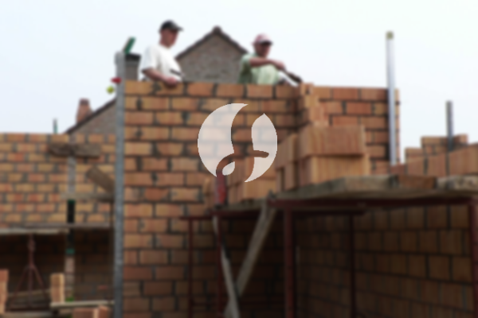

**Biaya Bangun Rumah Per Meter Di Kresek Tangerang** - Hai Mitra Sumber Material! Bagaimana kabar Anda? Kami dari penyedia layanan konstruksi di Kresek Tangerang ingin berbagi informasi penting seputar biaya membangun rumah per meter persegi. Seiring dengan meningkatnya kebutuhan akan tempat tinggal yang nyaman dan berkualitas, jasa bangun rumah semakin populer di kalangan masyarakat. Peningkatan populasi secara signifikan memacu permintaan akan hunian, dan para pengembang properti berlomba-lomba menawarkan berbagai opsi, mulai dari rumah sederhana hingga mewah. Kepercayaan pelanggan adalah kunci utama, sehingga penyedia jasa konstruksi berupaya mempertahankan reputasi yang baik dengan memberikan layanan prima. Kami sebagai penyedia jasa bangun rumah yang terpercaya, menawarkan beragam pilihan layanan untuk mewujudkan rumah impian Anda. Berikut adalah beberapa jenis layanan yang bisa Anda pilih:



## Jasa Desain Gambar Arsitektur Di Kresek Tangerang

Sebagai bagian dari layanan kami, Kami sangat memperhatikan desain sebuah bangunan yang akan dibangun. Dengan desain yang baik, Kami akan berusaha menampilkan keindahan dan fungsi rumah yang optimal. Kami mempertimbangkan berbagai faktor penting untuk menciptakan komposisi desain yang bagus dan harmonis. Seperti yang Anda ketahui, desain merupakan aspek krusial dalam pembangunan rumah karena menentukan tampilan visual dan estetika hunian Anda. Kami akan menciptakan desain yang sesuai dengan budget yang Anda miliki, sehingga Anda dapat mengetahui perkiraan biaya yang diperlukan untuk mewujudkan desain impian Anda. Selain itu, desain yang Kami buat juga mempertimbangkan pemilihan material bangunan yang sesuai. Semua proses ini membutuhkan keahlian dan pengalaman, itulah pentingnya memilih jasa arsitek profesional. Kami memahami keinginan Anda dan akan berusaha mewujudkannya dalam desain yang memuaskan.

Namun, biaya jasa desain bangunan Kami bervariasi tergantung pada luas bangunan dan tingkat kerumitan desain yang diinginkan. Untuk saat ini, Kami memberikan harga jasa desain rumah minimalis satu lantai sebesar Rp 54.000,- per meter persegi, termasuk desain, data RAB (Rencana Anggaran Biaya), dan dua kali revisi. Untuk rumah dua lantai atau lebih, biaya dapat dikalikan 2 atau 3 sesuai dengan jumlah lantai.

## Jasa Borong Renovasi Bangunan Di Kresek Tangerang

Seperti yang kita ketahui, kebutuhan akan rumah adalah kebutuhan mendasar manusia. Semakin banyak orang, semakin besar pula kebutuhan akan hunian. Banyaknya penyedia jasa bangun rumah memberikan pilihan terbaik bagi konsumen. Disinilah peran penting dari layanan bangun rumah dalam menangani tantangan pembangunan hunian. Dengan memilih layanan bangun rumah, Anda akan mendapatkan solusi yang sesuai dengan keinginan Anda. Memiliki rumah yang indah adalah impian setiap orang. Dengan memanfaatkan jasa bangun rumah, Kami akan membantu Anda mewujudkan impian tersebut. Anda tidak perlu repot mendesain rumah sendiri karena Kami akan berusaha memahami keinginan Anda dan mewujudkannya dalam karya nyata. Kepuasan Anda adalah prioritas Kami dan menjadi motivasi untuk terus memberikan layanan terbaik.

Untuk biaya jasa borong pembangunan rumah, Kami menawarkan beberapa tingkatan harga yang disesuaikan dengan kualitas material bangunan dan lokasi pembangunan. Dengan asumsi area tanah dalam kondisi rata, stabil, dan tidak memerlukan pengurugan, harga per meter persegi dengan material dinding hebel adalah Rp 1.950.000,-, sedangkan dengan material bata merah adalah Rp 2.200.000,-. Harga tersebut sudah termasuk pondasi batu gunung, kolom dan tiang beton, lantai keramik standar, serta atap dengan rangka baja ringan dan genteng spandek. Anda juga memiliki fleksibilitas untuk memilih jenis genteng dan keramik lain sesuai preferensi Anda, dengan penyesuaian biaya yang sesuai.

## Jasa Rombak Tempat Tinggal Di Kresek Tangerang

Selain layanan desain dan pembangunan rumah baru, Kami juga menyediakan jasa renovasi bangunan. Jasa renovasi rumah adalah solusi tepat untuk mengubah tampilan rumah agar terlihat baru dan segar. Dengan adanya jasa renovasi, Anda tidak perlu khawatir mencari tukang atau mengatur proses renovasi sendiri. Kami menawarkan renovasi dengan teknik perubahan model rumah secara parsial maupun total. Renovasi dapat menjadi alternatif hemat biaya untuk meningkatkan estetika bangunan Anda. Akan tetapi, biaya renovasi seringkali menjadi kendala bagi banyak orang. Namun, dengan adanya jasa renovasi rumah, semua kendala tersebut dapat diatasi. Kami hadir sebagai solusi renovasi rumah yang akan membantu Anda mewujudkan rumah impian yang lebih indah dan nyaman.

Untuk harga jasa renovasi, Kami memberikan penyesuaian harga berdasarkan kondisi kerusakan bangunan yang akan direnovasi. Setiap bangunan memiliki tingkat kerusakan yang berbeda-beda, sehingga harga disesuaikan dengan jenis kerusakan yang akan diperbaiki. Untuk jasa renovasi tenaga tukang harian, Kami mengenakan biaya Rp 150.000,- per hari untuk tukang dan Rp 100.000,- per hari untuk kenek.

## Didukung Tukang Dan Arsitek Berpengalaman Di Kresek Tangerang

Baik layanan desain, pembangunan rumah baru, maupun renovasi, semuanya memiliki peran penting dalam mewujudkan hunian impian Anda. Dengan dukungan arsitek profesional dan tenaga kerja yang handal, Kami akan membantu Anda mewujudkan impian tersebut. Membangun rumah impian bersama Kami akan memberikan Anda rumah yang menarik dan berkualitas. Anda tidak perlu khawatir karena Kami akan memberikan pelayanan terbaik, menjaga mutu dan kualitas, serta memberikan kepuasan kepada Anda. Sebagai penyedia jasa konstruksi, kepuasan pelanggan adalah prioritas utama Kami dan menjadi motivasi untuk terus berkarya lebih baik. Anda dapat melihat katalog proyek yang telah Kami selesaikan untuk melihat kualitas hasil kerja Kami.

Perlu diketahui, rumah adalah kebutuhan primer manusia yang sangat penting selain sandang dan pangan. Rumah menjadi tempat berlindung dari cuaca dan berbagai bahaya. Hal ini menjadi peluang bagi penyedia jasa bangun rumah untuk menampilkan keahlian mereka. Sebagai penyedia jasa terpercaya di Kresek Tangerang, Kami berpartisipasi dalam kemajuan dunia arsitektur dengan menawarkan layanan Kami melalui berbagai media, baik cetak maupun online. Hal ini memudahkan Anda untuk mewujudkan rumah impian Anda. Dengan menjaga mutu dan kualitas terbaik, Kami telah memiliki pengalaman yang cukup lama dalam menggeluti dunia arsitektur. Inilah yang membuat Kami semakin dipercaya oleh banyak orang.

Didukung oleh arsitek profesional dan tenaga kerja yang terampil, Kami siap mewujudkan jasa bangun rumah yang tidak diragukan lagi kemampuannya. Perkembangan yang berkelanjutan menjadi bukti komitmen Kami untuk memberikan yang terbaik. Banyak rumah dan bangunan yang telah Kami bangun dengan desain yang apik dan menarik. Dengan proses pengerjaan yang efisien, Anda akan segera mendapatkan rumah impian Anda. Baik rumah berskala kecil maupun besar, semuanya dapat Kami tangani dengan baik. Jadi, Anda tidak perlu khawatir atau cemas. Mulai dari desain rumah, pemilihan material, penentuan ukuran, hingga pengawasan pembangunan, semuanya menjadi tanggung jawab Kami. Sehingga, Kami dapat mendukung terwujudnya bangunan yang cantik dan menarik. Disitulah peran penting dari jasa bangun rumah. Karena, Kami akan mewujudkan tata desain yang Anda inginkan, serta mengawasi seluruh proses pembangunan. [Hubungi Kami Sekarang](https://api.whatsapp.com/send?phone=6285776786091&text=*Halo%20sumbermaterial.com*%20%3A)
