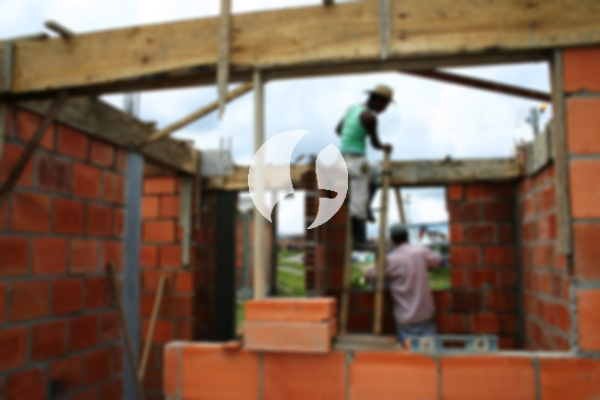

**Biaya Bangun Rumah Per Meter Di Krukut Depok** - Hai Mitra Sumber Material! Bagaimana kabar Anda? Kami dari Sumber Material, penyedia solusi konstruksi terpercaya di Krukut Depok, hadir untuk membantu mewujudkan impian rumah idaman Anda. Seiring dengan perkembangan zaman, layanan pembangunan rumah semakin diminati. Banyak orang kini memilih jasa bangun rumah yang profesional untuk memastikan kualitas dan efisiensi. Peningkatan populasi juga mendorong permintaan akan tempat tinggal, sehingga pengembang properti berlomba-lomba menawarkan berbagai pilihan hunian. Kepercayaan pelanggan adalah prioritas utama kami, dan kami berkomitmen untuk memberikan layanan terbaik serta membangun rumah impian Anda sesuai harapan. Nah, ada beberapa jenis layanan yang bisa Anda pilih dari kami:



## Jasa Desain Gambar Arsitektur Profesional di Krukut Depok

Sebagai penyedia jasa desain arsitektur, kami di Sumber Material akan membantu mewujudkan visualisasi rumah impian Anda. Kami memahami bahwa desain adalah fondasi utama dari sebuah bangunan yang indah dan fungsional. Oleh karena itu, kami akan menciptakan komposisi desain yang selaras dan menarik, dengan mempertimbangkan berbagai faktor penting. Kami tahu betul, desain yang tepat akan membuat rumah Anda tampil cantik dan memukau. Anda tidak perlu khawatir, karena Kami akan membuat desain yang sesuai dengan anggaran yang Anda miliki. Dengan desain yang jelas, Anda dapat mengetahui perkiraan biaya yang dibutuhkan untuk mewujudkan rumah impian Anda. Selain itu, desain juga akan mempertimbangkan pemilihan material bangunan yang tepat. Proses ini memang memerlukan keahlian khusus, itulah mengapa Kami merekomendasikan jasa arsitek profesional. Kami akan memahami keinginan Anda dan mewujudkannya dalam desain yang memuaskan.

Harga jasa desain bangunan dari Kami bervariasi tergantung luas rumah dan tingkat kesulitan desain yang diinginkan. Saat ini, harga jasa desain rumah minimalis satu lantai adalah Rp 54.000,- per meter persegi, termasuk desain, RAB (Rencana Anggaran Biaya) dan 2 kali revisi. Untuk rumah dua lantai atau lebih, harga akan dikalikan 2 atau 3 sesuai dengan jumlah lantai.

## Jasa Borong Renovasi Bangunan Terpercaya di Krukut Depok

Memiliki rumah yang nyaman dan sesuai dengan kebutuhan adalah impian setiap orang. Jika rumah Anda membutuhkan perbaikan atau perubahan, Kami menawarkan jasa borong renovasi bangunan di Krukut Depok. Layanan ini adalah solusi terbaik untuk mengubah tampilan rumah Anda agar terlihat baru dan segar. Kami dapat membantu Anda dalam merombak total atau sebagian rumah Anda, sesuai dengan kebutuhan dan anggaran yang Anda miliki. Renovasi adalah alternatif yang tepat untuk memberikan tampilan baru pada bangunan Anda tanpa harus mengeluarkan biaya yang besar. Namun, proses renovasi ini seringkali terasa sulit bagi pemilik rumah. Disinilah Kami hadir sebagai solusi! Kami menawarkan jasa renovasi bangunan yang akan memudahkan Anda dalam merealisasikan impian memiliki rumah yang lebih baik dan menarik. Kami akan siap mewujudkan keinginan Anda menjadi kenyataan.

Untuk layanan borong renovasi bangunan, Kami menawarkan beberapa pilihan harga yang dapat disesuaikan dengan jenis material yang digunakan dan lokasi pembangunan. Dengan asumsi area tanah dalam kondisi rata, stabil dan tidak perlu pengurukan, harga per meter persegi untuk material dinding hebel adalah Rp 1.950.000,-, sedangkan untuk material bata merah adalah Rp 2.200.000,-. Harga ini sudah termasuk pondasi batu sungai, kolom dan tiang beton, lantai keramik standar, serta atap dengan rangka baja ringan dan genteng spandek. Pemilihan genteng dan keramik dapat disesuaikan dengan preferensi Anda, dengan penyesuaian harga yang sesuai.

## Harga Jasa Rombak Rumah Efisien di Krukut Depok

Selain jasa arsitek dan layanan bangun rumah, Kami juga menyediakan jasa rombak rumah di Krukut Depok. Layanan ini cocok bagi Anda yang ingin memberikan sentuhan baru pada rumah tanpa melakukan pembangunan besar-besaran. Dengan jasa rombak rumah, Anda dapat mengubah tampilan rumah Anda agar terlihat lebih segar dan modern. Kami akan membantu Anda dalam merencanakan dan melaksanakan perubahan yang diinginkan, mulai dari perubahan tata letak hingga penggantian material bangunan. Renovasi rumah terkadang terasa rumit, terutama jika Anda tidak memiliki pengalaman yang cukup. Dengan menggunakan jasa Kami, Anda tidak perlu khawatir. Kami akan memberikan solusi renovasi yang tepat dan efisien, sesuai dengan anggaran yang Anda miliki. Sebagai penyedia jasa renovasi rumah terpercaya, Kami siap membantu Anda mewujudkan rumah impian Anda.

Untuk estimasi biaya jasa renovasi rumah, Kami menawarkan harga yang fleksibel karena setiap rumah memiliki kondisi kerusakan yang berbeda-beda. Harga akan disesuaikan dengan jenis kerusakan dan material yang digunakan. Namun, sebagai gambaran, untuk biaya jasa tenaga tukang harian adalah Rp 150.000,- per hari untuk tukang dan Rp 100.000,- per hari untuk kenek.

## Dukungan Tukang dan Arsitek Terbaik di Krukut Depok

Kualitas jasa arsitek, layanan bangun rumah, dan jasa renovasi rumah sangat bergantung pada dukungan tim yang profesional. Di Sumber Material, Kami memiliki tim arsitek yang berpengalaman dan tenaga kerja yang handal. Dengan dukungan tim yang solid, Kami dapat membantu mewujudkan impian Anda memiliki rumah yang menarik dan berkualitas. Kami berkomitmen untuk memberikan layanan terbaik, menjaga mutu dan kualitas pekerjaan, serta memberikan kepuasan kepada pelanggan. Kepuasan Anda adalah motivasi utama Kami untuk terus berkarya dan menghasilkan karya-karya yang lebih baik lagi. Anda dapat melihat portofolio proyek-proyek Kami untuk membuktikan bahwa Kami adalah pilihan terbaik dan terpercaya.

Rumah adalah kebutuhan dasar manusia yang sangat penting, selain sandang dan pangan. Rumah menjadi tempat berlindung dari cuaca ekstrem dan berbagai bahaya. Hal ini menjadi peluang bagi penyedia jasa bangun rumah untuk menawarkan solusi terbaik bagi Anda. Sebagai penyedia jasa terkhusus dalam membangun rumah, Kami berpartisipasi aktif dalam memajukan dunia arsitektur dengan menawarkan layanan melalui berbagai media, baik cetak maupun online. Hal ini memudahkan Anda dalam mewujudkan rumah impian Anda. Dengan mempertahankan mutu dan kualitas unggulan, Kami telah memiliki pengalaman yang cukup lama dalam dunia arsitektur. Itulah mengapa, semakin banyak orang mempercayai Kami.

Dengan dukungan arsitek profesional dan tenaga kerja yang terlatih, Kami akan mewujudkan jasa bangun rumah yang semakin dikenal dan terpercaya. Perkembangan yang berkelanjutan adalah bukti komitmen Kami untuk terus berinovasi dan memberikan karya-karya terbaik. Banyak bangunan indah dan menarik telah berhasil Kami bangun, berkat dedikasi dan kreativitas tim Kami. Proses pengerjaan yang cepat dan efisien akan memastikan Anda dapat segera menikmati rumah impian Anda. Baik rumah skala kecil maupun besar, semuanya dapat Kami tangani dengan baik. Kami akan membantu Anda dalam perencanaan, pemilihan material, penentuan ukuran bangunan, dan pengawasan pelaksanaan proyek. Sehingga, Anda dapat mewujudkan rumah yang cantik, nyaman, dan sesuai dengan keinginan Anda. Disitulah peran penting dari Sumber Material sebagai mitra terpercaya Anda dalam membangun rumah impian. [Hubungi Kami Sekarang](https://api.whatsapp.com/send?phone=6285776786091&text=*Halo%20sumbermaterial.com*%20%3A) untuk konsultasi dan penawaran harga terbaik! Anda juga bisa mengeksplorasi lebih lanjut tentang jasa Kami di  [bangun rumah di Bojong Pondok](/bangunan/biaya-bangun-rumah-per-meter-di-bojong-pondok-terong-depok/) atau [bangun rumah di Beji](/bangunan/biaya-bangun-rumah-per-meter-di-beji-depok/).
