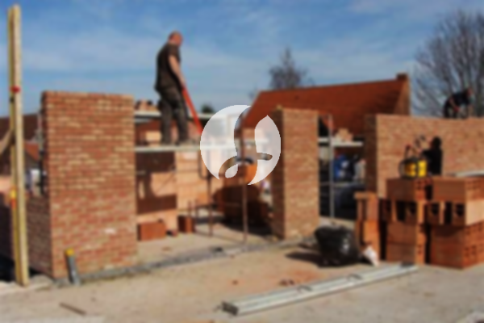

**Biaya Bangun Rumah Per Meter Di Krukut Jakarta** - Hai Mitra Sumber Material! Gimana kabarnya? Kami dari Sumber Material hadir untuk membantu Anda merencanakan dan mewujudkan rumah impian di Krukut Jakarta. Perkembangan dunia konstruksi semakin pesat, menawarkan beragam layanan bangun rumah yang memudahkan. Semakin banyak pilihan yang tersedia, semakin penting untuk menemukan mitra yang terpercaya. Dengan peningkatan jumlah populasi, kebutuhan akan tempat tinggal pun terus bertambah. Para pengembang properti berlomba-lomba menghadirkan berbagai opsi, mulai dari rumah sederhana hingga mewah. Kepercayaan konsumen menjadi kunci utama bagi layanan bangun rumah untuk menjaga kualitas dan memenuhi harapan. Kami, sebagai penyedia layanan yang andal, berkomitmen untuk memberikan penawaran terbaik dalam membangun rumah impian Anda. Berikut adalah beberapa tipe layanan yang dapat Anda pilih:



## Jasa Desain Gambar Arsitek Profesional Di Krukut Jakarta

Sebagai penyedia jasa desain arsitek, kami akan membantu mewujudkan konsep rumah impian Anda. Kami akan mengolah desain yang tidak hanya indah secara visual, tetapi juga fungsional dan sesuai dengan kebutuhan Anda. Dengan memahami pentingnya desain dalam menciptakan rumah yang nyaman dan menarik, kami akan memanfaatkan beragam faktor penting untuk menghasilkan komposisi desain yang harmonis. Desain yang baik adalah fondasi utama dari sebuah rumah yang estetis. Anda tidak perlu khawatir, karena kami akan menyesuaikan desain dengan anggaran yang Anda miliki. Melalui desain yang kami buat, Anda dapat memperkirakan biaya yang dibutuhkan untuk mewujudkan rumah impian Anda. Selain itu, desain juga akan mempertimbangkan pemilihan material bangunan yang tepat. Kami memahami bahwa semua ini membutuhkan keahlian khusus, sehingga kami menyediakan jasa arsitek profesional yang akan memahami keinginan Anda dan mewujudkannya menjadi kenyataan.

Biaya jasa desain rumah dari kami bervariasi, tergantung pada luas bangunan dan tingkat kesulitan desain yang diinginkan. Saat ini, kami menetapkan harga minimal Rp 54.000,- per meter untuk desain rumah minimalis satu lantai. Harga tersebut sudah termasuk desain, perhitungan RAB (Rencana Anggaran Biaya), dan 2 kali revisi. Sedangkan untuk bangunan 2 lantai atau lebih, harganya bisa dikalikan 2 atau 3 sesuai dengan jumlah lantai.

## Jasa Borong Renovasi Bangunan Terpercaya Di Krukut Jakarta

Di Krukut Jakarta, kebutuhan akan renovasi rumah juga semakin meningkat. Renovasi adalah cara efektif untuk memberikan tampilan baru pada hunian Anda tanpa harus membangun dari awal. Kami hadir untuk membantu Anda mewujudkan impian renovasi rumah yang sesuai dengan anggaran dan selera Anda. Kami melakukan renovasi dengan berbagai pendekatan, mulai dari perubahan minor pada model rumah hingga renovasi total menyeluruh. Renovasi memang solusi tepat untuk meningkatkan nilai estetika rumah, namun seringkali terkendala oleh keterbatasan biaya. Dengan layanan renovasi rumah dari Kami, semua masalah tersebut dapat diatasi. Kami siap membantu Anda merealisasikan renovasi impian Anda dengan hasil yang memuaskan.

Harga jasa borong bangun rumah dari Kami bervariasi, tergantung pada material bangunan yang digunakan dan lokasi wilayah pembangunan. Dengan syarat lokasi tanah yang akan dibangun dalam kondisi rata, stabil, dan tidak memerlukan pengurukan. Harga per meter dengan material dinding hebel adalah Rp 1.950.000,-, sedangkan dengan material bata merah per meternya Rp 2.200.000,-. Harga tersebut mencakup pondasi batu sungai, kolom dan tiang beton, lantai keramik standar, serta atap dengan rangka baja ringan plus genteng spandek. Untuk pemilihan genteng dan keramik, Anda dapat memilih tipe, model, kualitas, dan anggaran yang sesuai dengan preferensi Anda.

## Layanan Perbaikan Rumah Berkualitas Di Krukut Jakarta

Selain jasa arsitek dan bangun rumah, Kami juga menyediakan layanan perbaikan rumah. Jasa renovasi rumah adalah solusi tepat untuk memperbaiki kerusakan pada bangunan Anda. Dengan kehadiran layanan renovasi rumah, Anda tidak perlu khawatir, karena Kami akan membantu Anda memperbaiki kerusakan tersebut dengan cepat dan efisien. Renovasi yang Kami lakukan dapat berupa perubahan bentuk model rumah atau perbaikan menyeluruh. Renovasi memang merupakan opsi tepat untuk meningkatkan kualitas dan tampilan rumah Anda. Namun, dengan anggaran terbatas, seringkali sulit untuk melakukan renovasi secara mandiri. Dengan layanan renovasi rumah dari Kami, semua kendala tersebut dapat teratasi. Kami hadir sebagai penyedia jasa renovasi bangunan yang akan memudahkan Anda memperbaiki rumah menjadi lebih segar dan menarik. Kami siap membantu Anda mewujudkan rumah impian Anda.

Untuk harga borongan jasa renovasi bangunan dari Kami, penentuan harga dilakukan secara fleksibel, tergantung pada kondisi kerusakan bangunan yang akan diperbaiki. Namun, untuk harga jasa renovasi dengan tenaga tukang harian, tarifnya adalah Rp 150.000,- per hari untuk tukang dan Rp 100.000,- per hari untuk kenek.

## Dukungan Tim Profesional: Tukang dan Arsitek Berpengalaman Di Krukut Jakarta

Baik jasa arsitek, jasa bangun rumah, maupun jasa renovasi bangunan, semuanya memiliki peran penting. Didukung oleh arsitek profesional dan tenaga kerja yang handal, Kami akan membantu mewujudkan impian Anda. Dengan membangun rumah idaman bersama Kami, Anda akan mendapatkan rumah yang menarik dan indah. Kami memberikan pelayanan terbaik, menjaga mutu dan kualitas untuk memberikan kepuasan kepada Anda. Kepuasan pelanggan adalah motivasi utama Kami untuk terus berkarya dan memberikan yang terbaik. Anda dapat melihat portofolio proyek Kami untuk membuktikan kualitas dan dedikasi Kami.

Ingatlah bahwa rumah adalah kebutuhan primer yang sangat penting bagi manusia, selain sandang dan pangan. Rumah menjadi tempat berlindung dari cuaca ekstrem dan berbagai bahaya. Hal ini menjadi peluang bagi penyedia jasa bangun rumah untuk menawarkan layanan terbaik mereka. Sebagai penyedia jasa terkhusus dalam membangun rumah di Krukut Jakarta, Kami berpartisipasi aktif dalam memajukan dunia arsitektur dengan menawarkan jasa melalui berbagai media, baik cetak maupun online. Hal ini memudahkan Anda dalam mewujudkan rumah impian Anda. Dengan menjaga mutu dan kualitas terbaik, Kami telah terbukti memiliki pengalaman yang cukup lama dalam menggeluti dunia arsitektur. Itulah mengapa Kami semakin dipercaya oleh banyak orang. [bangun rumah di Bambu Apus](/bangunan/biaya-bangun-rumah-per-meter-di-bambu-apus-jakarta/)

Didukung oleh arsitek profesional dan tenaga kerja yang handal, Kami akan mewujudkan layanan bangun rumah yang semakin dikenal dan terpercaya. Kami terus berinovasi dan menciptakan karya-karya baru yang lebih kreatif dan menarik. Banyak bangunan-bangunan indah telah Kami bangun dengan desain yang apik. Dengan proses pengerjaan yang efisien, Anda akan segera mendapatkan rumah impian Anda. Baik bangunan berskala kecil maupun besar, semuanya dapat Kami tangani dengan baik. Anda tidak perlu khawatir atau cemas, karena Kami akan membantu Anda dalam setiap langkah. Mulai dari desain rumah, pemilihan material, ukuran bangunan, hingga penyediaan tenaga kerja, semuanya dapat Kami atasi dengan mudah. Kami akan mendukung Anda dalam mewujudkan rumah yang cantik dan menarik. Itulah peran penting Kami sebagai penyedia layanan bangun rumah yang terpercaya di Krukut Jakarta. [Hubungi Kami Sekarang](https://api.whatsapp.com/send?phone=6285776786091&text=*Halo%20sumbermaterial.com*%20%3A) Untuk informasi lebih lanjut dan penawaran terbaik, silakan hubungi Kami.
