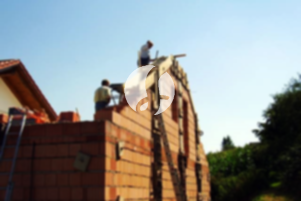

**Biaya Bangun Rumah Per Meter Di Kukusan Depok** - Hai Mitra Sumber Material! Bagaimana kabarnya? Kami dari penyedia solusi konstruksi di Kukusan Depok hadir untuk memberikan informasi penting bagi Anda yang tengah merencanakan pembangunan rumah impian. Seiring dengan perkembangan zaman, jasa bangun rumah semakin diminati karena menawarkan kemudahan dan kepraktisan. Bertambahnya populasi juga memicu kebutuhan akan hunian yang memadai, menjadikan sektor konstruksi semakin kompetitif. Para pengembang properti berlomba-lomba menghadirkan berbagai pilihan hunian untuk memenuhi kebutuhan konsumen. Kami memahami bahwa kepercayaan adalah kunci utama, dan komitmen kami adalah menjaga kepercayaan Anda dengan memberikan layanan terbaik. Layanan bangun rumah yang terpercaya akan menghadirkan berbagai penawaran untuk mewujudkan rumah ideal Anda. Berikut adalah beberapa jenis layanan yang dapat Anda pilih:



## Jasa Desain Gambar Arsitek Profesional Di Kukusan Depok

Sebagai bagian dari layanan kami, kami menyediakan jasa desain gambar arsitek untuk mewujudkan visualisasi rumah impian Anda. Kami akan bekerja sama dengan Anda untuk menciptakan desain yang indah dan fungsional. Jasa bangun rumah kami akan mengamati secara detail desain sebuah rumah yang akan dibangun, memastikan keindahan dan harmoni dalam setiap aspeknya. Beberapa faktor penting diperhatikan dalam menciptakan komposisi desain yang baik. Kami menyadari bahwa desain merupakan elemen krusial dalam membangun rumah impian Anda. Dengan desain yang tepat, rumah akan terlihat menarik dan nyaman dihuni. Anda tidak perlu khawatir tentang anggaran, karena kami akan menyesuaikan desain dengan *budget* yang Anda miliki. Hasil desain ini akan memberikan gambaran perkiraan biaya yang dibutuhkan untuk mewujudkan rumah impian Anda. Selain itu, kami juga mempertimbangkan pemilihan material yang sesuai dengan desain dan anggaran Anda. Proses ini memang membutuhkan ketelitian, oleh karena itu, bekerja sama dengan jasa arsitek profesional adalah pilihan yang tepat. Kami akan memahami harapan Anda dan mewujudkannya dalam sebuah desain yang memuaskan.

Biaya jasa desain rumah kami bervariasi tergantung luas bangunan dan kompleksitas desain yang diinginkan. Untuk saat ini, kami menawarkan harga per meter persegi. Harga jasa desain bangunan minimalis satu lantai adalah Rp 54.000,- per meter, sudah termasuk desain, data RAB (Rencana Anggaran Biaya), dan 2 kali revisi. Untuk rumah dua lantai atau lebih, harga dapat disesuaikan, dimulai dari dikalikan 2 atau dikalikan 3 sesuai jumlah lantai.

## Harga Borongan Bangun Rumah Lengkap Di Kukusan Depok

Memiliki rumah sendiri adalah impian setiap orang, dan kami hadir untuk mewujudkannya. Dengan banyaknya penyedia jasa bangun rumah, Kami menawarkan layanan terbaik untuk konsumen di Kukusan Depok. Kami memahami peran penting dari jasa bangun rumah dalam menangani berbagai permasalahan konstruksi. Dengan memilih layanan kami, Anda akan mendapatkan solusi pembangunan rumah yang sesuai dengan keinginan Anda. Memiliki rumah yang indah adalah impian semua orang, dan dengan bantuan jasa bangun rumah, impian itu akan menjadi kenyataan. Kami akan membantu Anda mendesain rumah impian tanpa perlu khawatir tentang proses desainnya. Tim kami akan berusaha memahami harapan Anda dan mewujudkannya dalam bentuk bangunan nyata yang memuaskan. Kepuasan Anda adalah prioritas utama kami, dan kami akan terus meningkatkan kualitas layanan kami. Melalui katalog proyek-proyek yang telah kami selesaikan, Anda dapat melihat kualitas dan keandalan layanan kami.

Untuk harga borong bangun rumah, kami menawarkan beberapa tingkatan harga yang disesuaikan dengan bahan bangunan yang digunakan dan lokasi pembangunan. Dengan asumsi lokasi tanah dalam kondisi rata, stabil, dan tidak memerlukan pengurukan, harga per meter persegi dengan material dinding hebel adalah Rp 1.950.000,-, sedangkan dengan material bata merah adalah Rp 2.200.000,-. Harga tersebut sudah termasuk pondasi batu gunung, kolom dan tiang beton, lantai keramik standar, serta atap dengan rangka baja ringan dan genteng spandek. Pemilihan genteng dan keramik dapat disesuaikan dengan preferensi Anda, dengan penyesuaian biaya yang sesuai.

## Harga Jasa Renovasi Rumah Terjangkau Di Kukusan Depok

Selain layanan desain dan konstruksi, kami juga menyediakan jasa renovasi rumah untuk memberikan tampilan baru pada hunian Anda. Renovasi rumah adalah cara efektif untuk memperbarui tampilan rumah Anda tanpa harus membangun dari awal. Dengan layanan renovasi rumah kami, Anda tidak perlu khawatir tentang proses renovasi yang rumit. Renovasi yang kami lakukan dapat berupa perubahan model rumah secara keseluruhan atau perbaikan kerusakan pada bagian-bagian tertentu. Renovasi dapat menjadi solusi yang tepat untuk meningkatkan nilai estetika dan fungsionalitas rumah Anda. Namun, biaya renovasi seringkali menjadi kendala bagi banyak orang. Dengan layanan renovasi bangunan dari Kami, Anda dapat mengatasi masalah tersebut. Kami hadir sebagai solusi renovasi bangunan yang terjangkau dan berkualitas, siap membantu Anda mewujudkan rumah impian yang lebih indah dan menarik.

Biaya borongan jasa renovasi rumah kami bervariasi tergantung pada kondisi kerusakan bangunan yang akan diperbaiki. Untuk tenaga tukang harian, kami mengenakan biaya Rp 150.000,- per hari untuk tukang dan Rp 100.000,- per hari untuk kenek.

## Dukungan Tenaga Kerja & Arsitek Terbaik Di Kukusan Depok

Baik layanan arsitek, konstruksi, maupun renovasi, semuanya memiliki peran penting dalam mewujudkan impian Anda. Dengan dukungan tenaga kerja yang handal dan arsitek profesional, kami akan membantu Anda mewujudkan rumah impian Anda. Membangun rumah idaman bersama Kami akan menghasilkan rumah yang menarik, indah, dan berkualitas tinggi. Kami menjamin pelayanan terbaik, menjaga mutu dan kualitas agar Anda merasa puas dengan hasil akhirnya. Kepuasan Anda adalah motivasi kami untuk terus berkarya dan memberikan yang terbaik. Kami memiliki katalog proyek-proyek yang telah kami selesaikan sebagai bukti kualitas dan keandalan layanan kami.

Perlu diingat bahwa rumah adalah kebutuhan pokok manusia, bukan hanya tempat berlindung dari cuaca ekstrem, tetapi juga sebagai tempat untuk merasa aman dan nyaman. Hal ini menjadi peluang bagi penyedia jasa bangun rumah untuk berkontribusi dalam dunia arsitektur yang terus berkembang. Kami telah memanfaatkan berbagai media, mulai dari cetak hingga *online*, untuk memperkenalkan layanan kami dan membantu orang-orang mewujudkan rumah impian mereka. Komitmen kami adalah menjaga mutu dan kualitas terbaik, serta pengalaman yang cukup lama dalam dunia arsitektur menjadikan Kami pilihan yang tepat dan terpercaya. [bangun rumah di Bedahan](/bangunan/biaya-bangun-rumah-per-meter-di-bedahan-depok/)

Dengan dukungan arsitek profesional dan tenaga kerja yang handal, Kami semakin dikenal sebagai penyedia jasa bangun rumah yang terpercaya dan kompeten. Perkembangan yang kami alami merupakan bukti dari dedikasi kami dalam menciptakan karya-karya inovatif dan kreatif. Banyak rumah dan bangunan yang telah kami bangun dengan desain yang apik dan menarik. Proses pengerjaan kami cepat dan efisien, sehingga Anda dapat segera menikmati rumah impian Anda. Kami memiliki kemampuan untuk menangani proyek pembangunan rumah dengan berbagai skala, baik kecil maupun besar. Mulai dari desain rumah, pemilihan material, ukuran bangunan, hingga sumber daya manusia, semuanya dapat kami atasi dengan baik. Kami akan menciptakan rancangan yang sesuai dengan keinginan Anda, serta mengawasi seluruh proses pembangunan untuk memastikan kualitasnya terjaga. [Hubungi Kami](https://api.whatsapp.com/send?phone=6285776786091&text=*Halo%20sumbermaterial.com*%20%3A) untuk konsultasi gratis!
