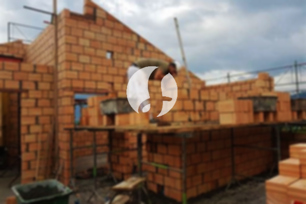

**Biaya Bangun Rumah Per Meter Di Maja Rangkasbitung** - Hai Mitra Sumber Material! Bagaimana kabar Anda semua? Kami dari Sumber Material, penyedia jasa dan material bangunan terpercaya di Maja Rangkasbitung, ingin berbagi informasi penting bagi Anda yang berencana membangun rumah. Di era modern ini, layanan bangun rumah semakin diminati seiring dengan perkembangan desain rumah yang inovatif. Banyak orang kini lebih memilih menggunakan jasa bangun rumah profesional demi kualitas dan efisiensi waktu. Dengan pertumbuhan populasi yang pesat, kebutuhan akan tempat tinggal juga meningkat. Tak heran jika banyak pengembang properti berlomba-lomba menawarkan berbagai pilihan hunian, dari yang ekonomis hingga mewah. Sebagai penyedia jasa bangun rumah yang terpercaya, Kami selalu berusaha mempertahankan kepercayaan pelanggan dengan memberikan layanan terbaik dan hasil yang memuaskan. Nah, apa saja layanan yang Kami tawarkan untuk mewujudkan rumah impian Anda di Maja Rangkasbitung? Mari kita simak lebih lanjut!



## Jasa Desain Gambar Arsitek Di Maja Rangkasbitung

Sebagai mitra Anda dalam membangun rumah, Kami menyediakan jasa desain gambar arsitek profesional. Desain yang baik adalah fondasi utama sebuah rumah impian. Kami akan membantu mewujudkan konsep rumah yang Anda inginkan, dengan mempertimbangkan keindahan, fungsionalitas, dan tentu saja, anggaran Anda. Dengan desain yang tepat, rumah Anda akan terlihat menarik dan harmonis. Anda tidak perlu khawatir, karena Kami akan menyesuaikan desain dengan budget yang Anda miliki. Desain ini juga akan menjadi acuan anggaran biaya yang jelas untuk mewujudkan rumah impian Anda. Selain itu, desain yang Kami buat juga akan mempertimbangkan pemilihan material bangunan yang tepat. Semua hal ini memang membutuhkan keahlian khusus. Oleh karena itu, Kami sarankan Anda untuk mempercayakan desain rumah Anda kepada ahlinya. Kami akan memahami harapan Anda dan menerjemahkannya menjadi sebuah karya nyata yang memuaskan.

Harga jasa desain rumah Kami bervariasi, tergantung pada luas bangunan dan tingkat kesulitan desain. Saat ini, Kami menawarkan harga jasa desain rumah minimalis satu lantai mulai dari Rp 54.000,- per meter persegi. Harga tersebut sudah termasuk desain, perhitungan RAB (Rencana Anggaran Biaya), dan dua kali revisi. Untuk bangunan dua lantai atau lebih, biayanya hanya dikalikan 2 atau 3 sesuai dengan jumlah lantai.

## Jasa Borong Konstruksi Bangunan Di Maja Rangkasbitung

Mengingat semakin banyaknya orang yang membutuhkan tempat tinggal, Kami hadir sebagai solusi untuk membangun rumah impian Anda di Maja Rangkasbitung. Kami menawarkan layanan borong konstruksi bangunan yang terpercaya dan berkualitas. Dengan pengalaman bertahun-tahun, Kami mampu menangani proyek pembangunan rumah dari berbagai skala dan kompleksitas. Memiliki rumah yang bagus adalah impian setiap orang. Dengan menggunakan jasa borong bangun rumah Kami, Anda akan lebih mudah mewujudkan impian tersebut. Anda tidak perlu lagi repot memikirkan desain atau mencari material bangunan sendiri. Kami akan membantu Anda dari awal hingga akhir proses pembangunan.  Kami selalu berusaha memahami keinginan Anda dan mewujudkannya dalam sebuah karya nyata yang memuaskan.

Untuk biaya borong bangun rumah, Kami menawarkan beberapa pilihan harga yang disesuaikan dengan material bangunan dan lokasi proyek. Dengan syarat lahan dalam keadaan rata, stabil, dan tidak memerlukan pengurugan, harga per meter persegi dengan material dinding hebel adalah Rp 1.950.000,-, sementara dengan material bata merah adalah Rp 2.200.000,-. Harga tersebut sudah termasuk pondasi batu gunung, kolom dan tiang beton, lantai keramik standar, serta atap rangka baja ringan dengan genteng spandek. Anda juga bisa menyesuaikan jenis genteng dan keramik sesuai dengan preferensi Anda, dengan penyesuaian biaya yang sesuai.

## Jasa Renovasi Rumah Di Maja Rangkasbitung

Selain jasa desain dan borong bangun rumah, Kami juga menyediakan jasa renovasi rumah di Maja Rangkasbitung. Renovasi rumah merupakan cara yang efektif untuk memberikan tampilan baru pada hunian Anda. Dengan bantuan jasa renovasi rumah Kami, Anda tidak perlu khawatir tentang proses renovasi yang rumit. Kami akan membantu Anda mengubah tampilan rumah Anda menjadi lebih segar dan modern. Renovasi yang Kami lakukan bisa meliputi perubahan bentuk model rumah, perombakan total, atau perbaikan kerusakan yang ada. Renovasi memang menjadi pilihan untuk meningkatkan nilai estetika rumah Anda dengan budget yang terjangkau. Namun, terkadang orang kesulitan untuk melakukan renovasi sendiri. Di sinilah peran penting jasa renovasi rumah Kami. Kami akan membantu Anda merenovasi rumah Anda menjadi lebih cantik dan sesuai dengan impian Anda.

Harga borongan jasa renovasi rumah Kami bervariasi, tergantung pada kondisi kerusakan rumah dan tingkat kesulitan pekerjaan. Kami akan melakukan survei terlebih dahulu untuk menentukan biaya yang sesuai. Namun, untuk biaya jasa renovasi dengan tenaga tukang harian, harganya adalah Rp 150.000,- per hari untuk tukang batu dan Rp 100.000,- per hari untuk kenek.

## Dukungan Tenaga Kerja dan Arsitek Terbaik Di Maja Rangkasbitung

Kualitas layanan Kami didukung oleh tim arsitek profesional dan tenaga kerja yang handal. Baik layanan desain, borong bangun rumah, maupun renovasi, semuanya membutuhkan peran penting dari keduanya. Dengan tim yang berpengalaman, Kami akan membantu mewujudkan impian Anda memiliki rumah idaman di Maja Rangkasbitung. Kami selalu menjaga mutu dan kualitas pekerjaan demi kepuasan pelanggan. Kepuasan Anda adalah penyemangat Kami untuk terus berkarya dan memberikan yang terbaik. Anda dapat melihat katalog proyek-proyek Kami untuk melihat contoh hasil karya Kami. Hal ini membuktikan bahwa Kami adalah pilihan yang tepat dan terpercaya untuk membangun rumah Anda.

Rumah adalah kebutuhan pokok manusia setelah sandang dan pangan. Rumah menjadi tempat berlindung dari cuaca ekstrem dan berbagai bahaya. Hal ini menjadi peluang bagi penyedia jasa bangun rumah untuk menawarkan layanan mereka. Sebagai penyedia jasa, Kami berpartisipasi dalam memajukan dunia arsitektur dengan menawarkan layanan melalui berbagai media, baik cetak maupun online. Hal ini memudahkan banyak orang untuk membangun rumah impian mereka. Dengan menjaga kualitas dan layanan terbaik, Kami telah terbukti memiliki pengalaman yang cukup lama dalam dunia arsitektur. Inilah yang membuat Kami semakin dipercaya oleh banyak orang.

Dengan dukungan arsitek profesional dan tenaga kerja yang handal, Kami yakin dapat memberikan layanan terbaik untuk Anda. Kami terus berinovasi dan berkreasi dalam setiap proyek yang Kami kerjakan. Kami telah berhasil membangun berbagai bangunan dengan desain yang apik dan menarik. Proses pengerjaan yang cepat dan efisien juga menjadi keunggulan Kami. Baik bangunan kecil maupun besar, Kami dapat mengatasinya dengan baik. Anda tidak perlu khawatir tentang detail apapun, karena Kami akan menangani semuanya mulai dari desain, material, ukuran, hingga tenaga kerja. Inilah peran penting dari Sumber Material dalam mewujudkan rumah impian Anda. Kami akan membantu Anda merencanakan dan mengawasi pembangunan rumah Anda, sehingga Anda dapat memiliki rumah yang cantik, nyaman, dan sesuai dengan impian Anda. [Hubungi Kami Sekarang!](https://api.whatsapp.com/send?phone=6285776786091&text=*Halo%20sumbermaterial.com*%20%3A) Untuk informasi lebih lengkap, Anda juga bisa melihat produk dan layanan yang Kami tawarkan di .
