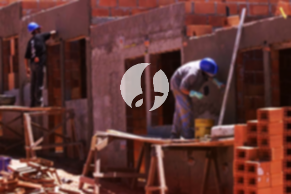

**Biaya Bangun Rumah Per Meter Di Malingping Rangkasbitung** - Halo Mitra Sumber Material! Bagaimana kabar Anda semua? Kami dari Sumber Material hadir sebagai penyedia solusi konstruksi terpercaya di Malingping Rangkasbitung dan sekitarnya. Seiring perkembangan zaman, jasa pembuatan bangunan semakin diminati. Banyak orang kini memilih menggunakan layanan kontraktor profesional untuk memastikan kualitas dan efisiensi pembangunan rumah impian mereka. Semakin meningkatnya kebutuhan akan tempat tinggal yang layak, semakin banyak pula pengembang properti yang berlomba-lomba menawarkan berbagai pilihan hunian, mulai dari yang standar hingga mewah. Kami hadir untuk memberikan layanan terbaik dan memastikan kepercayaan Anda sebagai pelanggan tetap terjaga.



## Jasa Desain Gambar Arsitek Di Malingping Rangkasbitung

Sebagai bagian penting dari proses konstruksi, desain arsitektur memainkan peran krusial dalam menciptakan hunian yang indah dan fungsional. Kami memahami betul pentingnya visualisasi yang baik sebelum pembangunan dimulai. Oleh karena itu, Kami menawarkan jasa desain gambar arsitek yang akan membantu Anda mewujudkan rumah impian sesuai dengan selera dan anggaran Anda. Kami akan mempertimbangkan berbagai faktor penting, seperti tata ruang, estetika, dan kebutuhan spesifik Anda, untuk menghasilkan desain yang optimal.

Kami percaya, desain yang baik adalah fondasi dari rumah yang berkualitas. Dengan desain yang tepat, rumah Anda akan terlihat menarik dan nyaman dihuni. Kami menawarkan layanan desain yang disesuaikan dengan budget Anda, sehingga Anda dapat mengetahui estimasi biaya yang dibutuhkan untuk mewujudkan desain rumah yang Anda inginkan. Selain itu, Kami juga memperhatikan pemilihan material bangunan yang tepat agar sesuai dengan desain dan anggaran Anda. Memilih jasa arsitek yang tepat akan sangat membantu Anda dalam mewujudkan impian memiliki rumah yang ideal.

Saat ini, Kami memberikan harga jasa desain bangunan per meter persegi mulai dari Rp 54.000,- untuk desain rumah minimalis satu lantai, sudah termasuk perhitungan RAB dan 2 kali revisi. Untuk rumah dengan 2 lantai atau lebih, harga desain hanya dikalikan 2 atau 3 sesuai jumlah lantai.

## Layanan Borong Renovasi Bangunan Di Malingping Rangkasbitung

Kebutuhan akan tempat tinggal mendorong banyak orang untuk berinvestasi dalam pembangunan rumah. Kami hadir sebagai mitra terpercaya dalam mewujudkan impian Anda memiliki hunian yang nyaman dan berkualitas. Kami bukan hanya membangun rumah baru, tetapi juga menawarkan layanan borong renovasi bangunan di Malingping Rangkasbitung. Apakah Anda ingin memperbarui tampilan rumah Anda, menambah ruang, atau memperbaiki kerusakan? Kami siap membantu!

Kami memahami bahwa setiap rumah memiliki keunikan dan kebutuhan renovasi yang berbeda-beda. Dengan pengalaman bertahun-tahun, Kami akan memberikan solusi renovasi yang sesuai dengan keinginan dan anggaran Anda. Memiliki rumah yang bagus adalah impian semua orang, dan Kami siap membantu Anda mewujudkannya. Dengan mempercayakan renovasi rumah Anda kepada Kami, Anda tidak perlu khawatir tentang desain, material, atau proses pengerjaan. Kami akan memastikan semuanya berjalan lancar dan sesuai dengan harapan Anda.

Untuk estimasi biaya, Kami menawarkan beberapa tingkatan harga yang disesuaikan dengan material bangunan dan lokasi proyek. Dengan asumsi lokasi tanah datar dan stabil (tidak memerlukan pengurukan), harga borongan renovasi dengan material dinding hebel adalah Rp 1.950.000,- per meter persegi, sedangkan dengan material bata merah adalah Rp 2.200.000,- per meter persegi. Harga tersebut sudah termasuk pondasi batu sungai, kolom dan tiang beton, lantai keramik standar, serta atap rangka baja ringan dengan genteng spandek. Anda juga bisa memilih variasi genteng dan keramik lainnya sesuai selera, dengan penyesuaian biaya.

## Harga Layanan Renovasi Rumah Di Malingping Rangkasbitung

Selain layanan desain dan pembangunan rumah baru, Kami juga menyediakan jasa renovasi rumah dengan harga yang kompetitif. Renovasi rumah adalah solusi yang tepat untuk memberikan tampilan baru pada hunian Anda tanpa harus membangun dari awal. Dengan layanan renovasi Kami, Anda dapat mengubah tampilan rumah Anda menjadi lebih segar dan modern.

Kami memahami bahwa biaya renovasi seringkali menjadi pertimbangan utama. Oleh karena itu, Kami menawarkan berbagai pilihan paket renovasi yang sesuai dengan anggaran Anda. Kami akan membantu Anda merencanakan renovasi yang efisien dan efektif, sehingga Anda dapat memaksimalkan investasi Anda. Kami melayani berbagai jenis renovasi, mulai dari renovasi ringan seperti pengecatan dan penggantian keramik, hingga renovasi total yang meliputi perubahan struktur bangunan. Dengan bantuan tim ahli Kami, Anda tidak perlu khawatir tentang kualitas dan keamanan renovasi Anda.

Harga jasa renovasi rumah Kami bervariasi tergantung pada tingkat kerusakan dan jenis pekerjaan yang dibutuhkan. Untuk tenaga tukang harian, Kami mengenakan biaya Rp 150.000,- per hari untuk tukang dan Rp 100.000,- per hari untuk kenek.

## Disupport Tukang Dan Arsitek Terbaik Di Malingping Rangkasbitung

Keberhasilan sebuah proyek konstruksi sangat bergantung pada kualitas tenaga kerja dan desain yang baik. Kami sangat bangga dapat mendampingi Anda dengan tim arsitek profesional dan tukang bangunan berpengalaman di Malingping Rangkasbitung. Baik Anda membutuhkan jasa desain arsitek, pembangunan rumah baru, atau renovasi, Kami akan memberikan layanan terbaik untuk mewujudkan impian Anda.

Kami berkomitmen untuk menjaga kualitas dan mutu pekerjaan agar sesuai dengan harapan Anda. Kami percaya bahwa kepuasan pelanggan adalah kunci utama kesuksesan bisnis Kami. Kami selalu berusaha untuk memberikan pelayanan terbaik dan menciptakan karya-karya yang inovatif dan kreatif. Anda dapat melihat portofolio proyek-proyek Kami sebelumnya untuk melihat contoh hasil kerja Kami. Kami yakin Anda akan terkesan dengan kualitas dan estetika bangunan yang Kami hasilkan.

Ingatlah, rumah adalah kebutuhan dasar manusia yang sangat penting. Kami hadir untuk membantu Anda mewujudkan impian memiliki rumah yang nyaman, aman, dan indah. Kami memanfaatkan berbagai media, baik cetak maupun online, untuk mempromosikan layanan Kami dan menjangkau lebih banyak pelanggan. Dengan pengalaman yang cukup lama di dunia arsitektur, Kami telah terbukti menjadi mitra terpercaya dalam mewujudkan bangunan impian Anda.

Didukung oleh tim arsitek profesional dan tukang bangunan yang handal, Kami dapat memberikan solusi konstruksi yang komprehensif. Kami terus berinovasi dan mengembangkan karya-karya baru yang lebih kreatif. Baik rumah berskala kecil maupun besar, Kami siap menghadapinya. Kami akan membantu Anda dalam perencanaan, desain, pemilihan material, dan pengawasan pembangunan. Sehingga, Anda dapat memiliki rumah yang cantik dan menarik sesuai dengan keinginan Anda. Jangan ragu untuk menghubungi Kami untuk mendapatkan informasi lebih lanjut dan penawaran terbaik untuk proyek konstruksi Anda di Malingping Rangkasbitung. [Hubungi Kami Sekarang!](https://api.whatsapp.com/send?phone=6285776786091&text=*Halo%20sumbermaterial.com*%20%3A)

Apakah Anda sedang mencari material bangunan berkualitas tinggi di Malingping Rangkasbitung? Kami menyediakan berbagai jenis material bangunan, seperti pasir, batu, bata, batako, hebel, besi, wiremesh, dan baja ringan. Kami juga menawarkan jasa sewa alat berat untuk memudahkan pekerjaan konstruksi Anda. Yuk, kunjungi toko Kami atau hubungi Kami untuk mendapatkan penawaran terbaik! Untuk wilayah lain, Kami juga melayani [bangun rumah di Bayah](/bangunan/biaya-bangun-rumah-per-meter-di-bayah-rangkasbitung/). Kami siap menjadi mitra Anda dalam membangun rumah impian Anda. Jangan ragu untuk menghubungi Kami, Kami akan dengan senang hati membantu Anda.
