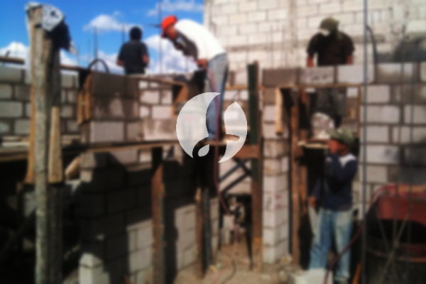

**Biaya Bangun Rumah Per Meter Di Mangga Besar Jakarta** - Hai Mitra Sumber Material! Gimana kabarnya hari ini? Kami dari Sumber Material hadir untuk memberikan solusi lengkap kebutuhan konstruksi Anda di Mangga Besar Jakarta. Seiring dengan perkembangan zaman, layanan pembangunan bangunan kini semakin diminati. Jasa pembangunan rumah semakin berkembang dan merambah ke layanan desain interior. Ini memberikan banyak pilihan bagi masyarakat yang ingin membangun rumah impian. Dengan meningkatnya kebutuhan akan tempat tinggal, para kontraktor properti berlomba-lomba menawarkan layanan terbaik. Kualitas dan kepercayaan menjadi kunci utama dalam persaingan ini. Kami, sebagai penyedia jasa bangun rumah terpercaya, berkomitmen untuk memberikan layanan terbaik dan menjaga kepercayaan pelanggan di Mangga Besar Jakarta.



## Harga Jasa Desain Gambar Arsitek Di Mangga Besar Jakarta

Sebagai penyedia jasa arsitek, kami akan membantu mewujudkan desain rumah impian Anda. Dengan desain yang tepat, rumah Anda akan terlihat indah dan fungsional. Kami memperhatikan berbagai faktor penting dalam menciptakan komposisi desain yang selaras dan menarik. Bagi kami, desain adalah elemen penting yang menentukan estetika rumah Anda. Kami akan menyesuaikan desain dengan anggaran yang Anda miliki, sehingga Anda dapat memahami perkiraan biaya yang dibutuhkan. Selain desain eksterior, kami juga mempertimbangkan pemilihan material yang tepat. Proses ini memang kompleks dan membutuhkan keahlian khusus. Itulah mengapa kami merekomendasikan penggunaan jasa arsitek profesional untuk memastikan hasil yang optimal. Kami memahami harapan Anda dan akan mewujudkannya menjadi kenyataan.

Biaya jasa desain bangunan kami bervariasi, tergantung pada luas rumah dan tingkat kesulitan desain. Saat ini, kami menawarkan harga per meter untuk jasa desain rumah dan bangunan lainnya. Biaya jasa desain rumah minimalis satu lantai adalah Rp 54.000,- per meter, sudah termasuk desain, perhitungan RAB (Rencana Anggaran Biaya), dan 2 kali revisi. Untuk rumah 2 lantai atau lebih, biayanya dikalikan 2 atau 3 sesuai dengan jumlah lantai.

## Layanan Borong Bangun Rumah Di Mangga Besar Jakarta

Mengingat semakin banyaknya orang yang membutuhkan tempat tinggal yang nyaman, layanan borong bangun rumah menjadi solusi praktis dan efisien. Kami hadir untuk memberikan layanan terbaik dalam mewujudkan rumah impian Anda di Mangga Besar Jakarta. Dengan menggunakan jasa borong bangun rumah, Anda tidak perlu repot dalam proses pembangunan. Kami akan membantu Anda mulai dari perencanaan hingga penyelesaian. Memiliki rumah yang cantik dan nyaman adalah impian semua orang. Kami akan mewujudkan impian tersebut dengan memberikan layanan yang sesuai dengan kebutuhan dan keinginan Anda. Dengan borong bangun rumah, Anda tidak perlu khawatir tentang desain, material, atau tenaga kerja. Kami akan mengurus semuanya untuk Anda.

Untuk harga borong renovasi rumah, kami menawarkan beberapa tingkatan harga yang disesuaikan dengan bahan bangunan yang digunakan dan lokasi pembangunan. Dengan syarat area tanah dalam kondisi rata dan stabil, tanpa perlu pengurugan. Harga per meter dengan material dinding hebel adalah Rp 1.950.000,-, sedangkan dengan material bata merah adalah Rp 2.200.000,-. Harga tersebut sudah termasuk pondasi batu gunung, kolom dan tiang beton, lantai keramik standar, serta atap dengan rangka baja ringan dan genteng spandek. Pilihan genteng dan keramik dapat disesuaikan dengan preferensi Anda, dengan penyesuaian harga yang sesuai.

## Harga Jasa Perbaikan Bangunan Di Mangga Besar Jakarta

Selain layanan arsitek dan borong bangun rumah, kami juga menyediakan jasa renovasi bangunan. Jasa renovasi bangunan adalah solusi tepat untuk mengubah tampilan rumah Anda agar terlihat baru dan segar. Dengan adanya jasa renovasi rumah, Anda tidak perlu merasa bingung dalam menentukan langkah-langkah renovasi. Kami menawarkan layanan renovasi yang komprehensif, mulai dari perubahan tampilan hingga renovasi total. Renovasi adalah pilihan yang bijak untuk meningkatkan nilai estetika rumah Anda dengan anggaran yang terjangkau. Namun, seringkali biaya renovasi menjadi kendala utama. Bersama layanan renovasi rumah kami, Anda dapat mengatasi masalah tersebut. Kami hadir sebagai solusi borongan renovasi rumah yang akan memudahkan Anda dalam merealisasikan impian renovasi. Kami siap membantu mengubah rumah Anda menjadi lebih indah dan menarik sesuai dengan harapan Anda.

Untuk biaya borongan jasa renovasi bangunan, kami memberikan harga yang berbeda-beda tergantung pada kondisi kerusakan bangunan. Setiap bangunan memiliki tingkat kerusakan yang berbeda, sehingga penyesuaian harga sangat diperlukan. Untuk jasa renovasi dengan tenaga tukang harian, harganya adalah Rp 150.000,- per hari untuk tukang dan Rp 100.000,- per hari untuk kenek.

## Didukung Tukang Dan Arsitek Berpengalaman Di Mangga Besar Jakarta

Baik jasa arsitek, borong bangun rumah, maupun borong renovasi rumah, semuanya memiliki peran penting dalam mewujudkan impian Anda. Dengan dukungan arsitek profesional dan tenaga kerja yang handal, kami akan membantu Anda menciptakan rumah impian Anda. Dengan membangun rumah bersama Kami, Anda akan memiliki rumah yang menarik dan nyaman. Anda tidak perlu khawatir, karena Kami selalu mengutamakan kualitas dan kepuasan pelanggan. Sebagai penyedia jasa bangun rumah, kepuasan pelanggan adalah penyemangat utama kami untuk terus berkarya dan memberikan yang terbaik. Anda dapat melihat katalog proyek-proyek kami untuk melihat hasil karya desain dan pembangunan rumah kami. Ini akan membuktikan bahwa Kami adalah pilihan yang tepat dan terpercaya di Mangga Besar Jakarta. [bangun rumah di Bale Kambang](/bangunan/biaya-bangun-rumah-per-meter-di-bale-kambang-jakarta/)

Perlu diingat bahwa rumah adalah kebutuhan primer manusia yang sangat penting, selain sandang dan pangan. Rumah adalah tempat berlindung dari cuaca ekstrem dan berbagai bahaya. Hal ini menjadi peluang bagi penyedia jasa bangun rumah untuk menawarkan layanan terbaik mereka. Kami, sebagai penyedia jasa, berpartisipasi aktif dalam meramaikan dunia arsitektur dengan mempresentasikan layanan kami melalui berbagai media, baik cetak maupun online. Ini membantu orang-orang yang ingin membangun rumah untuk menemukan solusi yang tepat. Dengan mempertahankan kualitas dan integritas, kami telah memiliki pengalaman yang cukup lama dalam dunia arsitektur. Itulah mengapa semakin banyak orang yang mempercayakan pembangunan rumah mereka kepada Kami.

Dengan dukungan arsitek profesional dan tenaga kerja yang handal, Kami semakin dikenal sebagai penyedia layanan bangun rumah yang terpercaya. Kami terus berinovasi dan mengembangkan karya-karya baru yang lebih kreatif dan menarik. Banyak bangunan yang telah kami bangun dengan desain yang apik dan menarik. Proses pengerjaan yang cepat dan efisien memungkinkan Anda untuk segera menikmati rumah impian Anda. Baik rumah skala kecil maupun besar, Kami dapat mengatasinya dengan baik. Anda tidak perlu ragu atau khawatir tentang hal tersebut. Mulai dari desain bangunan, pemilihan material, ukuran rumah, hingga sumber daya manusia, semuanya dapat Kami tangani dengan professional. Inilah peran penting dari Kami sebagai penyedia jasa bangun rumah. Karena, Kami akan membuat perencanaan yang matang dan melakukan pengawasan yang ketat selama proses pembangunan. [Hubungi Kami Sekarang!](https://api.whatsapp.com/send?phone=6285776786091&text=*Halo%20sumbermaterial.com*%20%3A)
