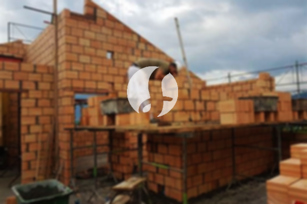

**Biaya Bangun Rumah Per Meter Di Mangga Dua Jakarta** - Hai Mitra Sumber Material! Bagaimana kabar Anda? Kami hadir sebagai solusi lengkap kebutuhan konstruksi di Mangga Dua Jakarta. Sejalan dengan perkembangan zaman, jasa pembangunan rumah semakin diminati, bahkan berkembang hingga layanan desain rumah. Banyak orang kini memilih pendekatan profesional dalam membangun tempat tinggal mereka. Peningkatan populasi secara otomatis meningkatkan kebutuhan akan hunian, mendorong kontraktor properti untuk berlomba-lomba menawarkan beragam jenis bangunan, mulai dari yang ekonomis hingga mewah. Kami, sebagai penyedia jasa konstruksi yang terpercaya di Mangga Dua Jakarta, berkomitmen untuk menjalankan pekerjaan yang diamanahkan dengan sebaik-baiknya, serta mempertahankan kepercayaan yang telah diberikan pelanggan. Dengan pengalaman bertahun-tahun, Kami menawarkan berbagai layanan sesuai kebutuhan Anda.



## Estimasi Biaya Desain Gambar Arsitek Di Mangga Dua Jakarta

Sebagai penyedia jasa desain arsitektur, Kami akan mengamati dan mewujudkan desain rumah impian Anda. Melalui desain yang kami buat, Kami berupaya menciptakan keindahan dan fungsionalitas pada hunian Anda. Untuk mencapai hasil yang optimal, Kami mempertimbangkan berbagai faktor penting dalam merancang komposisi desain yang selaras. Desain rumah adalah elemen krusial yang memengaruhi tampilan keseluruhan bangunan. Dengan desain yang tepat, rumah Anda akan terlihat menarik dan estetis. Anda tidak perlu khawatir, karena Kami akan mewujudkan desain yang sesuai dengan anggaran yang Anda miliki. Desain yang Kami buat akan memberikan gambaran jelas mengenai biaya yang dibutuhkan untuk merealisasikan rumah impian Anda. Selain itu, Kami juga cermat dalam memilih material bangunan yang tepat. Semua aspek ini memerlukan perencanaan yang matang, dan itulah mengapa Anda membutuhkan jasa arsitek profesional seperti Kami. Dengan pengalaman dan keahlian Kami, Kami siap memahami keinginan Anda dan mewujudkannya menjadi kenyataan.

Biaya jasa desain rumah Kami bervariasi, tergantung pada luas bangunan dan kompleksitas desain yang Anda inginkan. Saat ini, Kami menawarkan harga jasa desain rumah minimalis satu lantai sebesar Rp54.000,- per meter persegi, sudah termasuk desain, RAB (Rencana Anggaran Biaya), dan dua kali revisi. Untuk bangunan dua lantai atau lebih, harga per meter persegi dikalikan dua atau tiga sesuai dengan jumlah lantai.

## Jasa Borong Bangun Rumah Di Mangga Dua Jakarta

Seiring dengan pertumbuhan populasi, kebutuhan akan rumah yang layak huni semakin meningkat. Hal ini mendorong berbagai penyedia jasa borong bangun rumah untuk menawarkan produk dan layanan terbaik kepada pelanggan. Di sinilah peran Kami sebagai penyedia jasa bangun rumah yang andal di Mangga Dua Jakarta. Kami hadir untuk membantu Anda mengatasi permasalahan dalam membangun rumah impian Anda. Memiliki rumah yang indah adalah impian setiap orang. Dengan menggunakan jasa Kami, Anda akan mendapatkan bantuan dalam mewujudkan impian tersebut. Dengan mempercayakan pembangunan rumah Anda kepada Kami, Anda tidak perlu repot dalam mendesain atau mengawasi proses pembangunan. Kami akan selalu berusaha memahami keinginan Anda dan mewujudkannya dalam bentuk karya nyata. Kepuasan Anda adalah prioritas utama Kami, dan hal itu akan terus menjadi motivasi Kami untuk memberikan pelayanan terbaik. Portofolio proyek-proyek Kami dapat menjadi bukti nyata kualitas dan pengalaman Kami.

Untuk harga jasa borong pembangunan rumah, Kami menawarkan beberapa tingkatan harga yang disesuaikan dengan material bangunan yang digunakan dan lokasi pembangunan. Dengan asumsi area tanah dalam kondisi rata dan stabil, harga per meter persegi untuk material dinding hebel adalah Rp1.950.000,-, sementara untuk material bata merah adalah Rp2.200.000,-. Harga tersebut sudah termasuk pondasi batu kali, kolom dan tiang beton, lantai keramik standar, serta atap rangka baja ringan dengan genteng spandek. Anda juga dapat memilih variasi genteng dan keramik sesuai dengan preferensi, mutu, dan anggaran Anda.

## Layanan Renovasi Bangunan Di Mangga Dua Jakarta

Selain jasa desain dan borong bangun rumah, Kami juga menyediakan layanan renovasi bangunan. Jasa renovasi rumah adalah solusi tepat untuk memberikan tampilan baru pada hunian Anda. Dengan hadirnya Kami, Anda tidak perlu khawatir dalam menentukan cara renovasi yang tepat. Renovasi yang Kami lakukan dapat berupa perubahan bentuk model bangunan secara keseluruhan atau sebagian. Renovasi dapat menjadi pilihan yang ekonomis untuk mempercantik rumah Anda. Namun, seringkali anggaran menjadi kendala dalam melakukan renovasi. Dengan adanya jasa renovasi Kami, semua kendala tersebut dapat teratasi. Kami siap membantu Anda merenovasi bangunan Anda menjadi lebih indah dan sesuai dengan impian Anda.

Harga borong renovasi rumah Kami bervariasi tergantung pada kondisi kerusakan bangunan. Kami akan melakukan survei terlebih dahulu untuk menentukan perkiraan biaya yang dibutuhkan. Sebagai alternatif, Kami juga menawarkan jasa tenaga tukang harian dengan harga Rp150.000,- per hari untuk tukang dan Rp100.000,- per hari untuk kenek.

## Didukung Tenaga Ahli Terbaik Di Mangga Dua Jakarta

Baik layanan desain, borong bangun rumah, maupun renovasi bangunan, semuanya membutuhkan peran yang sama pentingnya. Dengan dukungan arsitek profesional dan tenaga kerja yang handal, Kami siap mewujudkan impian Anda. Membangun rumah idaman bersama Kami akan menghasilkan hunian yang menarik dan berkualitas. Anda tidak perlu khawatir, karena Kami berkomitmen untuk memberikan pelayanan terbaik, menjaga mutu dan kualitas pekerjaan, serta memberikan kepuasan maksimal kepada Anda. Kepuasan pelanggan adalah motivasi utama Kami untuk terus berkarya dan memberikan hasil yang lebih baik. Anda dapat melihat portofolio proyek-proyek Kami untuk membuktikan kualitas dan pengalaman Kami.

Perlu diketahui, rumah adalah kebutuhan utama manusia selain sandang dan pangan. Rumah menjadi tempat berlindung dari cuaca ekstrem dan berbagai bahaya. Hal ini menjadi peluang bagi para penyedia jasa bangun rumah untuk menghadirkan layanan terbaik. Sebagai penyedia jasa khusus dalam bidang konstruksi di Mangga Dua Jakarta, Kami berpartisipasi aktif dalam meramaikan perkembangan dunia arsitektur dengan menawarkan jasa melalui berbagai media. Kami memanfaatkan media cetak maupun online untuk menjangkau calon pelanggan. Hal ini memungkinkan Anda untuk mendapatkan informasi lengkap mengenai layanan Kami. Dengan menjaga mutu dan kualitas terbaik, Kami telah terbukti memiliki pengalaman yang cukup lama dalam bidang arsitektur. Inilah yang membuat Kami semakin dipercaya oleh banyak orang.

Didukung oleh arsitek profesional serta tenaga kerja yang handal, Kami semakin dikenal sebagai penyedia jasa konstruksi yang tidak diragukan lagi kemampuannya. Hal ini terlihat dari perkembangan pesat yang Kami alami. Kami terus berinovasi dan menciptakan karya-karya baru yang lebih kreatif. Banyak bangunan indah dan menarik telah Kami bangun dengan desain yang apik. Dengan proses pengerjaan yang efisien, Kami dapat menyelesaikan proyek dengan cepat tanpa mengurangi kualitas. Baik proyek skala kecil maupun besar, Kami mampu mengatasinya dengan profesional. Anda tidak perlu khawatir atau ragu karena Kami siap membantu Anda dalam setiap langkah pembangunan. Mulai dari desain rumah, pemilihan material, hingga ukuran bangunan dan sumber daya manusia, semua dapat Kami tangani dengan baik. Itulah peran penting Kami sebagai penyedia jasa konstruksi yang terpercaya di Mangga Dua Jakarta. [Hubungi Kami Sekarang](https://api.whatsapp.com/send?phone=6285776786091&text=*Halo%20sumbermaterial.com*%20%3A)
