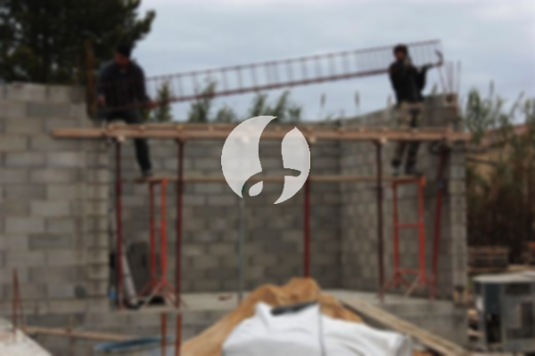

**Biaya Bangun Rumah Per Meter Di Manggarai Jakarta** - Hai Mitra Sumber Material! Gimana kabarnya? Kami dari Sumber Material hadir untuk membantu mewujudkan hunian impian Anda di Manggarai Jakarta dan sekitarnya. Seiring dengan perkembangan zaman, jasa bangun bangunan kini semakin banyak diminati. Muncul beragam layanan desain rumah yang menarik perhatian banyak orang. Peningkatan jumlah penduduk secara otomatis meningkatkan kebutuhan akan tempat tinggal. Hal ini mendorong pengembang properti untuk berlomba-lomba membangun rumah, apartemen, dan perumahan dengan berbagai kelas, mulai dari standar hingga mewah. Kepercayaan konsumen adalah kunci utama bagi penyedia jasa bangun bangunan. Kami berkomitmen untuk menjaga kepercayaan tersebut dan melaksanakan setiap tugas yang dipercayakan dengan baik. Sebagai penyedia jasa bangun bangunan yang terpercaya, kami menawarkan beragam layanan untuk membantu Anda mewujudkan rumah impian Anda.



## Desain Gambar Arsitektur Profesional di Manggarai Jakarta

Sebagai penyedia jasa arsitek, kami memberikan perhatian khusus pada desain bangunan yang akan Anda wujudkan. Kami berupaya menghasilkan desain yang indah dan sesuai dengan harapan Anda. Kami mempertimbangkan berbagai faktor penting untuk menciptakan komposisi desain yang harmonis dan menarik. Desain yang baik adalah fondasi utama dari sebuah bangunan yang indah. Kami siap mewujudkan desain yang sesuai dengan anggaran Anda, sehingga Anda dapat mengetahui perkiraan biaya yang dibutuhkan. Selain itu, kami juga memperhatikan pemilihan material bangunan yang tepat. Kami memahami bahwa semua ini membutuhkan keahlian khusus. Itulah mengapa Anda perlu memilih jasa arsitek profesional. Kami akan memahami keinginan Anda dan menciptakan desain yang memuaskan.

Biaya jasa desain rumah kami bervariasi tergantung pada luas bangunan dan tingkat kesulitan desain. Saat ini, kami menawarkan harga jasa desain rumah minimalis satu lantai mulai dari Rp 54.000,- per meter persegi, termasuk desain, perhitungan RAB, dan dua kali revisi. Untuk rumah dua lantai atau lebih, biayanya dikalikan dua atau tiga sesuai dengan jumlah lantai.

## Jasa Borong Renovasi Rumah Terpercaya di Manggarai Jakarta

Memiliki rumah yang nyaman dan indah adalah impian setiap orang. Dengan memanfaatkan jasa borong renovasi rumah, Anda bisa mewujudkan impian tersebut dengan lebih mudah. Kami membantu Anda mengubah tampilan rumah agar terlihat baru dan segar. Jasa renovasi bangunan yang kami tawarkan meliputi perubahan bentuk tampilan rumah, renovasi menyeluruh, atau renovasi total. Renovasi adalah solusi yang tepat untuk memperbarui penampilan rumah Anda tanpa harus membangun dari awal. Namun, renovasi seringkali membutuhkan anggaran yang tidak sedikit. Dengan adanya jasa renovasi bangunan, Anda dapat mengatasi masalah ini. Kami hadir sebagai solusi renovasi bangunan yang akan membantu Anda menciptakan rumah yang lebih *fresh* dan indah. Kami siap mewujudkan rumah impian Anda sesuai dengan keinginan Anda.

Adapun harga borongan untuk pembangunan, Kami memberikan beberapa level harga. Menyesuaikan bahan bangunan yang di pakai dan lokasi tempat yang akan di bangun. Dengan persyaratan area tanah yang akan dibangun dalam kondisi rata, tidak labil dan tidak perlu pengurugan. Harga per meter dengan material dinding hebel yakni Rp 1.950.000,-, dan dengan material bata merah per meternya Rp 2.200.000,-. Harga yang kami berikan itu mengaplikasikan pondasi batu sungai, kolom dan tiang beton, lantai keramik standar dan atap dengan rangka baja ringan plus genteng spandek. Untuk genteng dan kermiak dapat request tipe lain, model juga mutu dan anggaran menyesuaikan.

## Harga Jasa Renovasi Bangunan di Manggarai Jakarta

Selain layanan arsitek dan borong bangun rumah, kami juga menyediakan jasa renovasi bangunan. Jasa renovasi rumah adalah cara efektif untuk mengubah tampilan rumah agar terlihat baru. Dengan adanya jasa renovasi bangunan, Anda tidak perlu lagi bingung menentukan cara merenovasi rumah Anda. Renovasi yang kami lakukan meliputi perubahan bentuk tampilan rumah atau renovasi menyeluruh. Renovasi adalah opsi yang tepat untuk mempercantik rumah dengan anggaran yang terjangkau. Namun, renovasi seringkali terasa sulit bagi sebagian orang. Dengan adanya jasa renovasi bangunan, semua masalah itu dapat teratasi. Kami hadir sebagai solusi renovasi bangunan yang akan membantu Anda menciptakan rumah yang lebih segar dan indah dari sebelumnya. Kami siap mewujudkan rumah impian Anda sesuai dengan harapan Anda.

Untuk biaya borongan jasa renovasi bangunan, kami memberikan harga yang berbeda-beda. Hal ini dikarenakan kondisi kerusakan bangunan yang akan direnovasi bervariasi. Biaya borongan renovasi bangunan disesuaikan dengan jenis kerusakan yang akan diperbaiki. Namun, untuk biaya jasa renovasi dengan tenaga tukang harian, harganya adalah Rp 150.000,- per hari untuk tukang dan Rp 100.000,- per hari untuk kenek.

## Dukungan Tenaga Kerja & Arsitek Unggulan di Manggarai Jakarta

Baik layanan arsitek, jasa bangun rumah, maupun jasa renovasi bangunan, semuanya memiliki peran yang sangat penting. Didukung oleh arsitek profesional dan tenaga kerja yang handal, kami akan membantu mewujudkan impian Anda. Dengan membangun rumah idaman bersama kami, Anda akan memiliki rumah yang menarik dan berkualitas. Anda tidak perlu khawatir, karena kami selalu memberikan pelayanan terbaik, menjaga mutu dan kualitas untuk memberikan kepuasan Anda. Sebagai penyedia jasa bangun rumah, kepuasan pelanggan adalah penyemangat kami untuk terus berkarya dengan lebih baik. Anda dapat melihat katalog hasil proyek kami untuk membuktikan bahwa kami adalah pilihan terbaik dan terpercaya.

Perlu diingat, rumah adalah kebutuhan dasar manusia setelah sandang dan pangan. Rumah menjadi tempat berlindung dari cuaca dan bahaya. Hal ini menjadi peluang bagi penyedia jasa bangun rumah untuk menawarkan jasanya. Sebagai penyedia jasa, terutama jasa bangun rumah, kami berpartisipasi dalam meramaikan dunia arsitektur yang terus berkembang dengan menampilkan jasa kami melalui berbagai media. Mulai dari media cetak hingga media online, kami gunakan untuk menawarkan jasa bangun rumah. Ini tentu membantu banyak orang yang ingin membangun rumah. Dengan menjaga mutu dan kualitas terbaik, kami telah terbukti memiliki pengalaman yang cukup lama dalam menggeluti dunia arsitektur. Inilah alasan mengapa jasa bangun rumah kami semakin dipercaya oleh banyak orang.

Didukung oleh arsitek profesional dan tenaga kerja yang handal, tentu saja akan membuat jasa bangun rumah kami semakin dikenal dan terpercaya. Hal ini terlihat dari perkembangan yang terus kami berikan. Kami terus berkarya menciptakan karya-karya baru yang lebih inovatif dan kreatif. Banyak bangunan indah dibangun dengan desain apik dari tim kami. Dengan proses pengerjaan yang efisien, Anda akan segera mendapatkan rumah impian Anda. Baik bangunan kecil maupun besar, kami siap menangani semuanya. Sehingga, Anda tidak perlu ragu atau khawatir. Mulai dari desain bangunan, material bahan, ukuran rumah, dan sumber daya manusia, semuanya dapat kami atasi. Disitulah peran penting jasa bangun rumah. Kami akan membuat rancangan yang matang dan menjadi pengawas pembangunan. [Hubungi Kami Sekarang](https://api.whatsapp.com/send?phone=6285776786091&text=*Halo%20sumbermaterial.com*%20%3A)
