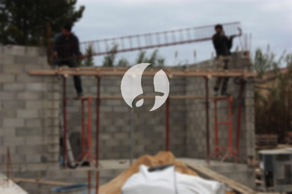

**Biaya Bangun Rumah Per Meter Di Manggarai Selatan Jakarta** - Hai Mitra Sumber Material! Gimana kabarnya hari ini? Kami dari Sumber Material hadir untuk membantu Anda mewujudkan rumah impian di Manggarai Selatan Jakarta. Seiring perkembangan zaman, jasa bangun rumah semakin diminati karena menawarkan kemudahan dan efisiensi. Semakin meningkatnya populasi, kebutuhan akan tempat tinggal pun ikut bertambah. Hal ini mendorong banyak pelaku properti untuk berlomba-lomba membangun hunian, mulai dari yang sederhana hingga mewah. Dengan kepercayaan yang diberikan konsumen, jasa bangun rumah berkomitmen untuk memberikan hasil terbaik. Kami menawarkan berbagai layanan untuk memenuhi kebutuhan konstruksi Anda. Berikut adalah beberapa layanan yang bisa Anda pilih:



## Jasa Desain Gambar Arsitektur Di Manggarai Selatan Jakarta

Sebagai penyedia jasa desain arsitektur, Kami akan memperhatikan secara detail desain rumah yang akan dibangun. Dengan desain yang baik, Kami akan berusaha menciptakan keindahan pada hunian Anda. Untuk itu, Kami mempertimbangkan beberapa faktor penting dalam menyusun komposisi desain yang selaras dan menarik. Seperti yang Anda ketahui, desain adalah elemen krusial dalam membangun rumah impian. Dengan desain yang tepat, rumah Anda akan terlihat cantik dan nyaman. Anda tidak perlu khawatir, karena Kami siap mewujudkan desain yang sesuai dengan anggaran yang Anda miliki. Hasil desain ini akan membantu Anda memperkirakan biaya yang dibutuhkan untuk membangun rumah sesuai keinginan. Selain itu, desain yang Kami buat juga akan mempertimbangkan pemilihan material bangunan yang tepat. Proses ini memang cukup kompleks, itulah mengapa Anda membutuhkan jasa arsitek profesional. Kami akan memahami keinginan Anda dan mewujudkannya menjadi kenyataan.

Biaya jasa desain bangunan dari Kami bervariasi tergantung pada luas rumah dan tingkat kesulitan desain. Saat ini, Kami menawarkan harga per meter untuk jasa desain, perhitungan RAB, dan dua kali revisi. Biaya jasa desain rumah minimalis satu lantai adalah Rp54.000,- per meter. Sedangkan untuk rumah dua lantai atau lebih, biayanya dikalikan 2 atau 3 sesuai jumlah lantai.

## Harga Borongan Bangun Rumah Di Manggarai Selatan Jakarta

Setiap orang pasti membutuhkan tempat tinggal yang nyaman dan aman. Banyaknya penyedia jasa bangun rumah yang bermunculan menawarkan berbagai produk dan layanan terbaik untuk menarik pelanggan. Di sinilah peran utama jasa bangun rumah dalam menangani tantangan pembangunan hunian. Kami akan membantu Anda menemukan solusi borongan bangun rumah yang sesuai dengan kebutuhan dan anggaran Anda. Memiliki rumah yang indah adalah impian setiap orang. Dengan menggunakan jasa bangun rumah, Anda akan terbantu mewujudkan impian tersebut tanpa perlu pusing mendesain rumah sendiri. Kami selalu berusaha memahami keinginan Anda dan merealisasikannya menjadi karya nyata berupa rumah impian. Kepuasan Anda adalah prioritas Kami, sehingga Kami akan terus memberikan pelayanan terbaik dan mempertahankan kepercayaan yang telah diberikan.

Untuk biaya borongan pembangunan, Kami menawarkan beberapa tingkatan harga yang disesuaikan dengan material bangunan dan lokasi pembangunan di Manggarai Selatan Jakarta. Dengan asumsi kondisi tanah rata, stabil, dan tidak memerlukan pengurugan, harga per meter dengan material dinding hebel adalah Rp1.950.000,-, sementara dengan material bata merah adalah Rp2.200.000,-. Harga tersebut sudah termasuk pondasi batu gunung, kolom dan tiang beton, lantai keramik standar, serta atap rangka baja ringan dengan genteng spandek. Untuk jenis genteng dan keramik, Anda bisa menyesuaikan dengan preferensi, model, kualitas, dan anggaran yang tersedia.

## Layanan Renovasi Rumah Di Manggarai Selatan Jakarta

Selain jasa arsitek dan bangun rumah, Kami juga menyediakan jasa renovasi rumah. Borongan renovasi rumah adalah solusi tepat untuk memberikan tampilan baru pada hunian Anda. Dengan bantuan jasa renovasi bangunan, Anda tidak perlu khawatir menentukan langkah-langkah renovasi. Renovasi yang Kami lakukan dapat berupa perubahan tampilan bangunan secara parsial atau menyeluruh. Renovasi merupakan pilihan yang menarik untuk mempercantik rumah Anda dengan biaya yang relatif terjangkau. Namun, seringkali orang kesulitan melakukan renovasi sendiri karena berbagai kendala. Kami hadir sebagai solusi yang akan mempermudah proses renovasi rumah Anda menjadi lebih baik dan indah dari sebelumnya. Kami siap mewujudkan rumah impian Anda sesuai dengan visi dan keinginan Anda.

Harga borongan renovasi rumah Kami bervariasi karena kondisi kerusakan setiap rumah berbeda-beda. Oleh karena itu, biaya borongan renovasi disesuaikan dengan jenis kerusakan yang akan diperbaiki. Untuk biaya tenaga tukang harian, tarifnya adalah Rp150.000,- per hari untuk tukang dan Rp100.000,- per hari untuk kenek.

## Didukung Tenaga Kerja Dan Arsitek Berpengalaman Di Manggarai Selatan Jakarta

Baik itu jasa desain, bangun rumah, maupun renovasi, semuanya memiliki peran penting dalam mewujudkan rumah impian Anda. Dengan dukungan arsitek profesional dan tenaga kerja yang handal, Kami akan membantu mewujudkan impian Anda. Membangun rumah bersama Kami akan menghasilkan hunian yang menarik dan indah. Anda tidak perlu khawatir, karena Kami mengutamakan kualitas, mutu, dan kepuasan Anda. Sebagai penyedia jasa bangun rumah, kepuasan pelanggan adalah penyemangat Kami untuk terus berkarya dan menghasilkan karya yang lebih baik. Anda bisa melihat katalog proyek Kami untuk melihat contoh hasil pekerjaan Kami. Katalog tersebut akan membuktikan bahwa Kami adalah pilihan terbaik dan terpercaya.

Perlu diingat, rumah adalah kebutuhan utama manusia selain sandang dan pangan. Rumah menjadi tempat berlindung dari cuaca ekstrem dan berbagai bahaya. Hal ini menjadi peluang bagi penyedia jasa bangun rumah untuk menawarkan jasanya. Sebagai penyedia jasa, Kami berpartisipasi dalam memajukan dunia arsitektur dengan mempromosikan jasa Kami melalui berbagai media, baik cetak maupun online. Hal ini membantu banyak orang yang ingin membangun rumah. Dengan menjaga kualitas dan mutu terbaik, Kami telah memiliki pengalaman yang cukup lama dalam menggeluti dunia arsitektur. Inilah alasan mengapa Kami semakin dipercaya oleh banyak orang.

Didukung oleh arsitek profesional dan tenaga kerja yang handal, Kami yakin dapat memberikan layanan terbaik. Hal ini terlihat dari perkembangan yang terus Kami berikan. Kami selalu berinovasi dan menciptakan karya-karya baru yang menarik. Banyak rumah dan bangunan yang telah Kami bangun dengan desain yang apik dan menarik. Proses pengerjaan yang cepat dan efisien memungkinkan Anda untuk segera menikmati rumah impian Anda. Baik bangunan skala kecil maupun besar, Kami dapat mengatasinya dengan baik. Anda tidak perlu khawatir atau cemas dengan hal tersebut. Kami siap membantu Anda dalam segala aspek pembangunan, mulai dari desain, material, ukuran rumah, hingga sumber daya manusia. Dengan demikian, Kami dapat mendukung terwujudnya rumah yang cantik dan menarik. Disitulah peran penting dari Kami sebagai penyedia jasa bangun rumah. Karena, Kami akan mewujudkan rancangan Anda, sekaligus mengawasi proses pembangunannya. [Hubungi Kami Sekarang](https://api.whatsapp.com/send?phone=6285776786091&text=*Halo%20sumbermaterial.com*%20%3A)

[bangun rumah di Ancol](/bangunan/biaya-bangun-rumah-per-meter-di-ancol-jakarta/) untuk informasi lebih lanjut tentang bangun rumah di Ancol Jakarta. Jangan ragu untuk menghubungi Kami untuk konsultasi gratis dan penawaran harga terbaik di Manggarai Selatan Jakarta.
