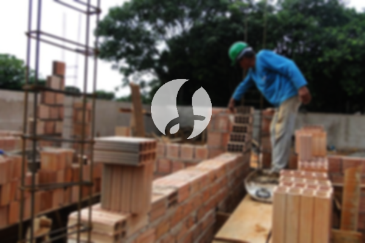

**Biaya Bangun Rumah Per Meter Di Margajaya Bogor** - Hai Mitra Sumber Material! Gimana kabarnya? Kami dari Sumber Material hadir untuk membantu mewujudkan impian memiliki rumah impian di Margajaya Bogor. Seiring perkembangan zaman, kebutuhan akan tempat tinggal yang nyaman dan berkualitas semakin meningkat. Hal ini mendorong pertumbuhan bisnis jasa konstruksi, menawarkan beragam solusi untuk mewujudkan rumah idaman Anda. Dengan banyaknya pilihan yang tersedia, menemukan penyedia jasa yang terpercaya menjadi kunci utama. Kami hadir sebagai mitra terpercaya Anda dalam membangun rumah impian di Margajaya Bogor, dengan komitmen untuk memberikan pelayanan terbaik dan hasil yang memuaskan.



## Layanan Desain Gambar Arsitek di Margajaya Bogor

Sebagai penyedia layanan desain arsitek, Kami akan mengamati dengan seksama desain rumah yang Anda inginkan. Kami berupaya menghasilkan desain yang indah dan fungsional, dengan mempertimbangkan faktor-faktor penting untuk menciptakan komposisi yang selaras. Desain adalah aspek krusial dalam membangun rumah yang menarik. Dengan desain yang tepat, rumah Anda akan terlihat menawan dan sesuai dengan kepribadian Anda. Anda tidak perlu khawatir tentang anggaran, karena Kami akan membuat desain sesuai dengan *budget* yang Anda miliki. Dari desain tersebut, Anda dapat memperkirakan biaya yang dibutuhkan untuk mewujudkan rumah impian Anda. Selain itu, desain juga mempertimbangkan pemilihan material bangunan yang tepat. Semua proses ini memerlukan keahlian khusus. Itulah mengapa penting untuk memilih jasa arsitek yang berpengalaman seperti Kami. Kami akan memahami harapan Anda dan mewujudkannya menjadi sebuah karya nyata yang membuat Anda puas.

Biaya jasa desain rumah Kami bervariasi, tergantung pada luas bangunan dan kompleksitas desain yang Anda inginkan. Saat ini, Kami menawarkan harga per meter persegi. Biaya jasa desain rumah minimalis satu lantai adalah Rp 54.000,- per meter. Harga ini sudah termasuk desain, perhitungan RAB (Rencana Anggaran Biaya), dan dua kali revisi. Untuk rumah dua lantai atau lebih, biayanya hanya dikali 2 atau dikali 3, sesuai dengan jumlah lantai.

## Jasa Borong Renovasi Bangunan di Margajaya Bogor

Seperti yang kita ketahui, memiliki rumah adalah kebutuhan dasar setiap manusia. Maka dari itu, jasa renovasi bangunan hadir sebagai solusi untuk memperbarui dan meningkatkan kualitas rumah Anda. Kami menawarkan layanan renovasi bangunan untuk membantu Anda mengubah tampilan rumah agar terlihat baru dan lebih menarik. Jasa renovasi bangunan yang Kami tawarkan meliputi perubahan bentuk tampilan rumah, renovasi total, atau perbaikan kerusakan pada bagian-bagian tertentu. Renovasi adalah cara yang efektif untuk memberikan nuansa baru pada rumah Anda tanpa harus membangun dari awal. Namun, dengan anggaran terbatas, seseorang mungkin kesulitan menjalankan renovasi rumah secara mandiri. Di sinilah Kami hadir untuk membantu Anda! Kami adalah penyedia jasa renovasi bangunan yang akan memudahkan Anda dalam memperbarui rumah Anda menjadi lebih segar dan indah. Kami siap mewujudkan rumah impian Anda dengan hasil yang memuaskan.

Untuk harga jasa borong renovasi bangunan, Kami memberikan harga yang bervariasi. Hal ini dikarenakan kondisi kerusakan bangunan yang akan direnovasi berbeda-beda. Biaya borongan akan disesuaikan dengan jenis kerusakan yang akan diperbaiki. Namun, untuk harga jasa renovasi dengan tenaga tukang harian, Kami menawarkan harga Rp 150.000,- per hari untuk tukang dan Rp 100.000,- per hari untuk kenek.

## Harga Jasa Perbaikan Bangunan di Margajaya Bogor

Selain layanan desain dan pembangunan rumah, Kami juga menyediakan jasa perbaikan bangunan di Margajaya Bogor. Jasa perbaikan bangunan merupakan solusi untuk mengatasi kerusakan pada rumah atau bangunan Anda. Dengan kehadiran Kami, Anda tidak perlu khawatir tentang perbaikan bangunan Anda, karena Kami siap memberikan solusi terbaik. Perbaikan yang Kami lakukan dapat berupa perubahan bentuk tampilan rumah atau perbaikan total bangunan. Renovasi memang menjadi alternatif untuk mengubah rumah agar terlihat lebih cantik, tetapi dengan anggaran yang terjangkau, seseorang mungkin kesulitan untuk melakukannya sendiri. Namun, dengan adanya jasa renovasi rumah, semua masalah ini dapat teratasi. Kami hadir sebagai layanan renovasi bangunan yang akan memudahkan Anda dalam merenovasi rumah Anda menjadi lebih segar dan indah dari sebelumnya. Kami siap mewujudkan rumah impian Anda sesuai dengan harapan Anda.

Untuk harga jasa perbaikan bangunan, Kami menawarkan harga yang variatif, tergantung pada jenis kerusakan yang akan diperbaiki. Namun, untuk harga jasa renovasi dengan tenaga tukang harian, harganya adalah Rp 150.000,- per hari untuk tukang dan Rp 100.000,- per hari untuk kenek.

## Didukung Tenaga Kerja dan Arsitek Berpengalaman di Margajaya Bogor

Baik layanan desain arsitek, pembangunan rumah, maupun renovasi bangunan, semuanya memiliki peran penting dalam mewujudkan impian Anda. Dengan didukung oleh arsitek profesional dan tenaga kerja yang handal, Kami akan membantu mewujudkan impian Anda. Membangun rumah idaman dengan Kami akan memberikan Anda rumah yang menarik dan berkualitas. Anda tidak perlu khawatir, karena Kami akan memberikan pelayanan terbaik, menjaga mutu dan kualitas, serta memberikan kepuasan kepada Anda. Sebagai penyedia jasa bangun rumah, kepuasan klien adalah prioritas utama Kami. Kepuasan Anda menjadi penyemangat Kami untuk terus berkarya dan menghasilkan karya yang lebih baik. Anda dapat melihat katalog hasil proyek Kami untuk melihat kualitas pekerjaan Kami. Katalog tersebut dapat membuktikan bahwa Kami adalah pilihan terbaik dan terpercaya untuk membangun rumah impian Anda di Margajaya Bogor.

Perlu diketahui bahwa rumah adalah kebutuhan primer manusia selain sandang dan pangan. Rumah berfungsi sebagai tempat tinggal yang melindungi dari cuaca panas dan dingin serta menjaga dari berbagai bahaya. Hal ini menjadi celah bagi penyedia jasa bangun rumah untuk menawarkan jasanya. Sebagai penyedia jasa, Kami berpartisipasi dalam memajukan dunia arsitektur dengan menawarkan jasa Kami melalui berbagai media. Mulai dari media cetak hingga media *online*, semua Kami gunakan untuk mempromosikan jasa bangun rumah. Hal ini tentu membantu banyak orang yang ingin membangun rumah impian mereka. Dengan menjaga mutu dan kualitas terbaik, Kami telah terbukti memiliki pengalaman yang cukup lama dalam menggeluti dunia arsitektur. Itulah mengapa Kami semakin banyak dipercaya oleh banyak orang. [bangun rumah di Babakan Pasar](/bangunan/biaya-bangun-rumah-per-meter-di-babakan-pasar-bogor/)

Didukung oleh arsitek profesional dan tenaga kerja yang handal, Kami yakin dapat mewujudkan jasa bangun rumah yang semakin dikenal dan tidak diragukan lagi kemampuannya. Hal ini terlihat dari perkembangan yang selalu Kami berikan. Kami selalu berkarya menciptakan karya-karya baru yang lebih inovatif dan kreatif. Banyak rumah dan bangunan telah Kami bangun dengan desain yang apik dan menarik. Dengan proses pengerjaan yang cepat, Anda akan segera mendapatkan rumah impian Anda. Baik rumah berskala kecil maupun besar, Kami dapat mengendalikannya dengan baik. Jadi, Anda tidak perlu khawatir tentang hal tersebut. Mulai dari desain rumah, material bangunan, ukuran rumah, dan sumber daya manusia, semuanya dapat Kami atasi dengan baik. Hingga, Kami dapat mendukung terwujudnya rumah yang cantik dan menarik. Disitulah peran penting Kami sebagai penyedia jasa bangun rumah. Kami akan menciptakan tata desain yang menarik dan juga berperan sebagai pengawas pembangunan. Dapatkan penawaran terbaik dan konsultasi gratis dari Kami sekarang juga! [Hubungi Kami](https://api.whatsapp.com/send?phone=6285776786091&text=*Halo%20sumbermaterial.com*%20%3A)
