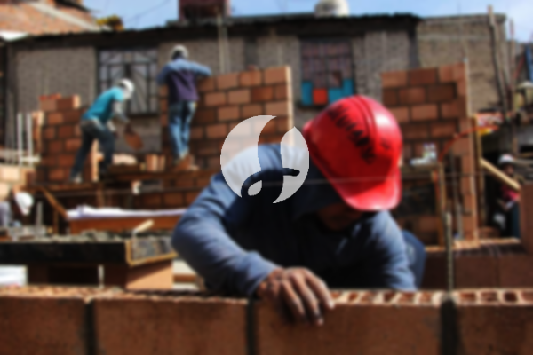

**Biaya Bangun Rumah Per Meter Di Mekarsari Depok** - Halo Mitra Sumber Material! Bagaimana kabarnya? Kami memahami bahwa membangun rumah adalah impian besar setiap keluarga. Seiring perkembangan zaman, kebutuhan akan jasa konstruksi semakin meningkat. Banyak warga Mekarsari Depok yang kini memilih memanfaatkan jasa bangun rumah untuk mewujudkan rumah impian mereka. Semakin padatnya populasi, kebutuhan akan tempat tinggal pun semakin meningkat. Inilah yang mendorong banyak kontraktor untuk berlomba-lomba menawarkan layanan pembangunan, mulai dari rumah sederhana hingga mewah. Kepercayaan konsumen adalah aset utama, sehingga jasa bangun rumah berkualitas akan berupaya keras menjaga reputasi mereka dan menjalankan proyek sesuai amanah. Nah, sebagai penyedia layanan bangun rumah terpercaya di Mekarsari Depok, Kami hadir untuk membantu mewujudkan rumah impian Anda! Kami menawarkan berbagai opsi layanan yang dapat disesuaikan dengan kebutuhan dan anggaran Anda. Mari kita bahas lebih lanjut!



## Estimasi Biaya Desain Rumah Di Mekarsari Depok

Sebagai penyedia jasa desain, Kami sangat memperhatikan estetika dan fungsionalitas sebuah rumah. Melalui desain yang matang, Kami berupaya menciptakan rumah yang indah dan nyaman dihuni. Kami mempertimbangkan beberapa faktor penting untuk menghasilkan komposisi desain yang harmonis. Desain adalah fondasi utama dari sebuah rumah yang menarik. Dengan desain yang baik, rumah Anda akan terlihat lebih menawan. Anda tidak perlu khawatir, karena Kami akan menciptakan desain yang sesuai dengan anggaran yang Anda miliki. Desain ini akan memberikan gambaran jelas tentang perkiraan biaya yang dibutuhkan untuk mewujudkan rumah impian Anda. Selain itu, desain juga akan mempertimbangkan material yang akan digunakan. Semua aspek ini memang membutuhkan perencanaan yang cermat, itulah mengapa Anda membutuhkan jasa arsitek profesional dari Kami. Kami akan memahami harapan Anda dan mewujudkannya menjadi kenyataan.

Namun, perlu Anda ketahui bahwa harga jasa desain rumah Kami bervariasi tergantung luas bangunan dan tingkat kesulitan desain. Saat ini, Kami mematok harga mulai dari Rp 54.000 per meter persegi untuk desain rumah minimalis satu lantai, sudah termasuk gambar kerja, RAB (Rencana Anggaran Biaya) dan dua kali revisi. Untuk rumah dua lantai atau lebih, harga akan disesuaikan, biasanya dikali dua atau tiga sesuai jumlah lantai.

## Perkiraan Biaya Borong Bangun Rumah Di Mekarsari Depok

Mengingat semakin banyaknya orang yang membutuhkan tempat tinggal, Kami hadir sebagai solusi untuk mewujudkan impian Anda. Banyaknya penyedia jasa bangun rumah tentu menawarkan berbagai produk dan layanan terbaik. Kami hadir untuk menangani permasalahan pembangunan Anda dan memastikan Anda mendapatkan layanan yang sesuai dengan keinginan Anda. Memiliki rumah yang bagus adalah impian setiap orang. Dengan menggunakan jasa bangun rumah Kami, Anda tidak perlu repot memikirkan desain rumah sendiri. Kami akan berusaha memahami semua keinginan Anda dan mewujudkannya dalam bentuk rumah impian yang nyata. Anda akan merasakan kepuasan dan hal ini akan semakin memperkuat kepercayaan Anda pada Kami.

Untuk layanan borong bangun rumah, Kami menawarkan beberapa pilihan harga berdasarkan material dan lokasi bangunan. Dengan asumsi lahan dalam kondisi rata dan tidak memerlukan pengurukan, harga per meter persegi dengan dinding hebel adalah Rp 1.950.000,-, sedangkan dengan dinding bata merah adalah Rp 2.200.000,-. Harga tersebut sudah termasuk pondasi batu sungai, kolom dan tiang beton, lantai keramik standar, serta atap rangka baja ringan dengan genteng spandek. Untuk pilihan genteng dan keramik lainnya, Anda dapat menyesuaikan model, mutu, dan harga sesuai keinginan Anda. [Hubungi Kami](https://api.whatsapp.com/send?phone=6285776786091&text=*Halo%20sumbermaterial.com*%20%3A) untuk konsultasi lebih lanjut!

## Jasa Renovasi Bangunan Terbaik Di Mekarsari Depok

Selain jasa desain dan bangun rumah, Kami juga menyediakan jasa renovasi bangunan. Renovasi adalah cara yang efektif untuk memberikan tampilan baru pada rumah Anda. Dengan adanya jasa renovasi, Anda tidak perlu khawatir lagi dalam melakukan renovasi. Kami siap membantu Anda mengubah tampilan rumah Anda, baik dengan merubah sebagian model atau melakukan renovasi total. Renovasi memang menjadi solusi yang tepat untuk mempercantik rumah Anda dengan biaya yang lebih terjangkau. Namun, seringkali renovasi terasa sulit dilakukan sendiri. Disinilah peran penting Kami sebagai penyedia jasa renovasi rumah yang handal. Kami akan membantu Anda merenovasi rumah Anda dengan hasil yang lebih baik dan sesuai dengan impian Anda.

Biaya borong untuk jasa renovasi rumah Kami bervariasi tergantung kondisi kerusakan bangunan. Setiap rumah memiliki tingkat kerusakan yang berbeda, sehingga harga akan disesuaikan. Untuk biaya jasa renovasi dengan tenaga tukang harian, tarifnya adalah Rp 150.000,- per hari untuk tukang dan Rp 100.000,- per hari untuk kenek.

## Didukung Tim Arsitek & Tukang Berpengalaman Di Mekarsari Depok

Baik itu layanan desain, bangun rumah, atau renovasi, semuanya memiliki peran yang sangat penting. Didukung oleh arsitek profesional dan tenaga kerja yang handal, Kami dapat membantu mewujudkan impian Anda. Dengan membangun rumah idaman bersama Kami, Anda akan memiliki rumah yang menarik dan berkualitas. Kami berkomitmen untuk memberikan pelayanan terbaik, menjaga mutu dan kualitas, serta memberikan kepuasan maksimal kepada Anda. Kepuasan klien adalah motivasi utama Kami untuk terus berkarya dan menghasilkan karya-karya yang lebih baik lagi. Anda dapat melihat portofolio proyek Kami untuk melihat hasil karya Kami sebelumnya. Catalog proyek tersebut dapat membuktikan bahwa Kami adalah pilihan yang tepat dan terpercaya. [bangun rumah di Abadijaya](/bangunan/biaya-bangun-rumah-per-meter-di-abadijaya-depok/)

Perlu diingat, rumah adalah kebutuhan primer manusia yang sangat penting, selain sandang dan pangan. Rumah menjadi tempat berlindung dari panas dan dingin serta melindungi dari berbagai bahaya. Hal ini menjadi peluang bagi penyedia jasa bangun rumah untuk menawarkan layanan mereka. Sebagai penyedia jasa, Kami berpartisipasi dalam perkembangan dunia arsitektur dengan menawarkan layanan melalui berbagai media, baik cetak maupun online. Tujuannya adalah untuk membantu banyak orang dalam mewujudkan rumah impian mereka. Dengan mempertahankan mutu dan kualitas terbaik, Kami telah memiliki pengalaman yang cukup lama dalam menggeluti dunia arsitektur. Inilah yang membuat Kami semakin dipercaya oleh banyak orang.

Didukung oleh arsitek profesional dan tenaga kerja yang andal, Kami yakin dapat memberikan layanan yang tak diragukan lagi kemampuannya. Hal ini terlihat dari perkembangan yang terus Kami berikan. Kami selalu berinovasi dan menciptakan karya-karya baru yang lebih kreatif. Banyak rumah-bangunan yang Kami bangun dengan desain yang apik dan menarik. Dengan progres pengerjaan yang cepat, Anda akan segera mendapatkan rumah impian Anda. Baik rumah berskala kecil maupun besar, Kami dapat mengatasinya. Anda tidak perlu khawatir, karena Kami dapat membantu Anda dalam segala hal, mulai dari desain rumah, material, ukuran bangunan, hingga tenaga kerja. Itulah peran penting Kami sebagai penyedia jasa bangun rumah. Kami akan membuat rancangan yang sesuai dengan keinginan Anda dan sekaligus mengawasi proses pembangunannya. Untuk wilayah lain, Kami juga melayani [bangun rumah di Bedahan](/bangunan/biaya-bangun-rumah-per-meter-di-bedahan-depok/).
