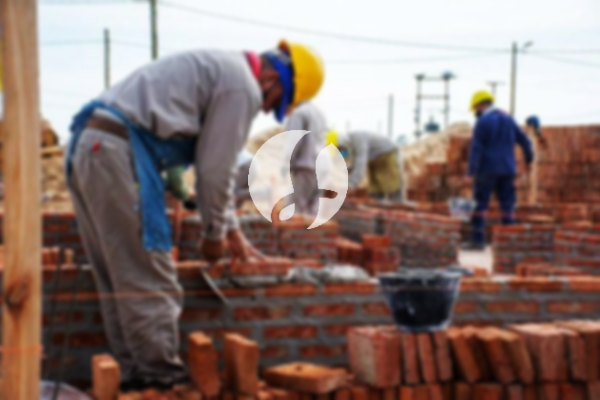

**Biaya Bangun Rumah Per Meter Di Meruya Utara Jakarta** - Hai Mitra Sumber Material! Bagaimana kabar Anda? Kami dari Sumber Material hadir untuk membantu Anda mewujudkan rumah impian di Meruya Utara Jakarta. Sejalan dengan perkembangan zaman, layanan pembangunan rumah semakin diminati. Borongan pembangunan rumah kini berkembang pesat, bahkan merambah jasa desain bangunan. Semakin banyak orang yang memilih jasa bangun rumah karena kemudahan dan efisiensinya. Pertumbuhan populasi yang pesat memicu peningkatan kebutuhan akan tempat tinggal. Hal ini mendorong para pengembang properti untuk berlomba-lomba membangun berbagai jenis hunian, dari yang ekonomis hingga mewah. Dengan kepercayaan yang diberikan oleh pelanggan, jasa bangun rumah berkomitmen untuk mempertahankan kualitas dan memberikan yang terbaik.



## Jasa Desain Gambar Arsitek Di Meruya Utara Jakarta

Sebagai penyedia jasa desain arsitek, Kami akan mengamati dan merancang desain rumah yang Anda inginkan. Melalui desain yang cermat, Kami berusaha mewujudkan keindahan dalam setiap detail hunian Anda. Beberapa faktor penting kami perhatikan untuk menciptakan komposisi desain yang harmonis dan sesuai selera. Desain adalah kunci utama! Karena desain yang baik akan menciptakan rumah yang menarik dan nyaman. Anda tak perlu khawatir, Kami akan menyesuaikan desain dengan anggaran yang Anda miliki. Dari desain ini, Anda dapat memperkirakan biaya yang dibutuhkan untuk mewujudkan rumah impian Anda. Selain itu, Kami juga mempertimbangkan pemilihan material bangunan yang tepat. Semua aspek ini membutuhkan keahlian khusus, itulah mengapa Anda membutuhkan jasa arsitek profesional. Kami akan memahami harapan Anda dan mewujudkannya dalam desain yang memuaskan.

Biaya jasa desain bangunan Kami bervariasi, tergantung pada luas rumah dan kompleksitas desain yang Anda inginkan. Saat ini, Kami menawarkan harga per meter persegi. Untuk desain rumah minimalis satu lantai, tarifnya mulai dari Rp 54.000,- per meter persegi, sudah termasuk desain, perhitungan RAB, dan dua kali revisi. Sedangkan untuk rumah dua lantai atau lebih, biayanya bisa dikalikan dua atau tiga sesuai dengan jumlah lantai.

## Harga Layanan Borong Bangun Tempat Tinggal Di Meruya Utara Jakarta

Seiring dengan pertumbuhan penduduk, kebutuhan akan tempat tinggal terus meningkat. Banyak layanan borong bangun rumah bermunculan, menawarkan berbagai produk dan layanan terbaik kepada konsumen. Disinilah peran utama Kami sebagai borongan bangun rumah dalam mengatasi tantangan mewujudkan rumah impian Anda. Dengan Kami, Anda akan mendapatkan layanan yang sesuai dengan keinginan Anda. Memiliki rumah yang cantik adalah impian setiap orang. Dengan memanfaatkan jasa borong bangun rumah, Kami akan membantu mewujudkan impian tersebut. Anda tidak perlu repot mendesain rumah sendiri, karena Kami akan berusaha memahami kebutuhan Anda dan mewujudkannya dalam bentuk nyata. Kepuasan Anda adalah prioritas Kami, dan hal itu menjadi motivasi Kami untuk terus memberikan yang terbaik.

Untuk layanan borong bangun rumah, Kami menawarkan beberapa tingkatan harga. Harganya disesuaikan dengan material bangunan yang digunakan dan lokasi pembangunan di Meruya Utara Jakarta. Dengan asumsi kondisi tanah yang rata, stabil, dan tidak memerlukan pengurugan. Harga per meter persegi dengan material dinding hebel adalah Rp 1.950.000,-, sedangkan dengan material bata merah adalah Rp 2.200.000,-. Harga ini sudah termasuk pondasi batu kali, kolom dan tiang beton, lantai keramik standar, serta atap rangka baja ringan dengan genteng spandek. Untuk jenis genteng dan keramik, Anda dapat menyesuaikan dengan preferensi, model, dan anggaran Anda.

## Ongkos Perbaikan Bangunan Di Meruya Utara Jakarta

Selain jasa desain dan pembangunan, Kami juga menyediakan jasa renovasi rumah. Renovasi rumah adalah cara efektif untuk memberikan tampilan baru pada hunian Anda. Dengan adanya jasa renovasi rumah, Anda tidak perlu bingung menentukan langkah yang tepat. Kami menawarkan renovasi yang meliputi perubahan bentuk model rumah secara parsial maupun menyeluruh. Renovasi memang menjadi solusi untuk mempercantik rumah dengan anggaran yang lebih terjangkau. Namun, seringkali seseorang kesulitan dalam menjalankan renovasi sendiri. Disinilah Kami hadir sebagai solusi! Kami adalah borongan renovasi bangunan yang akan memudahkan Anda dalam merenovasi rumah Anda menjadi lebih segar dan indah. Kami siap mewujudkan impian renovasi rumah Anda sesuai dengan yang Anda harapkan.

Biaya borongan renovasi rumah Kami bervariasi, tergantung pada kondisi kerusakan bangunan. Setiap bangunan memiliki tingkat kerusakan yang berbeda-beda. Oleh karena itu, harga borongan renovasi bangunan Kami disesuaikan dengan jenis kerusakan yang perlu diperbaiki. Namun, untuk jasa renovasi dengan tenaga tukang harian, tarifnya adalah Rp 150.000,- per hari untuk tukang dan Rp 100.000,- per hari untuk kenek.

## Didukung Tenaga Kerja Dan Arsitek Berpengalaman Di Meruya Utara Jakarta

Baik itu jasa desain arsitek, jasa bangun rumah, atau jasa renovasi, semuanya memiliki peran penting. Didukung oleh arsitek profesional dan tenaga kerja yang handal, Kami akan membantu mewujudkan impian Anda. Dengan membangun rumah idaman bersama Kami, Anda akan memiliki hunian yang menarik dan indah. Anda tidak perlu khawatir, karena Kami memberikan pelayanan terbaik, menjaga kualitas dan integritas untuk memberikan kepuasan Anda. Kepuasan pelanggan adalah motivasi utama Kami untuk terus berkarya dan menghasilkan karya-karya yang lebih baik. Anda dapat melihat katalog proyek-proyek Kami untuk melihat hasil kerja Kami. Katalog ini akan membuktikan bahwa Kami adalah pilihan terbaik dan terpercaya.

Penting untuk diingat bahwa rumah adalah kebutuhan utama manusia, selain sandang dan pangan. Rumah adalah tempat berlindung dari cuaca ekstrem dan berbagai bahaya. Hal ini menjadi peluang bagi penyedia jasa bangun rumah untuk menawarkan jasanya. Sebagai penyedia jasa khusus jasa bangun rumah, Kami berpartisipasi dalam meramaikan dunia arsitektur yang terus berkembang dengan mempromosikan jasa Kami melalui berbagai media. Mulai dari media cetak hingga media online, Kami gunakan untuk memperkenalkan jasa bangun rumah Kami. Hal ini tentu sangat membantu banyak orang yang ingin membangun rumah. Dengan menjaga kualitas dan mutu terbaik, Kami telah terbukti memiliki pengalaman yang cukup lama dalam dunia arsitektur. Inilah mengapa Kami semakin dipercaya oleh banyak orang.

Didukung oleh arsitek profesional dan tenaga kerja yang handal, tentu akan membuat jasa bangun rumah Kami semakin dikenal dan terpercaya. Hal ini tercermin dari perkembangan yang terus Kami berikan. Kami terus berkarya menciptakan karya-karya baru yang lebih inovatif dan kreatif. Banyak rumah-bangunan indah yang telah Kami bangun dengan desain yang apik dan menarik. Dengan proses pengerjaan yang efisien, Anda akan segera mendapatkan rumah impian Anda. Baik rumah berskala kecil maupun besar, semuanya dapat Kami tangani dengan baik. Jadi, Anda tidak perlu ragu atau khawatir. Mulai dari desain bangunan, material bahan, ukuran rumah, hingga sumber daya manusia, semuanya dapat Kami atasi dengan baik. Dengan demikian, Kami dapat mendukung terwujudnya rumah yang cantik dan menarik. Disinilah peran penting jasa bangun rumah. Kami akan mewujudkan perencanaan Anda dan juga mengawasi proses pembangunannya. [Hubungi Kami Sekarang!](https://api.whatsapp.com/send?phone=6285776786091&text=*Halo%20sumbermaterial.com*%20%3A)
