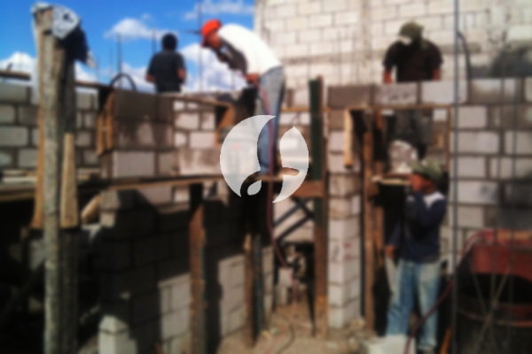

**Biaya Bangun Rumah Per Meter Di Muarasari Bogor** - Hai Mitra Sumber Material! Gimana kabarnya? Seiring perkembangan zaman, kebutuhan akan jasa pembangunan bangunan semakin meningkat. Kini banyak yang memilih layanan bangun rumah yang tidak hanya menawarkan konstruksi, tapi juga solusi desain yang komprehensif. Pertumbuhan populasi yang pesat turut mendorong permintaan akan tempat tinggal, dan para pelaku properti berlomba-lomba menghadirkan berbagai pilihan hunian, mulai dari yang sederhana hingga mewah. Kepercayaan konsumen adalah kunci utama, dan penyedia jasa bangun rumah berkomitmen untuk menjaga kepercayaan tersebut dengan memberikan hasil terbaik sesuai dengan harapan. Kami, sebagai penyedia layanan bangun rumah terpercaya di Muarasari Bogor, menawarkan beragam opsi yang bisa Anda pilih. Berikut beberapa tipe layanan dari jasa bangun rumah yang dapat memenuhi kebutuhan Anda:



## Jasa Desain Gambar Arsitek Profesional di Muarasari Bogor

Sebagai penyedia jasa arsitek, fokus utama Kami adalah mewujudkan visualisasi rumah impian Anda. Kami mengamati dan merancang desain yang tidak hanya indah, tetapi juga fungsional dan sesuai dengan gaya hidup Anda. Komposisi desain yang baik adalah kunci keberhasilan, dan Kami memperhatikan berbagai faktor penting untuk mencapai estetika yang harmonis.  Sebagaimana kita ketahui, desain yang menarik sangat berpengaruh pada tampilan rumah secara keseluruhan. Anda tidak perlu khawatir, karena Kami dapat menyesuaikan desain dengan budget yang Anda miliki. Desain ini akan memberikan gambaran jelas mengenai perkiraan biaya yang dibutuhkan untuk mewujudkan rumah impian Anda. Kami juga mempertimbangkan pemilihan material bangunan yang tepat agar sesuai dengan anggaran dan kualitas yang diinginkan. Proses ini memang membutuhkan keahlian khusus, itulah mengapa memilih jasa arsitek yang kompeten sangatlah penting. Kami siap memahami kebutuhan dan keinginan Anda, sehingga Anda akan merasa puas dengan hasil akhirnya.

Harga jasa desain rumah Kami bervariasi tergantung pada luas bangunan dan tingkat kesulitan desain. Saat ini, Kami menawarkan harga per meter persegi. Untuk desain rumah minimalis satu lantai, tarifnya mulai dari Rp 54.000,- per meter persegi, termasuk desain, perhitungan RAB (Rencana Anggaran Biaya), dan 2 kali revisi. Untuk bangunan 2 lantai atau lebih, biayanya hanya dikalikan 2 atau 3 sesuai dengan jumlah lantai.

## Estimasi Biaya Borong Renovasi Bangunan di Muarasari Bogor

Dengan semakin banyaknya orang yang membutuhkan tempat tinggal, permintaan akan jasa renovasi pun meningkat. Renovasi adalah solusi tepat untuk memperbarui tampilan rumah Anda, baik secara parsial maupun menyeluruh. Kami menyediakan layanan renovasi bangunan yang dapat membantu Anda merealisasikan ide-ide kreatif Anda. Renovasi yang Kami lakukan meliputi perubahan tampilan bangunan, perombakan struktur, dan bahkan renovasi total. Dengan bantuan jasa renovasi bangunan, Anda tidak perlu khawatir menghadapi kerumitan proses renovasi. Kami hadir sebagai solusi praktis untuk mempercantik rumah Anda dengan anggaran yang terjangkau.  Berbagai pilihan material dan desain tersedia untuk memenuhi selera Anda.

Untuk harga borong renovasi rumah, Kami menawarkan beberapa tingkatan harga yang disesuaikan dengan material bangunan yang digunakan dan lokasi geografis proyek. Dengan asumsi kondisi tanah rata, stabil, dan tidak memerlukan pengurukan, harga per meter persegi untuk material dinding hebel adalah Rp 1.950.000,-, sementara untuk material bata merah adalah Rp 2.200.000,-. Harga tersebut sudah termasuk pondasi batu gunung, kolom dan tiang beton, lantai keramik standar, serta atap rangka baja ringan dengan genteng spandek. Anda dapat memilih jenis genteng dan keramik lain sesuai preferensi dan anggaran Anda.

## Kalkulasi Biaya Rombak Tempat Tinggal di Muarasari Bogor

Selain layanan desain dan bangun rumah, Kami juga menyediakan jasa rombak tempat tinggal. Renovasi bisa menjadi cara efektif untuk memberikan nuansa baru pada rumah Anda. Kami hadir untuk membantu Anda mewujudkan impian memiliki rumah yang segar dan menarik. Jasa rombak rumah Kami meliputi perubahan bentuk bangunan secara menyeluruh atau sebagian. Renovasi adalah alternatif yang tepat untuk meningkatkan nilai estetika rumah Anda tanpa harus membangun dari awal. Akan tetapi, biaya renovasi seringkali menjadi kendala utama. Dengan adanya Kami, Anda dapat mengatasi masalah ini karena Kami menawarkan solusi renovasi yang terjangkau dan profesional. Kami siap membantu Anda mengubah rumah Anda menjadi lebih cantik dan sesuai dengan impian Anda.

Untuk biaya jasa rombak rumah, Kami memberikan penawaran harga yang berbeda-beda tergantung pada kondisi kerusakan bangunan. Oleh karena itu, penyesuaian biaya akan dilakukan berdasarkan jenis kerusakan yang perlu diperbaiki. Namun, untuk biaya jasa tukang harian, tarifnya adalah Rp 150.000,- per hari untuk tukang dan Rp 100.000,- per hari untuk kenek.

## Keunggulan Didukung Tenaga Kerja dan Arsitek Terbaik di Muarasari Bogor

Baik layanan desain, pembangunan, maupun renovasi, semuanya memiliki peran penting dalam mewujudkan rumah impian Anda. Kami didukung oleh tim arsitek profesional dan tenaga kerja yang handal, sehingga Kami dapat memberikan hasil terbaik sesuai dengan harapan Anda. Dengan bermitra bersama Kami, Anda akan mendapatkan rumah yang tidak hanya indah secara visual, tetapi juga kokoh dan nyaman untuk ditinggali. Kami berkomitmen untuk memberikan pelayanan terbaik, menjaga kualitas, dan memberikan kepuasan maksimal kepada setiap pelanggan. Kepuasan Anda adalah penyemangat Kami untuk terus berkarya dan menghasilkan karya yang lebih baik lagi. Anda dapat melihat katalog proyek-proyek sebelumnya Kami sebagai bukti kualitas dan keahlian Kami.

Penting untuk diingat bahwa rumah adalah kebutuhan primer manusia yang sangat penting, selain sandang dan pangan. Rumah menjadi tempat berlindung dari cuaca ekstrem dan berbagai bahaya. Hal ini menjadikan penyedia jasa bangun rumah memiliki peluang untuk berkontribusi dalam memenuhi kebutuhan tersebut. Sebagai penyedia jasa khususnya di Muarasari Bogor, Kami berpartisipasi untuk memajukan dunia arsitektur dengan menawarkan berbagai layanan melalui berbagai media, mulai dari media cetak hingga online. Hal ini memudahkan masyarakat untuk menemukan solusi terbaik untuk membangun rumah impian mereka. Dengan menjaga kualitas dan profesionalitas, Kami telah terbukti memiliki pengalaman yang cukup lama dalam industri ini. Inilah alasan mengapa semakin banyak orang mempercayakan pembangunan rumah mereka kepada Kami.

Dengan dukungan tim arsitek profesional dan tenaga kerja yang terampil, Kami yakin dapat memberikan layanan terbaik dan memuaskan kebutuhan bangunan Anda. Kami terus berkembang dan berinovasi untuk menghadirkan karya-karya baru yang lebih kreatif dan menarik. Banyak bangunan yang telah Kami bangun dengan desain yang apik dan menarik. Proses pengerjaan yang efisien memungkinkan Anda untuk segera menikmati rumah impian Anda. Baik itu rumah berskala kecil maupun besar, Kami siap menghadapinya. Kami dapat membantu Anda dalam hal desain, material bangunan, ukuran rumah, dan sumber daya manusia. Dengan demikian, Kami dapat mendukung terwujudnya rumah yang cantik dan menarik. Disitulah letak pentingnya peran Kami sebagai penyedia jasa bangun rumah. Kami tidak hanya mewujudkan rancangan, tetapi juga berperan sebagai pengawas dalam proses pembangunan. [bangun rumah di Bojongkerta](/bangunan/biaya-bangun-rumah-per-meter-di-bojongkerta-bogor/) Untuk proyek di luar wilayah Muarasari Bogor, Kami juga melayani [bangun rumah di Babakan Pasar](/bangunan/biaya-bangun-rumah-per-meter-di-babakan-pasar-bogor/). Jangan ragu untuk menghubungi Kami [untuk info lebih lanjut](https://api.whatsapp.com/send?phone=6285776786091&text=*Halo%20sumbermaterial.com*%20%3A)!
