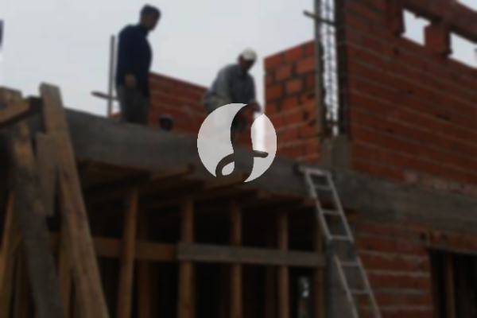

**Biaya Bangun Rumah Per Meter Di Mulyaharja Bogor** - Hai Mitra Sumber Material! Gimana kabarnya? Seiring perkembangan zaman, layanan bangun rumah semakin diminati. Banyak orang kini lebih memilih jasa kontraktor untuk mewujudkan hunian impian mereka. Pertumbuhan populasi yang pesat otomatis meningkatkan kebutuhan akan tempat tinggal. Tak heran jika banyak pengembang properti berlomba-lomba membangun rumah, apartemen, dan perumahan dengan berbagai kelas. Kepercayaan konsumen adalah kunci utama, dan jasa bangun rumah yang terpercaya akan berupaya keras menjaga reputasi mereka dengan melaksanakan pekerjaan sesuai amanah. Nah, bagi Anda yang berencana membangun rumah di Mulyaharja Bogor, Kami hadir menawarkan solusi lengkap!



## Harga Desain Gambar Arsitektur Di Mulyaharja Bogor

Sebagai penyedia jasa arsitektur, Kami memberikan perhatian khusus pada desain bangunan yang akan Anda wujudkan. Desain yang baik akan menciptakan keindahan dan kenyamanan. Kami berusaha memunculkan keindahan dari setiap hunian dengan mempertimbangkan berbagai faktor penting agar komposisi desain terlihat cantik dan selaras. Anda tahu sendiri, desain adalah elemen terpenting yang menentukan tampilan rumah. Dengan desain yang tepat, Anda bisa memperkirakan biaya yang dibutuhkan untuk mewujudkan rumah impian Anda. Kami juga memperhatikan pemilihan material bangunan yang sesuai dengan anggaran Anda. Proses ini memang membutuhkan keahlian khusus. Itulah mengapa, sangat penting untuk memilih jasa arsitek yang berpengalaman. Arsitek akan memahami harapan Anda dan menuangkan ide Anda ke dalam desain yang memuaskan.

Untuk layanan desain, harga Kami bervariasi tergantung luas bangunan dan tingkat kesulitan desain yang diinginkan. Saat ini, Kami menetapkan harga jasa desain rumah minimalis satu lantai sebesar Rp 54.000,- per meter persegi. Harga ini sudah termasuk desain, RAB (Rencana Anggaran Biaya), dan 2 kali revisi. Sedangkan untuk bangunan 2 lantai atau lebih, biayanya hanya dikali 2 atau 3 sesuai dengan jumlah lantai.

## Jasa Borong Renovasi Bangunan Di Mulyaharja Bogor

Mengingat semakin banyaknya orang yang membutuhkan tempat tinggal, layanan bangun rumah semakin berkembang pesat. Di sinilah peran penting kontraktor bangunan dalam menangani permasalahan pembangunan rumah. Dengan memilih jasa Kami, Anda akan mendapatkan layanan yang sesuai dengan kebutuhan Anda. Memiliki rumah yang indah adalah impian semua orang. Dengan menggunakan jasa bangun rumah profesional, Anda akan terbantu mewujudkan impian tersebut. Anda tidak perlu repot mendesain rumah sendiri karena Kami selalu berusaha memahami keinginan Anda dan mewujudkannya dalam bentuk bangunan nyata yang menawan. Kepuasan Anda adalah prioritas Kami, dan Kami selalu berusaha memberikan pelayanan terbaik.

Untuk layanan borong renovasi bangunan di Mulyaharja Bogor, Kami menawarkan beberapa pilihan harga. Harga disesuaikan dengan material bangunan yang digunakan dan lokasi pembangunan. Dengan asumsi tanah dalam kondisi rata, stabil, dan tidak memerlukan pengurukan, harga per meter persegi dengan material dinding hebel adalah Rp 1.950.000,-, sedangkan dengan material bata merah adalah Rp 2.200.000,-. Harga ini mencakup pondasi batu gunung, kolom dan tiang beton, lantai keramik standar, serta atap rangka baja ringan plus genteng spandek. Anda juga bisa memilih tipe, model, dan kualitas genteng serta keramik lainnya sesuai preferensi Anda, dan harga akan disesuaikan.

## Layanan Renovasi Rumah Di Mulyaharja Bogor

Selain layanan arsitek dan bangun rumah, Kami juga menyediakan jasa renovasi rumah di Mulyaharja Bogor. Renovasi adalah cara yang efektif untuk memberikan tampilan baru pada rumah Anda. Dengan adanya jasa renovasi bangunan, Anda tidak perlu khawatir menghadapi proses renovasi yang kompleks. Renovasi bisa dilakukan dengan mengubah tampilan rumah secara parsial atau total. Renovasi memang menjadi solusi menarik untuk mempercantik bangunan dengan anggaran yang terjangkau. Namun, seringkali seseorang kesulitan melakukan renovasi sendiri karena keterbatasan dana dan pengetahuan. Di sinilah Kami hadir sebagai solusi renovasi bangunan yang akan membantu Anda mengubah rumah menjadi lebih segar dan indah. Kami siap mewujudkan rumah impian Anda dengan sentuhan renovasi yang tepat.

Biaya borongan jasa renovasi rumah Kami bervariasi tergantung kondisi kerusakan bangunan. Karena setiap rumah memiliki tingkat kerusakan yang berbeda-beda, biaya renovasi akan disesuaikan dengan jenis kerusakan yang akan diperbaiki. Untuk jasa renovasi menggunakan tenaga tukang harian, Kami mengenakan tarif Rp 150.000,- per hari untuk tukang dan Rp 100.000,- per hari untuk kenek.

## Didukung Tukang Dan Arsitek Terbaik Di Mulyaharja Bogor

Baik layanan arsitek, bangun rumah, maupun renovasi, semuanya memiliki peran penting dalam mewujudkan hunian impian Anda. Dengan dukungan arsitek profesional dan tenaga kerja yang handal, Kami siap membantu mewujudkan impian Anda. Membangun rumah idaman dengan jasa bangun rumah berkualitas akan memberikan Anda hunian yang menarik dan nyaman. Anda tidak perlu khawatir karena Kami selalu mengutamakan kualitas dan menjaga mutu pekerjaan untuk memberikan kepuasan maksimal. Sebagai penyedia jasa bangun rumah terpercaya, kepuasan pelanggan adalah motivasi utama Kami untuk terus berkarya dan memberikan hasil yang lebih baik lagi. Anda bisa melihat katalog proyek Kami untuk melihat hasil karya jasa bangun rumah yang sudah Kami selesaikan. Katalog ini akan membuktikan bahwa Kami adalah pilihan terbaik dan terpercaya untuk membangun rumah impian Anda di Mulyaharja Bogor.

Perlu diingat, tempat tinggal adalah kebutuhan utama manusia selain sandang dan pangan. Rumah menjadi tempat berlindung dari cuaca ekstrem dan berbagai bahaya. Hal ini menjadi peluang bagi penyedia jasa bangun rumah untuk berkontribusi dalam dunia arsitektur yang terus berkembang dengan menawarkan layanan terbaik. Kami memanfaatkan berbagai media, mulai dari media cetak hingga online, untuk mempromosikan jasa bangun rumah Kami. Hal ini tentu memudahkan banyak orang yang ingin mewujudkan rumah impian mereka. Dengan menjaga mutu dan kualitas terbaik, Kami telah memiliki pengalaman yang cukup lama dalam menggeluti dunia arsitektur. Itulah mengapa, jasa bangun rumah Kami semakin dipercaya oleh banyak orang. [bangun rumah di Bondongan](/bangunan/biaya-bangun-rumah-per-meter-di-bondongan-bogor/)

Didukung oleh arsitek profesional dan tenaga kerja yang handal, Kami yakin dapat memberikan pelayanan terbaik dan hasil yang memuaskan. Kami terus berinovasi dan menciptakan karya-karya baru yang kreatif dan berkualitas. Banyak bangunan telah Kami bangun dengan desain yang apik dan menarik. Proses pengerjaan yang cepat dan efisien memungkinkan Anda segera menempati rumah impian Anda. Baik rumah kecil maupun besar, Kami mampu menangani berbagai proyek pembangunan dengan baik. Mulai dari desain bangunan, pemilihan material, ukuran bangunan, hingga pengelolaan sumber daya manusia, semuanya dapat Kami atasi dengan baik. Hal ini mendukung terwujudnya rumah yang cantik, nyaman, dan sesuai dengan harapan Anda. Disinilah peran krusial jasa bangun rumah. Kami akan membantu Anda dalam perencanaan, pelaksanaan, dan pengawasan pembangunan. [Hubungi Kami Sekarang](https://api.whatsapp.com/send?phone=6285776786091&text=*Halo%20sumbermaterial.com*%20%3A) untuk konsultasi gratis!
