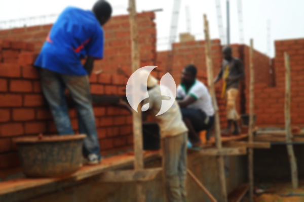

**Biaya Bangun Rumah Per Meter Di Muncang Rangkasbitung** - Halo Mitra Sumber Material! Gimana kabarnya? Perkembangan dunia konstruksi kini semakin pesat, dan jasa pembangunan rumah menjadi pilihan utama bagi banyak orang. Banyak sekali layanan yang ditawarkan untuk membangun tempat tinggal, mulai dari desain hingga konstruksi. Permintaan akan hunian terus meningkat seiring pertumbuhan penduduk, sehingga para kontraktor properti berlomba-lomba menawarkan layanan terbaik mereka. Kepercayaan konsumen adalah kunci utama, dan layanan bangun rumah yang terpercaya akan selalu berupaya memberikan yang terbaik. Kami hadir sebagai mitra Anda dalam mewujudkan rumah impian di Muncang Rangkasbitung. Berikut adalah beberapa layanan yang kami tawarkan:



## Jasa Desain Gambar Arsitektur di Muncang Rangkasbitung

Sebagai penyedia jasa desain, Kami sangat memperhatikan estetika rumah yang akan dibangun. Melalui desain yang matang, Kami berusaha menciptakan keindahan dan fungsi yang harmonis. Beberapa faktor penting kami perhatikan untuk menghasilkan komposisi desain yang baik dan selaras. Desain adalah elemen krusial dalam pembangunan rumah. Desain yang baik akan membuat hunian Anda tampak menarik dan nyaman. Kami akan membantu Anda mewujudkan desain yang sesuai dengan anggaran yang Anda miliki. Dengan desain yang jelas, Anda dapat memperkirakan biaya yang dibutuhkan untuk membangun rumah impian Anda. Selain itu, Kami juga akan mempertimbangkan bahan bangunan yang akan digunakan. Semua aspek ini memerlukan perencanaan yang cermat, dan itulah mengapa memilih jasa arsitek profesional di Muncang Rangkasbitung adalah pilihan yang tepat. Kami akan memahami keinginan Anda dan mewujudkannya menjadi kenyataan.

Biaya jasa desain rumah Kami bervariasi tergantung pada luas rumah dan tingkat kesulitan desain yang diminta. Saat ini, Kami menetapkan harga per meter persegi. Untuk desain rumah minimalis satu lantai, biaya jasa Kami adalah Rp 54.000,- per meter persegi, sudah termasuk desain, perhitungan RAB, dan 2 kali revisi. Sedangkan untuk rumah dua lantai atau lebih, harga akan dikalikan 2 atau 3 sesuai dengan jumlah lantai.

## Harga Layanan Borong Renovasi Rumah Di Muncang Rangkasbitung

Seiring bertambahnya populasi, kebutuhan akan tempat tinggal menjadi semakin mendesak. Banyak orang kini membutuhkan rumah yang nyaman dan aman untuk keluarga mereka. Kami hadir sebagai solusi untuk Anda yang ingin membangun hunian idaman di Muncang Rangkasbitung. Sebagai penyedia jasa borong renovasi rumah, Kami akan membantu Anda mengatasi permasalahan dalam membangun rumah. Kami akan memastikan bahwa Anda mendapatkan layanan yang sesuai dengan harapan Anda. Memiliki rumah yang indah adalah impian setiap orang. Dengan menggunakan layanan bangun rumah Kami, Anda akan mendapatkan bantuan untuk mewujudkan impian tersebut. Kami akan memahami keinginan Anda dan mewujudkannya menjadi karya nyata sebuah rumah impian di Muncang Rangkasbitung. Dengan begitu, Anda akan merasa puas dan percaya pada layanan Kami.

Untuk harga layanan borong renovasi rumah, Kami menawarkan beberapa tingkatan harga yang disesuaikan dengan bahan bangunan yang digunakan dan lokasi proyek. Harga per meter persegi dengan material dinding hebel adalah Rp 1.950.000,-, sedangkan dengan material bata merah adalah Rp 2.200.000,-. Harga ini sudah termasuk pondasi batu sungai, kolom dan tiang beton, lantai keramik standar, serta atap dengan rangka baja ringan dan genteng spandek. Anda dapat memilih tipe genteng dan keramik lain sesuai preferensi Anda, dengan penyesuaian harga yang sesuai.

## Layanan Rombak Bangunan Di Muncang Rangkasbitung

Selain jasa arsitek dan bangun rumah, Kami juga menyediakan layanan renovasi bangunan. Renovasi adalah cara efektif untuk memberikan tampilan baru pada rumah Anda. Dengan adanya layanan renovasi bangunan, Anda tidak perlu khawatir tentang proses renovasi. Kami menawarkan renovasi yang dapat berupa perubahan tampilan interior maupun eksterior, bahkan renovasi total. Renovasi seringkali menjadi solusi alternatif untuk memperbarui rumah dengan anggaran yang terjangkau. Namun, renovasi membutuhkan perencanaan dan keahlian khusus. Kami hadir sebagai layanan renovasi rumah profesional yang siap membantu Anda merenovasi rumah menjadi lebih indah dan menarik. Kami akan mewujudkan impian Anda memiliki rumah yang sesuai dengan keinginan Anda.

Harga borongan jasa renovasi rumah Kami bervariasi tergantung pada kondisi kerusakan bangunan. Oleh karena itu, harga disesuaikan dengan jenis kerusakan yang akan diperbaiki. Untuk jasa renovasi dengan tenaga tukang harian, Kami mengenakan biaya Rp 150.000,- per hari untuk tukang dan Rp 100.000,- per hari untuk kenek.

## Didukung Tukang Dan Arsitek Berpengalaman Di Muncang Rangkasbitung

Baik layanan desain, bangun rumah, maupun renovasi, semuanya memiliki peran penting dalam mewujudkan rumah impian Anda. Kami didukung oleh arsitek profesional dan tenaga kerja yang handal, sehingga Kami dapat membantu Anda mewujudkan impian tersebut. Membangun rumah impian dengan layanan bangun rumah Kami akan memberikan Anda hunian yang menarik, nyaman, dan berkualitas. Kami mengutamakan kepuasan pelanggan dan selalu berupaya memberikan pelayanan terbaik, menjaga kualitas dan mutu pekerjaan untuk memenuhi harapan Anda. Kepuasan Anda adalah dorongan Kami untuk terus berkarya dan menghasilkan karya-karya yang lebih baik. Anda dapat melihat portofolio proyek Kami untuk melihat hasil karya desain dan pembangunan rumah. Katalog tersebut akan membuktikan bahwa Kami adalah pilihan terbaik dan terpercaya untuk membangun rumah di Muncang Rangkasbitung.

Perlu diingat, rumah adalah kebutuhan primer manusia yang sangat penting, selain sandang dan pangan. Rumah memberikan perlindungan dari cuaca ekstrem dan bahaya lainnya. Hal ini menjadi peluang bagi penyedia jasa bangun rumah untuk menawarkan layanan mereka. Sebagai penyedia jasa terkhusus dalam membangun rumah, Kami berpartisipasi dalam memajukan dunia arsitektur dengan mempromosikan layanan Kami melalui berbagai media, baik cetak maupun online. Hal ini tentu membantu masyarakat yang ingin membangun rumah. Dengan mempertahankan kualitas dan mutu terbaik, Kami telah memiliki pengalaman yang cukup lama dalam menggeluti dunia arsitektur. Itulah mengapa, layanan bangun rumah Kami semakin banyak dipercaya oleh masyarakat. Untuk wilayah lain, Kami juga melayani [bangun rumah di Bojongmanik](/bangunan/biaya-bangun-rumah-per-meter-di-bojongmanik-rangkasbitung/).

Kami didukung oleh arsitek profesional dan tenaga kerja yang handal, yang akan menciptakan layanan bangun rumah yang semakin dikenal dan terpercaya. Kami terus berinovasi dan menciptakan karya-karya baru yang kreatif dan menarik. Banyak bangunan indah yang telah Kami bangun dengan desain yang apik. Dengan progres pengerjaan yang cepat, Anda akan segera memiliki rumah impian Anda. Baik rumah skala kecil maupun besar, Kami dapat mengatasinya. Anda tidak perlu khawatir atau cemas. Mulai dari desain bangunan, pemilihan material, hingga ukuran bangunan dan sumber daya manusia, semua dapat Kami atasi. Dengan demikian, Kami dapat mendukung terwujudnya bangunan yang cantik dan menarik. Disitulah peran penting dari layanan bangun rumah. Kami akan membuat tata desain yang sesuai dengan keinginan Anda dan sekaligus mengawasi proses pembangunan. [Hubungi Kami Sekarang](https://api.whatsapp.com/send?phone=6285776786091&text=*Halo%20sumbermaterial.com*%20%3A) untuk konsultasi gratis!
