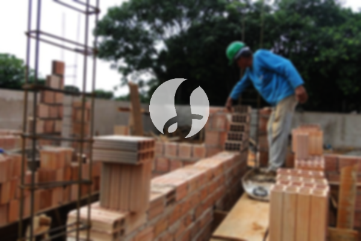

**Biaya Bangun Rumah Per Meter Di Pabuaran Serang** - Hai Mitra Sumber Material! Gimana kabarnya hari ini? Kami dari Sumber Material hadir sebagai mitra terpercaya Anda dalam mewujudkan hunian impian di Pabuaran Serang. Seiring dengan perkembangan zaman, jasa bangun rumah semakin diminati. Borongan bangun rumah telah berkembang pesat, bahkan merambah layanan desain interior. Banyak orang kini lebih memilih jasa bangun rumah karena kepraktisannya. Dengan meningkatnya jumlah penduduk, kebutuhan akan tempat tinggal juga ikut meningkat. Tak heran jika para pelaku properti berlomba-lomba membangun rumah, apartemen, atau tempat tinggal susun, dari yang ekonomis hingga mewah. Dengan kepercayaan yang diberikan konsumen, jasa bangun rumah berkomitmen menjaga reputasi dan menyelesaikan pekerjaan dengan baik. Dengan begitu, Anda akan mendapatkan layanan yang andal dan terpercaya. Kami menawarkan berbagai layanan untuk membangun rumah impian Anda. Berikut adalah beberapa jenis layanan dari jasa bangun rumah yang bisa Anda pilih:



## Harga Jasa Desain Gambar Arsitektur Di Pabuaran Serang

Sebagai penyedia jasa desain, Kami mengutamakan keindahan dan fungsionalitas sebuah rumah. Melalui desain yang matang, Kami berusaha menciptakan hunian yang menarik dan nyaman. Kami mempertimbangkan beberapa faktor penting untuk menghasilkan komposisi desain yang apik dan harmonis. Desain adalah elemen krusial dalam membangun rumah impian Anda. Desain yang baik akan membuat rumah Anda terlihat menarik dan bernilai tinggi. Anda tak perlu khawatir, karena Kami akan menciptakan desain yang sesuai dengan anggaran yang Anda miliki. Dari desain tersebut, Anda dapat memperkirakan biaya yang akan dikeluarkan untuk mewujudkan rumah idaman. Selain itu, Kami juga memperhatikan pemilihan bahan bangunan yang tepat. Semua aspek ini membutuhkan perencanaan yang matang, sehingga memilih jasa arsitek yang profesional adalah langkah yang bijak. Kami akan memahami keinginan Anda dan mewujudkannya menjadi kenyataan.

Namun, biaya jasa desain bangunan Kami bervariasi, tergantung pada luas bangunan dan tingkat kerumitan desain. Saat ini, Kami menerapkan harga per meter persegi. Untuk rumah minimalis satu lantai, biaya desain adalah Rp 54.000,- per meter persegi, termasuk desain, data RAB, dan 2 kali revisi. Untuk rumah dua lantai atau lebih, harganya dikalikan 2 atau 3 sesuai jumlah lantai.

## Jasa Borong Renovasi Bangunan Di Pabuaran Serang

Kebutuhan akan rumah yang baik dan nyaman semakin meningkat seiring dengan pertumbuhan populasi. Banyak layanan bangun rumah yang hadir menawarkan produk dan pelayanan terbaik mereka. Disinilah peran penting jasa bangun rumah dalam menangani tantangan pembangunan. Dengan memilih jasa bangun rumah yang tepat, Anda akan mendapatkan hasil yang sesuai dengan harapan Anda. Memiliki rumah yang bagus adalah impian setiap orang. Dengan menggunakan jasa bangun rumah, Kami akan membantu Anda mewujudkan impian tersebut. Anda tidak perlu repot mendesain rumah sendiri, karena Kami akan memahami keinginan Anda dan menerjemahkannya menjadi karya nyata. Kepuasan Anda adalah prioritas utama Kami.

Untuk harga layanan borong renovasi, Kami menawarkan beberapa opsi harga yang disesuaikan dengan bahan bangunan dan lokasi proyek di Pabuaran Serang. Dengan syarat lahan dalam keadaan rata, stabil, dan tidak memerlukan pengurugan. Harga per meter persegi dengan material dinding hebel adalah Rp 1.950.000,-, sedangkan dengan material bata merah adalah Rp 2.200.000,-. Harga ini mencakup pondasi batu gunung, kolom dan tiang beton, lantai keramik standar, serta atap rangka baja ringan plus genteng spandek. Untuk genteng dan keramik, Anda dapat memilih tipe, model, dan kualitas lain sesuai preferensi Anda, dan harga akan disesuaikan.

## Layanan Renovasi Bangunan Di Pabuaran Serang

Selain layanan desain dan pembangunan, Kami juga menyediakan jasa renovasi bangunan. Renovasi adalah cara yang efektif untuk memberikan tampilan baru pada rumah Anda. Dengan adanya jasa renovasi bangunan, Anda tidak perlu khawatir tentang proses renovasi yang rumit. Renovasi yang Kami lakukan meliputi perubahan tampilan rumah secara parsial atau total. Renovasi bisa menjadi solusi untuk memperbarui tampilan rumah Anda dengan anggaran yang lebih terjangkau. Namun, terkadang sulit untuk melakukan renovasi sendiri. Itulah mengapa Kami hadir sebagai mitra terpercaya Anda. Kami akan membantu Anda merenovasi bangunan Anda agar terlihat lebih bagus dan indah dari sebelumnya. Kami siap mewujudkan rumah impian Anda sesuai dengan keinginan Anda.

Untuk harga layanan renovasi, Kami memberikan harga yang bervariasi karena kondisi kerusakan bangunan berbeda-beda. Harga disesuaikan dengan tingkat kerusakan yang akan diperbaiki. Namun, untuk biaya tenaga tukang harian, tarifnya adalah Rp 150.000,- per hari untuk tukang dan Rp 100.000,- per hari untuk kenek.

## Disupport Tukang Dan Arsitek Terbaik Di Pabuaran Serang

Baik jasa desain, pembangunan, maupun renovasi, semuanya memiliki peran penting dalam mewujudkan hunian impian Anda. Didukung oleh arsitek profesional dan tenaga kerja yang handal, Kami akan membantu mewujudkan impian Anda. Dengan membangun rumah bersama Kami, Anda akan memiliki rumah yang menarik dan nyaman. Kami berkomitmen untuk memberikan pelayanan terbaik, menjaga kualitas, dan memberikan kepuasan kepada Anda. Kepuasan Anda adalah motivasi utama Kami untuk terus berkarya dan menghasilkan karya-karya yang lebih baik. Anda dapat melihat katalog proyek-proyek Kami sebelumnya untuk melihat kualitas pekerjaan Kami. Katalog tersebut akan membuktikan bahwa Kami adalah pilihan terbaik dan terpercaya.

Perlu diingat, rumah adalah kebutuhan pokok manusia, sama pentingnya dengan sandang dan pangan. Rumah memberikan perlindungan dari cuaca ekstrem dan berbagai bahaya. Inilah peluang bagi penyedia jasa bangun rumah untuk menampilkan keahlian mereka. Sebagai penyedia jasa, Kami berpartisipasi dalam memajukan dunia arsitektur dengan menampilkan jasa Kami melalui berbagai media, baik cetak maupun online. Hal ini tentu sangat membantu bagi mereka yang ingin membangun rumah. Dengan menjaga kualitas dan memberikan pelayanan terbaik, Kami telah terbukti memiliki pengalaman yang cukup lama dalam dunia arsitektur. Itulah sebabnya, semakin banyak orang mempercayai jasa bangun rumah Kami.

Didukung oleh arsitek profesional dan tenaga kerja yang handal, tentu akan membuat jasa bangun rumah semakin dikenal dan diakui kemampuannya. Hal ini terlihat dari perkembangan pesat yang Kami berikan. Kami terus berkarya mewujudkan karya-karya baru yang inovatif dan kreatif. Banyak rumah dan bangunan telah Kami bangun dengan desain yang apik dan menarik. Dengan proses pengerjaan yang cepat dan efisien, Anda akan segera mendapatkan rumah impian Anda. Baik rumah skala kecil maupun besar, Kami mampu mengatasinya. Sehingga, Anda tidak perlu ragu atau khawatir. Mulai dari desain rumah, pemilihan material, ukuran rumah, hingga tenaga kerja, semua bisa Kami atasi. Dengan begitu, Kami dapat mendukung terwujudnya rumah yang cantik dan menarik. Disitulah peran penting dari jasa bangun rumah. Karena, Kami akan mewujudkan tata desain yang Anda inginkan, sekaligus mengawasi proses pembangunan agar sesuai dengan harapan Anda. [Hubungi Kami Sekarang!](https://api.whatsapp.com/send?phone=6285776786091&text=*Halo%20sumbermaterial.com*%20%3A) Untuk wilayah lain, Kami juga melayani [bangun rumah di Binuang](/bangunan/biaya-bangun-rumah-per-meter-di-binuang-serang/).
