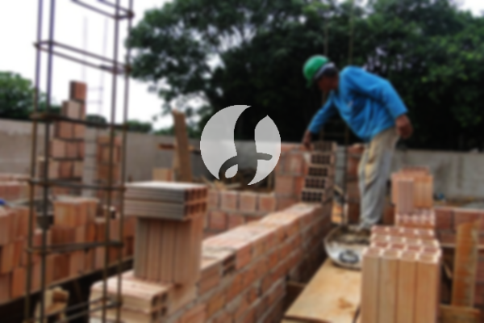

**Biaya Bangun Rumah Per Meter Di Pakuan Bogor** - Hai Mitra Sumber Material! Bagaimana kabarnya? Kami dari Sumber Material hadir untuk membantu mewujudkan impian memiliki rumah impian Anda di Pakuan Bogor. Seiring dengan perkembangan zaman, kebutuhan akan tempat tinggal yang nyaman dan berkualitas semakin meningkat. Hal ini mendorong pertumbuhan bisnis jasa bangun rumah, yang menawarkan solusi lengkap untuk mewujudkan rumah idaman Anda. Kami hadir sebagai mitra terpercaya dalam membangun rumah impian Anda di Pakuan Bogor.



## Harga Layanan Design Gambar Arsitek Di Pakuan Bogor

Sebagai bagian dari layanan komprehensif, Kami menyediakan jasa desain arsitek yang akan memperindah visual rumah Anda. Desain yang baik bukan hanya tentang estetika, tetapi juga fungsi dan efisiensi ruang. Dengan desain yang tepat, rumah Anda akan terasa lebih nyaman dan sesuai dengan kebutuhan keluarga Anda di Pakuan Bogor. Kami memahami bahwa setiap klien memiliki preferensi yang berbeda. Karena itu, Tim arsitek Kami akan bekerja sama dengan Anda untuk menciptakan desain yang sesuai dengan gaya dan anggaran Anda.

Sebagai penyedia jasa arsitek, karenanya layanan bangun akan memperhatikan design suatu bangunan yang akan di buat. melalui desain yang di buat, karenanya jasa bangun rumah akan berusaha utk menampilkan keindahan dari rumah tersebut. Sehingga, borongan bangun tempat tinggal akan menggunakan beberapa faktor penting utk dapat menciptakan komposisi design yg bagus dan selaras. Seperti di ketahui, jika desain terkadang menjadi hal yang paling penting utk di perhatikan. Dikarenakan, dengan desain yang di buat, karenanya tempat tinggal tersebut akan terlihat nampak indah. Anda tidak perlu bingung, dikarenakan layanan bangun rumah akan membuat desain yg sesuai dengan budget yang Anda miliki. Dari design itulah, karenanya Anda bisa memahami budget dari biaya yang akan dikeluarkan utk mewujudkan desain tempat tinggal yg Anda inginkan. Di samping itu, design yang akan di buat juga harus mengamati bahan material yang akan digunakan. Semua hal tersebut memang cukuplah sukar. Itulah sebabnya, anda wajib memilih jasa arsitek. Dimana, jasa arsitek akan memahami harapan anda. Sehingga anda akan merasa puas sudah memakai jasa arsitek.

Namun harga jasa untuk mendesign rumah dari kami berbeda-beda harganya. Sangat bergantung dengan luas rumah juga kerumitan desain yang di inginkan. Untuk sekarang ini kami memasang harga jasa desain rumah dan lainnya dengan harga per meter. Biaya jasa desain tempat tinggal minimalis satu lantai per meternya adalah 54.000,-. Harga yang demikian itu telah include desain, perhitungan RAB dan 2 kali revisi. Sedangan untuk rumah 2 lantai atau lebih, biayanya tinggal dikali 2 atau dikali 3 saja selaras dengan jumlah lantai.

## Ongkos Borong Renovasi Tempat Tinggal Di Pakuan Bogor

Mungkin Anda sudah memiliki rumah, tapi ingin memperbarui tampilan atau meningkatkan fungsinya? Kami juga menawarkan layanan borong renovasi rumah di Pakuan Bogor. Renovasi bisa memberikan perubahan besar pada hunian Anda, tanpa harus membangun dari awal. Dengan renovasi yang tepat, Anda bisa menciptakan rumah impian dengan budget yang lebih terjangkau. Kami akan membantu Anda mewujudkan tampilan baru yang segar dan modern untuk rumah Anda di Pakuan Bogor.

sebagaimana di ketahui, jika telah banyak orang yg menghuni bumi ini. Hingga, membuat orang harus mempunyai sebuah rumah utk tempat tinggal nya. Banyaknya borongan bangun rumah yg hadir tentu akan mempromosikam produk dan pelayanan terbaiknya untuk pembeli nya. Disinilah peran penting dari jasa bangun rumah dalam menangani permasalahan dari penciptaan sebuah tempat tinggal. Sehingga, Anda akan mendapatkan borongan bangun tempat tinggal yang sesuai harapan Anda. memiliki tempat tinggal yg bagus merupakan kemauan semua orang. Dengan memanfaatkan borongan bangun tempat tinggal, maka Anda akan di bantu untuk mewujudkan impian Anda. Dengan membangun rumah dengan borongan bangun rumah, karenanya Anda tidak perlu bingung untuk mendesain tempat tinggal anda sendiri. Karena, jasa bangun rumah senantiasa berusaha memahami harapan anda, yaitu dgn mewujudkan harapan Anda kedalam suatu karya nyata salahsatu tempat tinggal impian. Sehingga Anda akan merasa puas dan hal itu menjadikan layanan bangun tempat tinggal semakin di percaya.

Untuk harga layanan borong renovasi rumahnya sendiri dari kami ada sebagian level harga. Menyelaraskan dengan bahan bangunan yang di pakai dengan lokasi daerah yang akan di bangun. Dengan persyaratan tempat tanah yang akan dibanguan dalam posisi rata, tidak labil dan tidak perlu pengurukan. Harga per meternya dengan material dinding hebel adalah 1.950.000,-, dan dengan material bata merah per meternya 2.200.000,-. Harga yang kami bnerikan itu memakai pondasi batu gunung, kolom dan tiang beton, lantai keramik standar dan atap dengan rangka baja ringan plus genteng spandek. Untuk genteng dan kermiak dapat request variasi lain, model juga kwalitas dan harga menyesuaikan.

## Layanan Perbaikan Tempat Tinggal Di Pakuan Bogor

Kami juga melayani perbaikan rumah untuk mengatasi kerusakan akibat usia, bencana, atau faktor lainnya. Layanan ini dirancang untuk memberikan solusi cepat dan efisien untuk berbagai masalah kerusakan pada rumah Anda di Pakuan Bogor. Mulai dari perbaikan atap bocor, dinding retak, hingga penggantian keramik, Kami siap membantu Anda memulihkan kondisi rumah Anda. Jangan tunda perbaikan rumah Anda, karena kerusakan kecil dapat berkembang menjadi masalah yang lebih serius.

Untuk harga borongan dari jasa renovasi rumah kami, kami memberikan harga berbeda-beda. Disebabkan tempat tinggal yang hendak di renovasi biasanya keadaan kerusakannya tidak sama. Jadi, untuk biaya borongan renovasi bangunan ini disesuaikan dengan variasi kerusakan yang akan diperbaiki. Tapi untuk harga jasa renovasi dengan tenaga tukang harian, harganya adalah 150.000,- per hari untuk tukang dan 100.000,- per hari untuk kenek.

## Didukung Tenaga Kerja Dan Arsitek Berpengalaman Di Pakuan Bogor

Kualitas adalah prioritas utama Kami. Kami didukung oleh tim arsitek dan tenaga kerja yang berpengalaman dan profesional. Mereka memiliki keahlian dan dedikasi untuk menghasilkan pekerjaan yang rapi, kuat, dan sesuai dengan standar kualitas terbaik. Dengan tim yang solid dan terpercaya, Anda bisa tenang mengetahui bahwa proyek Anda ditangani oleh ahlinya. Kami bangga menjadi bagian dari pembangunan rumah impian Anda di Pakuan Bogor.

Wajib di ketahui, bahwa tempat tinggal yaitu suatu kebutuhan utama manusia yang sangat di perlukan selain sandang dan pangan. Dimana, tempat tinggal sudah menjadi tempat berteduh manusia dari cuaca panas dan dingin serta sebagai pelindung dari berbagai macam bahaya. Hal ini lah yang menjadi peluang para penyedia jasa bangun rumah untuk menampilkan jasanya. Sebagai penyedia jasa khususnya pada jasa bangun tempat tinggal, maka mereka akan berpartisipasi untuk meramaikan dunia arsitektur yang sedang berkembang pada saat ini dengan menawarkan jasanya melalui berbagai media. Mulai dari media cetak hingga media online sudah di manfaatkan untuk menawarkan jasa bangun rumah. Hal ini tentu menolong banyak orang yang akan mewujudkan sebuah tempat tinggal. Dengan memlihara mutu dan quality terbaiknya, maka jasa bangun rumah sudah terbukti mempunyai pengalaman yang cukup lama dalam menggeluti dunia arsitektur. Inilah sebabnya, jasa bangun rumah semakin banyak di percaya oleh orang-orang.

Didukung oleh arsitek profesional serta tenaga kerja yang handal, tentu akan mewujudkan jasa bangun tempat tinggal semakin dikenal yang tidak diragukan lagi kemampuannya. Hal ini terlihat dari perkembangan yang selalu di berikan oleh jasa bangun tempat tinggal. Dimana, jasa bangun rumah selalu berkarya menciptakan karya-karya baru yg lebih inovatif dan kreatif. Sehingga, Banyak bangunan-bangunan yg dibangun dgn design yang apik dan menarik dari jasa bangun tempat tinggal. Dgn cara pengerjaan yang tidak memakan waktu yg lama, karenanya Anda akan cepat memperoleh rumah impian Anda. Baik tempat tinggal berskala kecil ataupun besar banyak yang dibangun bisa di kendalaikan oleh jasa bangun rumah. Sehingga, Anda tidak perlu cemas ataupun khawatir dgn hal itu. Mulai dari design rumah, material bahan, ukuran tempat tinggal dan SDM mampu di atasi dgn adanya jasa bangun tempat tinggal. Hingga, bisa mendukung terwujudnya suatu rumah yang cantik dan menarik. Disitulah peran penting dari jasa bangun tempat tinggal. Karena, jasa bangun tempat tinggal akan membuat sebuah tata desain, dan sekaligus pengawas suatu pembangunan.

[Hubungi Kami Sekarang!](https://api.whatsapp.com/send?phone=6285776786091&text=*Halo%20sumbermaterial.com*%20%3A) untuk konsultasi gratis dan penawaran terbaik untuk proyek bangunan Anda di Pakuan Bogor. Kami siap membantu mewujudkan rumah impian Anda!
