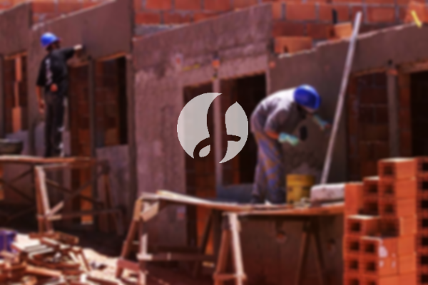

**Biaya Bangun Rumah Per Meter Di Paledang Bogor** - Hai Mitra Sumber Material! Gimana kabarnya? Kami dari Sumber Material hadir untuk mendukung proyek konstruksi Anda di Paledang Bogor. Seiring perkembangan zaman, jasa membangun rumah semakin diminati. Banyaknya pilihan kontraktor kini memudahkan kita dalam mewujudkan rumah impian. Pertumbuhan populasi yang pesat tentu saja meningkatkan kebutuhan akan tempat tinggal, dan para pengembang properti berlomba-lomba menawarkan beragam solusi, dari rumah sederhana hingga mewah. Kepercayaan pelanggan adalah kunci utama, dan layanan bangun rumah profesional akan berupaya keras menjaga kepercayaan tersebut dengan menyelesaikan pekerjaan sesuai harapan Anda. Berikut adalah beberapa jenis layanan yang kami tawarkan untuk membangun rumah di Paledang Bogor:



## Jasa Desain Gambar Arsitek Di Paledang Bogor

Sebagai penyedia jasa desain arsitektur terpercaya, Kami akan membantu Anda mewujudkan konsep rumah impian. Proses desain yang matang akan menjadi fondasi utama dalam menciptakan hunian yang indah dan fungsional. Kami mengutamakan beberapa faktor penting dalam menyusun komposisi desain yang harmonis dan sesuai selera Anda. Desain adalah aspek krusial dalam membangun rumah; desain yang baik akan menghasilkan tampilan rumah yang menarik dan estetis. Anda tak perlu khawatir soal anggaran, karena Kami akan menciptakan desain yang sesuai dengan *budget* yang Anda miliki. Dengan desain yang jelas, Anda bisa memperkirakan secara rinci biaya yang dibutuhkan untuk mewujudkan rumah impian di Paledang Bogor. Selain itu, desain juga mempertimbangkan pemilihan material bangunan yang tepat. Semua hal ini membutuhkan keahlian khusus, itulah mengapa menggunakan jasa arsitek profesional adalah pilihan yang tepat. Arsitek akan memahami keinginan Anda dan menerjemahkannya ke dalam desain yang memuaskan.

Biaya jasa desain rumah Kami bervariasi, tergantung pada luas bangunan dan kompleksitas desain yang diinginkan. Saat ini, tarif jasa desain rumah minimalis satu lantai adalah Rp 54.000,- per meter persegi, sudah termasuk desain, perhitungan Rencana Anggaran Biaya (RAB), dan dua kali revisi. Untuk rumah dua lantai atau lebih, biayanya dikalikan dua atau tiga sesuai dengan jumlah lantai.

## Ongkos Borong Bangun Rumah Di Paledang Bogor

Dengan semakin banyaknya orang yang membutuhkan tempat tinggal, layanan borong bangun rumah menjadi semakin kompetitif. Kami hadir untuk memberikan solusi terbaik dalam mewujudkan rumah idaman Anda di Paledang Bogor. Pilihan yang tepat dalam memilih kontraktor akan sangat menentukan kualitas dan kenyamanan hunian Anda. Memiliki rumah yang indah adalah impian setiap orang, dan dengan memanfaatkan jasa borong bangun rumah, Anda akan mendapatkan dukungan penuh untuk mewujudkannya. Anda tidak perlu repot memikirkan desain atau proses pembangunan secara detail, karena Kami akan menangani semuanya sesuai dengan kebutuhan dan harapan Anda. Dengan layanan borong bangun rumah, Anda akan merasakan kepuasan dan kepercayaan yang tinggi.

Untuk layanan borong renovasi, Kami menawarkan beberapa tingkatan harga yang disesuaikan dengan material bangunan dan lokasi proyek. Dengan asumsi kondisi tanah yang rata, stabil, dan tidak memerlukan pengurukan, harga per meter persegi dengan material dinding *hebel* adalah Rp 1.950.000,-, sedangkan dengan material bata merah adalah Rp 2.200.000,-. Harga tersebut sudah termasuk pondasi batu kali, kolom dan tiang beton, lantai keramik standar, dan atap rangka baja ringan dengan genteng spandek. Pilihan genteng dan keramik dapat disesuaikan dengan preferensi Anda, serta anggaran yang tersedia.

## Harga Rombak Rumah Di Paledang Bogor

Selain jasa arsitek dan borong bangun rumah, Kami juga menyediakan jasa renovasi rumah di Paledang Bogor. Renovasi adalah solusi tepat untuk menyegarkan tampilan rumah Anda atau memperbaiki kerusakan yang ada. Dengan pengalaman dan keahlian Kami, renovasi rumah tak lagi menjadi masalah. Renovasi yang Kami lakukan dapat berupa perubahan tampilan bangunan secara menyeluruh atau perbaikan kerusakan tertentu. Renovasi adalah alternatif yang terjangkau untuk memperbarui rumah Anda. Namun, biaya renovasi seringkali menjadi kendala bagi sebagian orang. Untungnya, dengan layanan renovasi profesional, masalah ini dapat diatasi. Kami siap membantu Anda merenovasi rumah impian dengan hasil yang memuaskan.

Harga borongan renovasi rumah Kami bervariasi tergantung pada kondisi kerusakan bangunan. Untuk tenaga tukang harian, tarifnya adalah Rp 150.000,- per hari untuk tukang dan Rp 100.000,- per hari untuk kenek.

## Didukung Tukang Dan Arsitek Terbaik Di Paledang Bogor

Baik jasa arsitek, borong bangun rumah, maupun renovasi, semuanya membutuhkan peran penting dalam mewujudkan hunian impian Anda. Kami didukung oleh tim arsitek profesional dan tenaga kerja yang handal, sehingga dapat memberikan layanan terbaik. Dengan dukungan tim yang kompeten, Kami akan membantu mewujudkan rumah idaman Anda, menarik dan nyaman untuk ditinggali. Anda tak perlu khawatir, karena Kami selalu mengutamakan kualitas dan kepuasan pelanggan. Sebagai penyedia jasa terpercaya, kepuasan Anda menjadi motivasi Kami untuk terus berkarya dan menghasilkan karya-karya yang lebih baik. Anda bisa melihat portofolio proyek Kami untuk melihat hasil nyata dari layanan Kami.

Perlu Kami sampaikan juga, bahwa rumah adalah kebutuhan pokok manusia, selain sandang dan pangan. Rumah menjadi tempat berlindung dari cuaca ekstrem dan berbagai bahaya. Hal ini menjadi peluang bagi penyedia jasa bangun rumah untuk menawarkan layanan mereka. Sebagai penyedia jasa yang terkhusus dalam bangun rumah, Kami turut berkontribusi dalam meramaikan dunia arsitektur dengan menawarkan jasa melalui berbagai media, baik cetak maupun *online*. Hal ini tentu memudahkan banyak orang yang ingin membangun rumah. Dengan menjaga kualitas dan memberikan layanan terbaik, Kami telah memiliki pengalaman yang cukup lama dalam bidang arsitektur. Itulah mengapa, banyak orang mempercayakan pembangunan rumah mereka kepada Kami.

Didukung oleh arsitek profesional dan tenaga kerja yang handal, Kami akan terus meningkatkan kualitas layanan Kami. Perkembangan yang berkelanjutan menjadi bukti komitmen Kami dalam memberikan solusi pembangunan yang inovatif dan kreatif. Banyak bangunan indah dan menarik telah Kami bangun. Proses pengerjaan yang cepat dan efisien memungkinkan Anda untuk segera menempati rumah impian Anda. Baik proyek kecil maupun besar, Kami dapat mengatasinya dengan baik. Mulai dari desain rumah, pemilihan material bangunan, ukuran rumah, hingga sumber daya manusia, semuanya dapat Kami atasi dengan profesional. Dengan demikian, Kami dapat mendukung terwujudnya rumah yang cantik dan nyaman. Disinilah peran penting jasa bangun rumah. Kami akan membantu Anda dalam perencanaan, pelaksanaan, dan pengawasan pembangunan. [Hubungi Kami Sekarang](https://api.whatsapp.com/send?phone=6285776786091&text=*Halo%20sumbermaterial.com*%20%3A) untuk konsultasi gratis! Anda juga dapat melihat layanan Kami untuk [bangun rumah di Batutulis](/bangunan/biaya-bangun-rumah-per-meter-di-batutulis-bogor/) dan [bangun rumah di Bantarjati](/bangunan/biaya-bangun-rumah-per-meter-di-bantarjati-bogor/). Kami siap menjadi mitra terpercaya Anda dalam membangun rumah impian di Paledang Bogor.
