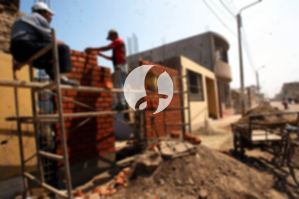

**Biaya Bangun Rumah Per Meter Di Pamarayan Serang** - Hai Mitra Sumber Material! Bagaimana kabarnya hari ini? Kami dari Sumber Material hadir sebagai mitra terpercaya Anda dalam mewujudkan hunian impian di Pamarayan Serang. Seiring dengan perkembangan zaman, jasa pembuatan rumah semakin diminati. Para penyedia layanan ini terus berkembang, bahkan merambah ke desain rumah. Hal ini membuktikan bahwa masyarakat semakin selektif dalam memilih jasa bangun rumah yang tepat. Dengan pertumbuhan penduduk yang pesat, kebutuhan akan tempat tinggal pun meningkat. Para pengembang properti berlomba-lomba membangun rumah dari berbagai kelas, mulai dari ekonomis hingga mewah. Kepercayaan konsumen adalah kunci utama, dan penyedia jasa bangun rumah berkomitmen untuk memberikan pekerjaan yang amanah dan berkualitas. Mereka menawarkan berbagai layanan yang dapat disesuaikan dengan kebutuhan Anda. Yuk, kita lihat beberapa jenis layanan dari jasa bangun rumah yang tersedia:



## Harga Layanan Desain Gambar Rumah Di Pamarayan Serang

Sebagai penyedia jasa desain, Kami sangat memperhatikan estetika sebuah rumah yang akan dibangun. Melalui desain yang baik, Kami berupaya menciptakan keindahan pada hunian Anda. Beberapa faktor penting diperhatikan untuk menghasilkan komposisi desain yang harmonis. Desain adalah aspek krusial karena sangat memengaruhi tampilan rumah Anda. Mitra Sumber Material bisa tenang, karena Kami akan mewujudkan desain yang sesuai dengan anggaran yang Anda miliki. Dari desain inilah, Anda dapat memperkirakan biaya yang dibutuhkan untuk mewujudkan rumah impian Anda. Selain itu, Kami juga mempertimbangkan material bangunan yang akan digunakan. Semua proses ini memang membutuhkan ketelitian. Inilah mengapa penting untuk memilih jasa arsitek yang tepat – yang bisa memahami keinginan Anda. Dengan begitu, Anda akan merasa puas dengan hasil akhirnya.

Biaya jasa desain rumah Kami bervariasi, tergantung pada luas bangunan dan kompleksitas desain yang diminta. Untuk hari ini, Kami menetapkan harga jasa desain rumah minimalis satu lantai sebesar Rp 54.000,- per meter persegi. Harga tersebut sudah termasuk desain, kalkulasi RAB (Rencana Anggaran Biaya), dan dua kali revisi. Sedangkan untuk rumah dua lantai atau lebih, harganya bisa dikalikan dua atau tiga, sesuai dengan jumlah lantai.

## Jasa Borong Renovasi Rumah Di Pamarayan Serang

Sebagai mitra Anda, Kami memahami bahwa memiliki rumah yang nyaman adalah impian semua orang. Banyaknya penyedia jasa bangun rumah yang tersedia tentu menawarkan produk dan layanan terbaik untuk menarik perhatian konsumen. Di sinilah peran penting jasa bangun rumah dalam mengatasi tantangan dalam membangun hunian. Dengan memilih jasa yang tepat, Anda akan mendapatkan hasil yang sesuai dengan keinginan Anda. Jasa renovasi rumah adalah solusi tepat untuk mengubah tampilan rumah Anda menjadi lebih segar dan modern. Dengan bantuan jasa renovasi profesional, Anda tidak perlu khawatir tentang proses renovasi yang rumit. Kami akan membantu Anda mewujudkan rumah impian Anda dengan mengubah tampilan bangunan secara menyeluruh atau sebagian. Renovasi adalah pilihan cerdas untuk meningkatkan nilai estetika rumah dengan budget yang terjangkau.

Untuk layanan borong renovasi, Kami menawarkan beberapa pilihan harga. Harga ini disesuaikan dengan material bangunan yang digunakan dan lokasi pembangunan di Pamarayan Serang. Dengan asumsi kondisi tanah rata, stabil, dan tidak memerlukan pengurugan, harga per meter persegi dengan material dinding hebel adalah Rp 1.950.000,-, sementara dengan material bata merah adalah Rp 2.200.000,-. Harga ini sudah termasuk pondasi batu gunung, kolom dan tiang beton, lantai keramik standar, serta atap dengan rangka baja ringan dan genteng spandek. Anda juga dapat menyesuaikan jenis genteng dan keramik sesuai preferensi, model, kualitas, dan anggaran Anda.

## Ongkos Perbaikan Rumah Di Pamarayan Serang

Selain jasa arsitek dan bangun rumah, Kami juga menyediakan layanan perbaikan rumah di Pamarayan Serang. Jasa renovasi rumah adalah cara efektif untuk menyegarkan tampilan rumah Anda. Dengan kehadiran Kami, Anda tidak perlu bingung menentukan cara terbaik untuk merenovasi rumah Anda. Kami menawarkan teknik pengubahan bentuk tampilan bangunan, baik secara menyeluruh maupun sebagian. Renovasi merupakan pilihan populer untuk mempercantik rumah Anda dengan budget yang lebih terjangkau. Namun, menjalankan renovasi sendiri bisa jadi sulit. Itulah mengapa Kami hadir sebagai solusi untuk memudahkan Anda merenovasi rumah menjadi lebih indah dan menarik. Kami siap mewujudkan impian Anda dengan merubah bangunan Anda sesuai dengan harapan Anda.

Harga borongan jasa renovasi Kami bervariasi tergantung pada kondisi kerusakan bangunan. Karena setiap rumah memiliki tingkat kerusakan yang berbeda, Kami akan menyesuaikan harga dengan jenis perbaikan yang dibutuhkan. Namun, untuk biaya tenaga tukang harian, harganya adalah Rp 150.000,- per hari untuk tukang dan Rp 100.000,- per hari untuk kenek.

## Didukung Tukang Dan Arsitek Terbaik Di Pamarayan Serang

Baik jasa arsitek, jasa bangun rumah, maupun jasa renovasi, semuanya memiliki peran penting dalam mewujudkan rumah impian Anda. Didukung oleh arsitek profesional dan tenaga kerja yang handal, Kami akan membantu Anda mewujudkan impian tersebut. Dengan membangun rumah bersama Kami, Anda akan memiliki rumah yang menarik dan indah. Anda tidak perlu khawatir, karena Kami memberikan pelayanan terbaik, menjaga mutu dan kualitas untuk memberikan kepuasan maksimal. Sebagai penyedia jasa bangun rumah, kepuasan pelanggan adalah motivasi utama Kami untuk terus berkarya dan menghasilkan karya yang lebih baik. Anda dapat melihat katalog proyek-proyek Kami untuk melihat kualitas hasil kerja Kami. Hal ini membuktikan bahwa Kami adalah pilihan terbaik dan terpercaya.

Perlu diingat, rumah adalah kebutuhan primer manusia, sama pentingnya dengan sandang dan pangan. Rumah memberikan perlindungan dari cuaca ekstrem dan berbagai bahaya. Hal ini mendorong para penyedia jasa bangun rumah untuk menawarkan layanan terbaik mereka. Sebagai penyedia jasa, Kami berpartisipasi dalam memajukan dunia arsitektur yang terus berkembang dengan menampilkan layanan Kami melalui berbagai media, baik cetak maupun online. Hal ini tentu memudahkan Anda dalam mencari penyedia jasa yang tepat. Dengan menjaga mutu dan kualitas terbaik, Kami telah membuktikan pengalaman Kami yang cukup lama dalam dunia arsitektur. Itulah mengapa Kami semakin dipercaya oleh banyak orang.

Didukung oleh arsitek profesional dan tenaga kerja yang handal, tentu akan menjadikan Kami semakin dikenal dan tepercaya. Hal ini terlihat dari pengembangan layanan yang terus Kami lakukan. Kami terus berkarya mewujudkan desain-desain baru yang inovatif dan kreatif. Dengan progres pengerjaan yang cepat, Anda akan segera menikmati rumah impian Anda. Baik rumah berskala kecil maupun besar, Kami dapat mengatasinya dengan baik. Anda tidak perlu khawatir atau cemas. Mulai dari desain, material, ukuran rumah, hingga SDM, semuanya dapat Kami atasi dengan layanan bangun rumah Kami. Sehingga, Kami dapat mendukung terwujudnya bangunan yang cantik dan menarik. Dikarenakan, Kami akan membuat perencanaan yang matang, dan sekaligus mengawasi pembangunan. [Hubungi Kami Sekarang](https://api.whatsapp.com/send?phone=6285776786091&text=*Halo%20sumbermaterial.com*%20%3A) untuk konsultasi gratis! Anda juga bisa mencari info pembangunan di [bangun rumah di Baros](/bangunan/biaya-bangun-rumah-per-meter-di-baros-serang/) atau [bangun rumah di Carenang](/bangunan/biaya-bangun-rumah-per-meter-di-carenang-serang/).
