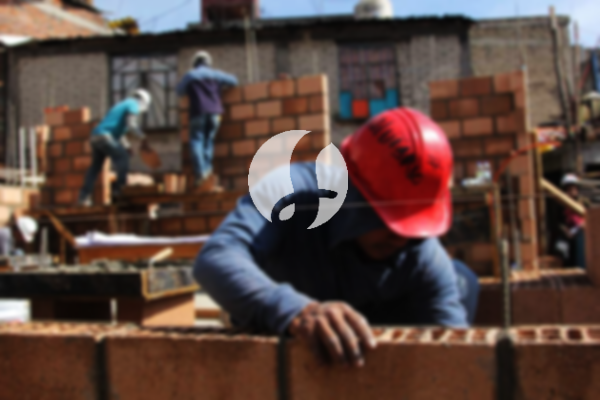

**Biaya Bangun Rumah Per Meter Di Pamulang Tangerang** - Halo Mitra Sumber Material! Bagaimana kabarnya? Kami dari penyedia layanan konstruksi di Pamulang Tangerang ingin berbagi informasi penting seputar biaya membangun rumah per meter. Di era modern ini, layanan bangun rumah semakin diminati karena kemudahan dan efisiensinya. Perkembangan ini juga merambah ke layanan desain rumah, memberikan lebih banyak pilihan bagi Anda. Dengan meningkatnya populasi, kebutuhan akan tempat tinggal pun meningkat. Para pengembang properti berlomba-lomba membangun rumah dan perumahan, mulai dari kelas ekonomi hingga mewah. Kepercayaan pelanggan adalah kunci utama, dan Kami berkomitmen untuk memberikan layanan terbaik dan memenuhi ekspektasi Anda dalam setiap proyek bangunan di Pamulang Tangerang. Kami menawarkan berbagai layanan untuk membantu mewujudkan rumah impian Anda. Berikut beberapa jenis layanan yang tersedia:



## Jasa Desain Gambar Rumah Arsitek Profesional di Pamulang Tangerang

Sebagai penyedia jasa arsitek, Kami akan mengamati dan merancang desain rumah yang sesuai dengan keinginan Anda. Tujuan Kami adalah menciptakan keindahan dan fungsionalitas dalam setiap desain. Kami mempertimbangkan berbagai faktor penting untuk menghasilkan komposisi desain yang harmonis dan menarik. Desain adalah elemen krusial dalam pembangunan rumah karena akan menentukan tampilan visualnya. Kami memastikan desain yang Kami buat sesuai dengan anggaran yang Anda miliki, sehingga Anda dapat memiliki gambaran jelas tentang biaya yang dibutuhkan. Selain itu, Kami juga memperhatikan pemilihan bahan bangunan yang tepat untuk memastikan kualitas dan efisiensi biaya. Semua proses ini membutuhkan keahlian khusus, dan itulah mengapa Kami hadir sebagai mitra terpercaya Anda. Kami memahami harapan Anda dan akan mewujudkannya menjadi kenyataan, memastikan Anda merasa puas dengan hasil akhirnya.

Biaya jasa desain Kami bervariasi tergantung pada luas rumah dan tingkat kesulitan desain yang Anda inginkan. Saat ini, Kami menetapkan harga jasa desain rumah minimalis satu lantai sebesar Rp 54.000,- per meter persegi, termasuk desain, perhitungan RAB, dan dua kali revisi. Untuk rumah dua lantai atau lebih, biayanya dapat dikalikan dua atau tiga sesuai dengan jumlah lantai.

## Harga Borong Bangun Rumah di Pamulang Tangerang

Seiring dengan pertumbuhan populasi, kebutuhan akan rumah yang terjangkau dan berkualitas semakin tinggi. Layanan borong bangun rumah hadir sebagai solusi praktis dan efisien bagi Anda. Kami menawarkan jasa konstruksi yang komprehensif untuk membantu Anda mewujudkan rumah impian tanpa repot. Dengan banyaknya penyedia jasa bangun rumah, penting untuk memilih yang terpercaya dan berpengalaman. Kami siap membantu Anda dalam setiap tahap pembangunan, mulai dari perencanaan hingga penyelesaian. Memiliki rumah yang indah dan nyaman adalah impian setiap orang, dan Kami akan membantu Anda mewujudkannya dengan layanan borong bangun rumah yang profesional. Dengan layanan ini, Anda tidak perlu khawatir tentang proses desain atau pengawasan pembangunan karena Kami akan menangani semuanya. Kami selalu berusaha memahami keinginan Anda dan mewujudkannya dalam bentuk karya nyata. Kepuasan Anda adalah prioritas utama Kami.

Untuk harga borong pembangunan rumah, Kami menawarkan beberapa opsi yang dapat disesuaikan dengan kebutuhan Anda. Harga per meter persegi bervariasi tergantung pada material yang digunakan dan lokasi pembangunan. Dengan asumsi area tanah dalam keadaan rata dan tidak membutuhkan pengurugan, harga dengan material dinding hebel adalah Rp 1.950.000,- per meter persegi, sedangkan untuk material bata merah adalah Rp 2.200.000,- per meter persegi. Harga ini mencakup pondasi batu sungai, kolom dan tiang beton, lantai keramik standar, serta atap rangka baja ringan dengan genteng spandek. Anda dapat memilih jenis genteng dan keramik sesuai preferensi Anda, dan Kami akan menyesuaikan biaya sesuai dengan pilihan Anda.

## Harga Rombak/Renovasi Rumah di Pamulang Tangerang

Selain layanan desain dan bangun rumah, Kami juga menyediakan jasa renovasi rumah di Pamulang Tangerang. Renovasi adalah cara yang efektif untuk memperbarui tampilan rumah Anda tanpa harus membangun dari awal. Jasa renovasi rumah dapat membantu Anda mengubah tampilan atau struktur rumah Anda secara menyeluruh. Renovasi menjadi alternatif yang menarik bagi mereka yang ingin mengubah bangunan tanpa harus mengeluarkan biaya yang besar. Namun, renovasi juga dapat menjadi tantangan tersendiri jika tidak dilakukan dengan perencanaan yang matang. Dengan adanya jasa renovasi bangunan seperti Kami, Anda tidak perlu khawatir karena Kami akan membantu Anda mengatasi semua kendala dan memastikan hasil renovasi yang memuaskan. Kami siap membantu Anda mengubah rumah Anda menjadi lebih indah dan sesuai dengan impian Anda.

Biaya borongan dari jasa renovasi bangunan Kami bervariasi tergantung pada kondisi kerusakan rumah Anda. Setiap rumah memiliki tingkat kerusakan yang berbeda, sehingga Kami akan menyesuaikan harga sesuai dengan kebutuhan Anda. Untuk biaya jasa renovasi dengan tenaga tukang harian, harganya adalah Rp 150.000,- per hari untuk tukang dan Rp 100.000,- per hari untuk kenek.

## Didukung oleh Tukang dan Arsitek Berpengalaman di Pamulang Tangerang

Baik itu layanan arsitek, bangun rumah, atau renovasi, semuanya memiliki peran penting dalam mewujudkan rumah impian Anda. Didukung oleh arsitek profesional dan tenaga kerja yang handal, Kami akan membantu Anda mewujudkan impian tersebut. Dengan membangun rumah bersama Kami, Anda akan memiliki rumah yang menarik dan indah. Kami menjamin kualitas dan mutu pekerjaan Kami untuk memberikan kepuasan maksimal bagi Anda. Sebagai penyedia jasa bangun rumah, kepuasan pelanggan adalah motivasi utama Kami untuk terus berkarya dan memberikan yang terbaik. Anda dapat melihat katalog proyek-proyek Kami sebelumnya untuk melihat hasil karya Kami. Katalog ini akan membuktikan bahwa Kami adalah pilihan yang tepat dan terpercaya.

Rumah adalah kebutuhan pokok manusia yang sangat penting, selain sandang dan pangan. Rumah melindungi kita dari cuaca ekstrem dan berbagai bahaya. Hal ini menjadi peluang bagi penyedia jasa bangun rumah untuk menawarkan layanan mereka. Sebagai penyedia jasa, Kami berpartisipasi dalam kemajuan dunia arsitektur dengan menawarkan layanan Kami melalui berbagai media, mulai dari media cetak hingga online. Ini membantu orang-orang yang ingin membangun rumah menemukan solusi yang tepat. Dengan mempertahankan mutu dan kualitas terbaik, Kami telah memiliki pengalaman yang cukup lama dalam menggeluti dunia arsitektur. Inilah alasan mengapa Kami semakin dipercaya oleh banyak orang.

Dengan dukungan arsitek profesional dan tenaga kerja yang handal, Kami yakin dapat memberikan layanan yang memuaskan. Kami berkomitmen untuk terus berinovasi dan menciptakan karya-karya baru yang kreatif. Banyak bangunan yang Kami bangun dengan desain yang apik dan menarik. Proses pengerjaan yang cepat dan efisien memungkinkan Anda untuk segera menikmati rumah impian Anda. Baik rumah dengan skala kecil maupun besar, Kami siap menangani semua proyek pembangunan. Anda tidak perlu ragu atau khawatir karena Kami akan memberikan solusi terbaik untuk Anda. Mulai dari desain rumah, pemilihan material, hingga ukuran rumah dan sumber daya manusia, semuanya dapat Kami atasi dengan baik. Kami hadir untuk mendukung terwujudnya rumah yang cantik dan menarik. Di sinilah peran penting Kami sebagai penyedia jasa bangun rumah. Kami akan menciptakan tata desain yang harmonis dan mengawasi proses pembangunan secara menyeluruh. [Hubungi Kami Sekarang](https://api.whatsapp.com/send?phone=6285776786091&text=*Halo%20sumbermaterial.com*%20%3A) untuk konsultasi gratis! atau Konsultasi Gratis untuk penawaran terbaik di Pamulang Tangerang.
