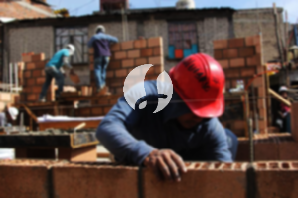

**Biaya Bangun Rumah Per Meter Di Panaragan Bogor** - Hai Mitra Sumber Material! Gimana kabarnya? Kami dari Sumber Material hadir untuk membantu mewujudkan impian memiliki rumah impian di Panaragan Bogor. Seiring perkembangan zaman, jasa membangun rumah semakin diminati. Banyak yang memilih jasa profesional karena kemudahan dan efisiensinya. Kebutuhan akan tempat tinggal terus meningkat seiring pertumbuhan penduduk, dan para pengembang properti berlomba-lomba menawarkan berbagai pilihan, mulai dari rumah sederhana hingga mewah. Kepercayaan konsumen adalah kunci utama, dan layanan bangun rumah yang terpercaya akan selalu berusaha memenuhi harapan serta menyelesaikan pekerjaan dengan baik. Nah, untuk itu Kami menawarkan berbagai layanan untuk membantu Anda membangun rumah impian. Berikut beberapa opsi layanan dari jasa bangun rumah yang bisa Anda pertimbangkan:



## Jasa Desain Gambar Arsitek Di Panaragan Bogor

Sebagai penyedia jasa arsitek, Kami akan memperhatikan desain bangunan yang akan Anda wujudkan. Sebuah desain yang baik akan mempercantik tampilan rumah Anda. Kami berkomitmen untuk menciptakan komposisi desain yang indah dan selaras. Desain memang merupakan aspek penting dalam pembangunan rumah. Dengan desain yang tepat, rumah Anda akan terlihat menarik dan sesuai dengan harapan. Kami akan membantu Anda mewujudkan desain yang sesuai dengan anggaran yang Anda miliki. Dari desain tersebut, Anda dapat memperkirakan biaya yang dibutuhkan untuk mewujudkan rumah impian Anda. Selain itu, desain juga harus mempertimbangkan material bangunan yang akan digunakan. Semua hal tersebut memerlukan keahlian khusus, itulah mengapa Anda perlu memilih jasa arsitek yang berpengalaman. Kami akan memahami keinginan Anda dan memberikan solusi terbaik.

Biaya jasa desain rumah dari Kami bervariasi, tergantung luas rumah dan kerumitan desain. Saat ini, harga jasa desain rumah minimalis satu lantai adalah Rp 54.000,- per meter persegi, sudah termasuk desain, perhitungan RAB, dan dua kali revisi. Untuk rumah dua lantai atau lebih, harganya tinggal dikali 2 atau 3 sesuai jumlah lantai.

## Layanan Borong Bangun Rumah Di Panaragan Bogor

Kebutuhan akan tempat tinggal yang layak adalah kebutuhan mendasar setiap orang. Banyak orang yang saat ini mencari layanan bangun rumah terbaik untuk mewujudkan impian mereka. Disinilah peran utama layanan bangun rumah dalam menangani proyek pembangunan. Dengan memilih layanan bangun rumah yang tepat, Anda akan mendapatkan solusi yang sesuai dengan kebutuhan dan keinginan Anda. Memiliki rumah yang indah adalah impian setiap orang, dan dengan menggunakan jasa borong bangun rumah, Kami akan membantu mewujudkannya. Anda tidak perlu khawatir tentang desain rumah, karena Kami akan memahami harapan Anda dan mewujudkannya menjadi karya nyata. Dengan begitu, Anda akan merasa puas dan percaya dengan layanan Kami.

Untuk layanan borong renovasi rumah, Kami menawarkan beberapa tingkatan harga. Harga disesuaikan dengan material bangunan yang digunakan dan lokasi pembangunan. Dengan persyaratan lahan yang rata, stabil, dan tidak perlu pengurugan, harga per meter persegi dengan material dinding hebel adalah Rp 1.950.000,-, sedangkan dengan material bata merah adalah Rp 2.200.000,-. Harga tersebut sudah termasuk pondasi batu gunung, kolom dan tiang beton, lantai keramik standar, serta atap dengan rangka baja ringan plus genteng spandek. Pilihan genteng dan keramik dapat disesuaikan dengan preferensi Anda, baik model, kualitas, maupun anggaran.

## Harga Jasa Renovasi Tempat Tinggal Di Panaragan Bogor

Selain jasa arsitek dan layanan bangun rumah, Kami juga menyediakan jasa renovasi rumah. Jasa renovasi rumah adalah solusi untuk mengubah tampilan rumah agar terlihat baru kembali. Dengan hadirnya jasa renovasi bangunan, Anda tidak perlu lagi bingung mencari solusi untuk merenovasi rumah Anda. Renovasi yang Kami lakukan meliputi perubahan bentuk tampilan bangunan atau perubahan total. Renovasi memang menjadi pilihan populer untuk membuat rumah terlihat lebih indah, tetapi seringkali terkendala anggaran. Namun, dengan jasa renovasi bangunan yang Kami tawarkan, masalah tersebut dapat diatasi. Kami siap membantu Anda merenovasi rumah Anda menjadi lebih cantik dan sesuai dengan impian Anda.

Biaya borongan jasa renovasi rumah Kami bervariasi, tergantung pada kondisi kerusakan bangunan. Setiap bangunan memiliki tingkat kerusakan yang berbeda-beda, sehingga harga disesuaikan dengan variasi kerusakan yang akan diperbaiki. Namun, untuk biaya jasa renovasi dengan tenaga tukang harian, harganya adalah Rp 150.000,- per hari untuk tukang dan Rp 100.000,- per hari untuk kenek.

## Disupport Tenaga Kerja Dan Arsitek Berpengalaman Di Panaragan Bogor

Baik jasa arsitek, layanan bangun rumah, maupun jasa renovasi bangunan, semuanya memiliki peran penting dalam mewujudkan impian Anda. Dengan dukungan arsitek profesional dan tenaga kerja yang handal, Kami akan membantu mewujudkan rumah impian Anda. Dengan membangun rumah bersama Kami, Anda akan memiliki tempat tinggal yang menarik dan indah. Kami menjamin pelayanan terbaik, menjaga mutu dan kualitas untuk memberikan kepuasan kepada Anda. Kepuasan Anda adalah penyemangat Kami untuk terus berkarya dan menciptakan karya yang lebih baik lagi. Anda dapat melihat katalog proyek-proyek Kami sebelumnya untuk melihat hasil karya Kami. Katalog tersebut akan membuktikan bahwa Kami adalah pilihan terbaik dan terpercaya.

Perlu diingat bahwa rumah adalah kebutuhan pokok manusia, sama pentingnya dengan sandang dan pangan. Rumah menjadi tempat berlindung dari cuaca ekstrem dan berbagai bahaya. Hal ini menjadi peluang bagi para penyedia jasa bangun rumah untuk menawarkan jasanya. Sebagai penyedia jasa, Kami berpartisipasi dalam memajukan dunia arsitektur dengan mempromosikan layanan Kami melalui berbagai media, baik cetak maupun online. Hal ini tentu akan membantu banyak orang mewujudkan rumah impian mereka. Dengan mempertahankan mutu dan kualitas terbaik, Kami telah memiliki pengalaman yang cukup lama dalam dunia arsitektur dan semakin banyak dipercaya oleh banyak orang.

Didukung oleh arsitek profesional dan tenaga kerja yang handal, Kami semakin dikenal dengan kemampuan Kami yang tidak diragukan lagi. Hal ini tercermin dari perkembangan yang selalu Kami berikan. Kami terus berkarya menciptakan karya-karya baru yang inovatif dan kreatif. Banyak rumah dan bangunan yang telah Kami bangun dengan desain yang apik dan menarik. Proses pengerjaan yang cepat memungkinkan Anda segera mendapatkan rumah impian Anda. Baik skala kecil maupun besar, banyak proyek yang berhasil Kami kendalikan tanpa masalah. Anda tidak perlu khawatir, karena Kami mampu mengatasi segala tantangan. Kami akan mendukung penuh terwujudnya rumah impian Anda yang cantik dan menarik. Disitulah peran penting Kami sebagai penyedia layanan bangun rumah yang andal. Kami akan mewujudkan tata desain yang Anda inginkan dan menjadi pengawas dalam proses pembangunan. Untuk informasi lebih lanjut atau konsultasi gratis mengenai pembangunan rumah di Panaragan Bogor, [hubungi Kami sekarang juga!](https://api.whatsapp.com/send?phone=6285776786091&text=*Halo%20sumbermaterial.com*%20%3A) Jangan ragu untuk bertanya, Kami siap membantu. Atau, Anda juga bisa melihat [bangun rumah di Bondongan](/bangunan/biaya-bangun-rumah-per-meter-di-bondongan-bogor/) untuk layanan bangun rumah di Bondongan Bogor.
