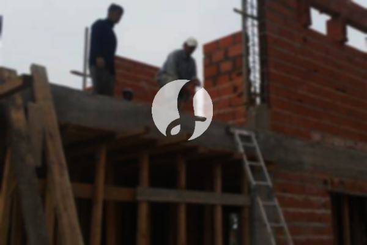

**Biaya Bangun Rumah Per Meter Di Parakan Salak Sukabumi** - Hai Mitra Sumber Material! Bagaimana kabar Anda? Kami dari penyedia jasa bangun rumah di Parakan Salak Sukabumi ingin berbagi informasi penting mengenai biaya pembangunan rumah per meter. Seiring dengan perkembangan zaman, jasa bangun rumah semakin diminati. Layanan ini kini merambah hingga jasa desain rumah, yang membuat masyarakat semakin selektif dalam memilih penyedia jasa yang tepat. Peningkatan jumlah penduduk secara otomatis meningkatkan kebutuhan akan tempat tinggal. Para pelaku di bidang properti berlomba-lomba membangun rumah, apartemen, dan perumahan dengan berbagai kelas, mulai dari standar hingga mewah. Kepercayaan konsumen adalah kunci utama, dan layanan bangun rumah yang terpercaya akan berusaha sebaik mungkin untuk memenuhi harapan pelanggan dan menjaga reputasi baik. Kami hadir sebagai solusi terpercaya untuk mewujudkan hunian impian Anda di Parakan Salak Sukabumi.



## Harga Desain Gambar Arsitek Di Parakan Salak Sukabumi

Sebagai layanan yang komprehensif, Kami juga menawarkan jasa desain gambar arsitek yang profesional. Desain yang baik merupakan fondasi utama dalam membangun rumah impian Anda. Kami akan berupaya menciptakan keindahan dan fungsionalitas dalam setiap desain yang Kami buat. Beberapa faktor penting yang Kami perhatikan dalam proses desain antara lain estetika, kenyamanan, dan harmonisasi dengan lingkungan sekitar. Desain yang tepat akan menghasilkan rumah yang tidak hanya indah dipandang, tetapi juga nyaman ditinggali. Kami memahami bahwa anggaran adalah pertimbangan utama. Oleh karena itu, Kami akan menyesuaikan desain dengan *budget* yang Anda miliki, sehingga Anda dapat mengetahui perkiraan biaya yang dibutuhkan untuk mewujudkan desain rumah impian. Selain itu, Kami juga mempertimbangkan pemilihan material bangunan yang sesuai dengan desain dan anggaran Anda. Proses desain ini memang membutuhkan ketelitian dan keahlian khusus. Itulah mengapa Kami merekomendasikan penggunaan jasa arsitek profesional. Tim arsitek Kami akan memahami keinginan Anda dan menerjemahkannya ke dalam rancangan yang sesuai.

Harga jasa desain rumah Kami bervariasi tergantung pada luas bangunan dan tingkat kesulitan desain. Saat ini, Kami menawarkan harga jasa desain rumah minimalis satu lantai mulai dari Rp54.000,- per meter persegi. Harga tersebut sudah termasuk desain, perhitungan RAB (Rencana Anggaran Biaya), dan dua kali revisi. Untuk bangunan dua lantai atau lebih, biayanya akan dikalikan dua atau tiga sesuai dengan jumlah lantai.

## Jasa Borong Renovasi Rumah Di Parakan Salak Sukabumi

Kebutuhan akan rumah yang nyaman dan representatif membuat banyak orang berpikir untuk melakukan renovasi. Kami juga menyediakan jasa borong renovasi rumah di Parakan Salak Sukabumi untuk membantu Anda memperbarui atau meningkatkan kualitas hunian Anda. Renovasi dapat dilakukan dengan berbagai cara, mulai dari mengubah tata letak ruangan, mengganti material bangunan, hingga melakukan perbaikan struktur bangunan. Dengan menggunakan jasa Kami, Anda tidak perlu khawatir tentang proses renovasi yang rumit. Kami akan menangani semua aspek renovasi, mulai dari perencanaan, pelaksanaan, hingga pengawasan. Kami selalu berusaha memahami keinginan Anda dan mewujudkannya ke dalam karya nyata yang memuaskan. Memiliki rumah yang bagus adalah impian setiap orang. Kami akan membantu Anda mewujudkan impian tersebut dengan layanan renovasi rumah yang profesional dan terpercaya.

Harga jasa borong renovasi bangunan Kami bervariasi tergantung pada jenis pekerjaan dan material yang digunakan. Sebagai gambaran, untuk bangunan dengan material dinding hebel, harga per meter persegi adalah Rp1.950.000,-. Sementara itu, untuk bangunan dengan material bata merah, harga per meter persegi adalah Rp2.200.000,-. Harga tersebut sudah termasuk pondasi batu gunung, kolom dan tiang beton, lantai keramik standar, serta atap dengan rangka baja ringan dan genteng spandek. Anda juga dapat menyesuaikan jenis genteng dan keramik sesuai dengan preferensi dan anggaran Anda.

## Layanan Renovasi Rumah Di Parakan Salak Sukabumi

Selain jasa arsitek dan pembangunan rumah baru, Kami juga menyediakan layanan renovasi rumah di Parakan Salak Sukabumi. Renovasi merupakan solusi yang tepat untuk memberikan tampilan baru pada rumah Anda. Kami menawarkan berbagai jenis layanan renovasi, mulai dari renovasi ringan seperti pengecatan dan penggantian keramik, hingga renovasi total yang meliputi perubahan struktur bangunan. Tim renovasi Kami akan bekerja secara profesional dan efisien untuk memastikan bahwa pekerjaan renovasi selesai tepat waktu dan sesuai dengan harapan Anda. Kami memahami bahwa renovasi rumah dapat menjadi proses yang melelahkan. Itulah mengapa Kami hadir untuk membantu Anda mengatasi semua tantangan dan memastikan bahwa Anda mendapatkan hasil renovasi yang memuaskan.

Untuk biaya borongan jasa renovasi rumah Kami, harga yang Kami tawarkan bervariasi tergantung pada kondisi bangunan dan jenis kerusakan yang akan diperbaiki. Kami akan melakukan survei terlebih dahulu untuk menilai kondisi bangunan dan memberikan penawaran harga yang sesuai. Sebagai referensi, untuk jasa tenaga tukang harian, Kami mengenakan biaya Rp150.000,- per hari untuk tukang dan Rp100.000,- per hari untuk kenek.

## Disupport Tukang Dan Arsitek Berpengalaman Di Parakan Salak Sukabumi

Kualitas layanan Kami didukung oleh tim arsitek dan tukang yang berpengalaman dan profesional. Baik layanan desain, pembangunan rumah baru, maupun renovasi, semua layanan Kami dikerjakan oleh tenaga ahli yang kompeten. Dengan dukungan tim yang solid, Kami dapat mewujudkan impian Anda memiliki rumah yang indah, nyaman, dan berkualitas. Kami selalu berusaha memberikan pelayanan terbaik, menjaga mutu dan kualitas pekerjaan, serta memastikan kepuasan pelanggan. Kepuasan Anda adalah prioritas utama Kami. Sebagai penyedia jasa bangunan yang terpercaya, Kami selalu mengutamakan kejujuran, transparansi, dan profesionalisme dalam setiap pekerjaan yang Kami lakukan. Anda dapat melihat portofolio proyek-proyek yang telah Kami kerjakan untuk melihat contoh hasil kerja Kami.

Rumah merupakan kebutuhan pokok manusia yang sangat penting. Sebagai penyedia jasa, Kami berkomitmen untuk berkontribusi dalam mewujudkan impian masyarakat memiliki rumah yang layak huni. Kami terus mengembangkan diri dan berinovasi untuk memberikan layanan yang lebih baik dan lebih efisien. Kami menggunakan berbagai media, baik cetak maupun online, untuk mempromosikan jasa Kami dan menjangkau lebih banyak pelanggan. Dengan pengalaman yang cukup lama di bidang arsitektur, Kami semakin dipercaya oleh banyak orang. Hal ini menjadi motivasi Kami untuk terus berkarya dan memberikan yang terbaik bagi pelanggan.

Tim arsitek dan tukang Kami yang berpengalaman akan memastikan bahwa setiap proyek yang Kami kerjakan berjalan lancar dan sesuai dengan standar kualitas yang tinggi. Kami selalu berusaha memberikan solusi yang tepat untuk setiap permasalahan yang mungkin timbul selama proses pembangunan atau renovasi. Dengan dukungan Kami, Anda dapat mewujudkan rumah impian Anda dengan tenang dan nyaman. Baik dari segi desain, material, ukuran, maupun tenaga kerja, Kami siap membantu Anda dalam setiap tahap pembangunan. [Hubungi Kami Sekarang](https://api.whatsapp.com/send?phone=6285776786091&text=*Halo%20sumbermaterial.com*%20%3A)
