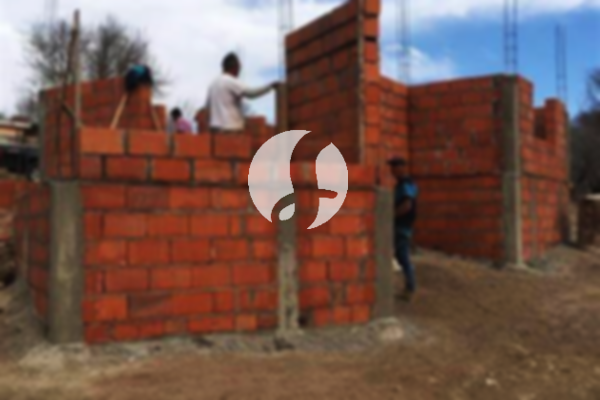

**Biaya Bangun Rumah Per Meter Di Pasar Manggis Jakarta** - Hai Mitra Sumber Material! Bagaimana kabar Anda semua? Kami dari tim Sumber Material hadir untuk memberikan solusi lengkap kebutuhan konstruksi Anda di Pasar Manggis Jakarta. Seiring perkembangan zaman, jasa pembangunan bangunan kini semakin diminati. Borongan bangun rumah telah berevolusi dengan menawarkan layanan desain rumah yang terintegrasi, memberikan kemudahan bagi banyak orang yang ingin mewujudkan hunian impian mereka. Meningkatnya populasi tentu saja memicu permintaan akan tempat tinggal yang terus bertambah. Para pelaku properti berlomba-lomba menghadirkan berbagai pilihan hunian, dari yang ekonomis hingga mewah. Kepercayaan konsumen menjadi prioritas utama kami sebagai penyedia jasa bangun rumah terpercaya di Pasar Manggis Jakarta – menjaga reputasi dan memberikan hasil yang memuaskan adalah komitmen kami. Kami menawarkan berbagai layanan konstruksi untuk memenuhi kebutuhan Anda.



## Jasa Desain Gambar Arsitektur di Pasar Manggis Jakarta

Sebagai penyedia jasa arsitek yang berpengalaman, kami di Sumber Material akan membantu Anda mewujudkan desain rumah impian Anda. Kami fokus pada estetika dan fungsionalitas, dengan mempertimbangkan berbagai faktor penting untuk menciptakan komposisi desain yang harmonis dan sesuai dengan selera Anda. Desain rumah adalah elemen krusial dalam sebuah proyek konstruksi. Desain yang baik akan menghasilkan hunian yang menarik dan nyaman. Kami memahami bahwa setiap anggaran berbeda-beda, oleh karena itu kami menawarkan solusi desain yang disesuaikan dengan *budget* Anda. Dengan desain yang jelas, Anda dapat memiliki gambaran perkiraan biaya yang dibutuhkan untuk mewujudkan rumah impian Anda. Selain itu, kami juga mempertimbangkan pemilihan material bangunan yang tepat, sehingga efisien dan sesuai dengan visi Anda. Kami siap membantu Anda mewujudkan desain ideal karena kami memahami betul keinginan Anda.

Biaya jasa desain rumah kami bervariasi tergantung pada luas bangunan dan kompleksitas desain yang Anda inginkan. Saat ini, kami menawarkan harga jasa desain rumah minimalis satu lantai mulai dari Rp54.000,- per meter persegi, sudah termasuk desain, RAB (Rencana Anggaran Biaya), dan 2 kali revisi. Untuk rumah dua lantai atau lebih, biaya dapat dikalikan 2 atau 3 sesuai jumlah lantai.

## Harga Borong Renovasi Bangunan di Pasar Manggis Jakarta

Seiring dengan pertumbuhan populasi, memiliki rumah yang nyaman menjadi kebutuhan utama setiap orang. Banyak penyedia jasa bangun rumah yang menawarkan layanan terbaik kepada para pelanggan. Di sinilah peran penting jasa bangun rumah dalam menyelesaikan berbagai permasalahan konstruksi. Kami membantu Anda mewujudkan rumah impian Anda dengan solusi yang tepat. Memiliki rumah yang cantik merupakan dambaan setiap orang. Dengan menggunakan layanan bangun rumah dari Sumber Material, Anda akan mendapatkan bantuan dalam merancang dan membangun hunian idaman Anda. Anda tidak perlu khawatir mendesain rumah sendiri karena kami selalu berusaha memahami keinginan Anda dan mewujudkannya menjadi bangunan impian yang nyata. Kepuasan Anda adalah prioritas kami, dan hal itu membuat layanan bangun rumah kami semakin dipercaya.

Untuk jasa borong renovasi bangunan, kami menawarkan beberapa pilihan harga yang disesuaikan dengan bahan bangunan yang digunakan dan lokasi pembangunan di Pasar Manggis Jakarta. Harga per meter persegi untuk material dinding hebel adalah Rp1.950.000,-, sedangkan untuk bata merah Rp2.200.000,-. Harga tersebut sudah termasuk pondasi batu gunung, kolom dan tiang beton, lantai keramik standar, serta atap rangka baja ringan dengan genteng spandek. Anda dapat memilih variasi genteng dan keramik sesuai preferensi Anda, dengan penyesuaian biaya yang sesuai.

## Jasa Perbaikan Bangunan di Pasar Manggis Jakarta

Selain layanan arsitek dan borongan bangun rumah, kami juga menyediakan jasa perbaikan bangunan. Renovasi merupakan solusi efektif untuk memberikan tampilan baru pada rumah Anda. Dengan layanan renovasi bangunan dari Sumber Material, Anda tidak perlu khawatir dengan proses renovasi karena kami menawarkan teknik renovasi yang tepat, baik itu perubahan bentuk model rumah secara keseluruhan maupun renovasi parsial. Renovasi memang bisa menjadi solusi untuk meningkatkan estetika rumah, namun seringkali terkendala *budget*. Kami hadir untuk membantu Anda mengatasi kendala tersebut dengan jasa renovasi bangunan yang terjangkau. Tim kami siap membantu Anda merenovasi bangunan menjadi lebih segar dan indah sesuai impian Anda.

Untuk harga borongan jasa perbaikan bangunan, kami menawarkan harga yang variatif karena kondisi kerusakan setiap rumah berbeda-beda. Harga disesuaikan dengan tingkat kerusakan yang perlu diperbaiki. Namun, untuk biaya jasa perbaikan dengan tenaga tukang harian, tarifnya adalah Rp150.000,- per hari untuk tukang dan Rp100.000,- per hari untuk kenek.

## Didukung Tukang dan Arsitek Terbaik di Pasar Manggis Jakarta

Baik jasa arsitek, borongan bangun rumah, maupun borongan renovasi bangunan, semuanya memiliki peran penting dalam mewujudkan hunian impian Anda. Kami di Sumber Material didukung oleh arsitek profesional dan tenaga kerja yang handal. Kombinasi ini memungkinkan kami membantu Anda mewujudkan hunian idaman Anda dengan hasil yang optimal. Dengan membangun rumah bersama Sumber Material, Anda akan memiliki hunian yang menarik dan indah. Kami mengutamakan pelayanan terbaik, menjaga kualitas, dan memberikan kepuasan kepada setiap pelanggan di Pasar Manggis Jakarta. Kepuasan pelanggan adalah motivasi kami untuk terus berkarya dan menghasilkan karya yang lebih baik lagi. Anda dapat melihat katalog proyek jasa bangun rumah kami untuk melihat hasil karya kami selama ini.

Perlu diingat, rumah adalah kebutuhan dasar manusia selain sandang dan pangan. Rumah menjadi tempat berlindung dari cuaca ekstrem dan berbagai bahaya. Hal ini menjadi peluang bagi para penyedia jasa bangun rumah untuk hadir dan menawarkan layanan terbaik mereka. Sebagai penyedia jasa khusus dalam bidang konstruksi, kami berpartisipasi aktif dalam meramaikan dunia arsitektur dengan menampilkan layanan kami melalui berbagai media, mulai dari media cetak hingga *online*. Hal ini tentu memudahkan banyak orang yang ingin mewujudkan rumah impian mereka. Dengan menjaga kualitas dan mutu terbaik, Sumber Material telah memiliki pengalaman yang cukup lama dalam dunia arsitektur – itulah sebabnya kami semakin dipercaya oleh banyak orang.

Kami didukung oleh arsitek profesional dan tenaga kerja yang handal, yang membuat layanan bangun rumah kami semakin dikenal dan terpercaya. Kami terus berinovasi dan menciptakan karya-karya baru yang kreatif dan menarik. Banyak bangunan-bangunan indah telah dibangun oleh tim kami dengan desain yang apik dan menarik. Dengan proses pengerjaan yang efisien, Anda akan segera mendapatkan rumah impian Anda. Kami siap menangani proyek bangunan berskala kecil maupun besar. Jadi, jangan ragu untuk mempercayakan proyek konstruksi Anda kepada Sumber Material. Kami akan menciptakan rancangan yang sesuai dengan keinginan Anda, serta melakukan pengawasan selama proses pembangunan. [Hubungi Kami Sekarang](https://api.whatsapp.com/send?phone=6285776786091&text=*Halo%20sumbermaterial.com*%20%3A) untuk penawaran terbaik! Anda juga dapat lihat layanan [bangun rumah di Bungur](/bangunan/biaya-bangun-rumah-per-meter-di-bungur-jakarta/) di wilayah lain.
