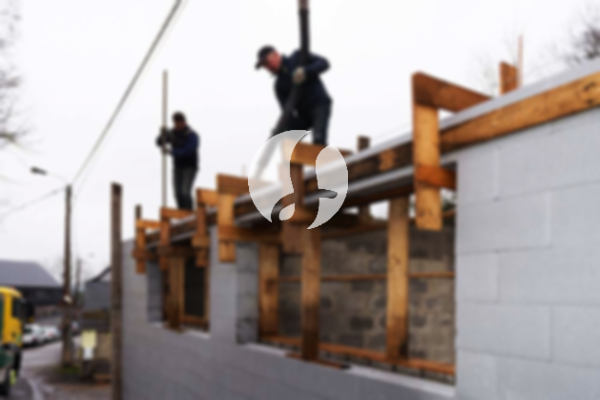

**Biaya Bangun Rumah Per Meter Di Pasar Minggu Jakarta** - Hai Mitra Sumber Material! Gimana kabarnya? Kami dari Sumber Material hadir untuk membantu Anda mewujudkan rumah impian di Pasar Minggu Jakarta. Di era modern ini, kebutuhan akan layanan konstruksi semakin meningkat. Banyak yang memilih jasa bangun rumah karena praktis dan efisien. Seiring dengan pertumbuhan penduduk, kebutuhan akan tempat tinggal pun terus bertambah. Tidak heran jika banyak pengembang properti berlomba-lomba membangun rumah, perumahan, apartemen, dan tempat tinggal susun untuk berbagai kalangan. Dengan kepercayaan yang diberikan oleh pembeli, layanan bangun rumah berkomitmen untuk mempertahankan kualitas dan memberikan yang terbaik bagi konsumen. Kami menjalankan pekerjaan dengan penuh tanggung jawab, menawarkan berbagai layanan untuk memenuhi kebutuhan pembangunan Anda. Berikut beberapa jenis layanan dari jasa bangun rumah yang dapat Anda pilih:



## Jasa Desain Gambar Arsitek Di Pasar Minggu Jakarta

Sebagai penyedia jasa arsitek terpercaya di Pasar Minggu Jakarta, Kami mengutamakan desain bangunan yang estetis dan fungsional. Melalui desain yang kami buat, Kami berusaha menampilkan keindahan rumah sesuai dengan impian Anda. Kami mempertimbangkan beberapa faktor penting untuk menciptakan komposisi desain yang baik dan harmonis. Desain adalah elemen krusial dalam pembangunan rumah karena sangat memengaruhi tampilan akhir. Anda tidak perlu khawatir, karena Kami akan menciptakan desain yang sesuai dengan anggaran yang Anda miliki. Dengan desain yang jelas, Anda dapat memperkirakan biaya yang dibutuhkan untuk mewujudkan rumah impian Anda. Selain itu, desain juga mempertimbangkan pemilihan bahan material yang tepat. Semua proses ini memerlukan keahlian khusus, itulah mengapa Anda membutuhkan jasa arsitek profesional. Kami siap memahami keinginan Anda dan mewujudkannya dalam karya nyata.

Namun, harga jasa desain bangunan Kami bervariasi tergantung pada luas bangunan dan kompleksitas desain yang diminta. Saat ini, Kami menetapkan harga per meter persegi. Untuk desain rumah minimalis satu lantai, biaya per meternya adalah Rp 54.000,-. Harga ini sudah termasuk desain, kalkulasi RAB (Rencana Anggaran Biaya), dan dua kali revisi. Sedangkan untuk rumah dua lantai atau lebih, biayanya dikalikan 2 atau 3 sesuai dengan jumlah lantai.

## Jasa Borong Bangun Rumah Di Pasar Minggu Jakarta

Seiring dengan pertumbuhan populasi, kebutuhan akan rumah yang layak huni semakin meningkat. Banyak orang yang ingin memiliki rumah sendiri sebagai tempat tinggal yang nyaman dan aman. Kami menawarkan jasa borong bangun rumah di Pasar Minggu Jakarta untuk membantu Anda mewujudkan impian tersebut. Dengan pengalaman bertahun-tahun, Kami memahami betul tantangan dalam membangun rumah, mulai dari perencanaan hingga penyelesaian. Kami berkomitmen untuk memberikan layanan terbaik dan memastikan kepuasan Anda sebagai pelanggan. Dengan menggunakan jasa bangun rumah Kami, Anda tidak perlu khawatir tentang proses pembangunan. Kami akan menangani semuanya, mulai dari desain, pengurusan izin, hingga pelaksanaan konstruksi.

Untuk biaya borong bangun rumah, Kami menawarkan beberapa pilihan harga yang disesuaikan dengan material bangunan dan lokasi pembangunan di Pasar Minggu Jakarta. Dengan syarat bahwa kondisi tanah rata, stabil, dan tidak memerlukan pengurugan. Harga per meter persegi dengan material dinding hebel adalah Rp 1.950.000,-, sedangkan dengan material bata merah adalah Rp 2.200.000,-. Harga ini sudah termasuk pondasi batu sungai, kolom dan tiang beton, lantai keramik standar, dan atap dengan rangka baja ringan plus genteng spandek. Untuk pilihan genteng dan keramik, Anda dapat mengajukan permintaan variasi lain, model, kualitas, dan biaya sesuai preferensi Anda.

## Jasa Renovasi Rumah Di Pasar Minggu Jakarta

Selain jasa arsitek dan borong bangun rumah, Kami juga menyediakan jasa renovasi rumah di Pasar Minggu Jakarta. Renovasi rumah adalah cara yang efektif untuk mengubah tampilan rumah Anda menjadi lebih segar dan modern. Kami membantu Anda mewujudkan rumah impian dengan layanan renovasi yang komprehensif. Renovasi yang Kami lakukan meliputi perubahan bentuk tampilan bangunan, perbaikan kerusakan, atau bahkan renovasi total. Renovasi bisa menjadi solusi yang tepat jika Anda ingin meningkatkan nilai properti Anda tanpa harus membangun rumah baru. Namun, biaya renovasi seringkali menjadi kendala bagi sebagian orang. Dengan adanya jasa renovasi rumah Kami, masalah ini dapat diatasi. Kami menawarkan solusi renovasi yang terjangkau dan berkualitas.

Untuk harga borongan jasa renovasi rumah Kami, harganya bervariasi tergantung pada kondisi kerusakan dan luas area yang direnovasi. Setiap rumah memiliki tingkat kerusakan yang berbeda-beda, sehingga Kami akan memberikan penawaran harga yang sesuai dengan kebutuhan Anda. Sebagai alternatif, Kami juga menawarkan jasa tenaga tukang harian dengan harga Rp 150.000,- per hari untuk tukang dan Rp 100.000,- per hari untuk kenek.

## Didukung Tenaga Kerja Dan Arsitek Terbaik Di Pasar Minggu Jakarta

Baik jasa desain arsitek, jasa borong bangun rumah, maupun jasa renovasi rumah, semuanya memiliki peran penting dalam mewujudkan impian Anda. Kami didukung oleh arsitek profesional dan tenaga kerja yang handal untuk memastikan kualitas terbaik dalam setiap proyek. Dengan tim yang berpengalaman, Kami berkomitmen untuk membantu Anda menciptakan rumah idaman yang menarik dan nyaman. Kami menjamin kualitas pekerjaan, menjaga mutu, dan memberikan kepuasan maksimal kepada setiap pelanggan. Kepuasan Anda adalah motivasi utama Kami untuk terus berkarya dan menghasilkan karya-karya yang lebih baik. Anda dapat melihat katalog proyek-proyek Kami sebelumnya untuk melihat hasil karya Kami.

Rumah adalah kebutuhan dasar manusia yang sangat penting, selain sandang dan pangan. Rumah menjadi tempat berlindung dari cuaca ekstrem dan berbagai bahaya. Hal ini menjadi peluang bagi Kami sebagai penyedia jasa bangun rumah untuk menawarkan solusi terbaik bagi Anda. Sebagai penyedia jasa terpercaya, Kami turut berkontribusi dalam memajukan dunia arsitektur dengan menampilkan layanan Kami melalui berbagai media, baik cetak maupun online. Dengan mutu dan kualitas terbaik, Kami telah terbukti memiliki pengalaman yang cukup lama dalam bidang arsitektur. Inilah alasan mengapa banyak orang mempercayai Kami.

Didukung oleh arsitek profesional dan tenaga kerja yang handal, Kami terus berkembang dan memberikan inovasi dalam setiap proyek. Kami menciptakan desain yang apik dan menarik, serta memastikan proses pembangunan berjalan lancar dan efisien. Baik rumah skala kecil maupun besar, Kami mampu menangani semuanya dengan baik. Dimulai dari desain rumah, pemilihan material, ukuran bangunan, hingga sumber daya manusia, semuanya Kami kelola dengan profesional. Dengan layanan terintegrasi, Kami mendukung terwujudnya bangunan yang cantik dan menarik. Kami berperan penting dalam menciptakan tata desain dan mengawasi proses pembangunan secara keseluruhan. Anda bisa menemukan banyak inspirasi membangun rumah di [bangun rumah di Bambu Apus](/bangunan/biaya-bangun-rumah-per-meter-di-bambu-apus-jakarta/) atau [bangun rumah di Cakung Timur](/bangunan/biaya-bangun-rumah-per-meter-di-cakung-timur-jakarta/) untuk wilayah lain. Jangan ragu untuk [Konsultasi Gratis](https://api.whatsapp.com/send?phone=6285776786091&text=*Halo%20sumbermaterial.com*%20%3A) dengan tim Kami untuk mendapatkan penawaran terbaik!
