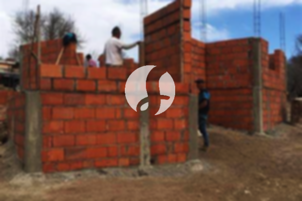

**Biaya Bangun Rumah Per Meter Di Pasawahan Purwakarta** - Hai Mitra Sumber Material! Gimana kabarnya? Kami dari Sumber Material, penyedia jasa bangun rumah di Pasawahan Purwakarta, ingin berbagi informasi penting bagi Anda yang berencana membangun rumah impian. Seiring perkembangan zaman, layanan borong bangun rumah semakin diminati. Bukan hanya karena kemudahannya, tapi juga karena banyak penyedia layanan yang kini menawarkan desain rumah yang menarik. Jumlah orang yang mencari tempat tinggal terus meningkat, dan otomatis kebutuhan akan rumah juga ikut bertambah. Para kontraktor properti berlomba-lomba menghadirkan solusi pembangunan, mulai dari rumah sederhana hingga mewah. Kepercayaan konsumen adalah kunci, dan Kami sebagai penyedia jasa selalu berusaha mempertahankan kredibilitas tersebut. Dengan begitu, Kami berkomitmen untuk menyelesaikan setiap proyek dengan baik dan memberikan hasil terbaik. Nah, Kami menawarkan beragam layanan yang bisa Anda pilih untuk membangun hunian idaman di Pasawahan Purwakarta:



## Jasa Desain Gambar Arsitek Profesional di Pasawahan Purwakarta

Sebagai penyedia jasa arsitek, Kami selalu mengutamakan observasi mendalam terhadap desain rumah yang Anda inginkan. Tujuan Kami adalah menghadirkan keindahan dan kenyamanan dalam setiap rancangan. Komposisi desain yang bagus dan selaras adalah prioritas Kami. Desain adalah fondasi utama sebuah bangunan yang indah. Dengan desain yang tepat, rumah Anda akan terlihat menarik dan sesuai dengan kepribadian Anda. Anda tidak perlu khawatir tentang anggaran, karena Kami akan menciptakan desain yang serasi dengan *budget* yang Anda miliki. Dari desain tersebut, Anda bisa memproyeksikan biaya yang dibutuhkan untuk mewujudkan rumah impian Anda. Selain itu, Kami juga memperhatikan pemilihan material bangunan yang tepat. Semua hal ini memang membutuhkan keahlian khusus, maka dari itu, memilih jasa arsitek profesional adalah langkah yang tepat. Kami memahami keinginan Anda dan akan mewujudkannya menjadi kenyataan.

Biaya jasa desain bangunan dari Kami bervariasi, bergantung pada luas rumah dan tingkat kesulitan desainnya. Saat ini, harga jasa desain rumah minimalis satu lantai adalah Rp 54.000,- per meter persegi, sudah termasuk desain, kalkulasi RAB, dan dua kali revisi. Untuk rumah dua lantai atau lebih, biayanya hanya dikalikan dua atau tiga, sesuai dengan jumlah lantai.

## Layanan Borong Bangun Rumah Terpercaya di Pasawahan Purwakarta

Seiring bertambahnya populasi, kebutuhan akan tempat tinggal juga semakin meningkat. Banyak penyedia jasa bangun rumah hadir menawarkan berbagai produk dan layanan terbaik untuk konsumen. Disinilah peran penting Kami dalam membantu mewujudkan impian Anda memiliki rumah idaman di Pasawahan Purwakarta. Memiliki rumah yang cantik adalah harapan setiap orang. Dengan mempercayakan pembangunan rumah Anda kepada Kami, Anda dapat mewujudkan impian tersebut. Kami akan membantu Anda merancang rumah sesuai keinginan, tanpa perlu repot memikirkan desain sendiri. Kami selalu berusaha memahami harapan Anda dan mewujudkannya dalam bentuk bangunan yang nyata. Kepuasan Anda adalah prioritas Kami, dan itu menjadi motivasi Kami untuk terus memberikan yang terbaik.

Untuk layanan borong renovasi, Kami menawarkan beberapa tingkatan harga, menyesuaikan dengan material bangunan yang digunakan dan lokasi proyek di Pasawahan Purwakarta. Dengan asumsi area tanah dalam kondisi rata, stabil, dan tidak memerlukan pengurukan, harga per meter persegi dengan material dinding hebel adalah Rp 1.950.000,-, sedangkan untuk material bata merah adalah Rp 2.200.000,-. Harga tersebut sudah termasuk pondasi batu kali, kolom dan tiang beton, lantai keramik standar, serta atap dengan rangka baja ringan dan genteng spandek. Anda juga bisa memilih jenis genteng dan keramik lain sesuai preferensi, dengan penyesuaian harga.

## Jasa Rombak Rumah Profesional di Pasawahan Purwakarta

Selain layanan arsitek dan bangun rumah, Kami juga menyediakan jasa renovasi rumah di Pasawahan Purwakarta. Renovasi adalah cara yang efektif untuk memberikan tampilan baru pada rumah Anda. Dengan kehadiran Kami, Anda tidak perlu khawatir lagi tentang proses renovasi. Renovasi yang Kami lakukan bisa berupa perubahan bentuk model bangunan, atau bahkan renovasi total. Renovasi adalah alternatif yang tepat untuk mempercantik rumah dengan anggaran yang terjangkau. Namun, seringkali seseorang kesulitan menjalankan renovasi sendiri karena berbagai kendala. Dengan adanya jasa renovasi bangunan, semua masalah tersebut bisa teratasi. Kami siap membantu Anda mengubah rumah Anda menjadi lebih segar dan indah dari sebelumnya, sesuai dengan impian Anda.

Biaya borongan renovasi Kami bervariasi, tergantung pada kondisi kerusakan bangunan yang akan diperbaiki. Untuk biaya jasa renovasi dengan tenaga tukang harian, tarifnya adalah Rp 150.000,- per hari untuk tukang dan Rp 100.000,- per hari untuk kenek.

## Didukung Tenaga Kerja & Arsitek Berpengalaman di Pasawahan Purwakarta

Baik layanan arsitek, bangun rumah, maupun renovasi, setiap layanan memiliki peran penting dalam mewujudkan impian Anda. Dengan dukungan arsitek profesional dan tenaga kerja yang handal, Kami dapat membantu Anda menciptakan rumah impian yang sesuai dengan harapan. Membangun rumah bersama Kami akan memberikan Anda hunian yang menarik dan berkualitas. Kami selalu berusaha memberikan pelayanan terbaik, menjaga mutu dan kualitas pekerjaan, serta memberikan kepuasan kepada setiap pelanggan. Kepuasan Anda adalah dorongan Kami untuk terus berkarya dan menghasilkan karya-karya yang lebih baik. Anda bisa melihat katalog proyek-proyek Kami untuk membuktikan kualitas layanan yang Kami berikan.

Perlu diingat, rumah adalah kebutuhan utama manusia, selain sandang dan pangan. Rumah menjadi tempat berlindung dari cuaca ekstrem dan berbagai bahaya. Hal ini menjadi peluang bagi penyedia jasa bangun rumah untuk menawarkan jasanya. Sebagai penyedia jasa, Kami berkontribusi dalam meramaikan dunia arsitektur dengan menampilkan layanan melalui berbagai media, baik cetak maupun *online*. Hal ini tentu memudahkan Anda yang berencana membangun rumah di Pasawahan Purwakarta. Dengan mempertahankan mutu dan kualitas terbaik, Kami telah terbukti memiliki pengalaman yang cukup lama dalam bidang arsitektur. Inilah sebabnya, semakin banyak orang mempercayakan pembangunan rumah mereka kepada Kami. [bangun rumah di Babakan Cikao](/bangunan/biaya-bangun-rumah-per-meter-di-babakan-cikao-purwakarta/)

Didukung oleh arsitek profesional dan tenaga kerja yang handal, Kami semakin dikenal sebagai penyedia layanan yang tidak diragukan lagi kemampuannya. Hal ini terlihat dari perkembangan yang terus Kami berikan. Kami terus berkarya mewujudkan karya-karya baru yang inovatif dan kreatif. Banyak bangunan-bangunan indah dengan desain apik telah Kami bangun. Proses pengerjaan yang efisien memungkinkan Anda segera mendapatkan rumah impian Anda. Baik rumah berskala kecil maupun besar, Kami mampu mengatasinya. Anda tidak perlu khawatir tentang desain, material, ukuran rumah, atau sumber daya manusia. Semuanya dapat Kami atasi dengan layanan bangun rumah Kami. Disitulah peran penting Kami. Kami akan membuat perencanaan dan sekaligus mengawasi proses pembangunan. [Hubungi Kami Sekarang](https://api.whatsapp.com/send?phone=6285776786091&text=*Halo%20sumbermaterial.com*%20%3A)
