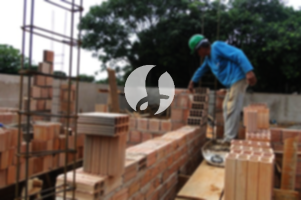

**Biaya Bangun Rumah Per Meter Di Paseban Jakarta** - Mitra Sumber Material! Bagaimana kabarnya hari ini? Kami hadir untuk memberikan solusi lengkap kebutuhan konstruksi Anda di Paseban Jakarta. Seiring dengan semakin banyaknya pilihan layanan pembangunan rumah, menemukan mitra yang tepat menjadi kunci utama. Semakin meningkatnya kebutuhan hunian mendorong para pelaku properti untuk berinovasi, menawarkan berbagai pilihan mulai dari rumah standar hingga mewah. Kepercayaan konsumen adalah fondasi utama, dan kami berkomitmen untuk menjalankan setiap amanah dengan penuh tanggung jawab. Kami, sebagai penyedia layanan membangun rumah terpercaya di Paseban Jakarta, menawarkan beragam solusi untuk mewujudkan hunian impian Anda. Berikut adalah beberapa layanan yang bisa Anda pilih:



## Jasa Desain Gambar Arsitektur Di Paseban Jakarta

Sebagai penyedia jasa arsitek, kami mengutamakan visualisasi bangunan impian Anda. Kami akan membantu menerjemahkan ide Anda menjadi desain yang indah dan fungsional. Sebuah desain yang baik adalah fondasi utama rumah yang menarik. Oleh karena itu, kami memanfaatkan berbagai faktor penting untuk menciptakan komposisi desain yang selaras dan estetis. Kami memahami bahwa desain merupakan elemen krusial dalam pembangunan rumah. Dengan desain yang tepat, rumah Anda akan terlihat lebih indah dan berkarakter. Anda tidak perlu khawatir, karena kami akan menyesuaikan desain dengan anggaran yang Anda miliki. Desain yang kami buat akan memberikan gambaran jelas mengenai biaya yang dibutuhkan untuk mewujudkan hunian idaman Anda. Selain itu, kami juga mempertimbangkan pemilihan material yang sesuai dengan anggaran dan konsep desain. Semua proses ini membutuhkan keahlian khusus, itulah mengapa Anda membutuhkan seorang arsitek profesional. Kami siap memahami keinginan Anda dan mewujudkannya dalam sebuah desain yang memuaskan.

Harga jasa desain rumah kami bervariatif, tergantung pada luas rumah dan kompleksitas desain yang diinginkan. Saat ini, harga jasa desain rumah minimalis satu lantai kami mulai dari Rp 54.000,- per meter persegi, sudah termasuk desain, perhitungan RAB, dan dua kali revisi. Untuk rumah dua lantai atau lebih, harga akan disesuaikan, dikalikan 2 atau 3 sesuai jumlah lantai.

## Jasa Borong Bangun Rumah Di Paseban Jakarta

Kebutuhan akan hunian terus meningkat seiring dengan pertumbuhan populasi. Ini membuka peluang bagi penyedia jasa bangun rumah untuk menawarkan layanan terbaik mereka. Kami hadir sebagai solusi untuk mewujudkan rumah impian Anda di Paseban Jakarta. Memiliki rumah yang nyaman dan indah adalah keinginan setiap orang. Dengan memanfaatkan jasa borong bangun rumah kami, Anda akan mendapatkan bantuan penuh dalam mewujudkan impian tersebut. Anda tidak perlu repot memikirkan desain atau proses pembangunan, karena kami akan mengurus semuanya untuk Anda. Kami selalu berusaha memahami harapan Anda dan mewujudkannya dalam sebuah karya nyata, sebuah bangunan impian yang sesuai dengan keinginan Anda. Kepuasan Anda adalah prioritas utama kami, dan hal itu menjadi motivasi bagi kami untuk terus memberikan layanan terbaik. Kami memiliki portofolio proyek yang beragam yang dapat Anda lihat untuk menilai kualitas kerja kami. [bangun rumah di Bukit Duri](/bangunan/biaya-bangun-rumah-per-meter-di-bukit-duri-jakarta/)

Untuk harga borong bangun rumah, kami menawarkan beberapa pilihan yang disesuaikan dengan bahan bangunan dan lokasi pembangunan. Dengan asumsi lokasi tanah dalam keadaan rata, stabil, dan tidak memerlukan pengurukan, harga dimulai dari Rp 1.950.000,- per meter persegi untuk material dinding hebel dan Rp 2.200.000,- per meter persegi untuk material bata merah. Harga tersebut sudah termasuk pondasi batu sungai, kolom dan tiang beton, lantai keramik standar, serta atap rangka baja ringan dengan genteng spandek. Anda dapat menyesuaikan pilihan genteng dan keramik sesuai preferensi Anda, dengan penyesuaian biaya yang sesuai.

## Layanan Renovasi Bangunan Di Paseban Jakarta

Selain jasa arsitek dan borong bangun rumah, Kami juga menyediakan jasa renovasi bangunan. Jasa renovasi rumah adalah solusi tepat untuk memberikan tampilan baru pada hunian Anda. Dengan layanan renovasi bangunan, Anda tidak perlu khawatir tentang proses renovasi, karena kami akan mengurus semuanya untuk Anda. Renovasi yang kami lakukan dapat berupa perubahan bentuk model rumah secara parsial atau total. Renovasi merupakan alternatif yang efektif untuk memperbarui tampilan rumah dengan biaya yang lebih terjangkau. Namun, terkadang orang merasa kesulitan untuk melakukannya sendiri. Dengan adanya jasa renovasi bangunan, semua masalah tersebut dapat teratasi. Kami hadir sebagai mitra renovasi yang akan membantu Anda menciptakan rumah yang lebih segar dan menarik. Kami siap mewujudkan rumah impian Anda sesuai dengan anggaran dan preferensi Anda.

Harga borong renovasi bangunan kami bervariasi tergantung pada kondisi kerusakan bangunan. Oleh karena itu, penentuan harga disesuaikan dengan tipe kerusakan yang akan diperbaiki. Namun, untuk jasa renovasi dengan tenaga tukang harian, kami mengenakan biaya Rp 150.000,- per hari untuk tukang dan Rp 100.000,- per hari untuk kenek.

## Digawangi Tenaga Kerja & Arsitek Terpercaya Di Paseban Jakarta

Baik jasa arsitek, borong bangun rumah, maupun renovasi bangunan, semuanya memiliki peran penting dalam mewujudkan hunian impian Anda. Didukung oleh arsitek profesional dan tenaga kerja yang handal, kami akan membantu Anda mewujudkan impian tersebut. Dengan membangun rumah bersama Kami, Anda akan memiliki hunian yang menarik dan nyaman. Kami mengutamakan kualitas, ketelitian, dan kepuasan pelanggan. Sebagai penyedia jasa bangun rumah, kepuasan Anda adalah motivasi utama kami untuk terus berkarya dan memberikan layanan terbaik. Anda dapat melihat portofolio proyek kami untuk melihat hasil karya kami dan meyakini kualitas layanan yang kami berikan .

Perlu diketahui, rumah merupakan kebutuhan primer manusia yang sangat penting selain sandang dan pangan. Rumah menjadi tempat berlindung dari cuaca ekstrem dan berbagai bahaya. Hal ini menjadi peluang bagi penyedia jasa bangun rumah untuk menawarkan jasanya. Sebagai penyedia jasa, kami turut serta meramaikan dunia arsitektur yang terus berkembang dengan mempromosikan layanan kami melalui berbagai media, baik cetak maupun online. Hal ini tentu memudahkan Anda dalam menemukan solusi pembangunan rumah Anda. Kami selalu menjaga kualitas dan pengalaman kami yang cukup lama dalam menggeluti dunia arsitektur. Inilah alasan mengapa Kami semakin dipercaya oleh banyak orang.

Didukung oleh arsitek profesional dan tenaga kerja yang handal, Kami akan terus mengembangkan layanan kami. Kami selalu berinovasi dan menciptakan karya-karya baru yang lebih kreatif dan menarik. Banyak rumah dan bangunan indah yang telah kami bangun dengan desain yang apik. Proses pengerjaan yang cepat dan efisien memungkinkan Anda untuk segera menikmati rumah impian Anda. Kami dapat menangani proyek bangunan berskala kecil maupun besar. Mulai dari desain, material, ukuran rumah, hingga sumber daya manusia, semuanya dapat kami atasi. Kami akan mewujudkan rancangan Anda dan mengawasi proses pembangunan secara menyeluruh. Jangan ragu untuk [Hubungi kami sekarang](https://api.whatsapp.com/send?phone=6285776786091&text=*Halo%20sumbermaterial.com*%20%3A) untuk konsultasi gratis dan penawaran terbaik di Paseban Jakarta! Apakah Anda tertarik untuk melihat biaya bangun rumah di [bangun rumah di Batu Ampar](/bangunan/biaya-bangun-rumah-per-meter-di-batu-ampar-jakarta/)?
