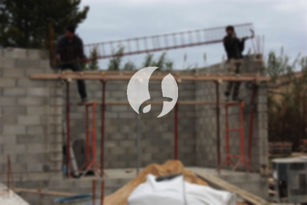

**Biaya Bangun Rumah Per Meter Di Pasir Kuda Bogor** - Hai Mitra Sumber Material! Bagaimana kabarnya? Kami dari Sumber Material hadir untuk memberikan solusi lengkap kebutuhan konstruksi Anda di Pasir Kuda Bogor. Seiring dengan perkembangan zaman, layanan pembuatan rumah kini semakin diminati. Jasa bangun rumah menawarkan kemudahan dan profesionalisme yang banyak dicari, terutama bagi mereka yang ingin mewujudkan hunian impian tanpa repot. Kebutuhan akan tempat tinggal terus meningkat seiring dengan pertumbuhan penduduk, mendorong para pelaku properti untuk berlomba-lomba menyediakan solusi perumahan dari berbagai kelas. Mitra Sumber Material hadir sebagai mitra terpercaya untuk mewujudkan proyek bangunan Anda, mulai dari perencanaan hingga penyelesaian.



## Layanan Desain Gambar Arsitek Profesional di Pasir Kuda Bogor

Kami tidak hanya membangun, tetapi juga membantu mewujudkan visi desain rumah impian Anda. Layanan desain arsitek dari Sumber Material menawarkan solusi kreatif dan fungsional untuk menciptakan rumah yang indah dan sesuai dengan kebutuhan Anda di Pasir Kuda Bogor. Desain adalah fondasi utama sebuah bangunan yang baik. Komposisi yang harmonis dan estetis akan menciptakan hunian yang nyaman dan memvisualisasikan gaya hidup Anda. Kami memahami bahwa desain seringkali menjadi aspek terpenting dalam pembangunan rumah. Oleh karena itu, Kami akan menciptakan desain yang sesuai dengan budget dan preferensi Anda. Dengan desain yang jelas, Anda dapat memperkirakan anggaran yang dibutuhkan untuk mewujudkan rumah impian Anda. Selain itu, Kami juga mempertimbangkan pemilihan bahan bangunan yang tepat agar sesuai dengan desain dan anggaran yang telah ditetapkan. Percayakan pada keahlian tim arsitek Kami yang berpengalaman untuk menghasilkan desain yang memuaskan.

Biaya jasa desain rumah Kami bervariasi tergantung pada luas bangunan dan kompleksitas desain yang Anda inginkan. Saat ini, Kami menawarkan harga jasa desain bangunan minimalis satu lantai mulai dari Rp 54.000,- per meter persegi, termasuk desain, kalkulasi RAB, dan 2 kali revisi. Untuk bangunan 2 lantai atau lebih, biaya dapat ditingkatkan menjadi 2 atau 3 kali lipat sesuai dengan jumlah lantai.

## Estimasi Biaya Borong Renovasi Rumah di Pasir Kuda Bogor

Tahukah Anda, memiliki rumah sendiri adalah impian banyak orang. Dengan banyaknya pilihan jasa bangun rumah yang tersedia, Anda dapat menemukan yang paling sesuai dengan kebutuhan Anda. Sumber Material hadir sebagai solusi terpercaya dalam menangani semua permasalahan pembangunan rumah Anda di Pasir Kuda Bogor. Dengan menggunakan jasa bangun rumah profesional, Anda dapat mewujudkan impian memiliki rumah yang bagus dan nyaman. Kami membantu Anda melewati kerumitan mendesain rumah sendiri, dengan berusaha memahami keinginan Anda dan mewujudkannya dalam bentuk bangunan yang nyata. Kepuasan Anda adalah prioritas Kami, dan Kami terus berupaya memberikan pelayanan terbaik dan menjaga kualitas pekerjaan.

Untuk layanan borongan pembangunan, Kami menawarkan beberapa pilihan harga yang disesuaikan dengan material bangunan dan lokasi proyek. Dengan asumsi area tanah rata, stabil, dan tidak memerlukan pengurukan, harga per meter persegi dengan material dinding hebel adalah Rp 1.950.000,-, sedangkan dengan material bata merah adalah Rp 2.200.000,-. Harga tersebut sudah termasuk pondasi batu sungai, kolom dan tiang beton, lantai keramik standar, dan atap dengan rangka baja ringan plus genteng spandek. Dapatkan penawaran khusus untuk jenis genteng dan keramik yang Anda inginkan, serta penyesuaian model dan kualitas sesuai anggaran Anda.

## Jasa Rombak Bangunan: Solusi Renovasi Terpercaya di Pasir Kuda Bogor

Selain layanan arsitek dan pembangunan, Kami juga menyediakan jasa renovasi rumah untuk memperbarui dan menyegarkan tampilan rumah Anda di Pasir Kuda Bogor. Renovasi adalah cara efektif untuk mengubah tampilan rumah dan meningkatkan nilainya. Dengan jasa renovasi bangunan profesional, Anda tidak perlu khawatir tentang kerumitan proses renovasi. Kami melayani berbagai jenis renovasi, mulai dari perubahan bentuk model rumah hingga renovasi total. Kami memahami bahwa renovasi seringkali membutuhkan anggaran yang terjangkau. Karena itu, Kami menawarkan solusi renovasi yang efisien dan efektif. Dengan memanfaatkan jasa renovasi bangunan dari Kami, Anda dapat dengan mudah merenovasi rumah Anda menjadi lebih fresh dan menarik. Kami siap mewujudkan impian renovasi rumah Anda sesuai dengan keinginan Anda.

Untuk biaya borongan jasa renovasi rumah, Kami memberikan harga yang bervariasi tergantung pada kondisi kerusakan bangunan Anda. Biaya akan disesuaikan dengan jenis kerusakan yang perlu diperbaiki. Untuk biaya tenaga tukang harian, tarifnya adalah Rp 150.000,- per hari untuk tukang dan Rp 100.000,- per hari untuk kenek.

## Dukungan Tenaga Kerja Berpengalaman & Arsitek Ahli di Pasir Kuda Bogor

Baik layanan desain arsitek, pembangunan rumah, maupun renovasi, semuanya memiliki peran penting dalam mewujudkan impian rumah Anda di Pasir Kuda Bogor. Dengan dukungan arsitek profesional dan tenaga kerja yang handal, Kami akan membantu mewujudkan rumah impian Anda. Membangun rumah idaman bersama Sumber Material berarti memiliki hunian yang menarik dan nyaman. Kami berkomitmen untuk memberikan pelayanan terbaik, menjaga mutu dan kualitas pekerjaan, serta memberikan kepuasan maksimal kepada Anda. Kepuasan Anda adalah motivasi Kami untuk terus berkarya dan menghasilkan karya yang lebih baik lagi. Anda dapat melihat katalog proyek-proyek Kami sebelumnya untuk membuktikan kualitas dan keandalan Kami.

Rumah adalah kebutuhan pokok manusia yang sangat penting, selain sandang dan pangan. Sebagai tempat berlindung dari cuaca dan bahaya, rumah menjadi bagian tak terpisahkan dari kehidupan kita. Inilah kesempatan bagi Kami sebagai penyedia jasa bangun rumah untuk berkontribusi dalam dunia arsitektur yang terus berkembang. Kami berpartisipasi dalam meramaikan dunia arsitektur dengan menawarkan jasa Kami melalui berbagai media, mulai dari media cetak hingga online. Hal ini memudahkan Anda dalam mencari informasi tentang jasa bangun rumah yang tepat. Kami selalu menjaga mutu dan kualitas terbaik dalam setiap pekerjaan, dan pengalaman Kami yang cukup lama di dunia arsitektur menjadi jaminan kualitas dan kepercayaan. Itulah sebabnya, Kami semakin dipercaya oleh banyak orang. [bangun rumah di Bojongkerta](/bangunan/biaya-bangun-rumah-per-meter-di-bojongkerta-bogor/)

Didukung oleh arsitek profesional dan tenaga kerja yang handal, Kami akan terus mengembangkan jasa bangun rumah dan memberikan solusi terbaik bagi kebutuhan Anda. Kami selalu berkarya membuat karya-karya baru yang inovatif dan kreatif. Banyak rumah-bangunan indah dan menarik telah Kami bangun dengan desain yang apik. Dengan progres pengerjaan yang cepat dan efisien, Anda dapat segera menikmati rumah impian Anda. Baik rumah berskala kecil maupun besar, Kami dapat mengatasinya dengan baik. Anda tidak perlu ragu atau khawatir, karena Kami menyediakan solusi lengkap, mulai dari desain, material bangunan, ukuran bangunan, hingga sumber daya manusia yang kompeten. Kami membantu Anda dalam merencanakan dan mengawasi pembangunan, sehingga Anda dapat memiliki bangunan yang cantik dan menarik. [Hubungi Kami Sekarang](https://api.whatsapp.com/send?phone=6285776786091&text=*Halo%20sumbermaterial.com*%20%3A) untuk konsultasi gratis dan penawaran terbaik!
