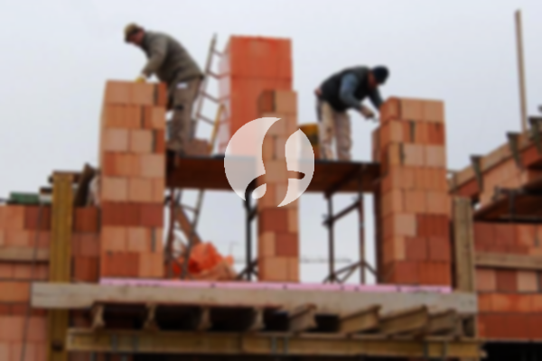

**Biaya Bangun Rumah Per Meter Di Pasir Mulya Bogor** - Hai Mitra Sumber Material! Bagaimana kabar Anda? Kami dari Sumber Material hadir untuk menghadirkan solusi lengkap kebutuhan konstruksi Anda di Pasir Mulya Bogor. Seiring dengan perkembangan zaman, layanan pembangunan rumah semakin diminati. Banyak orang kini memilih jasa bangun rumah demi kemudahan dan efisiensi. Pertumbuhan populasi yang pesat memicu permintaan akan hunian yang terus meningkat, sehingga para pengembang properti berlomba-lomba menawarkan berbagai pilihan rumah, mulai dari yang ekonomis hingga mewah. Dengan reputasi yang baik, jasa bangun rumah yang profesional akan berupaya keras mempertahankan kepercayaan pelanggan, dan menjalankan proyek dengan penuh tanggung jawab. Nah, sebagai penyedia jasa borongan bangun rumah yang terpercaya, Kami menawarkan beberapa layanan yang bisa Anda pilih:



## Harga Desain Gambar Arsitek Di Pasir Mulya Bogor

Sebagai penyedia layanan desain arsitektur, tentu saja Kami akan mengamati dan mewujudkan desain rumah impian Anda. Dengan desain yang matang, Kami berupaya menciptakan keindahan dan fungsionalitas dalam setiap bangunan. Kami memahami bahwa desain adalah elemen penting yang memengaruhi estetika rumah Anda. Oleh karena itu, Kami akan membuat desain yang sesuai dengan anggaran dan kebutuhan Anda. Dari desain awal, Anda dapat memperkirakan biaya yang dibutuhkan untuk mewujudkan rumah impian Anda. Selain itu, desain juga memperhitungkan pemilihan material bangunan yang tepat. Semua aspek ini membutuhkan perencanaan yang cermat, dan di sinilah keahlian seorang arsitek berperan penting. Kami akan memahami keinginan Anda dan mewujudkannya dalam wujud desain yang memuaskan.

Harga jasa desain rumah Kami bervariasi, tergantung pada luas rumah dan kompleksitas desain. Saat ini, Kami menawarkan harga per meter untuk desain rumah minimalis satu lantai, yaitu Rp54.000,-. Biaya ini sudah termasuk desain, perhitungan RAB (Rencana Anggaran Biaya), dan dua kali revisi. Untuk rumah dua lantai atau lebih, biayanya hanya dikalikan 2 atau 3 sesuai dengan jumlah lantai.

## Harga Layanan Borong Bangun Bangunan Di Pasir Mulya Bogor

Seperti yang kita ketahui, kebutuhan akan rumah terus meningkat seiring dengan pertumbuhan populasi. Banyak penyedia jasa bangun rumah bersaing menawarkan produk dan layanan terbaik. Di sinilah peran penting dari layanan borongan bangun rumah dalam mengatasi tantangan pembangunan. Kami hadir untuk membantu mewujudkan rumah impian Anda sesuai dengan keinginan Anda. Memiliki rumah yang indah adalah impian setiap orang. Dengan memanfaatkan jasa bangun rumah Kami, Anda tidak perlu repot mendesain rumah sendiri. Kami akan selalu berusaha memahami keinginan Anda dan mewujudkannya dalam bentuk bangunan yang nyata. Kepuasan Anda adalah prioritas Kami, dan Kami akan memberikan pelayanan terbaik untuk membangun rumah impian Anda.

Untuk layanan borong renovasi bangunan, Kami menawarkan beberapa pilihan harga. Harga disesuaikan dengan material bangunan yang digunakan dan lokasi pembangunan. Dengan asumsi lokasi tanah rata, stabil, dan tidak memerlukan pengurugan, harga per meter untuk material dinding hebel adalah Rp1.950.000,-, dan untuk material bata merah adalah Rp2.200.000,-. Harga ini sudah termasuk pondasi batu gunung, kolom dan tiang beton, lantai keramik standar, dan atap dengan rangka baja ringan plus genteng spandek. Untuk jenis genteng dan keramik, Anda dapat menyesuaikan pilihan Anda dengan model, kualitas, dan biaya yang sesuai.

## Layanan Renovasi Rumah Di Pasir Mulya Bogor

Selain layanan desain dan bangun rumah, Kami juga menyediakan jasa renovasi rumah di Pasir Mulya Bogor. Renovasi rumah adalah cara yang efektif untuk memberikan tampilan baru pada hunian Anda. Dengan adanya layanan renovasi rumah, Anda tidak perlu khawatir menentukan langkah renovasi yang tepat, karena Kami akan membantu Anda mengubah tampilan rumah secara menyeluruh atau sebagian sesuai keinginan Anda. Renovasi dapat menjadi solusi untuk meningkatkan keindahan rumah Anda, namun seringkali terkendala biaya. Namun dengan layanan renovasi Kami, semua masalah itu dapat diatasi. Kami hadir sebagai solusi renovasi rumah yang terjangkau dan berkualitas, siap mengubah bangunan Anda menjadi lebih segar dan menarik.

Untuk biaya borongan renovasi bangunan, Kami menawarkan harga yang bervariasi. Hal ini disebabkan karena kondisi kerusakan bangunan yang akan direnovasi berbeda-beda. Harga akan disesuaikan dengan jenis dan tingkat kerusakan yang perlu diperbaiki. Namun, untuk jasa renovasi dengan tenaga tukang harian, Kami mengenakan biaya Rp150.000,- per hari untuk tukang dan Rp100.000,- per hari untuk kenek.

## Didukung Tukang Dan Arsitek Berpengalaman Di Pasir Mulya Bogor

Baik itu layanan arsitek, bangun rumah, maupun renovasi rumah, semuanya memiliki peran yang sangat penting. Didukung oleh arsitek profesional dan tenaga kerja yang handal, Kami akan membantu mewujudkan impian Anda. Dengan membangun rumah impian bersama Kami, Anda akan memiliki hunian yang menarik dan indah. Kami memberikan pelayanan terbaik, menjaga mutu dan kualitas, serta memberikan kepuasan kepada Anda. Sebagai penyedia jasa bangun rumah, kepuasan pelanggan adalah motivasi Kami untuk terus berkarya dan memberikan hasil yang lebih baik. Anda bisa melihat katalog proyek-proyek yang telah Kami selesaikan untuk membuktikan kualitas dan keandalan Kami.

Perlu diketahui bahwa rumah merupakan kebutuhan utama manusia setelah sandang dan pangan. Tempat tinggal menjadi tempat berlindung dari cuaca ekstrem dan berbagai bahaya. Hal ini memberikan peluang bagi para penyedia jasa bangun rumah untuk menawarkan jasanya. Sebagai penyedia jasa, Kami berpartisipasi dalam memajukan dunia arsitektur dengan mempresentasikan layanan Kami melalui berbagai media, baik cetak maupun online. Tujuannya adalah membantu banyak orang mewujudkan rumah impian mereka. Dengan menjaga kualitas dan mutu terbaik, Kami telah memiliki pengalaman yang cukup lama dalam dunia arsitektur sehingga semakin banyak orang mempercayai jasa Kami.

Didukung oleh arsitek profesional dan tenaga kerja yang handal, tentu saja Kami dapat menciptakan layanan bangun rumah yang terpercaya. Hal ini terlihat dari perkembangan yang Kami berikan. Kami terus berkarya mewujudkan karya-karya baru yang inovatif dan kreatif. Banyak bangunan-bangunan yang dibangun dengan desain yang apik dan menarik dari Kami. Dengan proses pengerjaan yang efisien, Anda akan segera mendapatkan rumah impian Anda. Baik rumah berskala kecil maupun besar, Kami dapat mengatasinya dengan baik. Sehingga, Anda tidak perlu khawatir atau ragu. Mulai dari desain rumah, material bangunan, ukuran bangunan, hingga sumber daya manusia, semua dapat Kami atasi. Hal ini mendukung terwujudnya rumah yang cantik dan menarik. Disitulah peran penting dari layanan bangun rumah Kami – Kami akan membuat rancangan dan mengawasi seluruh proses pembangunan. [bangun rumah di Batutulis](/bangunan/biaya-bangun-rumah-per-meter-di-batutulis-bogor/)

Jangan ragu untuk menghubungi Kami untuk mendapatkan penawaran terbaik dan solusi konstruksi yang sesuai dengan kebutuhan Anda di Pasir Mulya Bogor. [Hubungi Kami Sekarang!](https://api.whatsapp.com/send?phone=6285776786091&text=*Halo%20sumbermaterial.com*%20%3A) Kami siap membantu mewujudkan impian rumah Anda!
