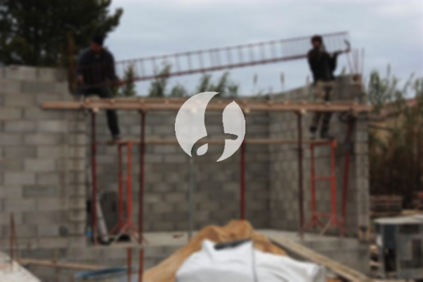

**Biaya Bangun Rumah Per Meter Di Pegadungan Jakarta** - Hai Mitra Sumber Material! Gimana kabarnya? Kami dari Sumber Material hadir untuk memberikan solusi lengkap kebutuhan konstruksi Anda di Pegadungan Jakarta. Seiring dengan perkembangan zaman, layanan bangun rumah semakin diminati. Banyak orang kini mencari jasa pembangunan yang juga menawarkan desain rumah, dan ini menciptakan persaingan positif di antara penyedia layanan. Semakin banyak kebutuhan akan tempat tinggal, semakin besar pula peluang bagi para pelaku properti untuk membangun rumah, apartemen, dan hunian lainnya dari berbagai segmen. Kepercayaan pelanggan adalah kunci, dan jasa bangun rumah yang terpercaya akan berupaya keras untuk memenuhi ekspektasi dan memberikan hasil terbaik. Kami hadir untuk menawarkan berbagai layanan dalam membangun rumah impian Anda di Pegadungan Jakarta. Mari kita lihat beberapa jenis layanan yang bisa Anda pilih:



## Harga Desain Gambar Arsitektur Di Pegadungan Jakarta

Sebagai penyedia jasa arsitek yang handal, kami sangat memperhatikan desain bangunan yang akan Anda wujudkan. Desain yang baik akan menciptakan keindahan dan kenyamanan di rumah Anda. Kami berusaha menciptakan komposisi desain yang indah dan selaras dengan kebutuhan Anda. Mendesain rumah yang menarik memang penting, karena desain yang tepat akan membuat rumah Anda terlihat lebih bagus dan berkarakter. Anda tidak perlu khawatir, karena kami bisa menciptakan desain yang sesuai dengan budget yang Anda miliki. Dengan desain yang jelas, Anda dapat memperkirakan biaya yang akan dikeluarkan untuk mewujudkan rumah impian Anda. Selain itu, kami juga mempertimbangkan pemilihan bahan material yang tepat. Semua hal ini membutuhkan keahlian khusus, sehingga Anda perlu memilih jasa arsitek yang tepat. Kami akan memahami keinginan Anda dan mewujudkannya menjadi desain yang memuaskan.

Biaya jasa desain rumah kami bervariasi, tergantung pada luas bangunan dan tingkat kerumitan desain yang Anda inginkan. Saat ini, harga jasa desain rumah minimalis satu lantai adalah Rp54.000,- per meter persegi, sudah termasuk desain, data RAB, dan 2 kali revisi. Untuk bangunan 2 lantai atau lebih, harga akan dikalikan 2 atau 3 sesuai dengan jumlah lantai.

## Ongkos Borong Bangun Bangunan Di Pegadungan Jakarta

Seperti yang kita tahu, memiliki rumah adalah kebutuhan dasar manusia. Semakin banyak populasi, semakin besar kebutuhan akan tempat tinggal. Banyaknya jasa bangun rumah tentu menawarkan produk dan pelayanan terbaik untuk menarik pelanggan. Di sinilah peran penting jasa bangun rumah dalam menangani permasalahan pembangunan rumah. Dengan menggunakan layanan kami, Anda akan mendapatkan solusi yang sesuai dengan keinginan Anda. Memiliki rumah yang indah adalah impian setiap orang. Dengan bantuan jasa bangun rumah, Anda akan lebih mudah mewujudkan impian tersebut. Anda tidak perlu repot mendesain rumah sendiri, karena kami akan memahami kebutuhan Anda dan mewujudkannya menjadi karya nyata. Kepuasan Anda adalah prioritas kami, dan itu menjadi motivasi kami untuk terus memberikan yang terbaik.

Untuk harga borong renovasi rumah, kami menawarkan beberapa level harga. Harga disesuaikan dengan material bangunan yang digunakan dan lokasi pembangunan. Dengan syarat lokasi tanah yang akan dibangun dalam keadaan rata, stabil, dan tidak membutuhkan pengurugan. Harga per meter persegi dengan material dinding hebel adalah Rp1.950.000,-, sedangkan dengan material bata merah adalah Rp2.200.000,-. Harga tersebut sudah termasuk pondasi batu gunung, kolom dan tiang beton, lantai keramik standar, serta atap dengan rangka baja ringan plus genteng spandek. Anda juga bisa memilih jenis genteng dan keramik lain sesuai dengan preferensi Anda, dengan penyesuaian harga.

## Ongkos Perbaikan Tempat Tinggal Di Pegadungan Jakarta

Selain jasa arsitek dan borongan bangun rumah, kami juga menyediakan jasa renovasi rumah. Renovasi adalah cara yang efektif untuk mengubah tampilan rumah agar terlihat baru kembali. Dengan kehadiran jasa renovasi bangunan, Anda tidak perlu bingung menentukan cara renovasi rumah Anda. Kami melakukan renovasi dengan teknik mengubah bentuk model rumah atau melakukan perubahan secara keseluruhan. Renovasi memang menjadi pilihan untuk meningkatkan kualitas bangunan dengan budget yang terjangkau. Namun, terkadang seseorang kesulitan melakukan renovasi sendiri. Dengan adanya jasa renovasi bangunan, semua masalah itu dapat diatasi. Kami hadir sebagai solusi renovasi bangunan yang akan membantu Anda menciptakan rumah yang lebih bagus dan indah dari sebelumnya. Kami siap mewujudkan impian Anda.

Harga borongan jasa renovasi rumah kami bervariasi, tergantung pada kondisi kerusakan bangunan yang akan diperbaiki. Setiap bangunan memiliki kerusakan yang berbeda-beda, sehingga harga disesuaikan dengan variasi kerusakan tersebut. Untuk harga jasa renovasi dengan tenaga tukang harian, kami mengenakan biaya Rp150.000,- per hari untuk tukang dan Rp100.000,- per hari untuk kenek.

## Didukung Tenaga Kerja Dan Arsitek Terbaik Di Pegadungan Jakarta

Baik jasa arsitek, borongan bangun rumah, maupun layanan renovasi bangunan, semuanya memiliki peran penting. Dengan dukungan arsitek profesional dan tenaga kerja yang handal, kami siap membantu mewujudkan impian Anda. Kami akan menciptakan rumah yang menarik dan indah. Anda tidak perlu khawatir, karena kami mengutamakan pelayanan terbaik, kualitas, dan kepuasan pelanggan. Sebagai jasa bangun rumah yang terpercaya, kepuasan Anda adalah motivasi kami untuk terus berkarya. Anda bisa melihat katalog proyek-proyek kami untuk melihat hasil karya kami. Katalog tersebut membuktikan bahwa kami adalah pilihan terbaik dan terpercaya untuk membangun rumah Anda di Pegadungan Jakarta.

Perlu diingat bahwa rumah adalah kebutuhan utama manusia yang sangat penting. Rumah melindungi kita dari cuaca ekstrem dan berbagai bahaya. Itulah mengapa banyak penyedia jasa bangun rumah berupaya menawarkan jasanya kepada masyarakat. Sebagai penyedia jasa, terutama dalam jasa bangun rumah, kami berpartisipasi dalam kemajuan dunia arsitektur dengan menawarkan layanan melalui berbagai media, mulai dari media cetak hingga online. Hal ini membantu orang-orang yang ingin membangun rumah menemukan solusi yang tepat. Dengan mempertahankan kualitas terbaik, kami telah memiliki pengalaman yang cukup lama dalam dunia arsitektur. Itulah sebabnya kami semakin banyak dipercaya oleh masyarakat.

Didukung oleh arsitek profesional dan tenaga kerja yang handal, kami akan menciptakan jasa bangun rumah yang semakin dikenal dan terpercaya. Kami terus berinovasi dan menciptakan karya-karya baru yang kreatif. Banyak bangunan-bangunan indah telah kami bangun dengan desain yang apik. Proses pengerjaan yang cepat dan efisien memungkinkan Anda untuk segera menikmati rumah impian Anda. Baik rumah berskala kecil maupun besar, kami mampu mengatasinya. Anda tidak perlu khawatir dengan hal itu. Kami dapat membantu Anda dalam segala hal, mulai dari desain rumah, pemilihan material, ukuran bangunan, hingga penyediaan tenaga kerja. Dengan demikian, kami mendukung terwujudnya rumah yang cantik dan nyaman. Di sinilah peran penting dari jasa bangun rumah. Kami akan membuat tata desain yang baik dan sekaligus mengawasi proses pembangunan. Untuk informasi lebih lanjut, [Hubungi Kami Sekarang](https://api.whatsapp.com/send?phone=6285776786091&text=*Halo%20sumbermaterial.com*%20%3A)! [LINK:2]
