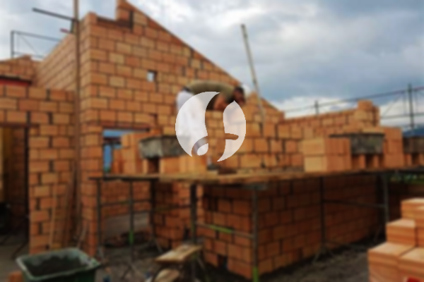

**Biaya Bangun Rumah Per Meter Di Pejagalan Jakarta** - Hai Mitra Sumber Material! Gimana kabarnya hari ini? Kami dari Sumber Material hadir untuk mendampingi Anda dalam mewujudkan rumah impian di Pejagalan Jakarta. Seiring dengan perkembangan zaman, layanan pembangunan tempat tinggal semakin diminati. Jasa membuat bangunan kini berkembang pesat, menawarkan solusi lengkap mulai dari desain hingga konstruksi. Kebutuhan akan tempat tinggal terus meningkat seiring pertumbuhan penduduk, mendorong para pengembang properti untuk berlomba-lomba menghadirkan berbagai pilihan rumah dan hunian. Kepercayaan pelanggan adalah kunci utama, dan jasa bangun rumah terpercaya berupaya menjaga reputasi tersebut dengan memberikan hasil terbaik. Nah, bagi Anda yang berencana membangun rumah di Pejagalan Jakarta, Kami menawarkan berbagai layanan untuk mewujudkan hunian impian Anda.



## Estimasi Biaya Desain Gambar Arsitektur Di Pejagalan Jakarta

Sebagai penyedia jasa desain arsitektur, Kami sangat memperhatikan estetika dan fungsionalitas sebuah bangunan. Melalui desain yang matang, Kami berupaya menciptakan rumah yang indah dan nyaman. Kami mempertimbangkan berbagai faktor penting untuk menghasilkan komposisi desain yang harmonis dan menarik. Desain yang baik adalah fondasi utama untuk menciptakan rumah impian Anda. Anda tidak perlu khawatir, karena Kami akan membuat desain yang sesuai dengan anggaran yang Anda miliki. Dengan desain yang jelas, Anda dapat memperkirakan biaya yang dibutuhkan untuk mewujudkan hunian impian Anda. Selain itu, desain juga memperhatikan pemilihan material bangunan yang tepat. Semua aspek ini memerlukan perencanaan yang cermat. Itulah mengapa, memilih jasa arsitek yang berpengalaman sangatlah penting. Mereka akan memahami kebutuhan dan keinginan Anda, sehingga Anda merasa puas dengan hasilnya.

Biaya jasa desain rumah dari Kami bervariasi, tergantung pada luas rumah dan tingkat kerumitan desain yang Anda minta. Saat ini, Kami menetapkan harga jasa desain rumah minimalis satu lantai sebesar Rp 54.000,- per meter persegi. Harga ini sudah termasuk desain, perhitungan RAB (Rencana Anggaran Biaya), dan 2 kali revisi. Untuk bangunan 2 lantai atau lebih, biayanya bisa dikalikan 2 atau 3, disesuaikan dengan jumlah lantai.

## Harga Jasa Borong Renovasi Rumah Di Pejagalan Jakarta

Kebutuhan akan tempat tinggal adalah hal yang mendasar bagi setiap manusia. Karena itu, banyak orang yang mencari jasa bangun rumah untuk mewujudkan impian mereka. Kami hadir sebagai solusi terpercaya untuk membantu Anda membangun rumah atau merenovasi hunian yang sudah ada. Memiliki rumah yang cantik dan nyaman adalah impian semua orang. Dengan mempercayakan pembangunan rumah Anda kepada Kami, Anda akan mendapatkan bantuan penuh dalam mewujudkan impian tersebut. Kami memahami betul keinginan Anda dan berusaha mewujudkannya dalam karya nyata. Dengan begitu, Anda akan merasa puas dan Kami semakin dipercaya oleh pelanggan.

Harga jasa borong bangun rumah Kami bervariasi, disesuaikan dengan material bangunan yang digunakan dan lokasi di Pejagalan Jakarta. Dengan syarat lokasi tanah dalam kondisi rata, stabil, dan tidak memerlukan pengurukan. Harga per meter persegi dengan material dinding hebel adalah Rp 1.950.000,-, sedangkan dengan material bata merah adalah Rp 2.200.000,-. Harga ini termasuk pondasi batu sungai, kolom dan tiang beton, lantai keramik standar, serta atap rangka baja ringan plus genteng spandek. Untuk jenis genteng dan keramik, Anda dapat memilih tipe, model, dan kualitas sesuai dengan anggaran Anda.

## Biaya Renovasi Bangunan Di Pejagalan Jakarta

Selain jasa arsitek dan jasa bangun rumah, Kami juga menyediakan jasa renovasi bangunan. Renovasi adalah cara yang efektif untuk memberikan tampilan baru pada rumah Anda. Dengan adanya jasa renovasi rumah, Anda tidak perlu khawatir dalam memastikan renovasi rumah Anda berjalan dengan lancar. Renovasi yang Kami lakukan dapat berupa perubahan tampilan rumah secara parsial atau total. Renovasi dapat menjadi solusi untuk memperbarui tampilan rumah agar terlihat lebih indah dan modern. Namun, biaya renovasi seringkali menjadi kendala bagi banyak orang. Dengan adanya jasa renovasi rumah, semua masalah tersebut dapat diatasi. Kami hadir sebagai solusi renovasi rumah yang dapat membantu Anda menciptakan hunian yang lebih bagus dan menarik dari sebelumnya. Kami siap mewujudkan impian Anda akan rumah yang cantik dan nyaman.

Untuk biaya borongan jasa renovasi bangunan, Kami memberikan harga yang bervariasi, tergantung pada tingkat kerusakan bangunan yang akan diperbaiki. Namun, untuk harga jasa renovasi dengan tenaga tukang harian, Kami mengenakan biaya Rp 150.000,- per hari untuk tukang dan Rp 100.000,- per hari untuk kenek.

## Didukung Tukang dan Arsitek Berpengalaman Di Pejagalan Jakarta

Baik layanan arsitek, jasa bangun rumah, maupun jasa renovasi, semuanya memiliki peran penting dalam mewujudkan hunian impian Anda. Dengan dukungan arsitek profesional dan tenaga kerja yang handal, Kami akan membantu Anda mewujudkan impian tersebut. Membangun rumah impian bersama Kami berarti Anda akan memiliki hunian yang menarik dan nyaman. Anda tidak perlu khawatir, karena Kami berkomitmen untuk memberikan pelayanan terbaik, menjaga kualitas, dan memberikan kepuasan maksimal kepada Anda. Kepuasan pelanggan adalah prioritas utama Kami dan menjadi motivasi untuk terus berkarya dengan lebih baik. Anda dapat melihat portofolio proyek-proyek Kami untuk melihat hasil karya Kami sebelumnya. Katalog tersebut membuktikan bahwa Kami adalah pilihan yang tepat dan terpercaya.

Perlu diingat bahwa rumah adalah kebutuhan pokok manusia, sama pentingnya dengan sandang dan pangan. Rumah menjadi tempat berlindung dari cuaca ekstrem dan berbagai bahaya. Hal ini menjadi peluang bagi penyedia jasa bangun rumahuntuk menawarkan jasanya. Sebagai penyedia jasa, Kami berpartisipasi aktif dalam memajukan dunia arsitektur dengan menawarkan jasa melalui berbagai media, baik media cetak maupun online. Hal ini tentu memudahkan banyak orang yang ingin membangun rumah. Dengan menjaga kualitas dan memberikan pelayanan terbaik, Kami telah terbukti memiliki pengalaman yang cukup dalam dunia arsitektur. Itulah mengapa, Kami semakin dipercaya oleh banyak orang. [bangun rumah di Cawang](/bangunan/biaya-bangun-rumah-per-meter-di-cawang-jakarta/)

Didukung oleh arsitek profesional dan tenaga kerja yang handal, Kami semakin dikenal sebagai jasa bangun rumah yang terpercaya. Perkembangan yang Kami tunjukkan terlihat dari karya-karya inovatif dan kreatif yang selalu Kami hasilkan. Banyak bangunan dengan desain apik dan menarik telah Kami bangun dengan dukungan tim yang solid. Kami juga memastikan proses pengerjaan berjalan dengan efisien, sehingga Anda dapat segera menikmati rumah impian Anda. Baik bangunan berskala kecil maupun besar, Kami mampu mengendalikan semuanya dengan baik. Anda tidak perlu ragu atau khawatir, karena Kami siap mengatasi semua tantangan. Mulai dari desain rumah, pemilihan material, ukuran rumah, hingga sumber daya manusia, semuanya dapat Kami atasi dengan baik. Dengan begitu, Kami dapat mendukung terwujudnya rumah impian Anda yang cantik dan menarik. Disinilah peran penting Kami sebagai jasa bangun rumah. Kami akan menciptakan perencanaan yang matang dan melakukan pengawasan penuh selama proses pembangunan. [Hubungi Kami Sekarang!](https://api.whatsapp.com/send?phone=6285776786091&text=*Halo%20sumbermaterial.com*%20%3A)
