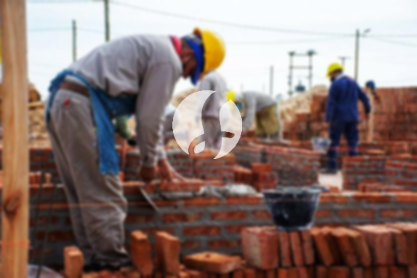

**Biaya Bangun Rumah Per Meter Di Pejaten Barat Jakarta** - Hai Mitra Sumber Material! Bagaimana kabarnya? Kami dari Sumber Material hadir untuk membantu mewujudkan hunian impian Anda di Pejaten Barat Jakarta dan sekitarnya. Seiring dengan perkembangan zaman, minat terhadap layanan konstruksi semakin meningkat, dan banyak yang memilih jasa bangun rumah untuk memastikan proyek mereka berjalan lancar dan efisien. Semakin banyaknya kebutuhan akan tempat tinggal, otomatis permintaan akan jasa bangun rumah pun ikut bertambah. Inilah yang mendorong para kontraktor properti untuk saling berkompetisi dalam membangun rumah atau perumahan, apartemen, dan bangunan lainnya, mulai dari yang ekonomis hingga mewah. Kepercayaan konsumen adalah kunci, dan layanan bangun rumah yang terpercaya akan selalu berupaya menjaga reputasi baik serta memberikan hasil yang memuaskan.



## Jasa Desain Gambar Arsitek Di Pejaten Barat Jakarta

Sebagai bagian dari layanan kami, Kami sangat memperhatikan desain bangunan yang akan dibangun. Kami berusaha menghadirkan keindahan dan fungsionalitas dalam setiap proyek. Desain yang baik adalah fondasi dari bangunan yang menarik dan nyaman. Kami menggunakan berbagai faktor penting untuk menciptakan komposisi desain yang selaras. Kami memahami bahwa desain adalah elemen krusial karena menentukan estetika rumah Anda. Dengan desain yang tepat, rumah Anda akan terlihat menawan. Anda tidak perlu khawatir tentang anggaran, karena Kami dapat menciptakan desain yang sesuai dengan *budget* yang Anda miliki. Dari desain itulah, Anda akan mendapatkan gambaran jelas mengenai biaya yang dibutuhkan untuk mewujudkan rumah impian Anda. Selain itu, Kami juga mempertimbangkan pemilihan material bangunan yang tepat. Semua aspek ini membutuhkan keahlian, itulah mengapa Anda memerlukan jasa arsitek profesional. Kami akan memahami keinginan Anda dan mewujudkannya dalam desain yang memuaskan.

Harga jasa desain rumah Kami bervariasi, tergantung pada luas bangunan dan kompleksitas desain yang Anda inginkan. Saat ini, Kami menetapkan harga per meter persegi. Untuk desain rumah minimalis satu lantai, biaya jasa desain adalah Rp 54.000,- per meter persegi, sudah termasuk desain, data RAB, dan 2 kali revisi. Untuk rumah dua lantai atau lebih, harganya bisa dikalikan dua atau tiga, sesuai dengan jumlah lantai.

## Jasa Borong Bangun Rumah Di Pejaten Barat Jakarta

Kebutuhan akan tempat tinggal terus meningkat seiring dengan pertumbuhan populasi. Bagi Anda yang berencana membangun rumah di Pejaten Barat Jakarta atau sekitarnya, Kami hadir sebagai solusi yang tepat. Kami menawarkan layanan borong bangun rumah yang komprehensif, mulai dari perencanaan hingga penyelesaian. Kami memahami bahwa memiliki rumah yang nyaman dan indah adalah impian setiap orang. Dengan mempercayakan pembangunan rumah Anda kepada Kami, Anda akan mendapatkan bantuan penuh dalam mewujudkan impian tersebut. Anda tidak perlu repot memikirkan desain, karena Kami siap membantu Anda menciptakan desain yang sesuai dengan selera dan kebutuhan Anda. Kami akan mewujudkan keinginan Anda menjadi karya nyata berupa bangunan impian Anda. Hal ini akan memberikan Anda kepuasan dan menjadikan Kami mitra terpercaya Anda.

Untuk harga borong pembangunan, Kami menawarkan beberapa tingkatan harga yang sesuai dengan bahan bangunan yang digunakan dan lokasi proyek. Dengan asumsi lahan berada dalam kondisi rata, stabil, dan tidak memerlukan pengurukan, harga per meter persegi dengan material dinding hebel adalah Rp 1.950.000,-, sedangkan dengan material bata merah adalah Rp 2.200.000,-. Harga tersebut sudah termasuk pondasi batu kali, kolom dan tiang beton, lantai keramik standar, serta rangka atap baja ringan dan genteng spandek. Untuk jenis genteng dan keramik, Anda dapat memilih sesuai preferensi Anda, dan harga akan disesuaikan.

## Layanan Renovasi Bangunan Di Pejaten Barat Jakarta

Selain layanan desain dan bangun rumah, Kami juga menyediakan jasa renovasi bangunan di Pejaten Barat Jakarta. Renovasi adalah cara yang efektif untuk memperbarui tampilan rumah Anda tanpa harus membangun dari awal. Kami hadir untuk membantu Anda dalam proses renovasi. Kami menawarkan berbagai jenis renovasi, mulai dari perubahan bentuk model rumah hingga renovasi total. Renovasi dapat memberikan tampilan baru pada rumah Anda dan meningkatkan nilai properti Anda. Kami memahami bahwa anggaran renovasi seringkali menjadi kendala. Oleh karena itu, Kami hadir sebagai solusi yang terjangkau. Jasa renovasi bangunan Kami akan membantu Anda mewujudkan rumah impian Anda dengan anggaran yang sesuai. Kami siap mengubah bangunan Anda menjadi lebih cantik dan indah sesuai dengan keinginan Anda.

Untuk harga borongan renovasi, Kami memberikan harga yang bervariasi tergantung pada kondisi kerusakan bangunan. Setiap bangunan memiliki tingkat kerusakan yang berbeda-beda, sehingga biaya renovasi akan disesuaikan dengan jenis kerusakan yang akan diperbaiki. Namun, untuk harga jasa renovasi dengan tenaga tukang harian, Kami mengenakan biaya Rp 150.000,- per hari untuk tukang dan Rp 100.000,- per hari untuk kenek.

## Didukung Tukang Dan Arsitek Terbaik Di Pejaten Barat Jakarta

Baik layanan desain, bangun rumah, maupun renovasi, semuanya memiliki peran yang penting dalam mewujudkan impian Anda. Kami didukung oleh arsitek profesional dan tenaga kerja yang handal, yang akan membantu Anda dalam setiap tahap proyek. Dengan tim yang kompeten, Kami dapat memastikan kualitas pekerjaan yang terbaik dan hasil yang memuaskan. Kami akan membangun rumah idaman Anda dengan kualitas tinggi dan desain yang menarik. Kami tidak hanya memberikan pelayanan terbaik, tetapi juga menjaga mutu dan kualitas pekerjaan untuk memberikan kepuasan kepada Anda. Kepuasan Anda adalah motivasi Kami untuk terus berkarya dan menghasilkan karya-karya yang lebih baik. Anda dapat melihat katalog proyek Kami untuk melihat contoh hasil pekerjaan Kami. Katalog tersebut akan membuktikan bahwa Kami adalah pilihan terbaik dan terpercaya.

Memiliki rumah adalah kebutuhan utama manusia, selain sandang dan pangan. Tempat tinggal memberikan perlindungan dari cuaca ekstrem dan berbagai bahaya. Hal ini menjadi peluang bagi penyedia jasa bangun rumah untuk berkontribusi dalam dunia arsitektur yang terus berkembang. Sebagai penyedia jasa, Kami akan berpartisipasi dalam memajukan dunia arsitektur dengan menampilkan layanan Kami melalui berbagai media, baik cetak maupun *online*. Hal ini tentu akan membantu banyak orang yang berencana membangun rumah. Dengan mempertahankan mutu dan kualitas terbaik, Kami telah memiliki pengalaman yang cukup lama dalam menggeluti dunia arsitektur. Inilah sebabnya, Kami semakin dipercaya oleh banyak orang.

Kami didukung oleh arsitek profesional dan tenaga kerja yang handal, yang akan menciptakan layanan bangun rumah yang semakin dikenal dan terpercaya. Kami terus berinovasi dan menciptakan karya-karya baru yang kreatif dan menarik. Banyak rumah-bangunan yang telah Kami bangun dengan desain yang apik dan inovatif. Proses pengerjaan yang efisien memungkinkan Anda untuk segera mendapatkan rumah impian Anda. Baik rumah berskala kecil maupun besar, Kami dapat mengatasinya dengan baik. Sistem perencanaan, pelaksanaan, dan pengawasan yang terintegrasi memastikan proyek Anda berjalan lancar dan sesuai dengan harapan Anda. Sehingga, Anda tidak perlu ragu atau khawatir. Dari desain rumah, pemilihan material, ukuran bangunan, hingga sumber daya manusia, semua dapat Kami atasi dengan baik. Hal ini memungkinkan Kami untuk mendukung terwujudnya rumah yang cantik dan menarik. Disitulah peran penting dari Kami sebagai penyedia jasa bangun rumah. Karena, Kami akan membuat perencanaan yang matang, dan sekaligus mengawasi setiap tahap pembangunan. [Hubungi Kami Sekarang!](https://api.whatsapp.com/send?phone=6285776786091&text=*Halo%20sumbermaterial.com*%20%3A)
