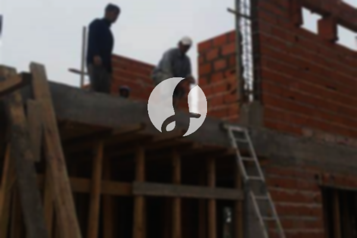

**Biaya Bangun Rumah Per Meter Di Pekojan Jakarta** - Hai Mitra Sumber Material! Bagaimana kabarnya? Kami dari Sumber Material hadir untuk memberikan solusi lengkap kebutuhan konstruksi Anda di Pekojan Jakarta. Seiring dengan perkembangan zaman, layanan membangun rumah semakin banyak diminati. Jasa bangun bangunan kini juga berkembang pesat, menawarkan layanan desain hingga konstruksi. Hal ini membuat banyak orang lebih selektif dalam memilih jasa bangun rumah yang tepat. Semakin meningkatnya populasi, kebutuhan akan tempat tinggal pun semakin besar. Tak heran jika para pengembang properti berlomba-lomba membangun rumah, apartemen, atau perumahan dengan berbagai kelas. Dengan kepercayaan yang diberikan konsumen, jasa bangun rumah berkomitmen untuk mempertahankan kualitas dan memberikan hasil terbaik. Nah, bagi Anda yang berencana membangun rumah di Pekojan Jakarta, yuk kita bahas lebih lanjut mengenai biaya yang dibutuhkan!



## Layanan Desain Gambar Arsitek Di Pekojan Jakarta

Sebagai penyedia jasa desain arsitek, Kami sangat memperhatikan desain sebuah bangunan yang akan dibangun. Melalui desain yang cermat, Kami berupaya menciptakan keindahan dan fungsionalitas rumah impian Anda. Kami mempertimbangkan berbagai faktor penting untuk menghasilkan komposisi desain yang cantik dan selaras. Desain adalah elemen penting dalam membangun rumah karena dapat memberikan kesan indah dan menarik. Dengan desain yang tepat, Anda bisa mendapatkan gambaran jelas tentang bagaimana rumah Anda akan terlihat. Jangan khawatir, karena Kami akan menciptakan desain yang sesuai dengan anggaran yang Anda miliki. Dari desain tersebut, Anda bisa memperkirakan biaya yang dibutuhkan untuk mewujudkan rumah impian Anda. Selain itu, desain juga mempertimbangkan pemilihan material bangunan yang sesuai dengan kebutuhan dan budget Anda. Semua aspek ini memang memerlukan keahlian khusus. Itulah mengapa, Kami merekomendasikan untuk menggunakan jasa arsitek profesional yang berpengalaman. Kami akan memahami keinginan Anda dan menerjemahkannya menjadi desain yang memuaskan.

Biaya jasa desain rumah Kami bervariasi tergantung pada luas bangunan dan kompleksitas desain yang Anda inginkan. Saat ini, Kami menawarkan harga jasa desain minimalis satu lantai sekitar Rp 54.000,- per meter persegi, sudah termasuk desain, perhitungan RAB (Rencana Anggaran Biaya), dan 2 kali revisi. Untuk rumah dua lantai atau lebih, biayanya hanya dikalikan 2 atau 3 sesuai jumlah lantai.

## Harga Jasa Borong Bangun Rumah Di Pekojan Jakarta

Seiring dengan pertumbuhan populasi, kebutuhan akan tempat tinggal terus meningkat. Banyaknya penyedia jasa bangun rumah di Pekojan Jakarta menghadirkan berbagai penawaran menarik untuk menarik minat pelanggan. Di sinilah peran penting jasa bangun rumah dalam mengatasi tantangan membangun hunian idaman Anda. Dengan menggunakan jasa bangun rumah, Anda bisa mendapatkan layanan yang sesuai dengan harapan Anda. Memiliki rumah yang bagus adalah impian setiap orang. Dengan Kami, Anda tidak perlu khawatir lagi soal desain rumah, karena Kami siap membantu mewujudkan impian Anda. Kami selalu berusaha memahami keinginan Anda dan menerjemahkannya menjadi karya nyata. Kepuasan Anda adalah prioritas Kami, dan hal itulah yang menjadikan Kami semakin dipercaya.

Untuk layanan borong renovasi rumah, Kami menawarkan beberapa tingkatan harga. Harga disesuaikan dengan material bangunan yang digunakan dan lokasi pembangunan. Dengan asumsi lokasi tanah dalam kondisi rata, stabil, dan tidak memerlukan pengurugan, harga per meter persegi dengan material dinding hebel adalah Rp 1.950.000,-. Sementara itu, dengan material bata merah, harganya Rp 2.200.000,-. Harga tersebut sudah termasuk pondasi batu kali, kolom dan tiang beton, lantai keramik standar, serta atap rangka baja ringan dengan genteng spandek. Anda juga bisa memilih jenis genteng dan keramik lain sesuai dengan preferensi, model, dan anggaran Anda.

## Harga Jasa Renovasi Rumah Di Pekojan Jakarta

Selain jasa arsitek dan borong bangun rumah, Kami juga menyediakan jasa renovasi rumah di Pekojan Jakarta. Renovasi adalah cara yang efektif untuk mengubah tampilan rumah Anda menjadi lebih segar dan modern. Dengan adanya jasa renovasi bangunan, Anda tidak perlu bingung menentukan bagaimana cara merenovasi rumah Anda. Kami melakukan renovasi dengan teknik mengubah bentuk tampilan bangunan atau bahkan merenovasi secara total. Renovasi memang bisa menjadi solusi yang menarik, terutama jika Anda memiliki anggaran terbatas. Namun, seringkali orang kesulitan untuk melakukannya sendiri. Nah, dengan Kami, segala kesulitan tersebut akan teratasi. Kami hadir sebagai jasa renovasi rumah yang akan memudahkan Anda merenovasi rumah menjadi lebih *fresh* dan menarik dari sebelumnya. Kami siap mewujudkan bangunan impian sesuai harapan Anda.

Untuk harga borongan dari jasa renovasi rumah Kami, Kami memberikan harga yang berbeda-beda tergantung pada kondisi kerusakan bangunan. Perlu diketahui bahwa setiap bangunan memiliki tingkat kerusakan yang berbeda-beda. Jadi, harga borongan renovasi rumah disesuaikan dengan variasi kerusakan yang akan diperbaiki. Namun, untuk harga jasa renovasi dengan tenaga tukang harian, Kami mematok harga Rp 150.000,- per hari untuk tukang dan Rp 100.000,- per hari untuk kenek.

## Didukung Tukang Dan Arsitek Terbaik Di Pekojan Jakarta

Baik jasa arsitek, borong bangun rumah, maupun renovasi rumah, semuanya memiliki peran yang sangat penting. Dengan dukungan arsitek profesional dan tenaga kerja yang handal, Kami akan membantu mewujudkan impian Anda. Dengan membangun rumah impian bersama Kami, Anda akan memiliki hunian yang menarik dan indah. Anda tidak perlu khawatir, karena Kami selalu mengutamakan kualitas dan memberikan pelayanan terbaik untuk memastikan kepuasan Anda. Sebagai penyedia jasa bangun rumah, kepuasan pelanggan adalah motivasi Kami untuk terus berkarya dan meningkatkan kualitas layanan. Anda bisa melihat katalog proyek-proyek sebelumnya untuk membuktikan bahwa Kami adalah pilihan yang tepat dan terpercaya. [bangun rumah di Angke](/bangunan/biaya-bangun-rumah-per-meter-di-angke-jakarta/)

Perlu diingat bahwa rumah adalah kebutuhan utama manusia, sama pentingnya dengan sandang dan pangan. Rumah memberikan perlindungan dari cuaca ekstrem dan bahaya lainnya. Hal inilah yang menjadi peluang bagi Kami sebagai penyedia jasa bangun rumah untuk berkontribusi dalam meramaikan dunia arsitektur yang terus berkembang. Kami mempromosikan jasa Kami melalui berbagai media, mulai dari media cetak hingga media online, untuk menjangkau lebih banyak calon pelanggan. Hal ini tentu saja membantu banyak orang yang berencana membangun rumah. Dengan menjaga kualitas dan memberikan layanan terbaik, Kami telah terbukti memiliki pengalaman yang cukup lama dalam dunia arsitektur. Itulah mengapa, Kami semakin dipercaya oleh banyak orang.

Didukung oleh arsitek profesional dan tenaga kerja yang handal, Kami berkomitmen untuk memberikan yang terbaik. Kami terus berinovasi dan meningkatkan kualitas layanan Kami. Banyak rumah dan bangunan yang telah Kami bangun dengan desain yang apik dan menarik. Proses pengerjaan yang cepat dan efisien juga menjadi keunggulan Kami. Apakah Anda berencana membangun rumah skala kecil atau besar, Kami siap membantu Anda. Mulai dari desain rumah, pemilihan material, hingga pengawasan pembangunan, Kami akan mengelola semuanya dengan baik. Dengan begitu, Anda bisa memiliki rumah impian yang cantik dan sesuai dengan harapan Anda. Disitulah peran penting Kami sebagai jasa bangun rumah yang terpercaya di Pekojan Jakarta. [Hubungi Kami Sekarang!](https://api.whatsapp.com/send?phone=6285776786091&text=*Halo%20sumbermaterial.com*%20%3A)
