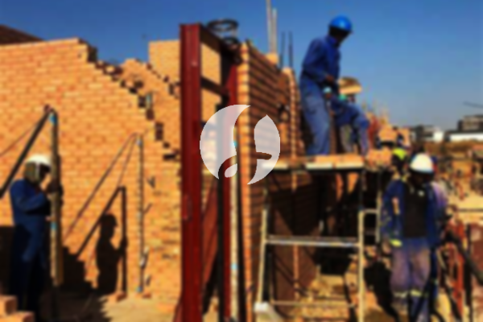

**Biaya Bangun Rumah Per Meter Di Pela Mampang Jakarta** - Hai Mitra Sumber Material! Bagaimana kabarnya? Kami dari Sumber Material hadir untuk membantu Anda mewujudkan rumah impian di Pela Mampang Jakarta. Seiring dengan meningkatnya kebutuhan tempat tinggal, layanan borong bangun rumah semakin banyak dicari. Perkembangan ini juga merambah ke jasa desain rumah, menjadikan banyak orang lebih selektif dalam memilih penyedia jasa. Dengan pertumbuhan populasi yang pesat, kebutuhan akan rumah pun ikut meningkat. Tak heran jika para pelaku properti berlomba-lomba membangun rumah, apartemen, hingga hunian susun, mulai dari kelas ekonomis hingga eksekutif. Kami percaya bahwa kepercayaan adalah kunci utama, dan kami selalu berupaya menjaga kepercayaan yang diberikan konsumen dengan melaksanakan pekerjaan sesuai harapan. Itulah mengapa kami menawarkan berbagai layanan dalam membangun rumah yang bisa Anda pilih.



## Jasa Desain Gambar Arsitek di Pela Mampang Jakarta

Sebagai penyedia jasa desain, kami di Sumber Material sangat memperhatikan estetika sebuah bangunan. Desain yang baik akan mempercantik tampilan rumah Anda. Kami berupaya menciptakan keindahan melalui komposisi desain yang selaras, dengan memanfaatkan faktor-faktor penting seperti tata letak, pencahayaan, dan pemilihan material. Kami memahami bahwa desain adalah elemen krusial dalam membangun rumah idaman. Dengan desain yang tepat, rumah Anda akan terlihat lebih menarik dan bernilai tinggi. Anda tidak perlu khawatir, karena kami menawarkan desain yang sesuai dengan anggaran yang Anda miliki. Desain yang kami buat akan memberikan gambaran jelas mengenai biaya yang dibutuhkan untuk mewujudkan rumah impian Anda. Selain itu, desain juga mempertimbangkan bahan bangunan yang akan digunakan. Semua proses ini memang memerlukan keahlian khusus, itulah mengapa Anda membutuhkan jasa arsitek yang berpengalaman. Kami siap mewujudkan harapan Anda menjadi karya nyata.

Biaya jasa desain rumah kami bervariasi, tergantung pada luas rumah dan kerumitan desain yang diinginkan. Saat ini, kami menetapkan harga mulai dari Rp 54.000,- per meter untuk desain rumah minimalis satu lantai, termasuk desain, perhitungan RAB, dan 2 kali revisi. Untuk bangunan 2 lantai atau lebih, biaya akan dikalikan 2 atau 3 sesuai jumlah lantai.

## Jasa Borong Bangun Rumah di Pela Mampang Jakarta

Di era modern ini, memiliki rumah sendiri adalah kebutuhan mendasar. Banyaknya penyedia jasa bangun rumah menawarkan berbagai pilihan dan layanan terbaik. Di sinilah peran penting borong bangun rumah dalam mengatasi permasalahan pembangunan hunian. Dengan memilih layanan kami, Anda akan mendapatkan solusi yang sesuai dengan harapan Anda. Memiliki rumah idaman adalah impian semua orang. Menggunakan jasa bangun rumah akan sangat membantu mewujudkan impian tersebut. Dengan mempercayakan pembangunan rumah Anda kepada kami, Anda tidak perlu repot mendesain sendiri. Kami selalu berusaha memahami keinginan Anda dan mewujudkannya dalam karya nyata. Kepuasan Anda adalah prioritas utama kami, dan itu menjadi motivasi kami untuk terus memberikan yang terbaik. Dengan hasil karya dan proyek-proyek yang telah kami selesaikan, Anda dapat melihat bukti kualitas layanan kami.

Untuk harga jasa borong renovasi, kami menawarkan beberapa level harga yang disesuaikan dengan material bangunan dan lokasi pembangunan. Dengan asumsi kondisi tanah rata, stabil, dan tidak memerlukan pengurukan, harga per meter dengan material dinding hebel adalah Rp 1.950.000,-, sedangkan dengan material bata merah adalah Rp 2.200.000,-. Harga tersebut sudah termasuk pondasi batu gunung, kolom dan tiang beton, lantai keramik standar, serta atap dengan rangka baja ringan plus genteng spandek. Untuk jenis genteng dan keramik, Anda dapat memilih tipe, model, dan kualitas yang berbeda sesuai preferensi dan anggaran Anda.

## Harga Renovasi Rumah di Pela Mampang Jakarta

Selain layanan desain dan bangun rumah, Kami juga menawarkan jasa renovasi bangunan. Renovasi adalah cara efektif untuk memberikan tampilan baru pada rumah Anda. Dengan hadirnya jasa renovasi, Anda tidak perlu khawatir menghadapi proses renovasi yang kompleks. Kami menyediakan solusi renovasi yang dapat mengubah tampilan bangunan secara menyeluruh atau sebagian, sesuai dengan kebutuhan Anda. Renovasi memang menjadi pilihan menarik untuk mempercantik rumah, terutama bagi mereka yang memiliki anggaran terbatas. Namun, seringkali renovasi terasa sulit dilakukan sendiri. Dengan menggunakan jasa renovasi rumah dari Kami, semua kendala tersebut dapat diatasi. Kami siap membantu Anda mengubah rumah Anda menjadi lebih segar dan indah dari sebelumnya.

Biaya borongan jasa renovasi rumah Kami bervariasi, tergantung pada kondisi kerusakan bangunan. Kami akan melakukan survei terlebih dahulu untuk menentukan biaya yang sesuai dengan kerusakan yang akan diperbaiki. Namun, untuk biaya tenaga tukang harian, Kami mengenakan tarif Rp 150.000,- per hari untuk tukang dan Rp 100.000,- per hari untuk kenek.

## Didukung Tenaga Kerja dan Arsitek Terbaik di Pela Mampang Jakarta

Baik layanan desain, bangun rumah, maupun renovasi, semuanya memiliki peran penting dalam mewujudkan hunian impian Anda. Didukung oleh arsitek profesional dan tenaga kerja yang handal, Kami siap membantu membawa impian Anda menjadi kenyataan. Dengan membangun rumah bersama Kami, Anda akan memiliki rumah yang menarik dan indah. Anda tidak perlu khawatir, karena Kami memberikan pelayanan terbaik, menjaga mutu dan kualitas, serta memberikan kepuasan maksimal. Kepuasan klien adalah motivasi utama Kami untuk terus berkarya dan menghasilkan karya-karya yang lebih baik. Katalog proyek-proyek yang telah Kami selesaikan dapat menjadi bukti kualitas layanan Kami.

Perlu Anda ketahui bahwa rumah adalah kebutuhan pokok manusia, sama pentingnya dengan sandang dan pangan. Rumah berfungsi sebagai tempat berlindung dari cuaca ekstrem dan berbagai bahaya. Hal ini menjadi peluang bagi penyedia jasa bangun rumah untuk mempresentasikan keunggulannya dan meramaikan dunia arsitektur yang sedang berkembang. Kami memanfaatkan berbagai media, mulai dari media cetak hingga media online, untuk mempromosikan jasa bangun rumah Kami. Hal ini memudahkan banyak orang untuk mewujudkan rumah impian mereka. Dengan menjaga mutu dan kualitas terbaik, Kami telah memiliki pengalaman yang cukup lama dalam dunia arsitektur. Itulah mengapa Kami semakin dipercaya oleh banyak orang.

Dengan dukungan arsitek profesional dan tenaga kerja yang handal, Kami yakin akan menciptakan jasa bangun rumah yang semakin dikenal dan diandalkan. Kami terus berinovasi dan berkreasi dalam setiap proyek yang Kami kerjakan. Hingga saat ini, banyak bangunan yang Kami bangun dengan desain yang apik dan menarik. Proses pengerjaan yang cepat dan efisien memungkinkan Anda untuk segera menikmati rumah impian Anda. Baik rumah berskala kecil maupun besar, Kami dapat mengendalikan semua aspek pembangunan. Anda tidak perlu khawatir atau cemas, karena Kami menyediakan solusi lengkap, mulai dari desain rumah, pemilihan material, ukuran rumah, hingga pengelolaan sumber daya manusia. Kami siap mendukung terwujudnya rumah cantik dan nyaman yang Anda impikan. Kami akan membuat tata desain yang menarik dan bertindak sebagai pengawas selama proses pembangunan. [bangun rumah di Bendungan Hilir](/bangunan/biaya-bangun-rumah-per-meter-di-bendungan-hilir-jakarta/) Untuk informasi lebih lanjut mengenai layanan bangun rumah di wilayah lain, silakan hubungi Kami. [Hubungi Kami Sekarang](https://api.whatsapp.com/send?phone=6285776786091&text=*Halo%20sumbermaterial.com*%20%3A) untuk konsultasi gratis!
