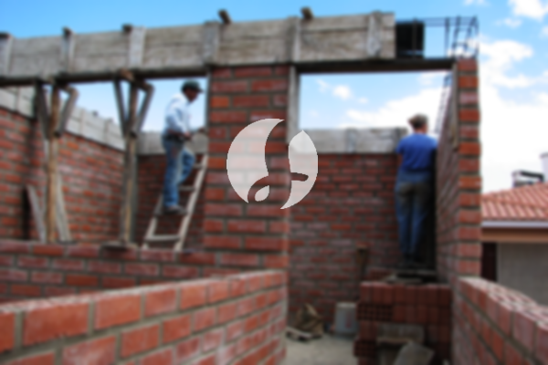

**Biaya Bangun Rumah Per Meter Di Penggilingan Jakarta** - Hai Mitra Sumber Material! Bagaimana kabarnya? Kami dari Sumber Material hadir sebagai mitra terpercaya Anda dalam mewujudkan rumah impian di Penggilingan Jakarta. Seiring perkembangan zaman, jasa pembuatan rumah semakin diminati. Banyak orang kini lebih memilih menyewa jasa profesional untuk membangun rumah, mulai dari desain hingga konstruksi. Semakin meningkatnya jumlah penduduk, kebutuhan akan tempat tinggal juga ikut bertambah. Tentu saja, ini memicu persaingan sehat antar kontraktor properti untuk menawarkan layanan terbaik, mulai dari rumah standar hingga mewah. Dengan kepercayaan yang diberikan konsumen, jasa bangun rumah berkomitmen untuk memberikan hasil yang memuaskan dan mempertahankan kualitas pekerjaan.



## Jasa Desain Gambar Arsitek Profesional Di Penggilingan Jakarta

Sebagai penyedia jasa desain arsitek, Kami mengutamakan estetika dan fungsionalitas dalam setiap rancangan. Kami percaya desain adalah kunci utama untuk menciptakan rumah impian Anda. Dengan desain yang tepat, rumah akan terasa lebih indah dan nyaman. Kami akan membantu Anda mewujudkan komposisi desain yang cantik dan selaras, mempertimbangkan berbagai faktor penting seperti gaya arsitektur, tata letak ruang, dan pencahayaan. Kami memahami bahwa setiap orang memiliki anggaran yang berbeda. Karena itu, Kami menawarkan solusi desain yang sesuai dengan *budget* Anda. Dengan adanya desain visual, Anda dapat memiliki gambaran jelas mengenai perkiraan biaya yang dibutuhkan untuk membangun rumah impian Anda. Selain itu, Kami juga memperhatikan pemilihan bahan material yang tepat agar sesuai dengan kebutuhan dan anggaran Anda. Kompleksitas desain bisa bervariasi, tetapi Kami siap memberikan solusi terbaik. Itulah mengapa Anda membutuhkan jasa arsitek profesional – Kami akan memahami harapan Anda dan menerjemahkannya ke dalam karya nyata.

Harga jasa desain rumah Kami bervariasi tergantung luas rumah dan tingkat kesulitan desain. Saat ini, Kami menawarkan harga mulai dari Rp 54.000,- per meter untuk desain rumah minimalis satu lantai, sudah termasuk desain, kalkulasi RAB (Rencana Anggaran Biaya), dan 2 kali revisi. Untuk bangunan 2 lantai atau lebih, biayanya hanya dikalikan 2 atau 3 sesuai dengan jumlah lantai.

## Jasa Borong Renovasi Rumah Terpercaya Di Penggilingan Jakarta

Mengingat semakin banyaknya orang yang membutuhkan tempat tinggal, jasa borong renovasi rumah menjadi solusi yang diminati. Kami hadir untuk membantu Anda mengatasi berbagai permasalahan konstruksi, termasuk renovasi rumah di Penggilingan Jakarta.  Dengan memilih jasa borong renovasi, Anda akan mendapatkan layanan yang sesuai dengan harapan Anda. Memiliki rumah yang cantik dan nyaman adalah impian semua orang. Dengan menggunakan jasa Kami, Anda bisa mewujudkan impian tersebut tanpa perlu repot mendesain atau mengawasi pekerjaan sendiri. Kami akan berusaha memahami keinginan Anda dan mewujudkannya dalam bentuk bangunan impian. Kepercayaan Anda adalah motivasi Kami untuk terus memberikan pelayanan terbaik dan menjaga kualitas pekerjaan. Hasil karya desain dan proyek pembangunan Kami dapat Anda lihat dalam katalog sebagai bukti kualitas dan pengalaman Kami.

Untuk jasa borong renovasi rumah, Kami menawarkan beberapa pilihan harga. Biaya akan disesuaikan dengan bahan bangunan yang digunakan dan lokasi rumah Anda. Dengan syarat kondisi tanah rata, stabil, dan tidak memerlukan pengurugan, harga per meter untuk material dinding hebel adalah Rp 1.950.000,-, sementara untuk material bata merah adalah Rp 2.200.000,-. Harga tersebut sudah termasuk pondasi batu kali, kolom dan tiang beton, lantai keramik standar, serta rangka baja ringan dan genteng spandek. Pilihan genteng dan keramik lain tersedia sesuai permintaan, dengan penyesuaian kualitas dan anggaran.

## Harga Jasa Perbaikan Rumah Terjangkau Di Penggilingan Jakarta

Selain jasa desain dan bangun rumah, Kami juga menyediakan jasa perbaikan rumah di Penggilingan Jakarta. Jasa ini ideal untuk Anda yang ingin merubah tampilan rumah agar terlihat lebih baru dan segar. Kami akan membantu Anda memperbaiki kerusakan pada rumah, baik kerusakan ringan maupun berat. Renovasi dapat dilakukan dengan mengubah tampilan bangunan secara keseluruhan atau hanya sebagian. Meskipun renovasi seringkali menjadi solusi yang menarik, budget terkadang menjadi kendala. Namun, dengan adanya jasa renovasi Kami, semua kendala tersebut dapat diatasi. Kami hadir sebagai penyedia jasa renovasi bangunan yang akan membantu Anda merenovasi rumah agar terlihat lebih bagus dan memikat. Kami siap mewujudkan impian Anda akan rumah yang lebih indah dan nyaman.

Biaya jasa perbaikan rumah Kami bervariasi tergantung kondisi kerusakan yang perlu diperbaiki. Karena setiap rumah memiliki tingkat kerusakan yang berbeda-beda, Kami akan memberikan penawaran harga yang disesuaikan dengan kebutuhan Anda. Untuk tenaga tukang harian, tarif yang Kami terapkan adalah Rp 150.000,- per hari untuk tukang dan Rp 100.000,- per hari untuk kenek.

## Dukungan Tenaga Ahli dan Arsitek Berpengalaman Di Penggilingan Jakarta

Jasa desain arsitek, pembangunan rumah, dan renovasi semuanya memiliki peran penting dalam menciptakan hunian impian. Kami didukung oleh tim arsitek profesional dan tenaga kerja yang handal, yang siap membantu mewujudkan impian Anda.  Dengan pengalaman yang Kami miliki, Kami yakin dapat memberikan hasil yang maksimal dan memuaskan. Kami berkomitmen untuk menjaga kualitas pekerjaan dan memberikan pelayanan terbaik. Kepuasan pelanggan adalah prioritas utama Kami. Anda dapat melihat portofolio proyek-proyek yang telah Kami kerjakan untuk melihat contoh hasil karya Kami. Kami percaya bahwa katalog tersebut akan membuktikan bahwa Kami adalah pilihan terbaik dan terpercaya untuk kebutuhan konstruksi Anda.

Penting untuk diingat bahwa rumah adalah kebutuhan pokok manusia, sama pentingnya dengan sandang dan pangan. Rumah adalah tempat berlindung dari cuaca ekstrem dan berbagai bahaya. Karena itu, Kami selalu berusaha untuk memberikan yang terbaik dalam setiap pekerjaan yang Kami lakukan. Sebagai penyedia jasa, Kami terus berpartisipasi dalam perkembangan dunia arsitektur dengan mempresentasikan layanan Kami melalui berbagai media, baik cetak maupun *online*. Hal ini bertujuan untuk membantu semakin banyak orang mewujudkan rumah impian mereka.  Dengan menjaga kualitas dan memberikan pelayanan terbaik, Kami telah membuktikan diri sebagai penyedia jasa yang berpengalaman dan terpercaya. [bangun rumah di Bali Mester](/bangunan/biaya-bangun-rumah-per-meter-di-bali-mester-jakarta/) Dengan dukungan tim arsitek profesional dan tenaga kerja yang handal, Kami yakin dapat menjawab semua kebutuhan konstruksi Anda. Kami selalu berinovasi dan menciptakan karya-karya baru yang kreatif dan menarik. Banyak bangunan yang telah Kami bangun dengan desain yang apik dan memukau. Proses pengerjaan yang cepat dan efisien memastikan Anda dapat segera menikmati rumah impian Anda. Kami mampu menangani proyek pembangunan rumah dengan berbagai skala, baik kecil maupun besar. Dengan perencanaan yang matang, material berkualitas, ukuran yang tepat, dan SDM yang kompeten, Kami siap mewujudkan rumah impian Anda. Karena itu, Kami adalah mitra yang tepat untuk semua kebutuhan konstruksi Anda. [Hubungi Kami sekarang!](https://api.whatsapp.com/send?phone=6285776786091&text=*Halo%20sumbermaterial.com*%20%3A)
