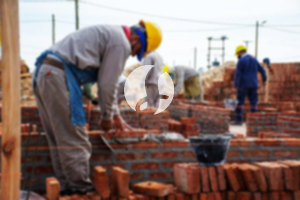

**Biaya Bangun Rumah Per Meter Di Petukangan Jakarta** - Hai Mitra Sumber Material! Gimana kabarnya hari ini? Kami dari Sumber Material hadir untuk memberikan solusi lengkap kebutuhan konstruksi Anda di Petukangan Jakarta. Seiring dengan perkembangan zaman, minat terhadap layanan bangun rumah semakin meningkat. Banyak yang memilih jasa profesional agar pembangunan berjalan efisien dan sesuai harapan. Kebutuhan akan tempat tinggal terus bertambah, sehingga para pengembang properti berlomba-lomba menawarkan berbagai pilihan, mulai dari standar hingga mewah. Kami berkomitmen untuk membangun kepercayaan pelanggan dengan memberikan hasil terbaik dan mempertahankan kualitas layanan kami. Berikut adalah beberapa layanan yang dapat Anda pilih untuk proyek bangunan Anda di Petukangan Jakarta:



## Harga Desain Gambar Arsitek Di Petukangan Jakarta

Sebagai penyedia layanan desain arsitek, kami sangat memperhatikan estetika dan fungsionalitas rumah yang akan dibangun. Melalui desain yang terkonsep, kami berusaha menghadirkan keindahan dan kenyamanan bagi penghuni. Komposisi desain yang cantik dan harmonis merupakan prioritas utama kami. Kami memahami bahwa desain merupakan elemen krusial dalam pembangunan, karena visual yang menarik akan meningkatkan nilai properti Anda. Jangan khawatir, Kami akan menyesuaikan desain dengan anggaran yang Anda miliki. Dengan desain yang jelas, Anda dapat memperkirakan biaya yang dibutuhkan untuk mewujudkan rumah impian Anda. Selain itu, kami juga mempertimbangkan pemilihan material bangunan yang sesuai. Proses ini memang memerlukan pertimbangan matang, itulah mengapa Anda membutuhkan jasa arsitek profesional. Kami akan memahami setiap keinginan Anda dan mewujudkannya menjadi rancangan yang memuaskan.

Harga jasa desain rumah Kami bervariasi, tergantung pada luas bangunan dan kompleksitas desain. Saat ini, Kami menawarkan harga per meter. Biaya jasa desain bangunan minimalis satu lantai adalah Rp 54.000,- per meter, sudah termasuk desain, perhitungan RAB (Rencana Anggaran Biaya), dan dua kali revisi. Untuk rumah dua lantai atau lebih, harga hanya dikalikan 2 atau 3 sesuai jumlah lantai.

## Ongkos Borong Renovasi Rumah Di Petukangan Jakarta

Seiring dengan pertumbuhan populasi, kebutuhan akan tempat tinggal semakin meningkat. Banyak orang yang mencari layanan bangun rumah untuk mewujudkan impian memiliki hunian nyaman. Kami hadir sebagai solusi untuk menangani permasalahan konstruksi Anda di Petukangan Jakarta. Dengan memilih jasa bangun rumah yang tepat, Anda akan mendapatkan hasil yang sesuai dengan harapan dan anggaran. Memiliki rumah yang cantik adalah impian semua orang. Dengan mempercayakan pembangunan kepada profesional, Anda akan terbantu mewujudkan impian tersebut. Borongan bangun rumah memungkinkan Anda untuk fokus pada aspek lain, sementara Kami akan menangani seluruh proses pembangunan, mulai dari desain hingga finishing. Kami selalu berusaha memahami kebutuhan dan preferensi Anda untuk mewujudkan rumah impian Anda. Kepuasan Anda adalah prioritas utama Kami, dan hal itu menjadi motivasi Kami untuk terus memberikan layanan terbaik.

Harga borongan bangun rumah Kami bervariasi, tergantung pada bahan bangunan yang digunakan dan lokasi proyek. Dengan asumsi tanah rata, stabil, dan tidak memerlukan pengurugan, harga per meter menggunakan material dinding hebel adalah Rp 1.950.000,-, dan dengan material bata merah adalah Rp 2.200.000,-. Harga tersebut mencakup pondasi batu kali, kolom dan tiang beton, lantai keramik standar, serta rangka atap baja ringan dengan genteng spandek. Anda dapat memilih variasi genteng dan keramik sesuai preferensi Anda, dengan penyesuaian harga yang disepakati bersama.

## Jasa Rombak Rumah Di Petukangan Jakarta

Selain layanan desain dan bangun rumah, Kami juga menyediakan jasa renovasi rumah. Renovasi rumah adalah cara yang efektif untuk memberikan tampilan baru pada hunian Anda. Dengan bantuan jasa renovasi profesional, Anda tidak perlu khawatir tentang proses renovasi yang rumit. Renovasi dapat dilakukan dengan mengganti elemen-elemen tertentu atau melakukan perubahan menyeluruh pada struktur bangunan. Renovasi menjadi pilihan menarik bagi mereka yang ingin meningkatkan nilai estetika rumah tanpa harus membangun dari awal. Namun, renovasi seringkali membutuhkan anggaran yang signifikan. Dengan adanya jasa renovasi rumah, Anda akan mendapatkan solusi yang terjangkau dan berkualitas. Kami siap membantu Anda mengubah rumah Anda menjadi lebih modern dan menarik sesuai dengan keinginan Anda.

Untuk biaya borongan jasa renovasi rumah, Kami memberikan harga yang fleksibel karena kondisi kerusakan setiap bangunan berbeda-beda. Harga disesuaikan dengan tingkat kerusakan yang perlu diperbaiki. Untuk biaya tenaga tukang harian, tarifnya adalah Rp 150.000,- per hari untuk tukang, dan Rp 100.000,- per hari untuk kenek.

## Disupport Tenaga Kerja Dan Arsitek Terbaik Di Petukangan Jakarta

Baik layanan arsitek, bangun rumah, maupun renovasi, semuanya memiliki peran penting dalam mewujudkan impian Anda. Didukung oleh arsitek profesional dan tenaga kerja yang handal, Kami siap membantu Anda mewujudkan rumah impian Anda di Petukangan Jakarta. Dengan membangun rumah bersama Kami, Anda akan memiliki hunian yang menarik dan berkualitas. Kami berkomitmen untuk memberikan pelayanan terbaik, menjaga kualitas, dan memberikan kepuasan maksimal kepada Anda. Kepuasan pelanggan merupakan penyemangat Kami untuk terus berkarya dan menghasilkan karya-karya yang lebih baik lagi. Anda dapat melihat portofolio proyek Kami untuk membuktikan kualitas layanan Kami.

Tempat tinggal merupakan kebutuhan dasar manusia selain sandang dan pangan. Rumah menjadi tempat berlindung dari cuaca dan berbagai bahaya. Hal ini menjadi peluang bagi Kami sebagai penyedia jasa bangun rumah untuk turut serta meramaikan dunia arsitektur dengan menawarkan layanan terbaik. Kami memanfaatkan berbagai media, baik cetak maupun online, untuk memperkenalkan layanan Kami kepada masyarakat. Mempertahankan kualitas dan memberikan layanan terbaik adalah komitmen Kami. Kami telah berpengalaman dalam menangani berbagai proyek konstruksi, sehingga Anda tidak perlu ragu untuk mempercayakan proyek Anda kepada Kami.

Dengan dukungan arsitek profesional dan tenaga kerja yang terampil, Kami semakin dikenal sebagai penyedia layanan konstruksi yang terpercaya. Kami terus berinovasi dan menciptakan karya-karya baru yang menarik dan fungsional. Banyak rumah dan bangunan indah telah Kami bangun dengan desain yang apik dan menarik. Proses pengerjaan yang cepat dan efisien memungkinkan Anda untuk segera menikmati rumah impian Anda. Kami mampu menangani proyek pembangunan, baik berskala kecil maupun besar. Mulai dari desain, material, ukuran rumah, hingga sumber daya manusia, semua dapat Kami atasi dengan baik. Itulah peran penting Kami sebagai jasa bangun rumah yang andal dan terpercaya. Karena, Kami akan menyajikan tata desain yang berkualitas, dan sekaligus bertindak sebagai pengawas selama proses pembangunan. [Hubungi Kami Sekarang](https://api.whatsapp.com/send?phone=6285776786091&text=*Halo%20sumbermaterial.com*%20%3A) untuk konsultasi gratis! Jangan ragu untuk berkonsultasi dengan tim Kami untuk mendapatkan penawaran terbaik untuk proyek Anda di Petukangan Jakarta. Kami juga melayani [bangun rumah di Cawang](/bangunan/biaya-bangun-rumah-per-meter-di-cawang-jakarta/) dan [bangun rumah di Bangka](/bangunan/biaya-bangun-rumah-per-meter-di-bangka-jakarta/) wilayah lain di Jakarta.
